# Owner Material 032 — The Complete Star Wars Encyclopedia, Vol. III (P–Z): scan pages 201–240

- **Source:** *The Complete Star Wars Encyclopedia* by Stephen J. Sansweet and Pablo Hidalgo, with Bob Vitas, Daniel Wallace, Chris Cassidy, Mary Franklin and Josh Kushins (Del Rey, 2008), 3 vols. Secondary source (licensed Legends reference). Scan OCR'd on the box; the scan stays box-only and is **not** published.
- **Method:** every scanned page was OCR'd and machine-screened sentence by sentence for power-relevant statements (fights, kills, defeats, Force feats, rankings, superweapons) that name a character on our roster; each kept sentence is quoted verbatim from the OCR text and has a crop of the printed passage directly under it. Pages with nothing power-relevant are still listed with what is on them.
- **Citation:** "The Complete Star Wars Encyclopedia, Vol. III, p.X" by printed page ("scan p.X" where no printed number applies). **Weight:** Lucasfilm-licensed encyclopedia: a secondary, in-universe summary of Legends (and some film) material. It sums up feats from novels, comics and games; where the original story is in our notes, that source is the stronger citation.

## p.195 (scan page 201)

Page contents: 1110 words, 26 paragraphs | headings/entries: Stryfe, Darth; Sturm; Sturn, Captain Ozzik; Su, Lama; Subjugator; Subpro Corporation; Subterra Period; Subterrel; Sucharme; Sulamar, General; Sull

## p.196 (scan page 202)

Page contents: 1316 words, 31 paragraphs | headings/entries: Sullust; Sulon; Sulon Star; Summertime War; Sump; Sumptor, Banner; Sun, Fe

- **Kyle Katarn**: "While Katarn was at the Academy, Imperials raided Sulon and killed his family, though they claimed the deaths were the result of Rebel terrorists." Source: The Complete Star Wars Encyclopedia, Vol. III, p.196
  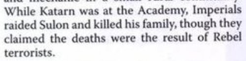
- **Mace Windu**: "With victories at the Battle of Lorshan Pass and the capture of Pelek Baw, Masters Windu and Billaba helped the Korunnai finally defeat the Balawai." Source: The Complete Star Wars Encyclopedia, Vol. III, p.196
  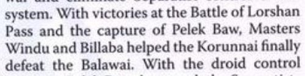

## p.197 (scan page 203)

Page contents: 1268 words, 24 paragraphs | headings/entries: Sun Crusher; Sundown, Taxer; Sun Crusher.; Sund, Elora; Sundari; Sunesi; Sunfighter Franchise; Sunlet, Mere

- **Sun Crusher (superweapon); Admiral Daala; Qwi Xux** — entry/section: Sun Crusher: "Under Admiral Daala, a design team headed by the scientist Qwi Xux made many breakthroughs that led to the new Sun Crusher, Only slightly larger than a fighter, its resonance torpedoes were powerful enough to destroy a star." Source: The Complete Star Wars Encyclopedia, Vol. III, p.197
  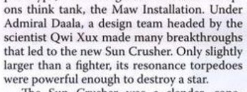
- **Sun Crusher (superweapon)** — entry/section: Sun Crusher: "The ship's 11 "resonance torpedoes" were energized through the transmitting dish and could be launched into a star to trigger a chain reaction that caused the star to go supernova, incinerating every world in its system." Source: The Complete Star Wars Encyclopedia, Vol. III, p.197
  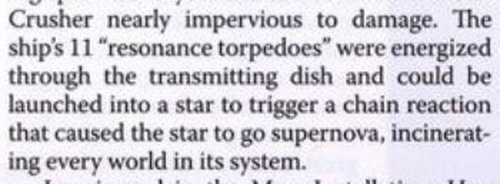
- **Sun Crusher (superweapon)** — entry/section: Sun Crusher.: "The Sun Crusher was destroyed at the Battle of the Maw when it was caught in the gravity well of one of the Maw's black holes." Source: The Complete Star Wars Encyclopedia, Vol. III, p.197
  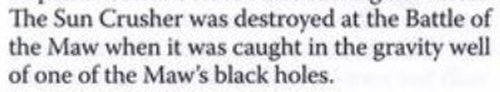
- **Obi-Wan Kenobi**: "Obi-Wan managed to destroy the top fin on the speeder, and Sundown was unable to control the craft." Source: The Complete Star Wars Encyclopedia, Vol. III, p.197
  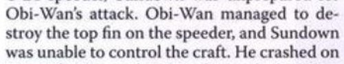

## p.198 (scan page 204)

Page contents: 1058 words, 16 paragraphs | headings/entries: Sunn-Childe, Cody; Sunrider, Andur; Sunrider, Nomi; Sunrider, Vima

- **Lando Calrissian; Chewbacca**: "This starship, capable of interdimensional travel, fled the known galaxy for many years until Lando Calrissian and Chewbacca stumbled upon it shortly after the Battle of Hoth." Source: The Complete Star Wars Encyclopedia, Vol. III, p.198
  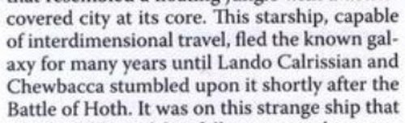
- **Andur Sunrider; Nomi Sunrider; Vima-Da-Boda; Master Thon** — entry/section: Sunrider, Andur: "Sunrider, Andur The husband of Nomi Sunrider and father of Vima, this Jedi was killed some 4,000 years before the Galactic Civil War in a senseless battle with petty gangsters at the Stenness hyperspace terminal while he was on his way to visit Jedi Master Thon on Ambria." Source: The Complete Star Wars Encyclopedia, Vol. III, p.198
  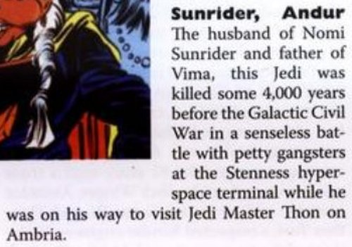
- **Nomi Sunrider; Master Thon; Andur Sunrider** — entry/section: Sunrider, Nomi: "She was accompanying her husband on a mission to take some Adegan crystals, used to construct lightsabers, to Jedi Master Thon in the Ambria system when Andur was cut down by several henchmen of Great Bogga the Hutt." Source: The Complete Star Wars Encyclopedia, Vol. III, p.198
  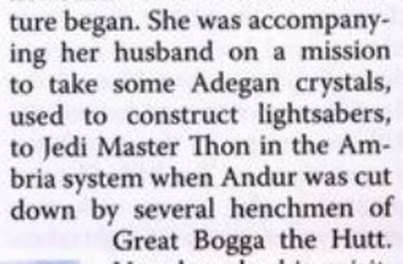
- **Nomi Sunrider; Arca Jeth** — entry/section: Sunrider, Nomi: "Nomi stayed to train with Arca in the Force mind technique known as Jedi battle meditation, gaining in both physical strength and self-confidence." Source: The Complete Star Wars Encyclopedia, Vol. III, p.198
  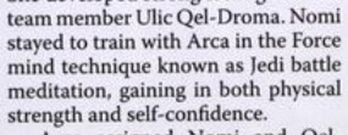
- **Nomi Sunrider; Ulic Qel-Droma; Cay Qel-Droma** — entry/section: Sunrider, Nomi: "But after Ulic murdered his brother, Cay, Nomi lashed out with her Force abilities in an attack so powerful that she severed his connection to the Force." Source: The Complete Star Wars Encyclopedia, Vol. III, p.198
  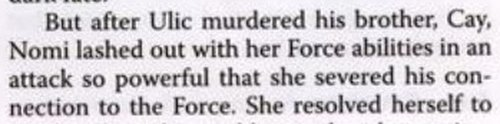
- **Ulic Qel-Droma**: "Ulic's apparent redemption was short-lived, as the overzealous pilot Hoggon shot and killed him, thinking he was ridding the Republic of a great enemy." Source: The Complete Star Wars Encyclopedia, Vol. III, p.198
  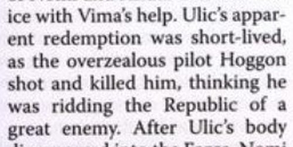
- **Vima-Da-Boda; Ulic Qel-Droma; Nomi Sunrider** — entry/section: Sunrider, Vima: "When Ulic was killed by Hoggon, Vima and Nomi saw Ulic's body disappear into the Force, and realized that he still had the heart of a Jedi." Source: The Complete Star Wars Encyclopedia, Vol. III, p.198
  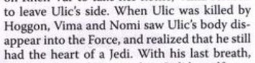

## p.199 (scan page 205)

Page contents: 1059 words, 17 paragraphs | headings/entries: Sunulok; Super-ciass Star Destroyer; Supply Depot Thrago; Suppoon, Gaar; Suprema

- **Jaina Solo; Jacen Solo (Darth Caedus)**: "Jaina, upon realizing that Jacen was working to destroy the Colony, refused to talk to him for the duration of the war." Source: The Complete Star Wars Encyclopedia, Vol. III, p.199
  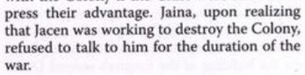

## p.200 (scan page 206)

Page contents: 1303 words, 31 paragraphs | headings/entries: Supreme Overlord; Supreme Prophet; Suprosa; Suspicious Silence Provision; Sureshot; Sutel, General Yald; Suurja

## p.201 (scan page 207)

Page contents: 1036 words, 23 paragraphs | headings/entries: Suu-Tonn, Master; Svivren; Swan, Bultar; Swarm War

## p.202 (scan page 208)

Page contents: 1099 words, 26 paragraphs | headings/entries: Sweet Surprise; Swimmer; Swimmer's Law; Swimming People; Syayna; S'ybil; Sykes, Lieutenant Gavyn; Sylivar

- **Exar Kun**: "During a lightsaber training duel with Exar Kun, she gave into instinctive rage and clawed Kun's face." Source: The Complete Star Wars Encyclopedia, Vol. III, p.202
  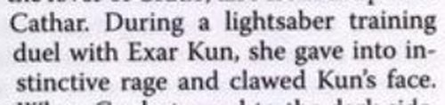

## p.203 (scan page 209)

Page contents: 963 words, 24 paragraphs | headings/entries: Sy Myrth; Syn, Andov; Syn, Grand Admiral Peccati; Syn, Jariah; Syndic; Syndicat; Syo, Brisha

- **Ulic Qel-Droma; Sylvar**: "Kun and Ulic Qel-Droma's bloody campaign against the Republic—which became known as the Great Sith War—left Sylvar alone and angry, Qel-Droma survived the fighting and was exiled, but Sylvar did not feel that was enough punishment for his actions." Source: The Complete Star Wars Encyclopedia, Vol. III, p.203
  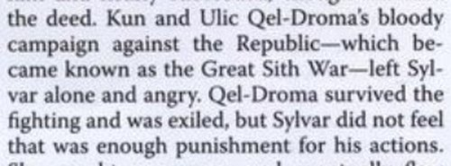
- **Sylvar; Ulic Qel-Droma**: "She sought vengeance, and eventually flew to Rhen Var to settle scores, Seeing that Qel- Droma had redeemed himself, Sylvar couldn't bring herself to kill him, but an ambitious, hero-worshipping pilot named Hoggon shot and killed Ulic, thinking he was ridding the Republic of a great villain." Source: The Complete Star Wars Encyclopedia, Vol. III, p.203
  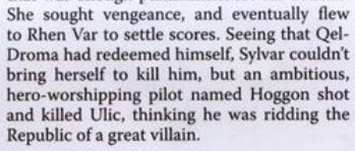
- **Admiral Ackbar**: "Syn was defeated by Admiral Ackbar during the liberation of Kashyyyk, and his flagship Fi (named for the High Galactic word for "son") was vaporized." Source: The Complete Star Wars Encyclopedia, Vol. III, p.203
  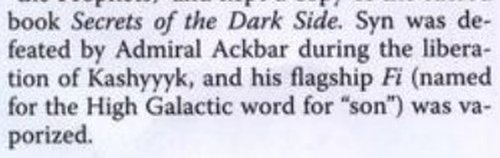
- **Leia Organa Solo**: "The synthdroids' central processor was destroyed by Leia Organa Solo during her escape from Ashgad's Hweg Shul fortress, and they were unable to stop her." Source: The Complete Star Wars Encyclopedia, Vol. III, p.203
  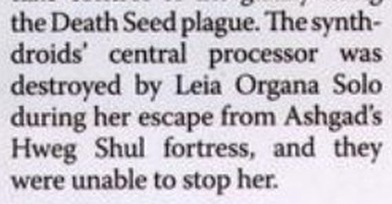

## p.204 (scan page 210)

Page contents: 0 words, 0 paragraphs | headings/entries: 

## p.205 (scan page 211)

Page contents: 731 words, 20 paragraphs | headings/entries: 23 Mere; 203rd Division; 212th Attack Battalion; 2187; 21st Nova Corps; 21st Recon Group; 22nd Air Combat Wing; 24th Bombardment Squadron; 27th Denarian Fleet

- **Luke Skywalker**: "Too- Onebee treated Luke Skywalker twice during the Battle of Hoth, once operating to replace Luke's severed hand with a biomechanical replacement." Source: The Complete Star Wars Encyclopedia, Vol. III, p.205
  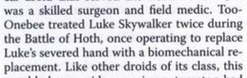
- **Obi-Wan Kenobi; General Grievous**: "Its most notable action came on Utapau, when Jedi General Obi-Wan Kenobi finally destroyed General Grievous at the end of the Clone Wars." Source: The Complete Star Wars Encyclopedia, Vol. III, p.205
  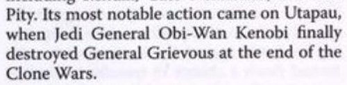
- **Palpatine (Darth Sidious)**: "Emperor Palpatine ordered some 250 Victory-class Star Destroyers decommissioned to make way for the new /mperial-class Star Destroyers." Source: The Complete Star Wars Encyclopedia, Vol. III, p.205
  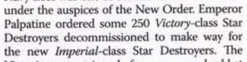

## p.206 (scan page 212)

Page contents: 1042 words, 28 paragraphs | headings/entries: 2-M; 2-ROB; 2X-3KPR; 327th Star Corps; 32nd Cruiser Squadron; 35th Infantry; 37th Detachment; 38th Armored Division; 3B3; 3B3-10; 3rd Imperial Heavy Armor; T-12

- **Aayla Secura; Palpatine (Darth Sidious)**: "Secura and her Jedi team were destroyed by the 327th Star Corps on Felucia after Sidious gave the command to execute Order 66." Source: The Complete Star Wars Encyclopedia, Vol. III, p.206
  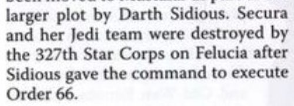
- **IG-88**: "Threedee-Fourex killed his master when the assassin droid IG-88 and his counterparts took over the programming of all of Mechis III's computer systems and droids." Source: The Complete Star Wars Encyclopedia, Vol. III, p.206
  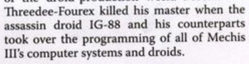

## p.207 (scan page 213)

Page contents: 859 words, 21 paragraphs | headings/entries: T-19; Tt-LB; T3-M4; T-47

- **Luke Skywalker**: "Just before he left the planet, Luke ripped the stabilizer off his skyhopper while trying to maneuver through the infamous Stone Needle in Beggar's Canyon." Source: The Complete Star Wars Encyclopedia, Vol. III, p.207
  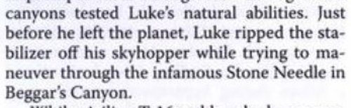
- **Zayne Carrick**: "Although T1-LB's original body had been destroyed, the Arkanian engineer Camper managed to restore his main cognitive centers and storage banks, allowing Zayne to witness the murders of his fellow students." Source: The Complete Star Wars Encyclopedia, Vol. III, p.207
  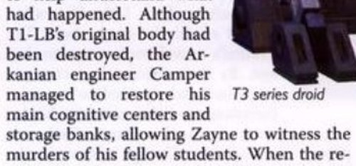
- **Darth Malak; Revan**: "After the defeat of Darth Malak, Revan's ship Ebon Hawk disappeared in deep space." Source: The Complete Star Wars Encyclopedia, Vol. III, p.207
  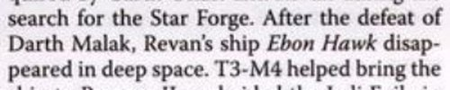

## p.208 (scan page 214)

Page contents: 1079 words, 23 paragraphs | headings/entries: T-6; Ta, Sayn; Taa, Orn Free; Ta'a Chume, Queen Mother; Taan; Taanab

- **Jacen Solo (Darth Caedus)**: "Ta'a Chume began to plot a new pathway to power, working a deal with the Gorog hive to have Jacen and Tenel Ka's infant daughter killed." Source: The Complete Star Wars Encyclopedia, Vol. III, p.208
  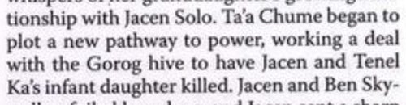

## p.209 (scan page 215)

Page contents: 955 words, 24 paragraphs | headings/entries: Taanab, Battle of; Taanab Sunrise; Taanab Yellow Aces; Ta'ania; Taanzer, Crys; TAARS; Taat; Tabanne, Lieutenant Atril; Taboon; Tabory, Eviyn; Tachi, Siri

- **Lando Calrissian**: "Finally, Calrissian led the Taanab defense fleet in a cleanup operation and single-handedly accounted for 19 kills." Source: The Complete Star Wars Encyclopedia, Vol. III, p.209
  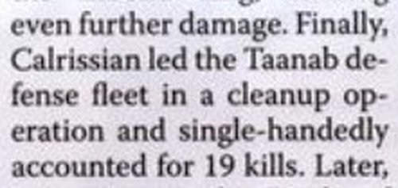
- **Joruus C'baoth**: "Some five years later, mad Jedi clone Joruus C'baoth coordinated an Imperial attack on Taanab, where he used the turbolasers of the Bellicose to destroy a New Republic ship against the direct orders of Captain Aban." Source: The Complete Star Wars Encyclopedia, Vol. III, p.209
  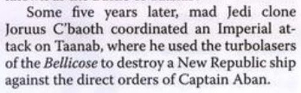

## p.210 (scan page 216)

Page contents: 1072 words, 34 paragraphs | headings/entries: Tactical Channel 5; Tachyon Flier; Tac-Spec Corporation; Tac-Spec Footman; Tacto; Tadrin, tLuthus; Tafanda Bay

- **Darth Vader (Anakin Skywalker)**: "About three years after the Battle of Naboo, she worked with Anakin Skywalker to destroy Krayn's organization." Source: The Complete Star Wars Encyclopedia, Vol. III, p.210
  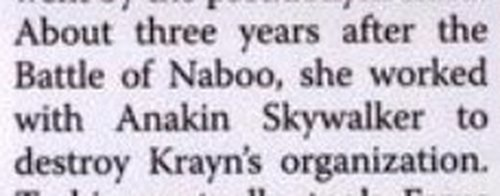

## p.211 (scan page 217)

Page contents: 961 words, 20 paragraphs | headings/entries: Taggar, Lieutenant Rone; Taggart; Tagge, Baron Orman; Tagge, Domina; Tagge, General Cassio; Tagge, Silas; Tagge, Viric

- **Luke Skywalker**: "Luke Skywalker destroyed the station, but Orman worked with his brother Silas to cut off a major supply route using the Omega Frost device." Source: The Complete Star Wars Encyclopedia, Vol. III, p.211
  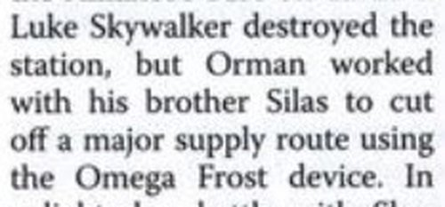
- **Darth Vader (Anakin Skywalker)**: "It was decided that Skywalker and Vader should duel to the death in the Crystal Valley." Source: The Complete Star Wars Encyclopedia, Vol. III, p.211
  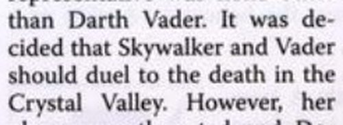
- **Darth Vader (Anakin Skywalker)**: "The Rebel Alliance fleet attacked the vessel, but both Silas and Orman Tagge survived in a sealed chamber, which was recovered by Darth Vader." Source: The Complete Star Wars Encyclopedia, Vol. III, p.211
  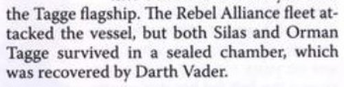

## p.212 (scan page 218)

Page contents: 1040 words, 29 paragraphs | headings/entries: TaggeCo; Tahi, Master; Tahiboor; Tai; Tai, Durga Besadii; Taieb; Tainer, Lieutenant Kell; Tainer, Tyria; Taire, Bufon; Taisden; Takara; Tak Base; Takeel

- **Leia Organa Solo**: "When Tai returned to Commander Knife to report the incident, his superior officer killed him for accepting Leia's mercy." Source: The Complete Star Wars Encyclopedia, Vol. III, p.212
  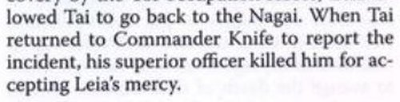
- **Luke Skywalker**: "Tainer, Doran Born to Kell Tainer and Tyria Sarkin several years after the defeat of Warlord Zsinj, Doran studied at Luke Skywalker's Jedi praxeum after the Yuuzhan Vong War and trained to become a Jedi." Source: The Complete Star Wars Encyclopedia, Vol. III, p.212
  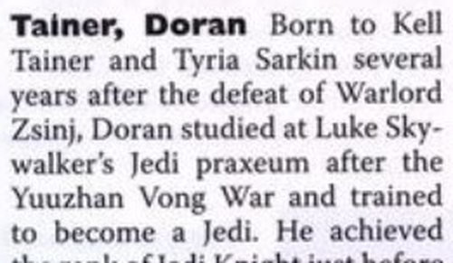

## p.213 (scan page 219)

Page contents: 1104 words, 24 paragraphs | headings/entries: Takel, Grand Admiral Miltin; Tak-Tak; Tata, Feeana; Tala 9; Talasea; Tal'cara; Taler; Talesia; Talgal, Isko

- **Yaddle**: "Yaddle's sacrifice in absorbing a dihexalon bomb persuaded her to remain, but only to double-cross the Jedi." Source: The Complete Star Wars Encyclopedia, Vol. III, p.213
  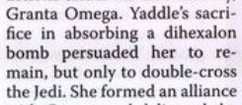
- **Darth Vader (Anakin Skywalker)**: "Colonized long ago, the world was eventually abandoned by the settlers' descendants; the last group was wiped out by Darth Vader after the Clone Wars for harboring a fugitive Jedi." Source: The Complete Star Wars Encyclopedia, Vol. III, p.213
  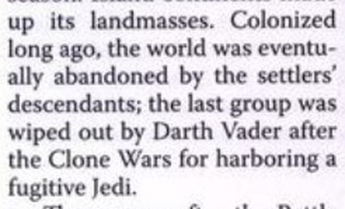

## p.214 (scan page 220)

Page contents: 998 words, 24 paragraphs | headings/entries: Talia; Taliff; Talisman; Talita; Talking Bone; Tallaan; Tallet; Tallo; Tallon, Adar; Taimont, Prefect Eugene

- **Grand Moff Tarkin**: "When Grand Moff Tarkin was killed aboard the first Death Star, the Empire released an official statement claiming that Tarkin had actually died in a shuttle crash at the Tallaan shipyards." Source: The Complete Star Wars Encyclopedia, Vol. III, p.214
  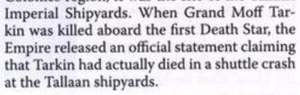
- **Darth Talon**: "Talon (1) An Imperial Strike-class cruiser that was destroyed by the Rebel Alliance during the Galactic Civil War." Source: The Complete Star Wars Encyclopedia, Vol. III, p.214
  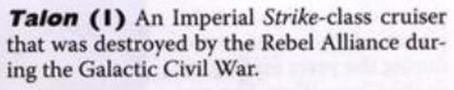

## p.215 (scan page 221)

Page contents: 1077 words, 27 paragraphs | headings/entries: Talon, Darth; Taloon, Rhya; Taloraan; Talos Spaceport; Talpron; Talisava; Talshib, Captain; Talu; Talus; Tal'yo, Nescan; Tamban

- **Darth Talon; Cade Skywalker; Darth Nihl** — entry/section: Talon, Darth: "She dueled Cade again in Coruscant's Sith Temple, and would have fallen to his lightsaber if Darth Nihl hadn't intervened." Source: The Complete Star Wars Encyclopedia, Vol. III, p.215
  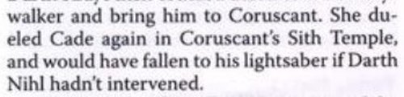
- **Cade Skywalker**: "Cade telekinetically smashed her body against a wall with the Force, but then used his powers to heal her." Source: The Complete Star Wars Encyclopedia, Vol. III, p.215
  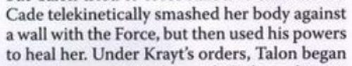

## p.216 (scan page 222)

Page contents: 1086 words, 29 paragraphs | headings/entries: Tambor, Wat; Tammar; Tammi; Tammuz-an; Tampion; Tanaal, Berec; Tanbris, Lieutenant; Tandankin; T'andar, T'achak; Tandeer; Tane, Ratri; Taneel, Terr

- **Darth Vader (Anakin Skywalker)**: "On Mustafar, Anakin Skywalker killed the members of the Separatist Council, including Wat Tambor." Source: The Complete Star Wars Encyclopedia, Vol. III, p.216
  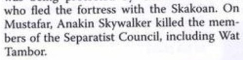
- **Palpatine (Darth Sidious)**: "Historians later determined that the Benevolent Guides who ruled the society foresaw the coming of Emperor Palpatine and the New Order." Source: The Complete Star Wars Encyclopedia, Vol. III, p.216
  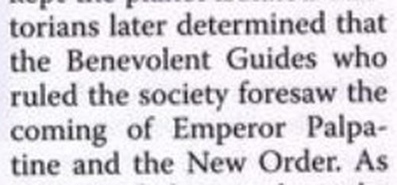

## p.217 (scan page 223)

Page contents: 1203 words, 25 paragraphs | headings/entries: Tangle Gun 7; Tango; Tangrene; Tank; Tann, General Sev'Rance; Tanogo; Tannath

- **Sev'rance Tann** — entry/section: Tann, General Sev'Rance: "She became a general in command of the Separatist military, participating in the Battle of Geonosis and defeating the Republic on Sarapin with her experimental Decimator tanks." Source: The Complete Star Wars Encyclopedia, Vol. III, p.217
  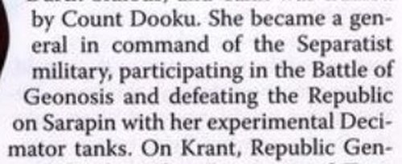

## p.218 (scan page 224)

Page contents: 1191 words, 24 paragraphs | headings/entries: Tansa Reach; Tantive V, Battle of; Tantor, Brenn; Tarasin

- **Darth Vader (Anakin Skywalker)**: "Darth Vader later had the ship destroyed." Source: The Complete Star Wars Encyclopedia, Vol. III, p.218
  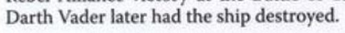

## p.219 (scan page 225)

Page contents: 1247 words, 23 paragraphs | headings/entries: Tare; Ta-Ree; Tarfang; Tarfful; Targon, Elassar; Targrim, Big Jak

- **Luke Skywalker**: "Luke Skywalker delayed the mission to destroy the Gorog ship's hyperdrive long enough to grab the Ewok with the Force and draw Tarfang back to safety." Source: The Complete Star Wars Encyclopedia, Vol. III, p.219
  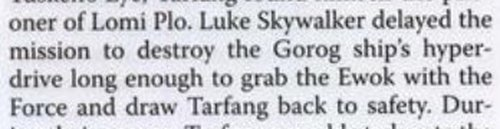
- **Leia Organa Solo**: "When the Wookiees agreed to let Leia Solo address the Rock Council, Tarfang demanded a chance to stop her by challenging Leia for possession of the Talking Bone." Source: The Complete Star Wars Encyclopedia, Vol. III, p.219
  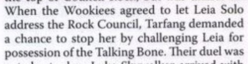
- **Luke Skywalker**: "Their duel was cut short when Luke Skywalker arrived with word of the Jedi Order's defection from the Galactic Alliance." Source: The Complete Star Wars Encyclopedia, Vol. III, p.219
  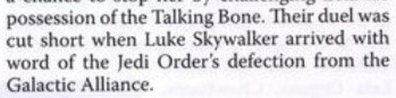

## p.220 (scan page 226)

Page contents: 858 words, 16 paragraphs | headings/entries: Tarhassan; Taris; Tarkin, Gideon

- **Bastila Shan; Darth Malak**: "During his search for Bastila Shan, Darth Malak ordered an orbital bombardment of Taris that devastated the planet's cities and killed billions." Source: The Complete Star Wars Encyclopedia, Vol. III, p.220
  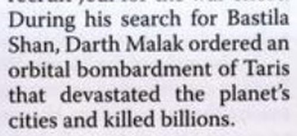
- **Grand Moff Tarkin; Luke Skywalker; Leia Organa Solo; Chewbacca**: "Later the Tarkin was destroyed by an elite team of Rebels that included Luke Skywalker, Leia Organa, Chewbacca, C-3PO, and R2-D2." Source: The Complete Star Wars Encyclopedia, Vol. III, p.220
  

## p.221 (scan page 227)

Page contents: 912 words, 30 paragraphs | headings/entries: Tarkin, Ranulph; Tarkin, Rivoche; Tarkin's Fang; Tarkona, Nolaa_; Tarkosa, Brace; Tarkov; Tari; Tarlen, Bentu Pall; Tar Morden; Tarn, Rhad

- **Grand Moff Tarkin; Leia Organa Solo** — entry/section: Tarkin, Gideon: "After interrogations failed, Tarkin made Leia watch as he destroyed her adopted planet of Alderaan and its billions of inhabitants with the Death Star's main weapon." Source: The Complete Star Wars Encyclopedia, Vol. III, p.221
  
- **Grand Moff Tarkin** — entry/section: Tarkin, Gideon: "When, at the Battle of Yavin, advisers told Tarkin that there was a slim chance the Rebels might be able to destroy the Death Star, Tarkin was incredulous and refused to evacuate his glorious weapon." Source: The Complete Star Wars Encyclopedia, Vol. III, p.221
  

## p.222 (scan page 228)

Page contents: 1001 words, 24 paragraphs | headings/entries: Tarnab; Tarnith Station; Tarnoonga; Taroon, Prince; Tarpals, Captain Roos; Tarpilan, Captain Jun; Tarrak, Ali; Tarrik; Tarturi, Gillam; Taru

- **Darth Vader (Anakin Skywalker)**: "When Rana Halion employed the young mercenaries to strafe an Andaran mili tary landing platform as part of a plan to force Berm Tarturi to negotiate, Gillam planned to use live fire in the mission as a way to have himself "killed" He actually planned to make sure Anakin Skywalker was killed in the mission, damaging the body enough so that it could pass as Gillam." Source: The Complete Star Wars Encyclopedia, Vol. III, p.222
  

## p.223 (scan page 229)

Page contents: 1118 words, 30 paragraphs | headings/entries: Tascl, Moff Boren; Taselda; Tasha, Saljé; Task Force Aster; Task Force Blackvine; Taspir Wl; Tassa; Tatakoz; Tathis, Orinn

## p.224 (scan page 230)

Page contents: 1212 words, 23 paragraphs | headings/entries: Tatoo I, Tatoo Il; Tatooine; Tatooine

## p.225 (scan page 231)

Page contents: 1174 words, 39 paragraphs | headings/entries: Tauk, Lemmet; Taul; Taung; Tavira, Moff Leonia; Tavo; Tawr, Vatok; Tawron, Relal; TC-14; TC-17; Tchiery; Tching, Uueg

- **Palpatine (Darth Sidious)**: "Tavo was eventually hunted down and killed by agents of Republic Intelligence, who were working under orders from Chancellor Palpatine." Source: The Complete Star Wars Encyclopedia, Vol. III, p.225
  
- **Boba Fett**: "Tawr, Vatok One of the few Mandalorian commandos who accompanied Boba Fett to the Nickel One asteroid, in the wake of the Second Battle of Fondor, to drive off the forces of the Imperial Remnant that had taken control of the asteroid and enslaved the native Verpine." Source: The Complete Star Wars Encyclopedia, Vol. III, p.225
  

## p.226 (scan page 232)

Page contents: 1108 words, 26 paragraphs | headings/entries: Tehuukthai; T'dai, Master; T'dawlish, Breyf; TDL3.5; Team Mynock; Team Purella; Saxan.; Team Slashrat; Team Tauntaun; Team Womp Rat; Tebut, Lieutenant Patra

- **Anakin Solo**: "Known for her efficiency and nononsense attitude, Lieutenant Tebut was stationed aboard the Star Destroyer Anakin Solo and served as one of the officers of the watch." Source: The Complete Star Wars Encyclopedia, Vol. III, p.226
  
- **Jacen Solo (Darth Caedus)**: "Her pride was short-lived; soon thereafter Jacen—angered by a mistake Tebut made and refusing to accept her apology—crushed her neck with the Force." Source: The Complete Star Wars Encyclopedia, Vol. III, p.226
  

## p.227 (scan page 233)

Page contents: 1005 words, 18 paragraphs | headings/entries: Techno Union; Tech Raiders; Tector-class Star Destroyer; Teda, Roy; Tedryn Holocron; Tedryn-Sha; Teebo

- **Darth Vader (Anakin Skywalker)**: "The facility was destroyed by Anakin Skywalker, and the Techno Union representatives summarily executed." Source: The Complete Star Wars Encyclopedia, Vol. III, p.227
  
- **Palpatine (Darth Sidious)**: "Despite the efforts of Ferus Olin to protect both Palpatine and Teda, a seeker droid killed Teda with a single blast to the chest." Source: The Complete Star Wars Encyclopedia, Vol. III, p.227
  
- **Palpatine (Darth Sidious)**: "Tedryn-Sha One of the clone Emperor Palpatine's personal advisers, Tedryn-Sha was promoted to second in command of Operation Shadow Hand after Sedriss and Vill Goir were killed on Ossus, Palpatine granted him the powers of Dark Jedi as part of the promotion." Source: The Complete Star Wars Encyclopedia, Vol. III, p.227
  
- **Leia Organa Solo**: "In the battle that ensued, Tedryn-Sha killed Jem Ysanna, but was in turn slain by Leia Organa Solo, who used her lightsaber to cleave the Dark Jedi in two." Source: The Complete Star Wars Encyclopedia, Vol. III, p.227
  

## p.228 (scan page 234)

Page contents: 997 words, 22 paragraphs | headings/entries: Teeko; Teeks, Edbit; Teem, Ainlee; Teers, Rep; Tekii Teevan; Teezi; Teke Ro; Tekli; Tel; Telamarch, Yura; Telamark, Dona

- **Obi-Wan Kenobi; Darth Vader (Anakin Skywalker); Count Dooku**: "Obi-Wan Kenobi and his apprentice, Anakin Skywalker, defeated the battle droids and saved the leaders, but Dooku escaped." Source: The Complete Star Wars Encyclopedia, Vol. III, p.228
  

## p.229 (scan page 235)

Page contents: 1194 words, 26 paragraphs | headings/entries: TeiBrinTel; Telerath; Telgorn Corporation; Tellivar Lady; Telitrig-7; Telos; Tels, Seggor; Telti

- **Luke Skywalker**: "Luke Skywalker discovered how to use the ship for its intended purpose—a tool for rebuilding a destroyed world." Source: The Complete Star Wars Encyclopedia, Vol. III, p.229
  
- **Palpatine (Darth Sidious)**: "Telti joined the Empire late in the Galactic Civil War, only after Palpatine threatened to destroy it." Source: The Complete Star Wars Encyclopedia, Vol. III, p.229
  

## p.230 (scan page 236)

Page contents: 798 words, 24 paragraphs | headings/entries: Temm, Pol; Tempest Force; Tendo, Liekas; Tenloss Syndicate; Tendrando Arms; Tenupe; Tenupe, Battle of

- **Luke Skywalker; Darth Vader (Anakin Skywalker)**: "The temple was the site of Luke Skywalker's first duel with Darth Vader." Source: The Complete Star Wars Encyclopedia, Vol. III, p.230
  

## p.231 (scan page 237)

Page contents: 1172 words, 17 paragraphs | headings/entries: Teppler, Denjax; Teradoc, High Admiral; Terak; Terephon; Termagant; Teroenza; Terpfen

- **Jacen Solo (Darth Caedus)**: "The pair developed a daring plan to kill Jacen Solo by taking control of Centerpoint Station and using it to destroy Solo's flagship." Source: The Complete Star Wars Encyclopedia, Vol. III, p.231
  
- **Admiral Daala**: "He was constantly trying to win control of the remaining Imperial fleet from Supreme Warlord Harrsk, and used his crimson-colored fleet of Victory-class Star Destroyers to take out Harrsk's flagship, the Shockwave, during Harrsk's talks with Admiral Daala." Source: The Complete Star Wars Encyclopedia, Vol. III, p.231
  
- **Exar Kun**: "Following Exar Kun's defeat, the Jedi exterminated all remaining terentateks in what was known as the Great Hunt." Source: The Complete Star Wars Encyclopedia, Vol. III, p.231
  
- **Boba Fett**: "When Teroenza's role in the death of Aruk the Hutt came to light, Boba Fett killed him and claimed the bounty by removing his horn as proof." Source: The Complete Star Wars Encyclopedia, Vol. III, p.231
  

## p.232 (scan page 238)

Page contents: 1120 words, 18 paragraphs | headings/entries: Terrafin, Kodu; Terra Sool; Terrik, Booster; Terrik, Captain Mod; Terrik, Mirax

- **Darth Vader (Anakin Skywalker); Obi-Wan Kenobi**: "The combined efforts of Anakin Skywalker and Obi-Wan Kenobi were able to destroy the battle platforms before they could raze the surface of the planet." Source: The Complete Star Wars Encyclopedia, Vol. III, p.232
  
- **Han Solo**: "When Captain Terrik was about to stop Han Solo's escape from Mos Eisley, Felth shot him in the back and killed him." Source: The Complete Star Wars Encyclopedia, Vol. III, p.232
  

## p.233 (scan page 239)

Page contents: 898 words, 28 paragraphs | headings/entries: Terror; Tervissis; Teshik, Grand Admiral Osvald; Tessek; Tessent; Tesser; Tessra, Captain Lun; Teta, Duke; Teta, Empress

- **Obi-Wan Kenobi; Asajj Ventress**: "The trio managed to flee before Obi-Wan Kenobi arrived; he dueled Ventress inside Teth castle." Source: The Complete Star Wars Encyclopedia, Vol. III, p.233
  

## p.234 (scan page 240)

Page contents: 1070 words, 40 paragraphs | headings/entries: Tetsus; Tevv, Sian; Tey, Raana; Teyr; Thackery; Thakwaash; Outer Rim.; Thanas, Commander Pter

- **K'Kruhk**: "Only K'Kruhk survived the attack, and Teyr fell to the Separatists." Source: The Complete Star Wars Encyclopedia, Vol. III, p.234
  
