# Owner Material 032 — The Complete Star Wars Encyclopedia, Vol. III (P–Z): scan pages 241–280

- **Source:** *The Complete Star Wars Encyclopedia* by Stephen J. Sansweet and Pablo Hidalgo, with Bob Vitas, Daniel Wallace, Chris Cassidy, Mary Franklin and Josh Kushins (Del Rey, 2008), 3 vols. Secondary source (licensed Legends reference). Scan OCR'd on the box; the scan stays box-only and is **not** published.
- **Method:** every scanned page was OCR'd and machine-screened sentence by sentence for power-relevant statements (fights, kills, defeats, Force feats, rankings, superweapons) that name a character on our roster; each kept sentence is quoted verbatim from the OCR text and has a crop of the printed passage directly under it. Pages with nothing power-relevant are still listed with what is on them.
- **Citation:** "The Complete Star Wars Encyclopedia, Vol. III, p.X" by printed page ("scan p.X" where no printed number applies). **Weight:** Lucasfilm-licensed encyclopedia: a secondary, in-universe summary of Legends (and some film) material. It sums up feats from novels, comics and games; where the original story is in our notes, that source is the stronger citation.

## p.235 (scan page 241)

Page contents: 1079 words, 20 paragraphs | headings/entries: Thanda; Thane, Archon Beed; Thanos; Thanta Zilbra; Tharen; Tharen Wayfarer

- **Palpatine (Darth Sidious)**: "When the Ssi-ruuvi Imperium attacked Bakura, Thanas's garrison sent out a plea for help, unaware that the second Death Star had just been destroyed along with Emperor Palpatine." Source: The Complete Star Wars Encyclopedia, Vol. III, p.235
  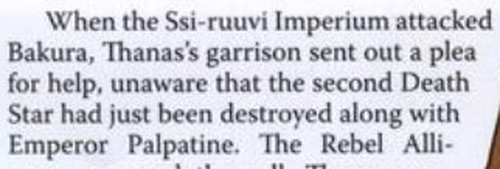

## p.236 (scan page 242)

Page contents: 756 words, 24 paragraphs | headings/entries: Theelin; Thel-Tanis, Darra; Therans

## p.237 (scan page 243)

Page contents: 1160 words, 21 paragraphs | headings/entries: Theta Squad; Thila; Third Fleet; Thire, Clone Commander; Thisspias; Thistleborn, Grand Moff; Thobek; Thokos; Tholatin; Tholaz; Thoime, Master

- **Tholme; Quinlan Vos; Volfe Karkko**: "Master Tholme was later dispatched to Kiffex to monitor Quinlan during the investigation into the reemergence of Volfe Karkko, and helped Quinlan defeat the feral Anzati warriors." Source: The Complete Star Wars Encyclopedia, Vol. III, p.237
  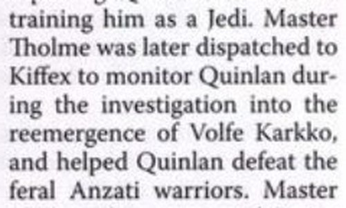

## p.238 (scan page 244)

Page contents: 1128 words, 20 paragraphs | headings/entries: Tholos; Thomork; Thon; Thon, Master; Tho'natu, Master

- **Sora Bulq; Tholme; Count Dooku**: "Bulq was captured in the fighting, and Master Tholme was blinded in his left eye in a lightsaber duel with Dooku." Source: The Complete Star Wars Encyclopedia, Vol. III, p.238
  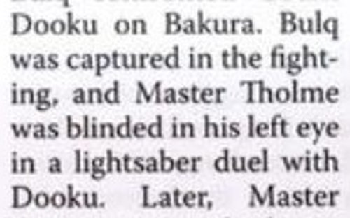
- **Tholme; Sora Bulq; Quinlan Vos**: "On Saleucami, Tholme set out to destroy the Separatist cloning facilities Sora Bulq had built in the magma caverns, Tholme was forced to fight Quinlan, who refused to acknowledge that he was too close to the dark side." Source: The Complete Star Wars Encyclopedia, Vol. III, p.238
  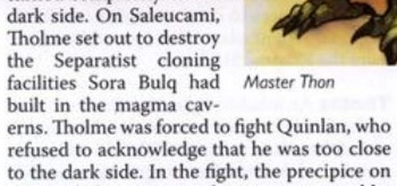
- **Master Thon** — entry/section: Thon: "Thon A continent on the destroyed planet Alderaan, it was the location of the Uplands." Source: The Complete Star Wars Encyclopedia, Vol. III, p.238
  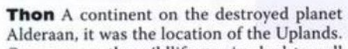
- **Darth Zannah**: "Zannah had masked their presence in the Force, after having slain Caleb and driving her cousin, Darovit, insane with horrific visions." Source: The Complete Star Wars Encyclopedia, Vol. III, p.238
  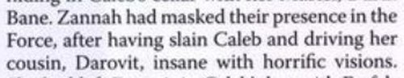
- **Lando Calrissian**: "It blockaded the entrance to the ThonBoka, preventing the flow of nutrients and slowly starving the inhabitants until it was defeated by Lando Calrissian and others." Source: The Complete Star Wars Encyclopedia, Vol. III, p.238
  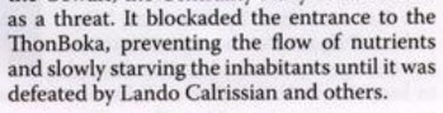
- **Lord Kaan; Lord Hoth**: "Lord Kaan and his followers triggered the bomb against the armies of Lord Hoth, resulting in a furious explosion of energy that annihilated every last member of Hoth's Army of Light and Kaan's Brotherhood of Darkness." Source: The Complete Star Wars Encyclopedia, Vol. III, p.238
  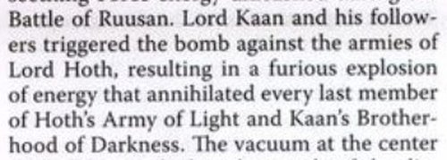

## p.239 (scan page 245)

Page contents: 1242 words, 24 paragraphs | headings/entries: Thovinack, Battie of; Thpffftht; Thracior; Thrackan Sal-Solo; Thrago; Thrakia; Thranx, Seeqov; Thrasher; Thrass

- **Jaina Solo; Jacen Solo (Darth Caedus)**: "Jaina, upon realizing that Jacen was going to work to destroy the Colony, refused to talk to him for the duration of the war." Source: The Complete Star Wars Encyclopedia, Vol. III, p.239
  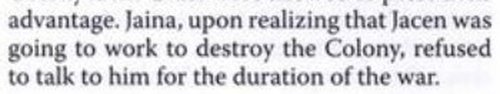
- **Grand Admiral Thrawn**: "After rendering Outbound Flight a derelict and destroying a large part of the Vagaari armada, Thrawn allowed Doriana to return to Coruscant." Source: The Complete Star Wars Encyclopedia, Vol. III, p.239
  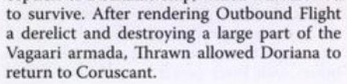

## p.240 (scan page 246)

Page contents: 1156 words, 24 paragraphs | headings/entries: Thrawn Simulator; Threadneedie Canyon; Three-Eye; Throat; Throgg; Throsen, Moff Gegren

- **Grand Admiral Thrawn**: "Pellaeon found Thrawn to be a complex individual who had a magnificent hologram collection representing some of the galaxy's greatest art treasures, for he believed one could understand—and thus eventually defeat—a species through its art." Source: The Complete Star Wars Encyclopedia, Vol. III, p.240
  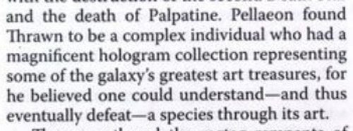
- **Grand Admiral Thrawn**: "During a climactic confrontation at the Bilbringi shipyards, Thrawn was surprised by the appearance of a fleet of smuggler ships aiding the New Republic, and his forces were defeated." Source: The Complete Star Wars Encyclopedia, Vol. III, p.240
  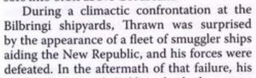
- **Luke Skywalker; Mara Jade Skywalker**: "This clone was never activated: Luke Skywalker and Mara Jade discovered it and destroyed it during their escape from the complex." Source: The Complete Star Wars Encyclopedia, Vol. III, p.240
  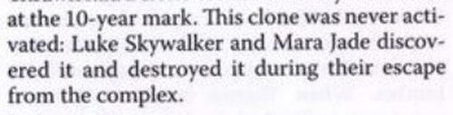

## p.241 (scan page 247)

Page contents: 1010 words, 16 paragraphs | headings/entries: Thrugii; Thrumble, Massad; Thugger's Alley; Thuku; Thul, Raynar; Thul, Tyko; Thule

- **Luke Skywalker; Admiral Ackbar**: "Millions died on both sides until Thul was confronted by Luke Skywalker aboard the captured Star Destroyer Admiral Ackbar." Source: The Complete Star Wars Encyclopedia, Vol. III, p.241
  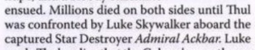
- **Ulic Qel-Droma; Darth Vader (Anakin Skywalker)**: "However, with the help of Ulic Qel- Droma's spirit, Anakin Skywalker destroyed the Dark Reaper and spared Thule from damage." Source: The Complete Star Wars Encyclopedia, Vol. III, p.241
  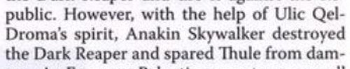

## p.242 (scan page 248)

Page contents: 1335 words, 28 paragraphs | headings/entries: Thule, Ryoo; Thun, Hekis Durumm Perdo Kolokk Baldikarr; Thunderflare; Thwim; Home Defense Corps; Thyfonian

- **Grand Inquisitor Malorum; Padmé Amidala**: "Inquisitor Malorum, seeking information on Padmé's death, killed Ryoo." Source: The Complete Star Wars Encyclopedia, Vol. III, p.242
  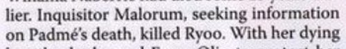
- **IG-88**: "He was killed by his personal droid, 3D-4X, after the assassin droid IG-88 and his counterparts arrived at Mechis III and took over the programming of all of the planet's computer systems and droids." Source: The Complete Star Wars Encyclopedia, Vol. III, p.242
  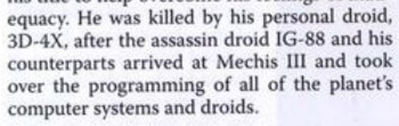
- **Corran Horn**: "It was destroyed by the combined efforts of Rogue Squadron pilots Corran Horn and Tycho Celchu as it attempted to make a run to hyperspace during the Bacta War." Source: The Complete Star Wars Encyclopedia, Vol. III, p.242
  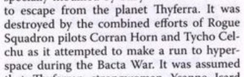

## p.243 (scan page 249)

Page contents: 723 words, 15 paragraphs | headings/entries: Thyne, Zekka; Ti, Kirana; Ti, Sanola; Ti, Shaak

- **Exar Kun; Luke Skywalker**: "Later she became one of Skywalker's Jedi candidates and joined his other Jedi students on Yavin 4 in defeating the spirit of Dark Lord Exar Kun, protecting Luke's body and freeing his spirit." Source: The Complete Star Wars Encyclopedia, Vol. III, p.243
  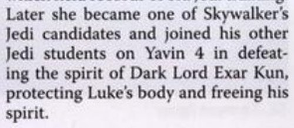
- **Shaak Ti** — entry/section: Ti, Shaak: "Shaak Ti was a female Togruta from Shili who trained two Padawans, though both were killed by criminals shortly after the completion of their training." Source: The Complete Star Wars Encyclopedia, Vol. III, p.243
  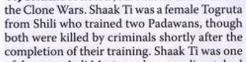
- **Shaak Ti; Roron Corobb; Foul Moudama** — entry/section: Ti, Shaak: "Shaak Tis companions—Jedi Masters Roron Corobb and Foul Moudama—were killed." Source: The Complete Star Wars Encyclopedia, Vol. III, p.243
  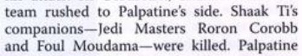
- **Shaak Ti; Darth Vader (Anakin Skywalker)** — entry/section: Ti, Shaak: "When Anakin Skywalker led an attack on the Jedi Temple, many believed that he killed Shaak Ti." Source: The Complete Star Wars Encyclopedia, Vol. III, p.243
  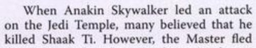
- **Maris Brood**: "There she trained the Zabrak Maris Brood, whose own Master had been killed while trying to return to Coruscant." Source: The Complete Star Wars Encyclopedia, Vol. III, p.243
  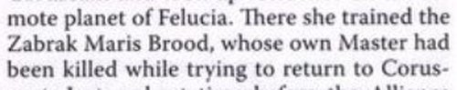

## p.244 (scan page 250)

Page contents: 822 words, 24 paragraphs | headings/entries: TibannaX; Tibannopolis; Tibor; Tibrin

## p.245 (scan page 251)

Page contents: 847 words, 19 paragraphs | headings/entries: 

- **Palpatine (Darth Sidious)**: "The TIE defender was used to defeat rogue Imperial Admiral Zaarin, who planned to depose Emperor Palpatine." Source: The Complete Star Wars Encyclopedia, Vol. III, p.245
  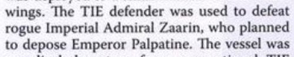

## p.246 (scan page 252)

Page contents: 901 words, 21 paragraphs | headings/entries: Tiems, Battle of; Tierce, Major Grodin

## p.247 (scan page 253)

Page contents: 1092 words, 25 paragraphs | headings/entries: Tierfon Yellow Aces; TIE-wing; Tigellinus, Grand Admiral Rufaan

- **Anakin Solo**: "The first working prototype was assigned to the flagship Star Destroyer Anakin Solo." Source: The Complete Star Wars Encyclopedia, Vol. III, p.247
  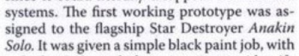
- **Darth Vader (Anakin Skywalker)**: "Both had been students of Darth Vader, but while Hethrir embraced the dark side of the Force and even helped destroy his own world as proof of his loyalty to the Empire, Rillao's powers came from the light side and she fled with her unborn child." Source: The Complete Star Wars Encyclopedia, Vol. III, p.247
  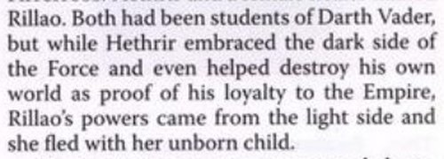

## p.248 (scan page 254)

Page contents: 1049 words, 21 paragraphs | headings/entries: Tiin, Saesee; Tika; Tikkes, Senator; Till, Essara; Tilotny; Tingel Arm; Tinn VI

- **Saesee Tiin** — entry/section: Tiin, Saesee: "Their orders were to secure the fleet or destroy it, a stance that led the crew of the Mersel Kebir to mutiny and attempt to remain at Rendili." Source: The Complete Star Wars Encyclopedia, Vol. III, p.248
  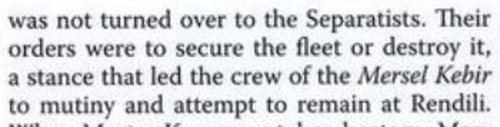
- **Saesee Tiin** — entry/section: Tiin, Saesee: "When Master Koon was taken hostage, Master Tiin was forced to act to destroy the fleet." Source: The Complete Star Wars Encyclopedia, Vol. III, p.248
  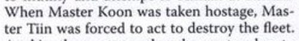
- **Saesee Tiin; Palpatine (Darth Sidious)** — entry/section: Tiin, Saesee: "However, the Jedi were unprepared for Palpatine's dark side powers, and Saesee Tiin was quickly defeated." Source: The Complete Star Wars Encyclopedia, Vol. III, p.248
  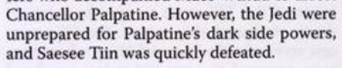
- **Leia Organa Solo**: "Tilotny resurrected Leia, but sent the stormtroopers back 8,000 years into the past." Source: The Complete Star Wars Encyclopedia, Vol. III, p.248
  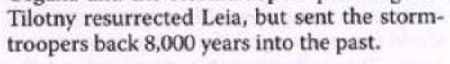

## p.249 (scan page 255)

Page contents: 974 words, 16 paragraphs | headings/entries: Tinoktin, Shok; Tin-Tin Dwarf; Tiny F; Tion, Lord; Tion Hegemony; Tipoca City

- **Leia Organa Solo**: "Thoroughly despicable, he was later killed in a scuffle with Princess Leia Organa." Source: The Complete Star Wars Encyclopedia, Vol. III, p.249
  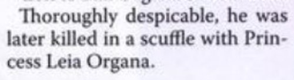

## p.250 (scan page 256)

Page contents: 1163 words, 29 paragraphs | headings/entries: Tiragga; Tirahnn; Tiran; Tiree; Tirsa; Tissar, Ziven; Tiss'shar; Tito; TK-O; Toat, Lord

## p.251 (scan page 257)

Page contents: 965 words, 29 paragraphs | headings/entries: Tobbra, Captain Theb; Tocneppil; Tod, Kass; Tof; Togoria

## p.252 (scan page 258)

Page contents: 1114 words, 38 paragraphs | headings/entries: Tojjeinoot; Tojjevvuk; Tok, Shogar; Toka; Toklar; Tokmia; Toleph-Sor; Tombat

- **Chewbacca; Han Solo**: "His clan's grudge against Chewbacca did not cease when Chewbacca was killed at Sernpidal, and seemed to extend to Han Solo as well." Source: The Complete Star Wars Encyclopedia, Vol. III, p.252
  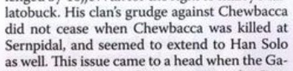
- **Chewbacca**: "Tojjevvuk An albino Wookiee who was Chewbacca's rival for the affections of Mallatobuck." Source: The Complete Star Wars Encyclopedia, Vol. III, p.252
  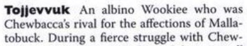
- **Shaak Ti**: "When Shaak Ti recovered, Shogar Tok tried to kill her but was no match for the Jedi." Source: The Complete Star Wars Encyclopedia, Vol. III, p.252
  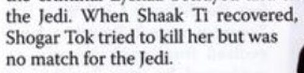
- **Admiral Ackbar**: "Tola During the Swarm War, this Mon Calamari served the Galactic Alliance as a captain aboard the Admiral Ackbar, acting on the orders of General Nek Bwua'tu during the blockade of the Murgo Choke." Source: The Complete Star Wars Encyclopedia, Vol. III, p.252
  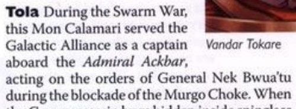

## p.253 (scan page 259)

Page contents: 962 words, 22 paragraphs | headings/entries: Tomcat; Tone, B'dard; Ton-Falk; Tonith, Pors; Tookarti; Toola

- **General Grievous**: "A tall, imposing Coway distinguished by the shield that covered the left side of his face and the cybernetic replacement of his right hand, Master Tone was one of a handful of Jedi who wanted to destroy General Grievous before he could kill any more innocent beings." Source: The Complete Star Wars Encyclopedia, Vol. III, p.253
  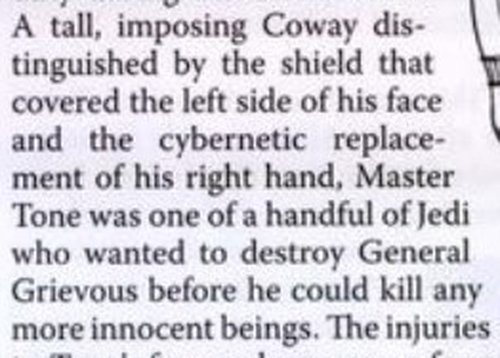
- **General Grievous**: "The injuries to Tone's face and arm came from an encounter with Grievous on Nadiem, and his first Padawan was killed by the general in the fighting." Source: The Complete Star Wars Encyclopedia, Vol. III, p.253
  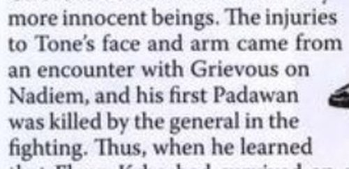
- **General Grievous**: "Thus, when he learned that Flynn Kybo had survived an encounter with the Separatist military leader, he sought out the Padawan to discuss the young man's plans for going after Grievous." Source: The Complete Star Wars Encyclopedia, Vol. III, p.253
  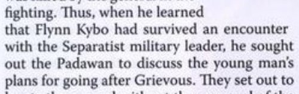
- **Quinlan Vos**: "When Vos learned of Tookarti's betrayal, he killed the Chadra-Fan." Source: The Complete Star Wars Encyclopedia, Vol. III, p.253
  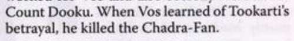

## p.254 (scan page 260)

Page contents: 1065 words, 22 paragraphs | headings/entries: Toom Clan; Toong; Toora, Toonbuck; Toorr, Jip; Tooth; To-phalion Base; Toprawa; Toq, Qrri; Torbin, Grand Inquisitor

- **Luke Skywalker**: "Four years after the Battle of Endor, Luke Skywalker traveled to Toola to inspect the ruined home of a slain Jedi Master who had once been the curator of Jedi records on Coruscant." Source: The Complete Star Wars Encyclopedia, Vol. III, p.254
  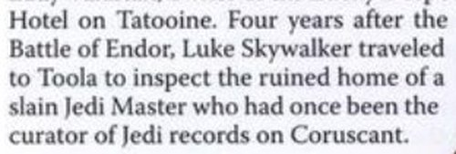

## p.255 (scan page 261)

Page contents: 943 words, 25 paragraphs | headings/entries: Torg, Galen; Tork, Admiral Mir; Torlin, Jor; Tornik; Torpil; Torr, Valsil; Torsyn, Ryle; Torve, Fynn; Toryaz Station; Tosche Station

- **Boba Fett**: "He died sometime after the Battle of Endor when Boba Fett destroyed his ship." Source: The Complete Star Wars Encyclopedia, Vol. III, p.255
  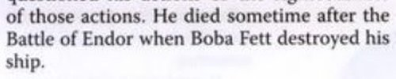

## p.256 (scan page 262)

Page contents: 1069 words, 29 paragraphs | headings/entries: Tosh, Jann; Tosi-karu; Tossk, Boss; Toth, Cavik; Totolaya; Tough Squadron; Touno, High General; Towani, Catarine; Towani, Cindel; Towani, jeremitt; Towani, Mace; Tower, Admiral Griggor; Toydarian

- **Adi Gallia**: "He and his fleet of Sabaoth Destroyers were defeated by forces led by Adi Gallia and Nym." Source: The Complete Star Wars Encyclopedia, Vol. III, p.256
  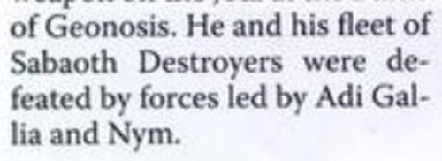

## p.257 (scan page 263)

Page contents: 1035 words, 20 paragraphs | headings/entries: Tozr, Chal; Traavis, General; Trace; Trachta, Grand Moff

## p.258 (scan page 264)

Page contents: 917 words, 16 paragraphs | headings/entries: Trade Federation Droid Control Ship; Trade Federation Executive Board; Trader's Luck; Trade Spine; Tradewyn; Tragett, Bogo

- **Count Dooku**: "Nute Gunray, the Viceroy of the Trade Federation, survived imprisonment and maintained control, throwing his support behind Count Dooku and the Separatists." Source: The Complete Star Wars Encyclopedia, Vol. III, p.258
  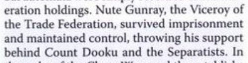

## p.259 (scan page 265)

Page contents: 844 words, 16 paragraphs | headings/entries: Trailing Sectors; Tralkpha; Tralus; Trang Robotics

## p.260 (scan page 266)

Page contents: 1045 words, 21 paragraphs | headings/entries: TransGalMeg Industries, Inc.; Trask, Anson; Traya, Darth; TRD

- **Kreia; Meetra Surik** — entry/section: Traya, Darth: "After the Jedi Exile traveled to Onderon and defeated General Vaklu, Kreia realized that her "pupil" was growing in strength and would become a threat to her triumverate of power." Source: The Complete Star Wars Encyclopedia, Vol. III, p.260
  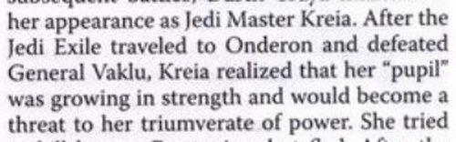

## p.261 (scan page 267)

Page contents: 874 words, 30 paragraphs | headings/entries: Treasury Orders Act; Trebela; Treblanc, Romeo; Trebor, Coleman; Tredway, Dena; Treece, Captain Hugo; Treemba, Si; Treetower, Master

- **Jango Fett**: "Unfortunately, his lack of combat experience became clear during the early stages of the battle when the bounty hunter Jango Fett shot and killed him." Source: The Complete Star Wars Encyclopedia, Vol. III, p.261
  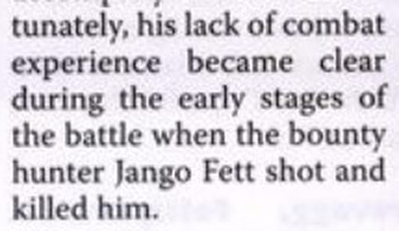
- **Lando Calrissian**: "Lando was saved from certain death by his cyborg aide, Lobot, and the two joined forces with rebellious Ugnaughts to defeat the Imperial forces." Source: The Complete Star Wars Encyclopedia, Vol. III, p.261
  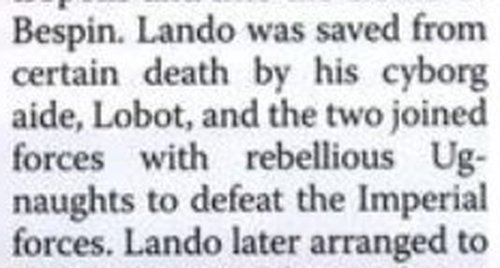

## p.262 (scan page 268)

Page contents: 1005 words, 25 paragraphs | headings/entries: Tregga; Treidum, Pol; Trell, Poas; Tremayne, High Inquisitor Antinnis; Trenchant; Trevagg, Feltipern; Trevee; Trevval, Liane; Trey'lis, Hosk

- **Antinnis Tremayne** — entry/section: Tremayne, High Inquisitor Antinnis: "After he defeated Darrin Arkanian, Tremayne was disfigured in battle during Shelvay's escape, losing an eye as well as his right arm." Source: The Complete Star Wars Encyclopedia, Vol. III, p.262
  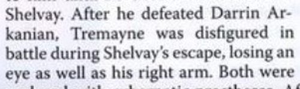
- **Antinnis Tremayne** — entry/section: Tremayne, High Inquisitor Antinnis: "Tremayne was given command of the Star Destroyer /nterrogator." Source: The Complete Star Wars Encyclopedia, Vol. III, p.262
  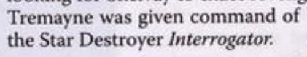

## p.263 (scan page 269)

Page contents: 1083 words, 38 paragraphs | headings/entries: Triad; Trian; Trianii; Trianii Ranger; Trickster; Triclops; Trid; Triebakk; Triffian; Trigalis; Trigg; Trigon

## p.264 (scan page 270)

Page contents: 1092 words, 28 paragraphs | headings/entries: Trihexalophineli38; Trilika; Trillot; TriNebulon News; Trioculus; Triple Zero; Trispzest; Trista; Triton Squad; Triumph; Trodd, Puggles; Trogan; Tro'Har; Troig

## p.265 (scan page 271)

Page contents: 1092 words, 24 paragraphs | headings/entries: Troiken; Trommer, Ranulf; Troper, Milac; Trosh; Troska; Troujow, Hasti; Troujow, Lanni; Trucemaker; Truchong, Brindy; True Justice; True Mandalorians; True Victory Party

- **Tresina Lobi**: "The situation only got worse when a delegation of Bothans from the True Victory Party were found murdered on the same night that Tresina Lobi was brutally killed in Fellowship Plaza." Source: The Complete Star Wars Encyclopedia, Vol. III, p.265
  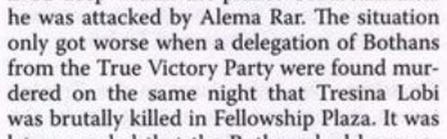

## p.266 (scan page 272)

Page contents: 1122 words, 23 paragraphs | headings/entries: Trulalis; Truuine; Tsayv, Liat; Tschel, Lieutenant; Tser, Wolam; Tsinimal; Tsoss Beacon; Tsyr

- **Jaina Solo**: "Shedao Shai carried one, and at Ebaq 9, Tsavong Lah dueled Jaina with his tsaisi." Source: The Complete Star Wars Encyclopedia, Vol. III, p.266
  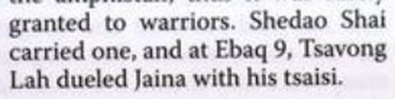
- **Grand Admiral Thrawn**: "Tschel, Lieutenant A young officer aboard the Imperial Star Destroyer Chimaera, he served as a member of the bridge crew under Captain Pellaeon and Grand Admiral Thrawn during Thrawn's campaign to destroy the New Republic five years after the Battle of Endor." Source: The Complete Star Wars Encyclopedia, Vol. III, p.266
  

## p.267 (scan page 273)

Page contents: 928 words, 28 paragraphs | headings/entries: Tu, Suribran; Tugorn; Tuhns, Geoff; Tung, Gengi; Tuomi, Senator; Tup; Turan, Dr. Fort

- **Count Dooku**: "Dooku agreed and used his lightsaber to behead Tu." Source: The Complete Star Wars Encyclopedia, Vol. III, p.267
  

## p.268 (scan page 274)

Page contents: 906 words, 25 paragraphs | headings/entries: Turi, Tionthes; Turkana; Tur-Mukan, Etain; Tusken Oasis; Tusken Raider

## p.269 (scan page 275)

Page contents: 1056 words, 18 paragraphs | headings/entries: The Jedi Knight; Tusken's Eye; Tuulab; Tuum, Rasi; Tuun, Maneeli; Tuyay; Tuzes-Adaz

- **Obi-Wan Kenobi; Padmé Amidala**: "After Sancor was killed while fighting Kenobi, Tuun remained behind to cover up Sancor's death and further safeguard any information on Padmé's fate." Source: The Complete Star Wars Encyclopedia, Vol. III, p.269
  
- **Prince Xizor; Guri**: "Xizor's top aide, Guri, choked Tuyay, then held a blaster up to his left eyeball and killed him." Source: The Complete Star Wars Encyclopedia, Vol. III, p.269
  
- **Darth Vader (Anakin Skywalker)**: "Her actions proved critical, as it was Anakin who later destroyed the Separatist facility and began Nelvaan's return to normalcy." Source: The Complete Star Wars Encyclopedia, Vol. III, p.269
  

## p.270 (scan page 276)

Page contents: 1116 words, 22 paragraphs | headings/entries: Twilight; Twilight; T-wing; Twin Suns; Twin Suns Squadron; Twith; Twizzi, Commander

- **Meetra Surik**: "They were among the many bounty hunters who were hired by GO-TO to capture Jedi Knights, but were killed aboard GO-TO's yacht when the Jedi Exile escaped from the vessel." Source: The Complete Star Wars Encyclopedia, Vol. III, p.270
  
- **Anakin Solo**: "He was the commander of the Star Destroyer Anakin Solo on its maiden voyage to Hapes." Source: The Complete Star Wars Encyclopedia, Vol. III, p.270
  

## p.271 (scan page 277)

Page contents: 1115 words, 23 paragraphs | headings/entries: Twofingers, Gerlon; Two-Guns, Longo; Twoseas, Lilit; Ty, Codi; Tydirium; Tyed Kant; Tyerell, Ratts; Tyestin, Iskit; Tyluun Night-Soarer; Tymmo; Tyne's Horky; Tynna; Typha-Dor

- **Darth Vader (Anakin Skywalker)**: "Unfortunately for Tyerell and his family, he was killed during the Boonta Eve Classic on Tatooine, which saw Anakin Skywalker defeat Sebulba." Source: The Complete Star Wars Encyclopedia, Vol. III, p.271
  
- **Count Dooku**: "Prior to the Clone Wars, an infestation of stone mites destroyed the Tynna Central Government Building and prompted the planet's leader, Razelfiin, to announce his support for Count Dooku." Source: The Complete Star Wars Encyclopedia, Vol. III, p.271
  

## p.272 (scan page 278)

Page contents: 883 words, 20 paragraphs | headings/entries: Typho, Captain Gregar; Tyrann; Tyrant; Tyranus, Darth; Tyrell, Bogg; Tyris, Nikkos; Tython

- **Padmé Amidala**: "Typho employed Cordé as a stand-in for Padmé upon their arrival, a move that likely saved the Senator's life when their starship was destroyed by a bomb." Source: The Complete Star Wars Encyclopedia, Vol. III, p.272
  
- **Count Dooku; Palpatine (Darth Sidious); Darth Vader (Anakin Skywalker)** — entry/section: Tyranus, Darth: "During the Battle of Coruscant, Palpatine ordered Anakin to kill Tyranus, and the young Jedi beheaded the treacherous former Jedi." Source: The Complete Star Wars Encyclopedia, Vol. III, p.272
  

## p.273 (scan page 279)

Page contents: 440 words, 11 paragraphs | headings/entries: Tyto, Captain; Tyvokka; Tzizvvt

- **Tyvokka** — entry/section: Tyvokka: "In the ensuing firefight, Master Tyvokka was killed when the Trade Federation's battle droids opened fire into the melee." Source: The Complete Star Wars Encyclopedia, Vol. III, p.273
  

## p.274 (scan page 280)

Page contents: 0 words, 0 paragraphs | headings/entries: 

