# Owner Material 032 — The Complete Star Wars Encyclopedia, Vol. III (P–Z): scan pages 281–320

- **Source:** *The Complete Star Wars Encyclopedia* by Stephen J. Sansweet and Pablo Hidalgo, with Bob Vitas, Daniel Wallace, Chris Cassidy, Mary Franklin and Josh Kushins (Del Rey, 2008), 3 vols. Secondary source (licensed Legends reference). Scan OCR'd on the box; the scan stays box-only and is **not** published.
- **Method:** every scanned page was OCR'd and machine-screened sentence by sentence for power-relevant statements (fights, kills, defeats, Force feats, rankings, superweapons) that name a character on our roster; each kept sentence is quoted verbatim from the OCR text and has a crop of the printed passage directly under it. Pages with nothing power-relevant are still listed with what is on them.
- **Citation:** "The Complete Star Wars Encyclopedia, Vol. III, p.X" by printed page ("scan p.X" where no printed number applies). **Weight:** Lucasfilm-licensed encyclopedia: a secondary, in-universe summary of Legends (and some film) material. It sums up feats from novels, comics and games; where the original story is in our notes, that source is the stronger citation.

## p.275 (scan page 281)

Page contents: 655 words, 18 paragraphs | headings/entries: U2-Cl; U-33; U-3PO0; Uaua; Uba IV, Battle of; Ubigtorate; Ubooki, Glah

## p.276 (scan page 282)

Page contents: 1028 words, 30 paragraphs | headings/entries: Ubote; Ubrikkian Steamworks; Ubris; Ucce, Lady; Uda-Khalid; Udelen; Udin; Udo-Mal, Sen; U'Dray; U-E; Uffel; Ugan, Captain; Ugbuz; Uggernaught; Ugloste; Ugly Truth

## p.277 (scan page 283)

Page contents: 1221 words, 31 paragraphs | headings/entries: Ugmush, Captain; Ugnor, Boss; Ugnorgrad; Ugnaught Surface; Uhitenden; Uhumele; Uhuru; Ukchet; Ulabore, Lieutenant

- **General Grievous**: "During the Clone Wars, General Grievous defeated the Ugnaughts on Belsus, a moon in the Anoat system." Source: The Complete Star Wars Encyclopedia, Vol. III, p.277
  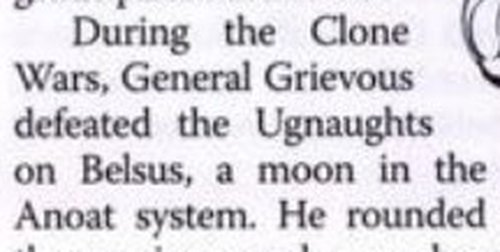
- **General Grievous**: "Unknown to Grievous, many of the Ugnaughts lived underground and survived." Source: The Complete Star Wars Encyclopedia, Vol. III, p.277
  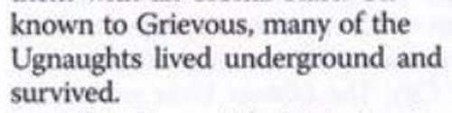

## p.278 (scan page 284)

Page contents: 1138 words, 43 paragraphs | headings/entries: Ulabos; Uiban Arms; Uibasca; Uicane, Meres; Ulgo; Uigo, Trask; Uliar, Director Chas; Ulicia; Uliss, Tam; Ulix, Ulu; Ulizra; Uin, Jorak; Uitaar; Ultimo Vista

- **Darth Malak**: "Years later, Uln was killed when a group of Jedi Knights infiltrated Korriban by posing as Sith apprentices during their search for Darth Malak." Source: The Complete Star Wars Encyclopedia, Vol. III, p.278
  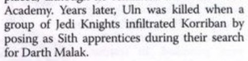

## p.279 (scan page 285)

Page contents: 1001 words, 29 paragraphs | headings/entries: Ulug; Umaren'k'sa; Umbaran; Umboo; Umgul; Umi, Bjork; Ummar; Umpass-stay

- **Palpatine (Darth Sidious)**: "Because many Umbarans secured positions of power within the Empire, they feared some form of retaliation when Palpatine was killed at the Battle of Endor." Source: The Complete Star Wars Encyclopedia, Vol. III, p.279
  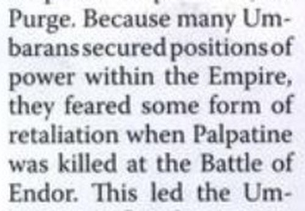

## p.280 (scan page 286)

Page contents: 1264 words, 23 paragraphs | headings/entries: Umwak; Unch, Sil; Undauntable; Undaunted; Undrarian; Unduli, Luminara; Undying Flame; Unification Policies; Unified Ruurian Colonies; UniFy; Unill, Mierme

- **Luminara Unduli** — entry/section: Unduli, Luminara: "Official Imperial reports later claimed that Master Unduli was killed for her part in the Jedi conspiracy to overthrow the Republic." Source: The Complete Star Wars Encyclopedia, Vol. III, p.280
  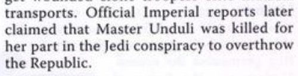

## p.281 (scan page 287)

Page contents: 971 words, 30 paragraphs | headings/entries: Uniting Day; Unity Green; Unit Zed; Unknown Regions; Unknown World; Untiu, Rai; Unnh, Dr'uun; Unreal City

## p.282 (scan page 288)

Page contents: 1339 words, 35 paragraphs | headings/entries: Unseen Queen; Unu; UnuThul; Uogo'cor; Upland Liberation Front; Uplands, the; Upper City; Upside; Urce; Urdur; Urgah; Urhal; Clone Wars.

## p.283 (scan page 289)

Page contents: 1032 words, 23 paragraphs | headings/entries: Uro-ik V'alh; Uroro Station; UroRRuR'R'R; Urothko; Urrdorf City; UrrOr'RuuR; Ussa; Ussor, Captain; Ut; Utai; Utapau

## p.284 (scan page 290)

Page contents: 1039 words, 21 paragraphs | headings/entries: Utapaun; Utegetu Nebula; Uthan, Ovolot Qail; Utharis

- **General Grievous; Obi-Wan Kenobi**: "Rather than let Grievous escape again, Kenobi single-handedly attacked and eventually defeated the half-alien, half-droid general." Source: The Complete Star Wars Encyclopedia, Vol. III, p.284
  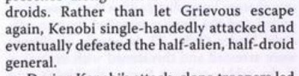

## p.285 (scan page 291)

Page contents: 1050 words, 36 paragraphs | headings/entries: Utrila, B'ink; Uul, Takhaff; Uul-Rha-Shan; Uulshos Manufacturing; Uunu; Uyter; Uz, Bizzin; Uziel, Glimmer

- **General Grievous; Palpatine (Darth Sidious)**: "Unfortunately, Master Utrila was no match for Grievous's strength and skills, and was cut down by the cyborg warrior while trying to prevent Grievous from reaching Palpatine." Source: The Complete Star Wars Encyclopedia, Vol. III, p.285
  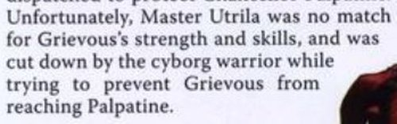
- **Obi-Wan Kenobi; Darth Vader (Anakin Skywalker); Count Dooku**: "Obi-Wan Kenobi and his apprentice, Anakin Skywalker, managed to defeat the battle droids and save the leaders, but Dooku managed to escape." Source: The Complete Star Wars Encyclopedia, Vol. III, p.285
  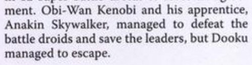

## p.286 (scan page 292)

Page contents: 0 words, 0 paragraphs | headings/entries: 

## p.287 (scan page 293)

Page contents: 649 words, 23 paragraphs | headings/entries: V-i; V-35; V-475; Space Dock.; Vaa, Seviss; Vaabesh; Vaal

## p.288 (scan page 294)

Page contents: 992 words, 22 paragraphs | headings/entries: Vaapad; Vaartsoon; Vaathkree; Vaca, Rayno; Vadde, Shas

- **Darth Vader (Anakin Skywalker); Obi-Wan Kenobi**: "Darth Vader duels Obi-Wan Kenobi on Mustofar." Source: The Complete Star Wars Encyclopedia, Vol. III, p.288
  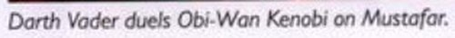
- **Obi-Wan Kenobi**: "Kenobi sensed too late what was happening, and when he tried to draw his former Padawan back to the light side, they engaged in a terrible duel on Mustafar that led to Skywalker's fall into the molten lava." Source: The Complete Star Wars Encyclopedia, Vol. III, p.288
  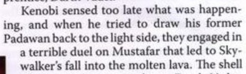

## p.289 (scan page 295)

Page contents: 870 words, 22 paragraphs | headings/entries: 

- **Darth Vader (Anakin Skywalker)**: "Darth Vader commanded by terror, thinking nothing of using the Force to choke an Imperial officer who had displeased him." Source: The Complete Star Wars Encyclopedia, Vol. III, p.289
  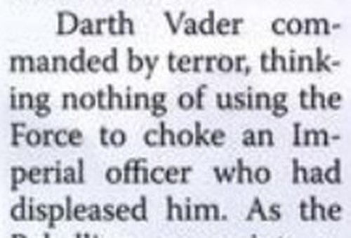
- **Obi-Wan Kenobi**: "In another fateful lightsaber duel, Kenobi allowed himself to be struck down by his former student, and his corporeal body disappeared as he became one with the Force." Source: The Complete Star Wars Encyclopedia, Vol. III, p.289
  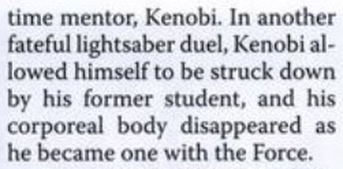
- **Darth Vader (Anakin Skywalker); Luke Skywalker**: "Then, seemingly from nowhere, a blast caught Vader's ship and sent it spinning into space as Luke Skywalker's proton torpedoes found their mark and destroyed the Death Star." Source: The Complete Star Wars Encyclopedia, Vol. III, p.289
  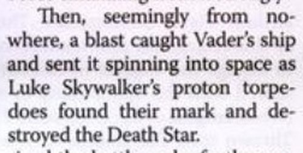
- **Darth Vader (Anakin Skywalker)**: "Vader survived the battle and a further encounter with the Force-wielder on the planet Mimban, where Vader lost his prosthetic right arm in a lightsaber duel." Source: The Complete Star Wars Encyclopedia, Vol. III, p.289
  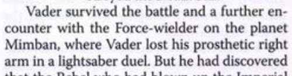
- **Darth Vader (Anakin Skywalker); Obi-Wan Kenobi**: "Darth Vader duels Obi-Wan Kenobi aboard the first Death Star." Source: The Complete Star Wars Encyclopedia, Vol. III, p.289
  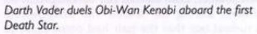
- **Luke Skywalker**: "Luke then confronted the Emperor, who attacked him with blast after blast of blue Force lightning." Source: The Complete Star Wars Encyclopedia, Vol. III, p.289
  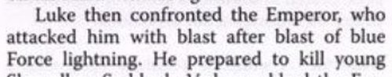
- **Darth Vader (Anakin Skywalker); Luke Skywalker**: "Darth Vader duels his son, Luke Skywalker." Source: The Complete Star Wars Encyclopedia, Vol. III, p.289
  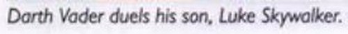

## p.290 (scan page 296)

Page contents: 1050 words, 25 paragraphs | headings/entries: Vader's Fist; Vae, Thrynni; Vaecta; Vagaari; Vagabond Trader; Vagno; Vagrant; Vainglorious; Vakier, Ko

- **Olee Starstone**: "Vagabond Trader A converted SX troop transport used by Olee Starstone and her crew of Jedi to search out any other members of the Jedi Order who survived Order 66." Source: The Complete Star Wars Encyclopedia, Vol. III, p.290
  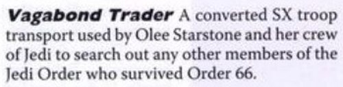

## p.291 (scan page 297)

Page contents: 1038 words, 18 paragraphs | headings/entries: Vakil, Nrin; Val, Krag; Valadon; Val, Ekh'm; Valance, Beilert; Valarian, Lady

- **Jacen Solo (Darth Caedus)**: "The Yuuzhan Vong lieutenant badly injured Rhysode but was slain in battle by Jacen Solo." Source: The Complete Star Wars Encyclopedia, Vol. III, p.291
  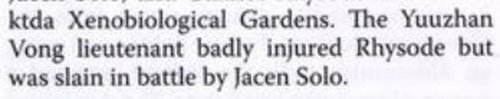
- **Beilert Valance** — entry/section: Valance, Beilert: "After gathering a group of mercenaries and bounty hunters to assist him, Valance attacked the base at Telos-4, destroying everything to erase his past." Source: The Complete Star Wars Encyclopedia, Vol. III, p.291
  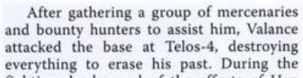

## p.292 (scan page 298)

Page contents: 985 words, 29 paragraphs | headings/entries: Vaicyn; Valdez, Shawn; Vale; Valesovich, Count Imal; Valia, Jikesh; Valiant; Valiant; Dark Lords; Vallusk Cluster; Valorous; Valorum, Supreme Chancellor Finis

- **Palpatine (Darth Sidious)**: "Darth Sidious, however, had put strong security measures in place, and a huge blast killed Valiant and his colleagues." Source: The Complete Star Wars Encyclopedia, Vol. III, p.292
  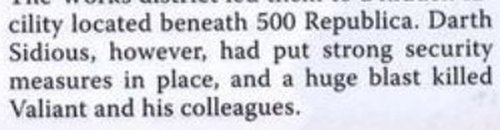

## p.293 (scan page 299)

Page contents: 1004 words, 16 paragraphs | headings/entries: Valiorum, Tarsus; Vamm, Eejee; Vandalor; Vandangante, Jessa; Vandelheim; Vandor-3

- **Darth Vader (Anakin Skywalker)**: "Anakin Skywalker killed Vandalor some 10 months after the Battle of Geonosis while searching for cortosis battle droids on Metalorn." Source: The Complete Star Wars Encyclopedia, Vol. III, p.293
  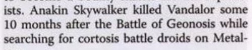
- **Darth Vader (Anakin Skywalker)**: "Darth Vader's strafing laserfire destroyed his ship before he reached the unshielded thermal exhaust port." Source: The Complete Star Wars Encyclopedia, Vol. III, p.293
  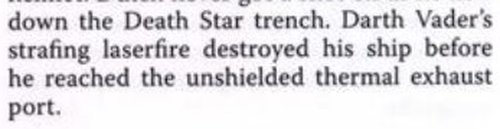

## p.294 (scan page 300)

Page contents: 963 words, 19 paragraphs | headings/entries: Vanguard Squadron; Vanicus, Captain; Vanis, Tay; Vangor; Vanquisher; Vanquo; Vant, Docent

- **Grand Admiral Thrawn; Palpatine (Darth Sidious)**: "Vanguard (2) this Imperial I-class Star Destroyer was used by then- Vice Admiral Thrawn to chase Zaarin after Zaarin's failed attempt to kidnap Emperor Palpatine near Coruscant during the Galactic Civil War." Source: The Complete Star Wars Encyclopedia, Vol. III, p.294
  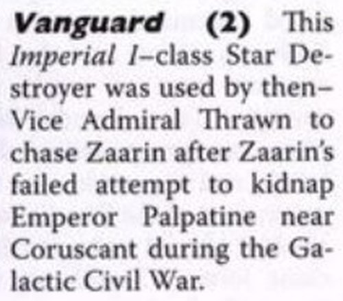

## p.295 (scan page 301)

Page contents: 972 words, 20 paragraphs | headings/entries: Vant, Ryko; Vantail, Kir; Vanya, Uncle; Vao, Astraal; Vao, Mission; Vao, Shado; Vapeet, Lo; Vapor Room, the

- **Darth Vader (Anakin Skywalker)**: "The pair managed to escape, although Vant was killed and Vader sustained injuries." Source: The Complete Star Wars Encyclopedia, Vol. III, p.295
  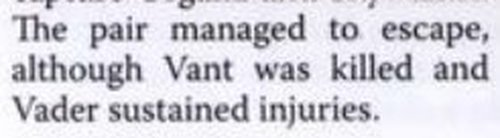

## p.296 (scan page 302)

Page contents: 1034 words, 24 paragraphs | headings/entries: Varesh; Vargi; Variable Geometry Self-Propelled Battle Droid; Vari; Varnay; Varr; Varth, Alinn; Varth, Wing Commander

- **Lando Calrissian; Han Solo; Chewbacca**: "He was defeated by Lando Calrissian and Han Solo, who had returned to Kashyyyk with Chewbacca to help him thwart the slavers." Source: The Complete Star Wars Encyclopedia, Vol. III, p.296
  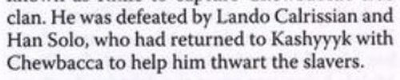

## p.297 (scan page 303)

Page contents: 1097 words, 18 paragraphs | headings/entries: Varykino; Vash, Lonna; Vashan; Vastor, Kar; Vasur, Medrit; Vatok; Vau, Walon

- **Jacen Solo (Darth Caedus)**: "The Mandalorians were outnumbered by the Imperial Elite Guard and stormtroopers stationed on the asteroid, and they were outmatched when Darth Caedus entered the fray." Source: The Complete Star Wars Encyclopedia, Vol. III, p.297
  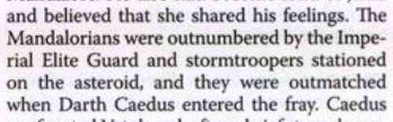

## p.298 (scan page 304)

Page contents: 1149 words, 18 paragraphs | headings/entries: Vaykaaris Uprising; VCD987; Vebb, Nahdar; Vectivus, Darth; Vector; Vector Prime; Veda; Veed, Moff Morlish; Veekan, Cebann

- **Darth Vectivus** — entry/section: Vectivus, Darth: "Unlike the popular image of a Sith Lord, Darth Vectivus did not conquer star systems and wipe out entire populations." Source: The Complete Star Wars Encyclopedia, Vol. III, p.298
  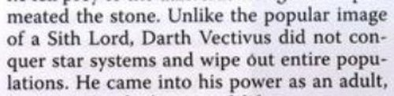

## p.299 (scan page 305)

Page contents: 1143 words, 21 paragraphs | headings/entries: Veers, General Maximilian; Veers, Zevulon; VeerTa; Veeshas Tuwan; Vegnu, Jub; Veila, Tahiri

- **Qui-Gon Jinn**: "VeerTa hoped that this alliance would free Bandomeer once Xanatos had exacted his revenge against Qui-Gon Jinn, but she ultimately discovered that she was just a pawn in Xanatos's plans to destroy the planet." Source: The Complete Star Wars Encyclopedia, Vol. III, p.299
  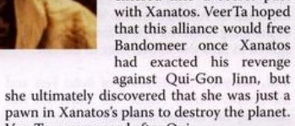
- **Darth Ruin**: "Many Sith Lords who rose to power after Darth Ruin believed that the loss of the Veeshas Tuwan complex was one of the costliest blows the Sith had ever been dealt since a great portion of their history was destroyed or stolen by the Jedi." Source: The Complete Star Wars Encyclopedia, Vol. III, p.299
  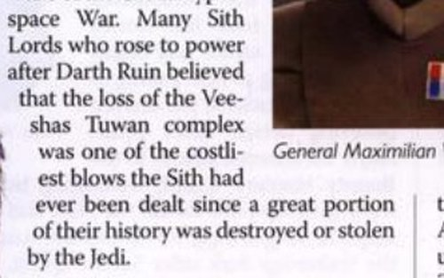
- **Tahiri Veila** — entry/section: Veila, Tahiri: "Tahiri Veila was orphaned as a child when Tusken Raiders killed her parents, The Tusken Raider Sliven and his tribe took her in and raised her as one of their own for five years." Source: The Complete Star Wars Encyclopedia, Vol. III, p.299
  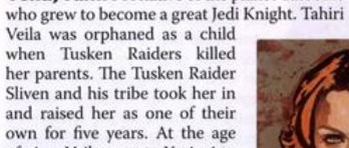

## p.300 (scan page 306)

Page contents: 1300 words, 32 paragraphs | headings/entries: Vek; Vekker; Vekki; Veknoid; Vel; Vel, Ailyn; Vel, Sintas; Veld, Tru; Veiga Prime

- **Boba Fett**: "A group of Mandalorians led by Boba Fett infiltrated the ship and killed the Moffs, and Veila was stabbed in the leg by Mirta Gev." Source: The Complete Star Wars Encyclopedia, Vol. III, p.300
  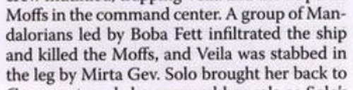

## p.301 (scan page 307)

Page contents: 1175 words, 25 paragraphs | headings/entries: Veloz, Jadonna; Velser's Ring; Veitraa, Admiral Jimas; Ven, Nawara; Venaari; Venan, Chala; Vendaxa; Vendetta

- **Luke Skywalker; Han Solo; Chewbacca**: "A swoop gang he hired was no match for Luke, Han Solo, and Wedge Antilles, and Venan himself was incapacitated by Chewbacca." Source: The Complete Star Wars Encyclopedia, Vol. III, p.301
  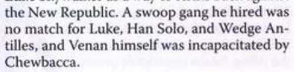
- **Darth Vader (Anakin Skywalker)**: "Several Venator-class ships in the Open Circle Armada were also armed with the superlasers from SPHA-T walkers, mounted near the ventral docking bay at the direction of Anakin Skywalker, to give the vessel a ventral firing arc." Source: The Complete Star Wars Encyclopedia, Vol. III, p.301
  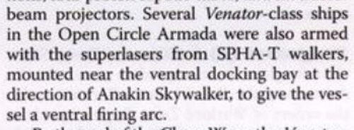

## p.302 (scan page 308)

Page contents: 1260 words, 24 paragraphs | headings/entries: Venku; Ven'nari, Knol; Ventor, Halagad; Ventooine; Venture; Venutton; Venzeiia 2 Prime

- **Jerec**: "When he lost the vessel in the effort, Jerec had the ship's computer core salvaged from the wreckage and transferred to a new Star Destroyer called the Vengeance Il, though with its predecessor destroyed, the numerical amendment was infrequently applied." Source: The Complete Star Wars Encyclopedia, Vol. III, p.302
  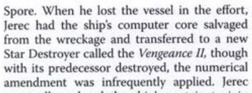
- **Obi-Wan Kenobi; Luke Skywalker**: "Upon learning of the survival of Kenobi and the appearance of Luke Skywalker, Halagad fought against the dark side and defeated it, but died shortly thereafter." Source: The Complete Star Wars Encyclopedia, Vol. III, p.302
  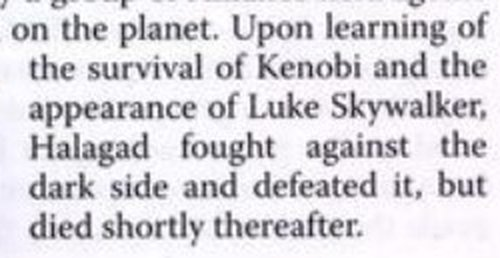
- **Asajj Ventress**: "A native of the planet Rattatak, Asajj Ventress was a ruthless and cunning adversary, known for her military expertise and her corrupt mastery over the Force, Her parents were murdered by Osika Kirske when she was young, and she might have died if not for the sudden appearance of Jedi Master Ky Narec." Source: The Complete Star Wars Encyclopedia, Vol. III, p.302
  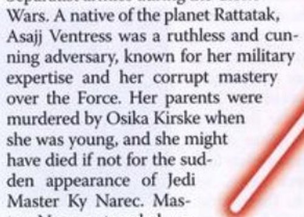
- **Asajj Ventress**: "After Kirske killed Narec, Ventress used her powers to take over her homeworld and kill Kirske." Source: The Complete Star Wars Encyclopedia, Vol. III, p.302
  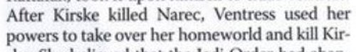
- **Mace Windu**: "She was unable to defeat Master Windu in battle and fled Ruul to fight another day." Source: The Complete Star Wars Encyclopedia, Vol. III, p.302
  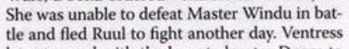
- **Asajj Ventress; Obi-Wan Kenobi**: "On Queyta, Ventress and Durge tried to secure the antidote to the swamp gas, but Obi-Wan Kenobi and his companions bested her." Source: The Complete Star Wars Encyclopedia, Vol. III, p.302
  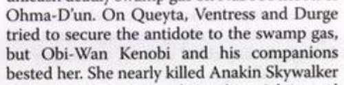
- **Darth Vader (Anakin Skywalker); Obi-Wan Kenobi**: "She nearly killed Anakin Skywalker on Yavin 4, then captured Kenobi on Jabiim and tortured him inside her Rattatak fortress." Source: The Complete Star Wars Encyclopedia, Vol. III, p.302
  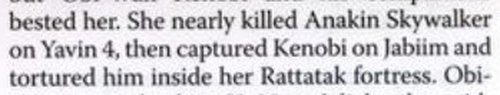

## p.303 (scan page 309)

Page contents: 1115 words, 28 paragraphs | headings/entries: Verdun, Dr. Tic; Veré; Vergere; Vergill; Vermel, Colonel Meizh

- **Han Solo; Mara Jade Skywalker**: "When Elan was chosen to act as an envoy to the New Republic in an effort to destroy the Jedi, Vergere accompanied her and gave Han Solo a sample of her tears, which cured Mara Jade Skywalker of a wasting disease that had crippled her." Source: The Complete Star Wars Encyclopedia, Vol. III, p.303
  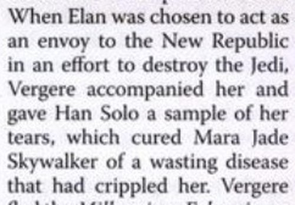
- **Grand Admiral Thrawn; Admiral Daala**: "Vermel, Colonel Meizh An Imperial Navy officer who served under Admiral Pellaeon after the death of Grand Admiral Thrawn and the defeat of Admiral Daala." Source: The Complete Star Wars Encyclopedia, Vol. III, p.303
  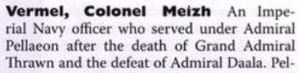

## p.304 (scan page 310)

Page contents: 1001 words, 24 paragraphs | headings/entries: Veron; Vero'tog'leo; Verpine; Versé; Ver Seryan, Karia; Veruna, King; Vesser, Dak; Vessery, Colonel Broak; Vestswe, Sateen; Vetter, Elke; Veubg; Vevut, Novoc

## p.305 (scan page 311)

Page contents: 1065 words, 30 paragraphs | headings/entries: Vexa; Vibro; Vicria; Victim; Victory, Salem; Victory Forum; Victory Lake; Victory Square; Vida, Ayy

- **Admiral Daala**: "Vevut later served with the many Mandalorians who participated in the Second Battle of Fondor, where they were backup for Admiral Daala's Maw Irregular Fleet and recaptured the destroyer Bloodfin." Source: The Complete Star Wars Encyclopedia, Vol. III, p.305
  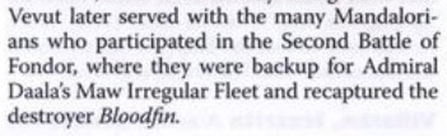
- **Grand Admiral Thrawn**: "The usefulness of Victory Star Destroyers was renewed with the return of Grand Admiral Thrawn." Source: The Complete Star Wars Encyclopedia, Vol. III, p.305
  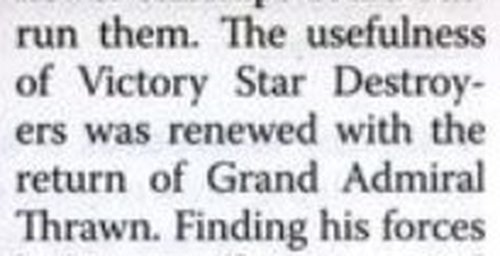

## p.306 (scan page 312)

Page contents: 1057 words, 22 paragraphs | headings/entries: Vidkun, Benedict; Vien'sai'Malloc; Viento, Senator; Vigilance; Vigilant; Vigos, Dantos; Viidaav; Vilas; Vill, Commander; Villache, Nazrita; Villa Solis

- **K'Kruhk; Quinlan Vos**: "Master K'kruhk and Quinlan Vos struggled, but Vos killed Viento before K'kruhk could stop him." Source: The Complete Star Wars Encyclopedia, Vol. III, p.306
  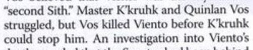
- **Obi-Wan Kenobi; General Grievous**: "Vigilance This Old Republic Venator-class Star Destroyer was deployed to Utapau as the flagship of a task force under the command of Obi-Wan Kenobi, during the search for General Grievous in the wake of the First Battle of Coruscant." Source: The Complete Star Wars Encyclopedia, Vol. III, p.306
  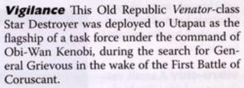

## p.307 (scan page 313)

Page contents: 1025 words, 25 paragraphs | headings/entries: Vilosoria; Vimdin, Bom; Vinda; Vindi, Doctor Nuvo; Vinoc; Vinsoth; Vippit; Virago

- **Darth Vader (Anakin Skywalker)**: "Both were killed 10 months after the Battle of Geonosis by Anakin Skywalker, who was searching for the source of cortosis-based battle droids being made on Metalorn." Source: The Complete Star Wars Encyclopedia, Vol. III, p.307
  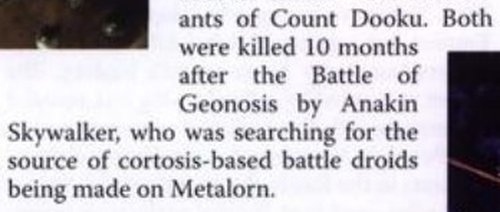

## p.308 (scan page 314)

Page contents: 1254 words, 22 paragraphs | headings/entries: Viraxo Industries; Virdugo Plunge; Virgillian Civil War; Virujansi; Virulence; Vis'l; Vispil; Viss, Ellu

## p.309 (scan page 315)

Page contents: 1205 words, 20 paragraphs | headings/entries: Vizcarra; Vizsia; Vjun; Viee, Ussar; Vlix; Voal, Captain; Vob; Vocatara

- **Jaster Mereel**: "Vizsla shot and killed Jaster Mereel, then celebrated the victory." Source: The Complete Star Wars Encyclopedia, Vol. III, p.309
  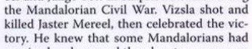
- **Jango Fett**: "Vizsla seemed to gain the upper hand when he injected poison into Jango's body but was unprepared for the pack of dire-cats that ripped him apart and ate him." Source: The Complete Star Wars Encyclopedia, Vol. III, p.309
  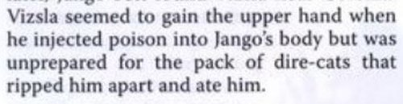
- **Kam Solusar; Palpatine (Darth Sidious)**: "Soon after Solusar's conversion, three Ysanna prisoners from Ossus were taken to Vjun to serve as raw material in creating new clone bodies for Emperor Palpatine." Source: The Complete Star Wars Encyclopedia, Vol. III, p.309
  
- **Luke Skywalker**: "The Ysanna were frozen in carbonite to await the future construction of a clone laboratory in Bast Castle, but Luke Skywalker and his Jedi trainees managed to storm the castle and defeat the Emperor's minions." Source: The Complete Star Wars Encyclopedia, Vol. III, p.309
  
- **Grand Moff Tarkin; Luke Skywalker; Leia Organa Solo**: "When Colonel Nord decided to use the ionic cannon aboard the Tarkin to take out Luke Skywalker and Leia Organa, the superweapon exploded." Source: The Complete Star Wars Encyclopedia, Vol. III, p.309
  

## p.310 (scan page 316)

Page contents: 1022 words, 33 paragraphs | headings/entries: Vogel 7; Void Spider THX 1138; Vojak; Vokkoli, Ydor; Barshnis Choard.; Vonce; Vondar, Dr. Jos

- **Luke Skywalker**: "These animals were later found feeding on garbage virtually everywhere in the galaxy; Luke Skywalker was attacked and nearly killed by one in the Death Star's trash compactor." Source: The Complete Star Wars Encyclopedia, Vol. III, p.310
  
- **C-3PX**: "There Vojak cornered C-3PX momentarily, until the droid killed him with a laser mounted in the back of its head." Source: The Complete Star Wars Encyclopedia, Vol. III, p.310
  

## p.311 (scan page 317)

Page contents: 1180 words, 23 paragraphs | headings/entries: Vong; Vongforming; Vongspawn; Vonzel; Vook, Bama; Vookto, Cei; Voors, Hallolar; Voota, Tho; Vootuh, Tsaak; Vorknkx; Vorn, Liegeus Sarpaetius; Vor'Na'Tu; Vorrik, B'shith; Vorru, Fliry; Vortex

- **Boba Fett**: "Voors, Hallolar A young spice-trading entrepreneur on Jubilar, he was killed by Boba Fett because he dared to try to break a Hutt cartel's monopoly on black-market spice." Source: The Complete Star Wars Encyclopedia, Vol. III, p.311
  
- **Darth Vader (Anakin Skywalker); Palpatine (Darth Sidious)**: "Vor'Na'Tu An ancient Jedi artifact destroyed by Echuu Shen-Jon on the planet Krant to prevent the device from falling into the hands of Darth Vader and Emperor Palpatine." Source: The Complete Star Wars Encyclopedia, Vol. III, p.311
  

## p.312 (scan page 318)

Page contents: 1148 words, 13 paragraphs | headings/entries: Vorzyd 4; Vos, Quinian; Vos, Tinté

- **Admiral Ackbar; Leia Organa Solo**: "During a visit to Vortex by Admiral Ackbar and Leia Organa Solo, Ackbar's sabotaged B-wing crashed into and destroyed the centuries-old Cathedral of Winds and killed at least 358 Vors." Source: The Complete Star Wars Encyclopedia, Vol. III, p.312
  
- **Quinlan Vos; Volfe Karkko** — entry/section: Vos, Quinian: "Vos's parents, Quian and Pethros, were members of the Guardians of Kiffu, but were killed by a group of rogue Anzati under the command of Volfe Karkko." Source: The Complete Star Wars Encyclopedia, Vol. III, p.312
  
- **Volfe Karkko; Aayla Secura**: "The trail led to the prison world of Kiffex, where the Dark Jedi Volfe Karkko had enslaved Aayla Secura." Source: The Complete Star Wars Encyclopedia, Vol. III, p.312
  
- **Quinlan Vos; Volfe Karkko** — entry/section: Vos, Quinian: "Vos defeated Karkko but left Kiffu with the Devaronian con artist Vilmarh Grahrk." Source: The Complete Star Wars Encyclopedia, Vol. III, p.312
  
- **Quinlan Vos; Count Dooku** — entry/section: Vos, Quinian: "Vos learned that Dooku had been negotiating with Sheyf Tinté for the rights to establish a Separatist base on Kiffu, but when Dooku ordered Tinté's death, Vos killed Kadrian Sey before she could assassinate his aunt." Source: The Complete Star Wars Encyclopedia, Vol. III, p.312
  
- **Oppo Rancisis**: "There, he assumed command of the mission when Bulg killed Rancisis and created his own battle plan, allowing him to eliminate Sora Bulg." Source: The Complete Star Wars Encyclopedia, Vol. III, p.312
  
- **Quinlan Vos** — entry/section: Vos, Quinian: "He killed Commander Faie despite his injuries and was saved by the timely arrival of Vilmarh Grahrk." Source: The Complete Star Wars Encyclopedia, Vol. III, p.312
  

## p.313 (scan page 319)

Page contents: 856 words, 20 paragraphs | headings/entries: Vosa, Komari; Vram; Vriss, Commander

- **Count Dooku**: "After her defeat at Fett's hands, Dooku killed her." Source: The Complete Star Wars Encyclopedia, Vol. III, p.313
  

## p.314 (scan page 320)

Page contents: 1162 words, 25 paragraphs | headings/entries: Vri'syk, Peshk; Vuffi Raa; Vulatan; Vulgarr; Vulnerator; Vulpter; Vuiptereen; Vultan; Vultar Cataclysm

- **Lando Calrissian; Rokur Gepta**: "After Vuffi Raa reverted to his original programming, he helped Calrissian defeat Whett's boss Rokur Gepta in the defense of the ThonBoka." Source: The Complete Star Wars Encyclopedia, Vol. III, p.314
  
