# Owner Material 032 — The Complete Star Wars Encyclopedia, Vol. III (P–Z): scan pages 321–360

- **Source:** *The Complete Star Wars Encyclopedia* by Stephen J. Sansweet and Pablo Hidalgo, with Bob Vitas, Daniel Wallace, Chris Cassidy, Mary Franklin and Josh Kushins (Del Rey, 2008), 3 vols. Secondary source (licensed Legends reference). Scan OCR'd on the box; the scan stays box-only and is **not** published.
- **Method:** every scanned page was OCR'd and machine-screened sentence by sentence for power-relevant statements (fights, kills, defeats, Force feats, rankings, superweapons) that name a character on our roster; each kept sentence is quoted verbatim from the OCR text and has a crop of the printed passage directly under it. Pages with nothing power-relevant are still listed with what is on them.
- **Citation:** "The Complete Star Wars Encyclopedia, Vol. III, p.X" by printed page ("scan p.X" where no printed number applies). **Weight:** Lucasfilm-licensed encyclopedia: a secondary, in-universe summary of Legends (and some film) material. It sums up feats from novels, comics and games; where the original story is in our notes, that source is the stronger citation.

## p.315 (scan page 321)

Page contents: 908 words, 20 paragraphs | headings/entries: Vuivarch; Vurd, Kyood; Vurk; Vuuil

- **Darth Vader (Anakin Skywalker)**: "Like all Separatist war machines, the vulture droids were shut down after Darth Vader destroyed the Separatist leaders on Mustafar." Source: The Complete Star Wars Encyclopedia, Vol. III, p.315
  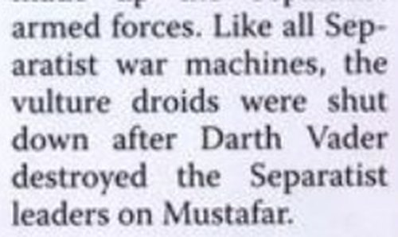
- **Padmé Amidala**: "He survived an assassination attempt on Bri'ahl when the droids R2-D2 and C-3PO disobeyed Padmé's orders and foiled the would-be killers." Source: The Complete Star Wars Encyclopedia, Vol. III, p.315
  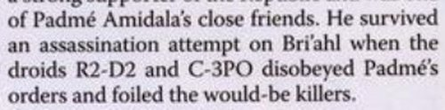

## p.316 (scan page 322)

Page contents: 0 words, 0 paragraphs | headings/entries: 

## p.317 (scan page 323)

Page contents: 781 words, 23 paragraphs | headings/entries: Wa, Orun; Wa, Stieg; WA-7; Wac, Dar; Wadda; Wagg; Waggral; Waglila, Noy; Waivers List; Wake, Russell; Walalla

- **Han Solo; Chewbacca**: "When Han Solo and Chewbacca were able to turn the tables on Zlarb, Wadda was one of the handful of slavers who were themselves enslaved after Solo turned them over to a group of Lurrian geneticists." Source: The Complete Star Wars Encyclopedia, Vol. III, p.317
  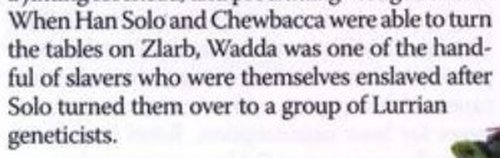
- **Darth Vader (Anakin Skywalker)**: "Darth Vader, who had been monitoring Olin's movements, later confronted Wake and used the Force to choke the life out of him." Source: The Complete Star Wars Encyclopedia, Vol. III, p.317
  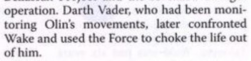

## p.318 (scan page 324)

Page contents: 896 words, 23 paragraphs | headings/entries: Wald; Waleran; Waler'v; Walker; Wallen; Wanderhome; Wann, Roland; Wannschok

## p.319 (scan page 325)

Page contents: 1117 words, 49 paragraphs | headings/entries: Wann Tsir; Wanuri; Waoabi, Ooamu; Warb; War Council Advisory Panel; Ward, Liats; Warden Squadron; Warder; Warlug; Warhawk; Warlin; Warlord; Warok

## p.320 (scan page 326)

Page contents: 1240 words, 31 paragraphs | headings/entries: Waroot; Warren, Barosa; Warrick, Deej; Warrick, Erpham; Warrick, Shodu; Warrick, Weechee; Warrick, Wicket W.; Warrick, Winda; Warrior

## p.321 (scan page 327)

Page contents: 1003 words, 31 paragraphs | headings/entries: Wartaki Islands; Warthan's Wizards; Warto; Wartogg; Warton; Waru; Wass; Wasteland, the; WatchCircle; Watchkeeper

## p.322 (scan page 328)

Page contents: 835 words, 19 paragraphs | headings/entries: Watto Water Moon; Watto; Watts, Lieutenant; Wavechaser; Waverton; Wawaatt Archipelago; Way, the; Wayland

## p.323 (scan page 329)

Page contents: 1155 words, 27 paragraphs | headings/entries: Waz, Izal; WBD; We, Taun; Weasy; Weazel; Web, Robior; Webb, Jeroen; Webbie, Iilyan; Wedd, Baron Edi

- **Lando Calrissian; Chewbacca**: "The cloning complex and most of the mountain were destroyed when Lando Calrissian and Chewbacca sabotaged the central equipment column." Source: The Complete Star Wars Encyclopedia, Vol. III, p.323
  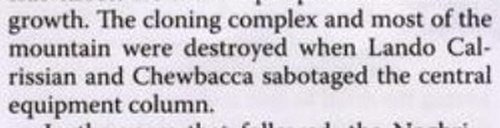
- **Jango Fett**: "Although Kamino was devastated during the Clone Wars, Taun We survived, along with a portion of the genetic material harvested from Jango Fett." Source: The Complete Star Wars Encyclopedia, Vol. III, p.323
  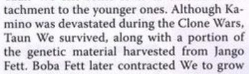

## p.324 (scan page 330)

Page contents: 800 words, 22 paragraphs | headings/entries: WED-15-17; Weebacca; WeeGee; Weequay

- **Kyle Katarn; Jerec**: "After Kyle defeated Jerec and returned to the New Republic, he took WeeGee with him, and the droid gladly accepted a position on a naval maintenance team." Source: The Complete Star Wars Encyclopedia, Vol. III, p.324
  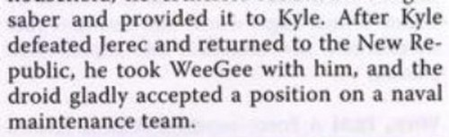

## p.325 (scan page 331)

Page contents: 1305 words, 30 paragraphs | headings/entries: Weerden; Weez; Wehttam; Wehutti; Weir, General; Wel, Tsillin; Welflet, Nog; Welk; Well, the; Welmo Darb; Wena; Wenbus, Gustab; Wen-Chii, Anno

- **Plo Koon**: "During the Yuuzhan Vong War, Welk and Lomi Plo were captured by the invaders and held aboard the worldship Baanu Rass, Both agreed to help a Jedi strike team infiltrate the worldship and destroy the voxyn and their queen, but later abandoned the Jedi in order to save themselves." Source: The Complete Star Wars Encyclopedia, Vol. III, p.325
  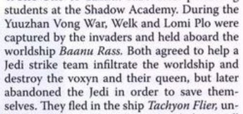
- **Plo Koon**: "Welk and Lomi Plo barely survived." Source: The Complete Star Wars Encyclopedia, Vol. III, p.325
  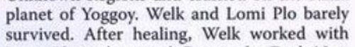

## p.326 (scan page 332)

Page contents: 1010 words, 20 paragraphs | headings/entries: Wend; Wendik, Lieutenant Arven; Weng, Mayli; Wennen, Besany; Werl, Admiral Apelben; Wermis, Captain Muichive; Wermyn; Wesell, Zam

- **Rokur Gepta**: "Gepta had built a small windowless chamber near the ship's drive tubes with 2-meter-thick walls to contain the bioweapon that he had used to destroy the planet Tund." Source: The Complete Star Wars Encyclopedia, Vol. III, p.326
  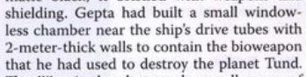
- **Leia Organa Solo**: "Captain Wermis commanded the Star Destroyer Devastator when it captured Princess Leia Organa and the Tantive [V just prior to the Battle of Yavin." Source: The Complete Star Wars Encyclopedia, Vol. III, p.326
  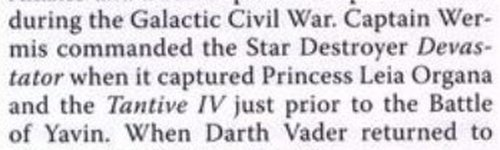
- **Darth Vader (Anakin Skywalker)**: "When Darth Vader returned to the Emperor's side, Captain Wermis was assigned to the first task force assembled to track down the Rebels who had destroyed the Death Star." Source: The Complete Star Wars Encyclopedia, Vol. III, p.326
  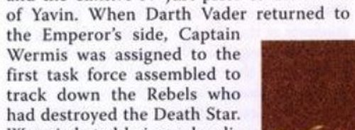
- **Jango Fett**: "Zam Wesell was also a rival of Jango Fett, as the two were generally considered the best bounty hunters of their generation." Source: The Complete Star Wars Encyclopedia, Vol. III, p.326
  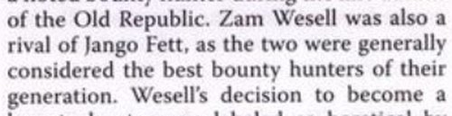

## p.327 (scan page 333)

Page contents: 935 words, 24 paragraphs | headings/entries: Wessel, General Redd; Wessel, Governor Marcellin; Wessex, Lira; Wessiri, Diric; Wessiri, fella; Westermal, Moff Kosimo; Western Dune Sea; Wezz, Sia-Lan; Whaladon; Whari; Wheel, the

- **Hero of Tython; Jango Fett**: "Wesell escaped to the Outlander Club, but Jango refused to have his plans compromised and killed Wesell with a poison dart as the Jedi were about to capture her." Source: The Complete Star Wars Encyclopedia, Vol. III, p.327
  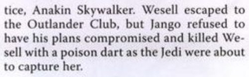
- **Carnor Jax; Palpatine (Darth Sidious)**: "Opportunity struck when Wessel conspired with Carnor Jax and the Emperor's physician to destroy Palpatine's clones and rule the Empire." Source: The Complete Star Wars Encyclopedia, Vol. III, p.327
  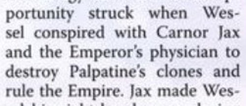
- **Kir Kanos; Jax Pavan**: "General Wessel made a fatal mistake by bringing Kir Kanos's bomb-rigged ship aboard Jax's Star Destroyer Emperor's Revenge. \t exploded and killed everyone on board." Source: The Complete Star Wars Encyclopedia, Vol. III, p.327
  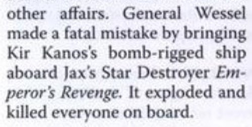
- **Darth Vader (Anakin Skywalker)**: "She was killed by Darth Vader on Kessel." Source: The Complete Star Wars Encyclopedia, Vol. III, p.327
  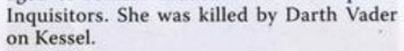

## p.328 (scan page 334)

Page contents: 902 words, 20 paragraphs | headings/entries: Whelm; Whett, Osuno; Whills; Whip Hand; Whirlwind; Whistier's Whirlpool; White Eyes; White Room

- **Lando Calrissian**: "Before that caper, which involved Lando Calrissian, could be completed, Whett and his ship were destroyed." Source: The Complete Star Wars Encyclopedia, Vol. III, p.328
  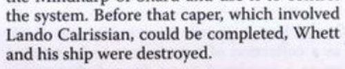

## p.329 (scan page 335)

Page contents: 1083 words, 38 paragraphs | headings/entries: Whitesun, Beru; White Thranta; White Watch; White Witch; Whyren's Reserve; Wialu; Wiamdi, Vviir; Widowmaker

- **Quinlan Vos**: "Vos defeated it by allowing himself to be swallowed whole." Source: The Complete Star Wars Encyclopedia, Vol. III, p.329
  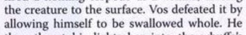

## p.330 (scan page 336)

Page contents: 1012 words, 22 paragraphs | headings/entries: Wild Knights; Wild Space; Wiley; Wilkadon; Will, the; Willard, Commander Vanden; Willems, Rorf; Williams, Antidar; Wilum, Oss; Wimateeka; Windsloe, Barthalemew; Windu, Mace

- **Master Thon**: "But Thon, with help, defeated the beasts, captured Wilum, and brought him out of his Sith spell." Source: The Complete Star Wars Encyclopedia, Vol. III, p.330
  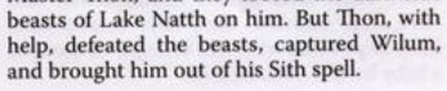

## p.331 (scan page 337)

Page contents: 999 words, 20 paragraphs | headings/entries: Windy; Winger, Alexandra; Winning Gamble; Winning Hand; Winter; Winward, Riij; Wioslea

- **Mace Windu** — entry/section: Windu, Mace: "A popular story among the Padawans told of Windu single-handedly capturing a team of Gank Killers without ever igniting his lightsaber." Source: The Complete Star Wars Encyclopedia, Vol. III, p.331
  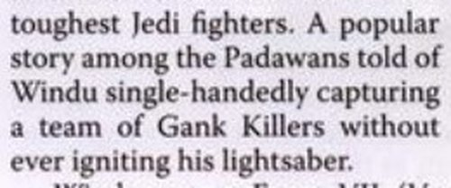
- **Mace Windu** — entry/section: Windu, Mace: "He took as his Padawan learner the Chalactan child Depa Billaba, after he rescued her from space pirates who had killed her parents." Source: The Complete Star Wars Encyclopedia, Vol. III, p.331
  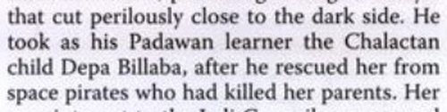
- **Mace Windu** — entry/section: Windu, Mace: "Windu decapitated Fett during the fighting but was overpowered by the droid soldiers." Source: The Complete Star Wars Encyclopedia, Vol. III, p.331
  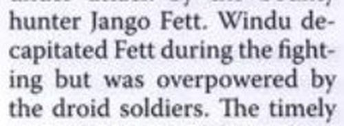
- **Mace Windu; Palpatine (Darth Sidious)** — entry/section: Windu, Mace: "Palpatine killed Master Windu's companions and battled the Jedi Master, who soon gained the upper hand." Source: The Complete Star Wars Encyclopedia, Vol. III, p.331
  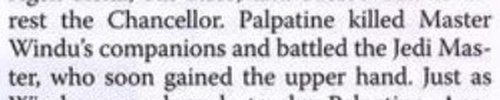
- **Mace Windu; Palpatine (Darth Sidious)** — entry/section: Windu, Mace: "This gave Palpatine the opportunity to blast Windu with Force lightning, sending him out a window to his death." Source: The Complete Star Wars Encyclopedia, Vol. III, p.331
  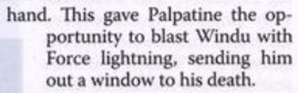

## p.332 (scan page 338)

Page contents: 905 words, 21 paragraphs | headings/entries: Wirut; Wister; Wistie; Wittin; Wodrata, Rogwa; Wokling; Wol Cabasshite; Wolf Clan; Wolfman

- **Mara Jade Skywalker; Luke Skywalker**: "When confronted, Mara Jade quickly cut down two wolvkils while Luke Skywalker used the Force to cause others to fall asleep." Source: The Complete Star Wars Encyclopedia, Vol. III, p.332
  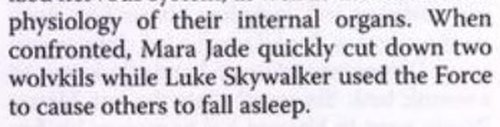

## p.333 (scan page 339)

Page contents: 842 words, 21 paragraphs | headings/entries: Womrik; Wonetun; Wookiee; Wookiee-wango

## p.334 (scan page 340)

Page contents: 1000 words, 37 paragraphs | headings/entries: Wooof; Woostoid; Works, The; World Brain

- **Alema Rar; Jacen Solo (Darth Caedus)**: "The World Brain was killed when Alema Rar tried to murder Jacen by firing a poisoned dart at him." Source: The Complete Star Wars Encyclopedia, Vol. III, p.334
  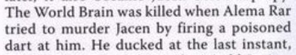
- **Palpatine (Darth Sidious)**: "The key to the defeat of the monstrous machines was Palpatine's fear that the weapons could be turned against him." Source: The Complete Star Wars Encyclopedia, Vol. III, p.334
  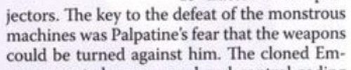
- **Luke Skywalker**: "The New Republic was saved when Luke Skywalker provided the code to R2-D2, who shut down the World Devastators on Mon Calamari, allowing New Republic forces to destroy the helpless planet smashers." Source: The Complete Star Wars Encyclopedia, Vol. III, p.334
  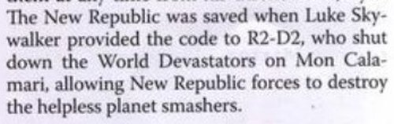

## p.335 (scan page 341)

Page contents: 942 words, 19 paragraphs | headings/entries: Worlohp, Captain; Wormie; Worr, Eshin; Worror, Master; Wor Tandell; Worxer; Wotan Weave; Woteba; Wraith Squadron; Wraw

- **Darth Zannah**: "While the others faced Bane and his apprentice, Zannah, Master Worror stayed in the shadows, using battle meditation to coordinate their attacks." Source: The Complete Star Wars Encyclopedia, Vol. III, p.335
  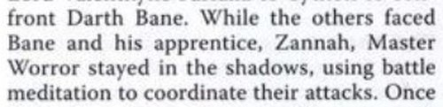
- **Cilghal**: "Cilghal and other Jedi healers learned that the Fizz was a sophisticated nanotechnology aimed at destroying anything that wasn't native to Woteba." Source: The Complete Star Wars Encyclopedia, Vol. III, p.335
  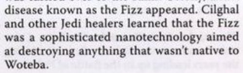

## p.336 (scan page 342)

Page contents: 1042 words, 24 paragraphs | headings/entries: Wrea; Wrench; Wrils; Wroona; Wroshyr; Wuher; Wuht, Admiral Darez; Wuitho Trifalls; Wukkar; Wuluw; Wunka; Wurf'al; Wwebyls; Wxtm

- **Admiral Ackbar**: "During the blockade of the Murgo Choke, Captain Wurf'al served under Admiral Bwua'tu aboard the Admiral Ackbar." Source: The Complete Star Wars Encyclopedia, Vol. III, p.336
  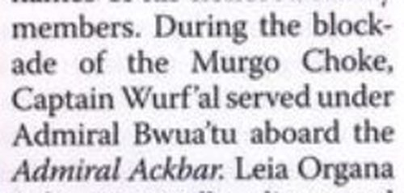
- **Leia Organa Solo**: "Leia Organa Solo eventually discovered that the admiral's spinglass statuary contained assassin bugs from the Gorog hive; Wurf'al was the first officer killed by the swarm." Source: The Complete Star Wars Encyclopedia, Vol. III, p.336
  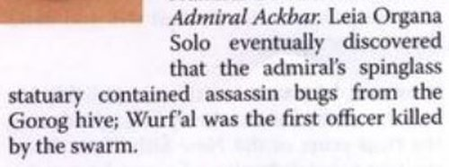

## p.337 (scan page 343)

Page contents: 628 words, 15 paragraphs | headings/entries: Wyn, Aubrie; Wynl, Senator; Wynn, Uthar; Wynni; Wyrian; Wyvern; Wyyrlok, Darth

- **Obi-Wan Kenobi**: "Her Master, Sirrus, was killed in a blast that also appeared to take the life of Obi-Wan Kenobi, and Wyn joined with the other orphaned Padawans on Jabiim for survival." Source: The Complete Star Wars Encyclopedia, Vol. III, p.337
  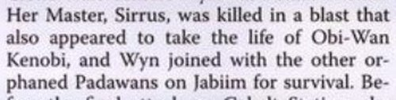
- **Yuthura Ban**: "Wynn and Yuthura attacked the Jedi, but both were defeated in combat." Source: The Complete Star Wars Encyclopedia, Vol. III, p.337
  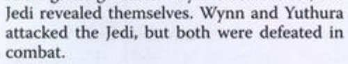
- **Darth Wyyrlok III; Darth Krayt** — entry/section: Wyyrlok, Darth: "Wyyrlok's knowledge of Sith lore, rituals, and history was rivaled only by that of Krayt himself." Source: The Complete Star Wars Encyclopedia, Vol. III, p.337
  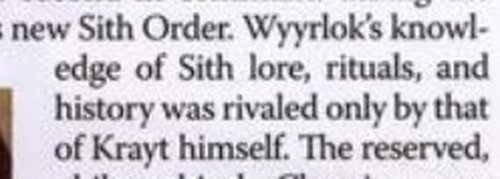

## p.338 (scan page 344)

Page contents: 0 words, 0 paragraphs | headings/entries: 

## p.339 (scan page 345)

Page contents: 630 words, 17 paragraphs | headings/entries: X0O-XI; X-10-D; X14; X-1 Viper Automadon; X-222; X-23 StarWorker; X-83 TwinTail

## p.340 (scan page 346)

Page contents: 1149 words, 39 paragraphs | headings/entries: Xaczik; Xagobah; Xaj, Sarro; Xakrea; Xal 3; Xam, Selif; Xamar; Xamster; Xamus/Sumax; Xan; Xan, Hena

- **Grand Admiral Thrawn**: "Xa Fel Located in the heart of the Kanchen sector, this planet surrendered to Admiral Thrawn's military after New Republic forces were defeated in a 30-hour battle." Source: The Complete Star Wars Encyclopedia, Vol. III, p.340
  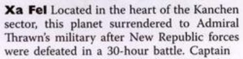
- **Qui-Gon Jinn**: "Xanatos was born into wealth; his father, Crion, was one of the most powerful men on Telos, Qui-Gon Jinn requested that Xanatos return with him to Coruscant for Jedi instruction." Source: The Complete Star Wars Encyclopedia, Vol. III, p.340
  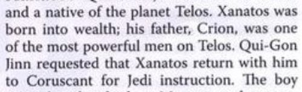
- **Qui-Gon Jinn**: "Ultimately Qui-Gon killed Crion to end the planet's war." Source: The Complete Star Wars Encyclopedia, Vol. III, p.340
  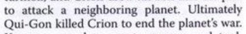

## p.341 (scan page 347)

Page contents: 1121 words, 29 paragraphs | headings/entries: Marga; Xarran, Gaege; Xartun; Xarxis; Xaverri; X-C 2; XCiter; Xelbree; Xelric Draw; Xendor; Xer Vill; Xeran; Xern; Xeron; Xexto

## p.342 (scan page 348)

Page contents: 1122 words, 20 paragraphs | headings/entries: Xhaxin, Captain Urias; Xi Charrian; Xi'Dee; Xiss, Zule; Xist; Xizor, Prince

- **Obi-Wan Kenobi; Count Dooku**: "But Kenobi later discovered that Xist had lied and set him up to be killed as part of an elaborate plot by Count Dooku." Source: The Complete Star Wars Encyclopedia, Vol. III, p.342
  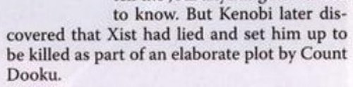
- **Prince Xizor** — entry/section: Xizor, Prince: "Prince Xizor was also highly political and was probably the third most powerful individual in the galaxy." Source: The Complete Star Wars Encyclopedia, Vol. III, p.342
  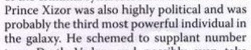

## p.343 (scan page 349)

Page contents: 1053 words, 20 paragraphs | headings/entries: Xo; Xong, Zorbazat; Xora; XoXaan

- **Prince Xizor; Darth Vader (Anakin Skywalker)** — entry/section: Xizor, Prince: "An accident let a tissue-destroying bacterium escape, so Vader ordered the city near the lab burned to ashes, killing 200,000 Falleen including Xizor's entire family." Source: The Complete Star Wars Encyclopedia, Vol. III, p.343
  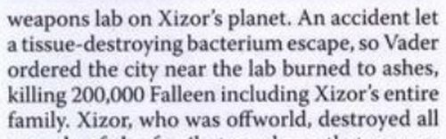
- **Prince Xizor; Darth Vader (Anakin Skywalker)** — entry/section: Xizor, Prince: "Xizor, who was offworld, destroyed all records of the family tragedy so that no one would know of his personal reasons for despising Vader and his pledge to avenge the deaths." Source: The Complete Star Wars Encyclopedia, Vol. III, p.343
  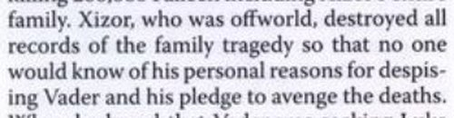
- **Darth Vader (Anakin Skywalker); Luke Skywalker**: "When he heard that Vader was seeking Luke Skywalker to convert him to the dark side of the Force—and that young Skywalker was Vader's son—he plotted to have Luke killed and Vader's plans thwarted." Source: The Complete Star Wars Encyclopedia, Vol. III, p.343
  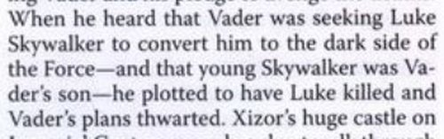
- **XoXaan** — entry/section: XoXaan: "Hett killed the bounty hunter, but the act awakened the spirit of XoXaan." Source: The Complete Star Wars Encyclopedia, Vol. III, p.343
  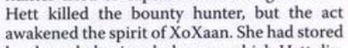

## p.344 (scan page 350)

Page contents: 1268 words, 31 paragraphs | headings/entries: XR-85; New Republic.; Xris, Sordaan; XT-6; Xtib; X-TIE; XTS; Xucphra; Xucphra Alazhi; Xucphra Meander; Xucphra Rose; Xulropic Badlands

- **Darth Krayt**: "When Hett opened himself up to her teachings, he absorbed her knowledge and eventually became Darth Krayt." Source: The Complete Star Wars Encyclopedia, Vol. III, p.344
  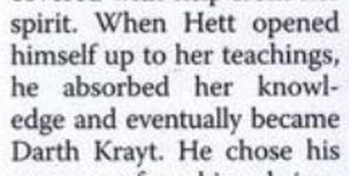

## p.345 (scan page 351)

Page contents: 1181 words, 21 paragraphs | headings/entries: Xuz, Cevva; Xyn, Torvin; Xyquine

- **Sun Crusher (superweapon)**: "Her most powerful superweapon was the Sun Crusher, an indestructible ship that carried resonance torpedoes with enough firepower to snuff out a star." Source: The Complete Star Wars Encyclopedia, Vol. III, p.345
  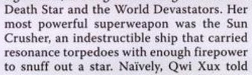
- **Luke Skywalker**: "In the hands of Luke Skywalker, two of those torpedoes were enough to set off a chain-reaction explosion that destroyed the Death Star." Source: The Complete Star Wars Encyclopedia, Vol. III, p.345
  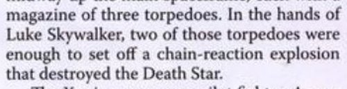

## p.346 (scan page 352)

Page contents: 0 words, 0 paragraphs | headings/entries: 

## p.347 (scan page 353)

Page contents: 813 words, 17 paragraphs | headings/entries: Yablari; Yaddle; Yaddle Yaga Minor; Yag'Dhul

## p.348 (scan page 354)

Page contents: 1201 words, 31 paragraphs | headings/entries: Yage, Commander Arien; Yage, Moff Rulf; Yaght, Duman; Yahk-Tosh; Yaka; Yakez; Yak Face; Yald; Yainal, Nevar; Yalu, Viith

## p.349 (scan page 355)

Page contents: 1164 words, 23 paragraphs | headings/entries: Yam'rii; Yané; Yanee; Yang, Kar; Yanibar; Yant, Zan; Yao; Yar, Senator Tolik; Yarar, Brimon; Yarkora; Yarrow, Eve

## p.350 (scan page 356)

Page contents: 1117 words, 17 paragraphs | headings/entries: Yarua, Senator; Yas'tua; Yavaris; Yavid, General; Yavin; Yavin 13; Yavin 4

- **Admiral Daala**: "One year later, following an intense battle at Yavin 4, Admiral Daala's Super Star Destroyer Knight Hammer plunged into Yavin's atmosphere and was destroyed." Source: The Complete Star Wars Encyclopedia, Vol. III, p.350
  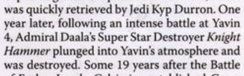

## p.351 (scan page 357)

Page contents: 1275 words, 19 paragraphs | headings/entries: Yavin 8

- **Exar Kun**: "When the Dark Jedi Exar Kun arrived on Yavin 4, he enslaved the Massassi and forced them to construct new temples as focal points for Sith power." Source: The Complete Star Wars Encyclopedia, Vol. III, p.351
  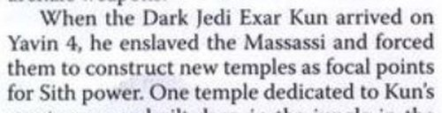
- **Exar Kun**: "Before his defeat, Exar Kun had trapped the children of the Massassi within a strange golden globe, and several desperate Massassi traveled to Yavin 8 to seek assistance from the Melodie people." Source: The Complete Star Wars Encyclopedia, Vol. III, p.351
  
- **Luke Skywalker**: "In the Battle of Yavin, Luke Skywalker destroyed the battle station as it attempted to shatter Yavin 4 with its superlaser." Source: The Complete Star Wars Encyclopedia, Vol. III, p.351
  
- **Admiral Daala**: "After a long, destructive battle, Daala's forces were defeated and her Super Star Destroyer Knight Hammer was demolished." Source: The Complete Star Wars Encyclopedia, Vol. III, p.351
  
- **Anakin Solo**: "After the rescue of Anakin Solo, the shaper base was destroyed by bombardment from Talon Karrde's fleet." Source: The Complete Star Wars Encyclopedia, Vol. III, p.351
  

## p.352 (scan page 358)

Page contents: 1059 words, 21 paragraphs | headings/entries: Yavin, Battle of; Yavin Vassilika

## p.353 (scan page 359)

Page contents: 924 words, 24 paragraphs | headings/entries: Yehthytonian; Yeb, Solipo; Yedan, Gade; Yeesrim, Baskol; Yemm; Yemm, Yarbolk; Yevethan Protectorate; Yevra; Yfra, Ambassador; Ygziir; Yibikkoror

- **Sirak**: "When Sirak was defeated in the lightsaber training ring by Bane, he plotted revenge with Llokay and Yevra's help." Source: The Complete Star Wars Encyclopedia, Vol. III, p.353
  

## p.354 (scan page 360)

Page contents: 975 words, 21 paragraphs | headings/entries: Yim, Ahsi; Yim, Nen; Yinchorri; Ying, Valius; Yintal, Dr.; Yith, Limna; Yitheeth

