# Owner Material 032 — The Complete Star Wars Encyclopedia, Vol. III (P–Z): scan pages 361–385

- **Source:** *The Complete Star Wars Encyclopedia* by Stephen J. Sansweet and Pablo Hidalgo, with Bob Vitas, Daniel Wallace, Chris Cassidy, Mary Franklin and Josh Kushins (Del Rey, 2008), 3 vols. Secondary source (licensed Legends reference). Scan OCR'd on the box; the scan stays box-only and is **not** published.
- **Method:** every scanned page was OCR'd and machine-screened sentence by sentence for power-relevant statements (fights, kills, defeats, Force feats, rankings, superweapons) that name a character on our roster; each kept sentence is quoted verbatim from the OCR text and has a crop of the printed passage directly under it. Pages with nothing power-relevant are still listed with what is on them.
- **Citation:** "The Complete Star Wars Encyclopedia, Vol. III, p.X" by printed page ("scan p.X" where no printed number applies). **Weight:** Lucasfilm-licensed encyclopedia: a secondary, in-universe summary of Legends (and some film) material. It sums up feats from novels, comics and games; where the original story is in our notes, that source is the stronger citation.

## p.355 (scan page 361)

Page contents: 1037 words, 20 paragraphs | headings/entries: Yittreas, Moff; Yiesia; Ylix; Yn; Ynr, Rhysati; Yoda, Master

- **Yoda** — entry/section: Yoda, Master: "One of these dark siders had gotten as far as Dagobah, were Yoda bested him in direct confrontation." Source: The Complete Star Wars Encyclopedia, Vol. III, p.355
  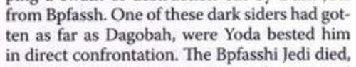

## p.356 (scan page 362)

Page contents: 1227 words, 17 paragraphs | headings/entries: 

- **Yoda** — entry/section: Yoda, Master: "Many of the Republic's greatest Jedi trained under Yoda when they were children, schooled in groupings called clans." Source: The Complete Star Wars Encyclopedia, Vol. III, p.356
  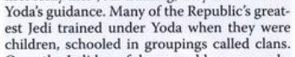
- **Palpatine (Darth Sidious)**: "Supreme Chancellor Palpatine, newly granted emergency powers, took possession of the clone army and ordered the Jedi into action." Source: The Complete Star Wars Encyclopedia, Vol. III, p.356
  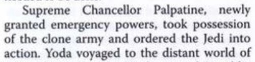
- **Yoda** — entry/section: Yoda, Master: "Yoda oversaw the battle from the forward command center, The clones handily defeated the Separatists on Geonosis, but many escaped." Source: The Complete Star Wars Encyclopedia, Vol. III, p.356
  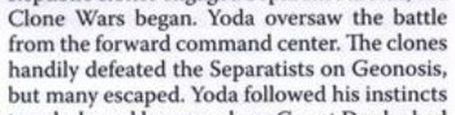
- **Count Dooku**: "First their powers in the Force were put to the test as Dooku attempted to crush the tiny Jedi Master with hurled debris." Source: The Complete Star Wars Encyclopedia, Vol. III, p.356
  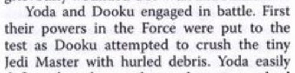
- **Yoda; Count Dooku** — entry/section: Yoda, Master: "Yoda easily deflected such assaults, and even repulsed Dooku's Force lightning attacks." Source: The Complete Star Wars Encyclopedia, Vol. III, p.356
  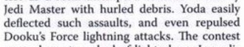
- **Yoda; Qui-Gon Jinn** — entry/section: Yoda, Master: "While meditating, Yoda had felt a traumatic event befall young Skywalker, At that very moment, he also heard the voice of Qui-Gon Jinn, a Jedi Master slain a decade before." Source: The Complete Star Wars Encyclopedia, Vol. III, p.356
  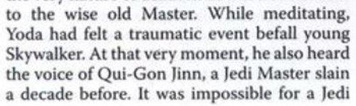
- **Yoda** — entry/section: Yoda, Master: "Although Yoda held his own for much of the duel, in the end the Sith bested him." Source: The Complete Star Wars Encyclopedia, Vol. III, p.356
  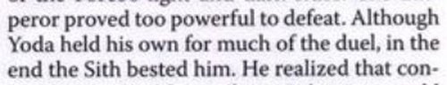

## p.357 (scan page 363)

Page contents: 974 words, 13 paragraphs | headings/entries: Yo'gand's Core; Yoggoy; Yomaget, Jir

- **Yoda; Palpatine (Darth Sidious)** — entry/section: Yoda, Master: "Yoda duels Emperor Palpatine in the Galactic Senate Chamber." Source: The Complete Star Wars Encyclopedia, Vol. III, p.357
  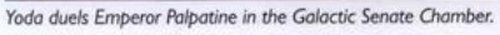
- **Luke Skywalker**: "Telekinetic challenges, challenges of the will and body, more challenges than Luke had ever faced before helped to mold the reckless youth into a Jedi." Source: The Complete Star Wars Encyclopedia, Vol. III, p.357
  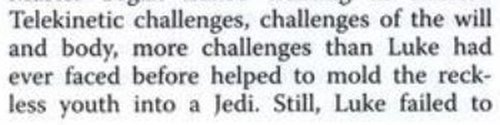
- **Yoda** — entry/section: Yoda, Master: "He was proven wrong when Yoda telekinetically lifted the X-wing fighter and placed it on dry land." Source: The Complete Star Wars Encyclopedia, Vol. III, p.357
  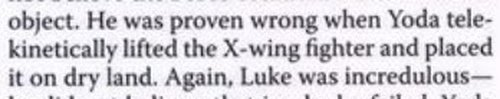

## p.358 (scan page 364)

Page contents: 1113 words, 26 paragraphs | headings/entries: Yomm, Nilz; Yonka, Captain Sair; Yorn Skot; Yorta, Raal; Young, the; Youst

- **Obi-Wan Kenobi**: "With the help of Obi-Wan Kenobi, the Young eventually defeated the elders of Daan and Melida." Source: The Complete Star Wars Encyclopedia, Vol. III, p.358
  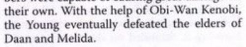

## p.359 (scan page 365)

Page contents: 1070 words, 18 paragraphs | headings/entries: Yowza, Joh; Ysanna, Jem; Ysanna, Rayf; Yso, Uso; YT-1300

- **Grand Admiral Thrawn**: "Grand Admiral Thrawn's plans to destroy the New Republic included the use of the docile ysalamiri." Source: The Complete Star Wars Encyclopedia, Vol. III, p.359
  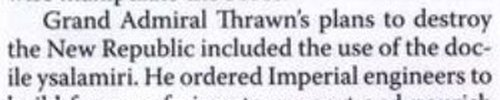

## p.360 (scan page 366)

Page contents: 1116 words, 26 paragraphs | headings/entries: YT-2400; YT-5100; Y-TIE; Yuga 2; Yugi; Yuls, Dellis; Yumfila; Yun; Yun-Harla; Yun-Lingni; Yun-Ne'Shel

- **Yun (Dark Jedi)** — entry/section: Yun: "Angry at being rebuffed, Yun killed his father to "earn" her love." Source: The Complete Star Wars Encyclopedia, Vol. III, p.360
  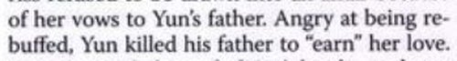
- **Yun (Dark Jedi); Kyle Katarn** — entry/section: Yun: "Later, during the search for the Valley of the Jedi, Yun attempted to kill Kyle Katarn at Baron's Hed, but was defeated." Source: The Complete Star Wars Encyclopedia, Vol. III, p.360
  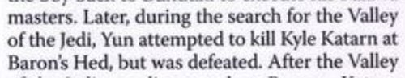
- **Yun (Dark Jedi); Sariss; Kyle Katarn** — entry/section: Yun: "Yun stepped in to prevent Sariss from killing Katarn, but she showed no such mercy and killed Yun." Source: The Complete Star Wars Encyclopedia, Vol. III, p.360
  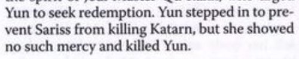

## p.361 (scan page 367)

Page contents: 1132 words, 19 paragraphs | headings/entries: Yun-Q'aah; Yun-Shuno; Yun-Txiin; Yun-Yammka; Yun-Yuuzhan; Yusanis; Yu'shaa; Yuun; Yuuzhan'tar; Yuuzhan Vong

- **Revan**: "Later, when Yusanis discovered that an Echani Senator had been killed by Darth Revan, he set out to confront the Sith Lord and bring him to justice." Source: The Complete Star Wars Encyclopedia, Vol. III, p.361
  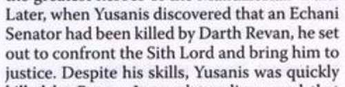
- **Revan**: "Despite his skills, Yusanis was quickly killed by Revan." Source: The Complete Star Wars Encyclopedia, Vol. III, p.361
  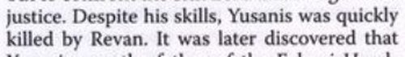

## p.362 (scan page 368)

Page contents: 1130 words, 18 paragraphs | headings/entries: Yuza Bre; Yuzzum

- **Jaina Solo**: "Tsavong Lah himself was killed in combat by Jaina Solo, and Supreme Overlord Shimrra vowed to destroy anything that got in the way of galactic conquest." Source: The Complete Star Wars Encyclopedia, Vol. III, p.362
  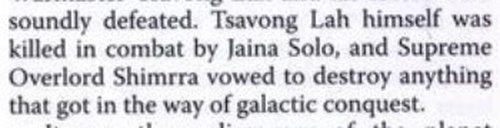
- **Onimi**: "The war came to an end at Coruscant, after Supreme Overlord Shimrra and his court jester Onimi—the true power behind the throne—were killed in battle." Source: The Complete Star Wars Encyclopedia, Vol. III, p.362
  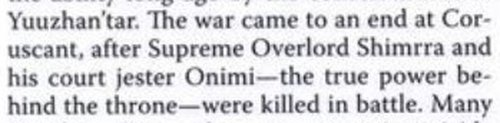

## p.363 (scan page 369)

Page contents: 876 words, 15 paragraphs | headings/entries: YVH 1-1A_

## p.364 (scan page 370)

Page contents: 0 words, 0 paragraphs | headings/entries: 

## p.365 (scan page 371)

Page contents: 550 words, 18 paragraphs | headings/entries: Z-18; Z-95 Headhunter; Za, Suprema Ampotem; Za, Prince; Zaadja

- **Mace Windu**: "During the Clone Wars, Z-18 assisted Mace Windu, who arrived at the fortress searching for Alpha-2 Squad, and Rajine was finally killed by zombies she had created." Source: The Complete Star Wars Encyclopedia, Vol. III, p.365
  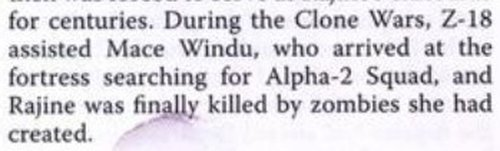

## p.366 (scan page 372)

Page contents: 929 words, 19 paragraphs | headings/entries: Zaalbar; Zaarin, Grand Admiral Demetrius; Zabin, Queen; Zabrak; Zac; Zaddja; Zaga, Gorto

- **Palpatine (Darth Sidious)**: "Zaarin outraced Imperial pursuit in his Star Destroyer Glory and reached Coruscant, but was unable to capture Palpatine's shuttle despite the assistance of Emperor's Hand Arden Lyn." Source: The Complete Star Wars Encyclopedia, Vol. III, p.366
  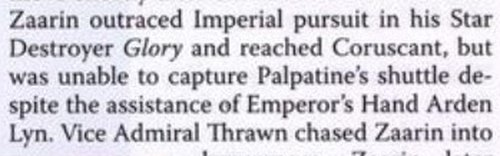

## p.367 (scan page 373)

Page contents: 1009 words, 19 paragraphs | headings/entries: Zak, Noro; Zalem; Zalk't; Zaloriis; Zaltin; Zanales, Scorch; Zanibar; Zann, Tyber

- **Quinlan Vos**: "He was killed during a battle involving Jedi Quinlan Vos and the vampiric Anzati." Source: The Complete Star Wars Encyclopedia, Vol. III, p.367
  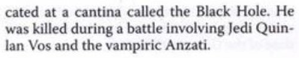

## p.368 (scan page 374)

Page contents: 1084 words, 17 paragraphs | headings/entries: Zannah, Darth; Zao, Master; Zar, Fang; Zardra

- **Darth Zannah; Darth Bane; Lord Kaan** — entry/section: Zannah, Darth: "She was later discovered by Darth Bane, after Sith Lord Kaan set off a thought bomb that wiped out thousands of Sith and many Jedi." Source: The Complete Star Wars Encyclopedia, Vol. III, p.368
  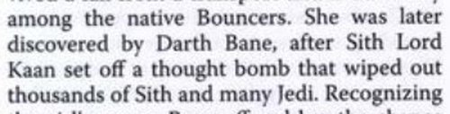
- **Darth Zannah** — entry/section: Zannah, Darth: "She was befriended by Bordon and his son, Wend, but shot and killed everyone aboard to ensure that she could take the ship to Onderon and continue her apprenticeship to Bane." Source: The Complete Star Wars Encyclopedia, Vol. III, p.368
  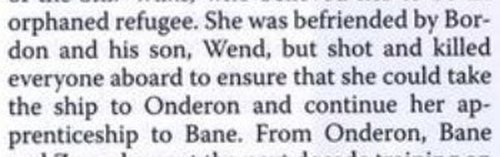
- **Darth Zannah** — entry/section: Zannah, Darth: "While Bane dealt with the Jedi Masters, Zannah killed Sarro Xaj." Source: The Complete Star Wars Encyclopedia, Vol. III, p.368
  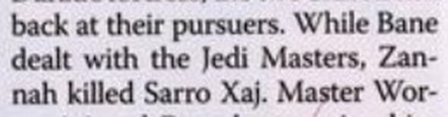
- **Darth Zannah** — entry/section: Zannah, Darth: "Master Worror injured Bane by trapping him in a bubble of Force energy that reflected Force lightning, and Zannah and Darovit returned to Ambria with Bane's damaged body." Source: The Complete Star Wars Encyclopedia, Vol. III, p.368
  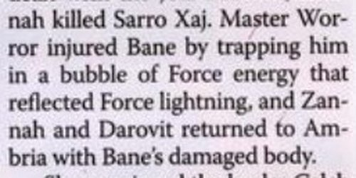
- **Darth Zannah** — entry/section: Zannah, Darth: "After he finished the task, Zannah killed him with her lightsaber and used the dark side of the Force to flood Darovit's mind with horrific visions." Source: The Complete Star Wars Encyclopedia, Vol. III, p.368
  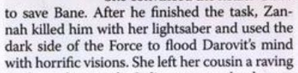
- **Darth Zannah** — entry/section: Zannah, Darth: "She left her cousin a raving madman, leaving the Jedi to assume that he was the Sith Lord who had killed Caleb." Source: The Complete Star Wars Encyclopedia, Vol. III, p.368
  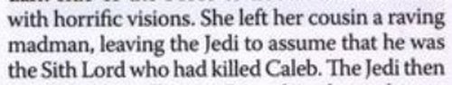
- **Darth Zannah** — entry/section: Zannah, Darth: "Zannah told Bane that she would one day surpass him, and until that point would keep him alive to learn everything she could about the dark side." Source: The Complete Star Wars Encyclopedia, Vol. III, p.368
  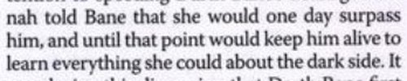

## p.369 (scan page 375)

Page contents: 1230 words, 33 paragraphs | headings/entries: Zeetsa; Zark Squadron; Zatec-Cha; Zatoq, Lyyr; Zeffliffl; Zebulon Dak Speeder Corporation; ZeHethbra; Zeebo; Zeemacht Cluster; Zeison Sha; Zekk

- **Han Solo**: "During Han Solo's escape from Ylesia, Zavval was caught under a pile of rubble from the collapsing ceiling after his repulsorsled crashed into a support column, Zavval was crushed, and a bounty was put on Solo's head for his death." Source: The Complete Star Wars Encyclopedia, Vol. III, p.369
  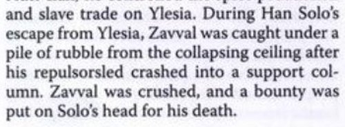

## p.370 (scan page 376)

Page contents: 1207 words, 20 paragraphs | headings/entries: Zeltros; Zellock, Kleb; Zend, Salla; Zelosian; Zeltron

## p.371 (scan page 377)

Page contents: 1037 words, 27 paragraphs | headings/entries: Zenex; Zenlav, General Gustav; Zephata'ru'tor; Zephee; Zerimar, Ram; Zexx; Zey, General Arligan; Zhanox; Zhar; Ziering, General

- **Quinlan Vos; Aayla Secura**: "Vos intervened before she could pull the trigger, and Aayla Secura killed Zenex." Source: The Complete Star Wars Encyclopedia, Vol. III, p.371
  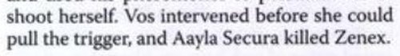
- **General Grievous**: "Zephata'ru'tor was killed during the Battle of Nadiem as General Grievous fled the planet on his Belbullab-22 fighter." Source: The Complete Star Wars Encyclopedia, Vol. III, p.371
  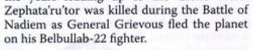

## p.372 (scan page 378)

Page contents: 982 words, 32 paragraphs | headings/entries: Zilar, Senator; Ziost; Zirtran's Anchor; Zissu, Stuart; Ziveri, Nerra; Zizimaak; Ziarb; Ziash, Mister; Ziato; Ziato's Place; Zolan; Zonama Sekot

## p.373 (scan page 379)

Page contents: 1325 words, 28 paragraphs | headings/entries: Zonder; Zoomer; Zora; Zorba Express; Zorbia Wt; Zorp House; Zqar, Romm; Zrati, Master; Zsing, Thak Val; Zsinj, Warlord

- **Darth Vader (Anakin Skywalker)**: "Vader killed Zonder, and Lo'gaan and Ekria later recovered his body for burial on Selonia." Source: The Complete Star Wars Encyclopedia, Vol. III, p.373
  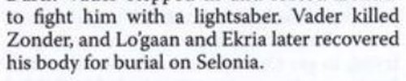

## p.374 (scan page 380)

Page contents: 1068 words, 23 paragraphs | headings/entries: Z'trop; Zuckuss; Zug, Myk'chur Finux; Zuggs, Commodore; Zun-qin, Kotaa; Zurros; Zut; Zutton; Zuud

- **Han Solo**: "About four years after the Battle of Endor, Han Solo led a fleet to bring down Zsinj, succeeding in destroying the Super Star Destroyer Razor's Kiss at the Kuat Drive Yards before Zsinj could take possession." Source: The Complete Star Wars Encyclopedia, Vol. III, p.374
  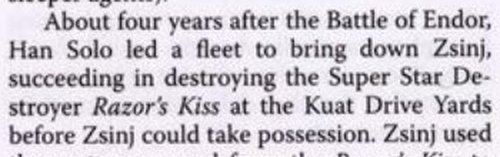
- **Han Solo**: "Zsinj was killed when Han Solo, flying the Millennium Falcon, fired concussion missiles at point-blank range into the /ron Fist's bridge." Source: The Complete Star Wars Encyclopedia, Vol. III, p.374
  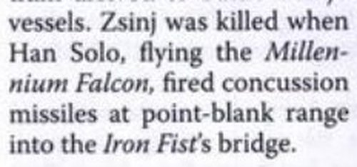
- **Count Dooku**: "Although Dooku was initially displeased, he realized that if Zurros had been killed, he would have been replaced by another Senator equally as corrupt." Source: The Complete Star Wars Encyclopedia, Vol. III, p.374
  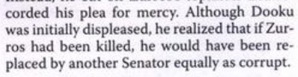

## p.375 (scan page 381)

Page contents: 805 words, 24 paragraphs | headings/entries: Zuur; Zuzz, Rorand; Z-X3; Zygerria; Zygerrian Slavers Guild; Zyggurats; Zygian's Banking Concern; Zythmor

## p.376 (scan page 382)

Page contents: 648 words, 14 paragraphs | headings/entries: 

## p.377 (scan page 383)

Page contents: 739 words, 19 paragraphs | headings/entries: 

## p.378 (scan page 384)

Page contents: 298 words, 3 paragraphs | headings/entries: 

## p.379 (scan page 385)

Page contents: 0 words, 0 paragraphs | headings/entries: 

