# Owner Material 033 — Power of the Jedi Sourcebook (d20, 2002): Chapter One: History of the Jedi

- **Source:** *Power of the Jedi Sourcebook* by JD Wiker, Michael Mikaelian, Jeff Grubb, Owen K.C. Stephens and James Maliszewski (Wizards of the Coast, 2002), for the Star Wars Roleplaying Game (d20). Secondary source (licensed Legends reference). Scan OCR'd on the box; the scan stays box-only and is **not** published.
- **Method:** every scanned page was OCR'd and machine-screened sentence by sentence for power-relevant statements (fights, kills, defeats, Force feats, rankings, superweapons) that name a character on our roster; each kept sentence is quoted verbatim from the OCR text and has a crop of the printed passage directly under it. Pages with nothing power-relevant are still listed with what is on them.
- **Citation:** "Power of the Jedi Sourcebook, p.X" by printed page ("scan p.X" where no printed number applies). **Weight:** Licensed RPG sourcebook: a secondary source. Its narrative text sums up Legends history; game statistics are rules for players, not canon power levels.

## p.5 (scan page 7)

Page contents: 1005 words, 13 paragraphs | headings/entries: Chapter One: History of the Force; Students of the Force; Guardians of Peace and Justice

## p.6 (scan page 8)

Page contents: 1101 words, 14 paragraphs | headings/entries: The Growing Shadows

- **Queen Amanoa**: "He initially sent his three apprentices to keep peace in the system, but Queen Amanoa soon overpowered them." Source: Power of the Jedi Sourcebook, p.6
  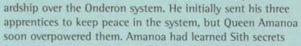
- **Arca Jeth; Queen Amanoa; Freedon Nadd**: "Master Arca traveled to Onderon to defeat Queen Amanoa personally, but he could not end Freedon Nadd's powerful influence." Source: Power of the Jedi Sourcebook, p.6
  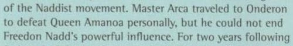
- **Queen Amanoa**: "For two years following Amanoa's defeat, a shadow sat over Onderon." Source: Power of the Jedi Sourcebook, p.6
  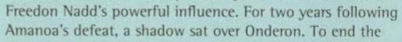

## p.7 (scan page 9)

Page contents: 1153 words, 17 paragraphs | headings/entries: The Return of the Sith

- **King Ommin**: "Their quest for knowledge had introduced them to King Ommin shortly before his defeat." Source: Power of the Jedi Sourcebook, p.7
  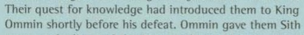
- **Arca Jeth**: "Dozens of Jedi were killed, including Master Arca Jeth." Source: Power of the Jedi Sourcebook, p.7
  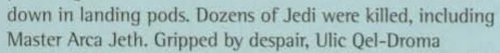
- **Ulic Qel-Droma**: "Gripped by despair, Ulic Qel-Droma executed his plan of infiltrating the darksiders to defeat them from within." Source: Power of the Jedi Sourcebook, p.7
  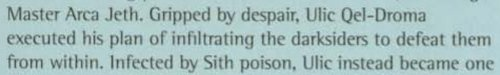
- **Qrrrl Toq; Dace Diath; Shoaneb Culu**: "In an instant, the resulting supemova incinerated many Jedi Knights, including Qrrrl Toq, Dace Diath, and Shoaneb Culu." Source: Power of the Jedi Sourcebook, p.7
  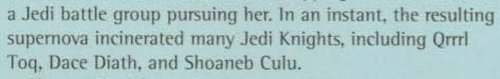
- **Nomi Sunrider; Vima-Da-Boda; Sylvar; Crado; Ulic Qel-Droma**: "While Nomi and Vima discussed her training, others arrived: the Jedi Knight Sylvar, whose mate Crado had been slain by the supernova; and Hoggon, the tramp freighter pilot who had brought Ulic to Rhen Var in the first place." Source: Power of the Jedi Sourcebook, p.7
  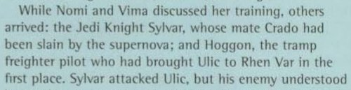

## p.8 (scan page 10)

Page contents: 1100 words, 20 paragraphs | headings/entries: The Rise of the Empire; AN; J; J I; Se a WA UI; The Rebellion and the Battle of Yavin

- **Darth Vader (Anakin Skywalker)**: "The Empire undertook a Jedi Purge, a massive campaign of genocide designed to destroy every last Jedi aside from Vader." Source: Power of the Jedi Sourcebook, p.8
  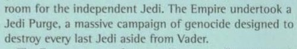

## p.9 (scan page 11)

Page contents: 1110 words, 17 paragraphs | headings/entries: A Tradition Restored

- **Obi-Wan Kenobi; Luke Skywalker; Darth Vader (Anakin Skywalker)**: "Obi-Wan began Luke's training in the ways of the Force, revealing to him that Luke's father had been a powerful Jedi killed by Darth Vader." Source: Power of the Jedi Sourcebook, p.9
  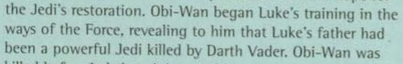
- **Obi-Wan Kenobi; Luke Skywalker**: "Obi-Wan was killed before Luke's training could cover more than the most basic lessons." Source: Power of the Jedi Sourcebook, p.9
  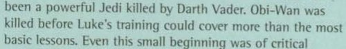
- **Darth Vader (Anakin Skywalker); Luke Skywalker**: "During the battle that followed, Vader soundly defeated Luke, severing his right hand at the wrist." Source: Power of the Jedi Sourcebook, p.9
  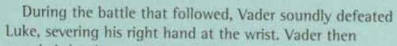
- **Luke Skywalker**: "He invited Luke to join him in defeating the Emperor and ruling the galaxy as father and son." Source: Power of the Jedi Sourcebook, p.9
  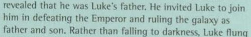
- **Luke Skywalker; Darth Vader (Anakin Skywalker)**: "Enraged, Luke drew upon his anger to overcome his father and sever Vader's hand." Source: Power of the Jedi Sourcebook, p.9
  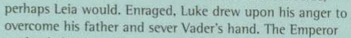
- **Luke Skywalker**: "The Emperor applauded Luke and encouraged him to destroy his father." Source: Power of the Jedi Sourcebook, p.9
  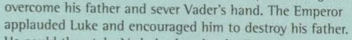
- **Darth Vader (Anakin Skywalker); Luke Skywalker**: "Witnessing Vader's severed hand, and seeing that his anger had led him to inflict that injury—just as Vader had previously injured him—Luke stepped back from the brink of destruction." Source: Power of the Jedi Sourcebook, p.9
  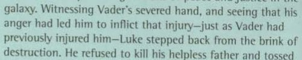
- **Luke Skywalker; Darth Vader (Anakin Skywalker)**: "Furious, the Emperor struck Luke down with bolts of Force lightning, against which Luke was defenseless, Vader, mortally injured and barely able to move, found within himself a new source of vitality." Source: Power of the Jedi Sourcebook, p.9
  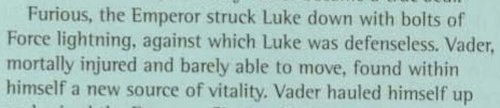

## p.10 (scan page 12)

Page contents: 1031 words, 16 paragraphs | headings/entries: A New Generation; Sve=

- **Exar Kun; Gantoris; Kyp Durron**: "The dark side spirit of Exar Kun managed to destroy Gantoris and seduce Kyp Durron, placing Master Skywalker into a coma in the process." Source: Power of the Jedi Sourcebook, p.10
  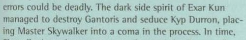
- **Admiral Daala**: "As the earliest students began to prove their worth against threats such as the Black Fleet Crisis and Admiral Daala and her Super Star Destroyer, Knight Hammer, new students petitioned Skywalker for instruction." Source: Power of the Jedi Sourcebook, p.10
  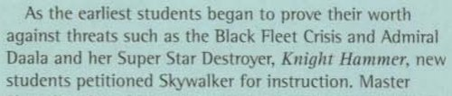
- **Darth Vader (Anakin Skywalker)**: "Anakin intended to destroy their latest sinister creation, the Jedi-hunting voxyn." Source: Power of the Jedi Sourcebook, p.10
  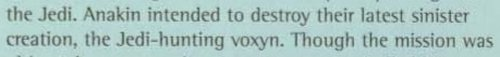
