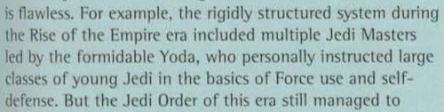
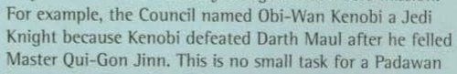
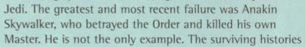

# Owner Material 033 — Power of the Jedi Sourcebook (d20, 2002): Chapter Three: Gamemastering a Jedi campaign

- **Source:** *Power of the Jedi Sourcebook* by JD Wiker, Michael Mikaelian, Jeff Grubb, Owen K.C. Stephens and James Maliszewski (Wizards of the Coast, 2002), for the Star Wars Roleplaying Game (d20). Secondary source (licensed Legends reference). Scan OCR'd on the box; the scan stays box-only and is **not** published.
- **Method:** every scanned page was OCR'd and machine-screened sentence by sentence for power-relevant statements (fights, kills, defeats, Force feats, rankings, superweapons) that name a character on our roster; each kept sentence is quoted verbatim from the OCR text and has a crop of the printed passage directly under it. Pages with nothing power-relevant are still listed with what is on them.
- **Citation:** "Power of the Jedi Sourcebook, p.X" by printed page ("scan p.X" where no printed number applies). **Weight:** Licensed RPG sourcebook: a secondary source. Its narrative text sums up Legends history; game statistics are rules for players, not canon power levels.

## p.29 (scan page 31)

Page contents: 990 words, 21 paragraphs | headings/entries: Chapter Three: Gamemastering a Jedi Campaign; Rules for Jedi Behavior

## p.30 (scan page 32)

Page contents: 834 words, 11 paragraphs | headings/entries: Self-Discipline

## p.31 (scan page 33)

Page contents: 1085 words, 27 paragraphs | headings/entries: Responsibility; LIGHTSABER SYNDROME

## p.32 (scan page 34)

Page contents: 1086 words, 15 paragraphs | headings/entries: Responsibility

## p.33 (scan page 35)

Page contents: 1127 words, 15 paragraphs | headings/entries: Public Service

## p.34 (scan page 36)

Page contents: 1116 words, 15 paragraphs | headings/entries: JEDI FUNDING ©; The Potentium Heresy

## p.35 (scan page 37)

Page contents: 1147 words, 18 paragraphs | headings/entries: Fallen Jedi; Tainted Jedi; Dark Jedi; GaN ik:

## p.36 (scan page 38)

Page contents: 1011 words, 22 paragraphs | headings/entries: Playing Jedi; The Goal of Peace; The Goal of Knowledge; The Goal of Serenity; The Unity of the Force

## p.37 (scan page 39)

Page contents: 1060 words, 23 paragraphs | headings/entries: The Internal Journey; The Challenge of Temptation; Rising from the Ashes; St an oe; Bie GME

## p.38 (scan page 40)

Page contents: 1043 words, 19 paragraphs | headings/entries: Jedi as Allies; Jedi as Opponents; Jedi Training

## p.39 (scan page 41)

Page contents: 538 words, 9 paragraphs | headings/entries: Identifying Force Sensitivity

- **Yoda**: "For example, the rigidly structured system during the Rise of the Empire era included multiple Jedi Masters Jed by the formidable Yoda, who personally instructed large classes of young Jedi in the basics of Force use and selfdefense." Source: Power of the Jedi Sourcebook, p.39
  

## p.40 (scan page 42)

Page contents: 1056 words, 14 paragraphs | headings/entries: THE CONSULAR-GUARDIAN DISTINCTION

## p.41 (scan page 43)

Page contents: 1046 words, 20 paragraphs | headings/entries: Padawan Training

## p.42 (scan page 44)

Page contents: 1078 words, 16 paragraphs | headings/entries: Adventuring as an Apprentice; The Trials of Knighthood

## p.43 (scan page 45)

Page contents: 1143 words, 14 paragraphs | headings/entries: The Jedi Trials; Pa ay wwe; Se ae; RS ERAS

- **Obi-Wan Kenobi; Darth Maul; Qui-Gon Jinn**: "For example, the Council named Obi-Wan Kenobi a Jedi Knight because Kenobi defeated Darth Maul after he felled Master Qui-Gon Jinn." Source: Power of the Jedi Sourcebook, p.43
  

## p.44 (scan page 46)

Page contents: 932 words, 32 paragraphs | headings/entries: The Mission; The Risks; The Complications; RS ae; Lightsaber Duels

## p.45 (scan page 47)

Page contents: 1070 words, 21 paragraphs | headings/entries: Life as a Jedi Master; NZS FATE

## p.46 (scan page 48)

Page contents: 532 words, 14 paragraphs | headings/entries: Jedi through the Eras; Before the Rise of the Empire Era

## p.47 (scan page 49)

Page contents: 1073 words, 14 paragraphs | headings/entries: The Rebellion Era

## p.48 (scan page 50)

Page contents: 1089 words, 20 paragraphs | headings/entries: Other Jedi, Other Eras; Running Jedi Campaigns

## p.49 (scan page 51)

Page contents: 535 words, 15 paragraphs | headings/entries: Themes of Jedi Campaigns

## p.50 (scan page 52)

Page contents: 1060 words, 25 paragraphs | headings/entries: S) =) \ ABE; Jedi as Lawgiver; Jedi as Refugee

## p.51 (scan page 53)

Page contents: 542 words, 10 paragraphs | headings/entries: Jedi as Builder

## p.52 (scan page 54)

Page contents: 1102 words, 21 paragraphs | headings/entries: Jedi as Teacher

- **Darth Vader (Anakin Skywalker)**: "The greatest and most recent failure was Anakin Skywalker, who betrayed the Order and killed his own Master." Source: Power of the Jedi Sourcebook, p.52
  

## p.53 (scan page 55)

Page contents: 607 words, 8 paragraphs | headings/entries: CHAPTER

