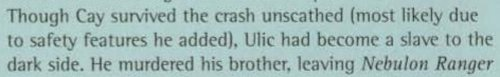

# Owner Material 033 — Power of the Jedi Sourcebook (d20, 2002): Chapter Four: Equipment (great lightsabers)

- **Source:** *Power of the Jedi Sourcebook* by JD Wiker, Michael Mikaelian, Jeff Grubb, Owen K.C. Stephens and James Maliszewski (Wizards of the Coast, 2002), for the Star Wars Roleplaying Game (d20). Secondary source (licensed Legends reference). Scan OCR'd on the box; the scan stays box-only and is **not** published.
- **Method:** every scanned page was OCR'd and machine-screened sentence by sentence for power-relevant statements (fights, kills, defeats, Force feats, rankings, superweapons) that name a character on our roster; each kept sentence is quoted verbatim from the OCR text and has a crop of the printed passage directly under it. Pages with nothing power-relevant are still listed with what is on them.
- **Citation:** "Power of the Jedi Sourcebook, p.X" by printed page ("scan p.X" where no printed number applies). **Weight:** Licensed RPG sourcebook: a secondary source. Its narrative text sums up Legends history; game statistics are rules for players, not canon power levels.

## p.54 (scan page 56)

Page contents: 528 words, 14 paragraphs | headings/entries: Chapter Four: Great Lightsaber; Weapon and Armor Descriptions

## p.55 (scan page 57)

Page contents: 831 words, 24 paragraphs | headings/entries: Dual-Phase Lightsaber; Table 4-1: Jedi Weapons; GB LIGHTSABER COLOR; Jedi Battle Armor; Table 4-2: Jedi Armor; Armor Speed; Check Penalty (10m) (6m) Weight

## p.56 (scan page 58)

Page contents: 734 words, 14 paragraphs | headings/entries: Force-Specific Equipment; Force Detector; Force Training Aids

## p.57 (scan page 59)

Page contents: 466 words, 12 paragraphs | headings/entries: Image Emitter; Training Remote (Marksman-H)

## p.58 (scan page 60)

Page contents: 787 words, 28 paragraphs | headings/entries: Vehicles and Starships; Jedi Speeder Bike; Whitecloak Fighter

## p.59 (scan page 61)

Page contents: 786 words, 22 paragraphs | headings/entries: XJ X-Wing; Incom TE5Xd X-wing; Class: Starfighter Crew: | (Skilled +4); Jedi Courier Ship; Passengers: 6 Defense: 20 (+10 armor); Hull Points: 120 (DR 10)

- **Cay Qel-Droma; Ulic Qel-Droma**: "Though Cay survived the crash unscathed (most likely due to safety features he added), Ulic had become a slave to the dark side." Source: Power of the Jedi Sourcebook, p.59
  

## p.60 (scan page 62)

Page contents: 349 words, 25 paragraphs | headings/entries: Hull Points: 140 (DR 10); Stinger; Corellian Engineering Corp S-100 Stinger-class Starfighter; Class: Starfighter Size: Fine (3.5 m long); Cargo Capacity: 10 kg Shield Points: 60; Cost: 465,000 (new), 310,000 (used); Maximum Speed in Space: Ramming (12 squares/action); Star Saber

## p.61 (scan page 63)

Page contents: 374 words, 25 paragraphs | headings/entries: Defense: 24 (+4 size, +10 armor); Shield Points: 70; Hull Points: 120 (DR 5); Passengers: None; Maneuver: +8 (+8 crew); Defense: 20 (+10 armor) Shield Points: 150

## p.62 (scan page 64)

Page contents: 855 words, 32 paragraphs | headings/entries: Equipment; Jedi Utility Belt; Jedi Credits; Weapon Archaic lightsaber; Cost 1,600; Damage Critical 2d8 20; Artifacts; Archaic Lightsaber; Jedi Holocron; Range Increment; Size Medium; Weight —Type 3 kg Energy; Group Exotic

## p.63 (scan page 65)

Page contents: 748 words, 11 paragraphs | headings/entries: 

