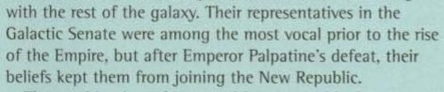
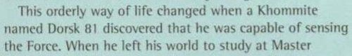
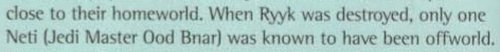

# Owner Material 033 — Power of the Jedi Sourcebook (d20, 2002): Chapter Five: Creatures, species and archetypes

- **Source:** *Power of the Jedi Sourcebook* by JD Wiker, Michael Mikaelian, Jeff Grubb, Owen K.C. Stephens and James Maliszewski (Wizards of the Coast, 2002), for the Star Wars Roleplaying Game (d20). Secondary source (licensed Legends reference). Scan OCR'd on the box; the scan stays box-only and is **not** published.
- **Method:** every scanned page was OCR'd and machine-screened sentence by sentence for power-relevant statements (fights, kills, defeats, Force feats, rankings, superweapons) that name a character on our roster; each kept sentence is quoted verbatim from the OCR text and has a crop of the printed passage directly under it. Pages with nothing power-relevant are still listed with what is on them.
- **Citation:** "Power of the Jedi Sourcebook, p.X" by printed page ("scan p.X" where no printed number applies). **Weight:** Licensed RPG sourcebook: a secondary source. Its narrative text sums up Legends history; game statistics are rules for players, not canon power levels.

## p.64 (scan page 66)

Page contents: 920 words, 28 paragraphs | headings/entries: OZ; Cy; Chapter Five: Creatures and Archetypes; Arkanian; Caamasi

- **Palpatine (Darth Sidious)**: "Their representatives in the Galactic Senate were among the most vocal prior to the rise of the Empire, but after Emperor Palpatine's defeat, their beliefs kept them from joining the New Republic." Source: Power of the Jedi Sourcebook, p.64
  

## p.65 (scan page 67)

Page contents: 884 words, 35 paragraphs | headings/entries: Table 6-1: New Species; Species Species Traits; Cathar +2 Dex, —2 Int; Claws; Vultan +2 Int, -2 Wis, -2 Cha; Cathar

## p.66 (scan page 68)

Page contents: 475 words, 12 paragraphs | headings/entries: Celegian

## p.67 (scan page 69)

Page contents: 425 words, 13 paragraphs | headings/entries: Draethos; Khommite

## p.68 (scan page 70)

Page contents: 995 words, 24 paragraphs | headings/entries: Krevaaki; Kushiban

- **Dorsk 81**: "This orderly way of life changed when a Khommite named Dorsk 81 discovered that he was capable of sensing the Force." Source: Power of the Jedi Sourcebook, p.68
  

## p.69 (scan page 71)

Page contents: 498 words, 15 paragraphs | headings/entries: Lannik; TTT

## p.70 (scan page 72)

Page contents: 502 words, 19 paragraphs | headings/entries: Miraluka

## p.71 (scan page 73)

Page contents: 481 words, 16 paragraphs | headings/entries: Nautolan; TAU =; TLE

## p.72 (scan page 74)

Page contents: 1014 words, 27 paragraphs | headings/entries: Of; Nazzar; Neti

- **Ood Bnar**: "When Ryyk was destroyed, only one Neti (Jedi Master Ood Bnar) was known to have been offworld." Source: Power of the Jedi Sourcebook, p.72
  

## p.73 (scan page 75)

Page contents: 505 words, 10 paragraphs | headings/entries: Quermian

## p.74 (scan page 76)

Page contents: 471 words, 12 paragraphs | headings/entries: Short-Range Telepathy: Quermians can communicate; Tehuukthai

## p.75 (scan page 77)

Page contents: 982 words, 27 paragraphs | headings/entries: Thisspian; Togruta

## p.76 (scan page 78)

Page contents: 507 words, 19 paragraphs | headings/entries: Equipment: Variety of; Vultan; Vultans are a technologically; Knowledge (any two) +2,; Languages: Basic,

## p.77 (scan page 79)

Page contents: 745 words, 26 paragraphs | headings/entries: Beck-tori

## p.78 (scan page 80)

Page contents: 483 words, 19 paragraphs | headings/entries: Droch; Jakobeast

## p.79 (scan page 81)

Page contents: 749 words, 19 paragraphs | headings/entries: Marsh Haunt

## p.80 (scan page 82)

Page contents: 712 words, 20 paragraphs | headings/entries: Muttamok; Nighthunter

## p.81 (scan page 83)

Page contents: 453 words, 13 paragraphs | headings/entries: Taozin

## p.82 (scan page 84)

Page contents: 407 words, 13 paragraphs | headings/entries: 

## p.83 (scan page 85)

Page contents: 768 words, 17 paragraphs | headings/entries: Force Skills: Empathy +13. The Supernatural:

## p.84 (scan page 86)

Page contents: 794 words, 18 paragraphs | headings/entries: 

## p.85 (scan page 87)

Page contents: 968 words, 37 paragraphs | headings/entries: Side Points. =:; Example; Dim -5; Faint +0; Moderate +2; Strong +5; Overwhelming +8

## p.86 (scan page 88)

Page contents: 685 words, 18 paragraphs | headings/entries: AgriCorps Worker

## p.87 (scan page 89)

Page contents: 486 words, 14 paragraphs | headings/entries: Force Skills: Enhance Ability

## p.88 (scan page 90)

Page contents: 910 words, 36 paragraphs | headings/entries: Feats: Force-Sensitive, Skill Emphasis (Empathy),; Force Spirit

## p.89 (scan page 91)

Page contents: 961 words, 35 paragraphs | headings/entries: Equipment: None,; Jedi Consular

## p.90 (scan page 92)

Page contents: 924 words, 33 paragraphs | headings/entries: 

## p.91 (scan page 93)

Page contents: 871 words, 32 paragraphs | headings/entries: Jedi Healer

## p.92 (scan page 94)

Page contents: 662 words, 30 paragraphs | headings/entries: Jedi Martial Artist

## p.93 (scan page 95)

Page contents: 950 words, 39 paragraphs | headings/entries: B= TE

## p.94 (scan page 96)

Page contents: 711 words, 28 paragraphs | headings/entries: Jedi Teacher; Por re ee ee ee ae; MedCorps Worker

## p.95 (scan page 97)

Page contents: 552 words, 19 paragraphs | headings/entries: Atk +8/+3 melee (1d3-1,

## p.96 (scan page 98)

Page contents: 912 words, 42 paragraphs | headings/entries: LH s '; TR BE; Padawan Consular; Padawan Guardian

## p.97 (scan page 99)

Page contents: 897 words, 35 paragraphs | headings/entries: Equipment: Lightsaber", Jedi robes, utility belt,; Rogue Jedi; Mid-Level Rogue Jedi: Jedi Guardian 6/Scoundrel 2;; High-Level Rogue Jedi: Jedi Guardian 9/Scoundrel 3;

