# Owner Material 033 — Power of the Jedi Sourcebook (d20, 2002): Chapter Six: Jedi traditions and famous Jedi

- **Source:** *Power of the Jedi Sourcebook* by JD Wiker, Michael Mikaelian, Jeff Grubb, Owen K.C. Stephens and James Maliszewski (Wizards of the Coast, 2002), for the Star Wars Roleplaying Game (d20). Secondary source (licensed Legends reference). Scan OCR'd on the box; the scan stays box-only and is **not** published.
- **Method:** every scanned page was OCR'd and machine-screened sentence by sentence for power-relevant statements (fights, kills, defeats, Force feats, rankings, superweapons) that name a character on our roster; each kept sentence is quoted verbatim from the OCR text and has a crop of the printed passage directly under it. Pages with nothing power-relevant are still listed with what is on them.
- **Citation:** "Power of the Jedi Sourcebook, p.X" by printed page ("scan p.X" where no printed number applies). **Weight:** Licensed RPG sourcebook: a secondary source. Its narrative text sums up Legends history; game statistics are rules for players, not canon power levels.

## p.98 (scan page 100)

Page contents: 682 words, 16 paragraphs | headings/entries: Chapter Six: Jedi Traditions; Ooroo, Martyr of Kirrek; AF; SPECIAL QUALITIES

- **Odan-Urr**: "Odan-Urr employed the littleknown art of Jedi battle meditation to resolve the conflict." Source: Power of the Jedi Sourcebook, p.98
  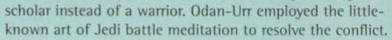
- **Odan-Urr**: "Convinced that battle meditation was the key to victory, Odan-Urr learned that the single-minded determination of the Massassi warriors could not be easily overcome." Source: Power of the Jedi Sourcebook, p.98
  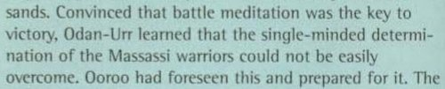

## p.99 (scan page 101)

Page contents: 774 words, 19 paragraphs | headings/entries: Force Skills: Affect Mind +14, Empathy +7,; Odan-Urr, Keeper of Antiquities

- **Odan-Urr** — entry/section: Odan-Urr, Keeper of Antiquities: "Odan-Urr, assisted by Empress Teta's Jedi advisor Memit Nadill, used the Jedi battle meditation technique to defeat the Kirrek rebels and reach an accord with the pirate leaders." Source: Power of the Jedi Sourcebook, p.99
  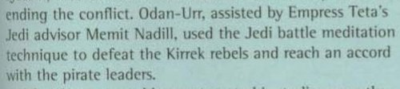
- **Odan-Urr** — entry/section: Odan-Urr, Keeper of Antiquities: "Odan-Urr offered him a tale from a Sith holocron that showed how a Jedi once thought he could defeat the dark side from within, and was forever lost." Source: Power of the Jedi Sourcebook, p.99
  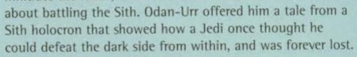

## p.100 (scan page 102)

Page contents: 729 words, 13 paragraphs | headings/entries: Arca Jeth, Watchman of Onderon

- **Arca Jeth; King Ommin** — entry/section: Arca Jeth, Watchman of Onderon: "If his scheme succeeded, Ommin would have destroyed Arca's body and raised the former Jedi as a dark side spirit." Source: Power of the Jedi Sourcebook, p.100
  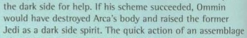
- **King Ommin; Freedon Nadd**: "Ommin was defeated, and Freedon Nadd's remains were moved to Dxun." Source: Power of the Jedi Sourcebook, p.100
  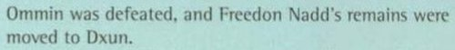

## p.101 (scan page 103)

Page contents: 640 words, 17 paragraphs | headings/entries: Thon, Watchman of Stennes

- **Master Thon; Exar Kun; Ulic Qel-Droma** — entry/section: Thon, Watchman of Stennes: "The Jedi and the Republic clashed with the Krath, Exar Kun, and Ulic Qel-Droma many times before defeating the Sith forces." Source: Power of the Jedi Sourcebook, p.101
  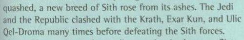

## p.102 (scan page 104)

Page contents: 727 words, 13 paragraphs | headings/entries: Knights of the Old Republic

- **Vodo-Siosk Baas; Exar Kun**: "Four thousand years before the Battle of Yavin, Master Vodo's strongest apprentice was a young Human named Exar Kun." Source: Power of the Jedi Sourcebook, p.102
  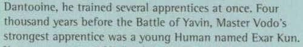
- **Vodo-Siosk Baas**: "Kun was a master of lightsaber combat and had even bested Master Vodo's quarterstaff during sparring practice." Source: Power of the Jedi Sourcebook, p.102
  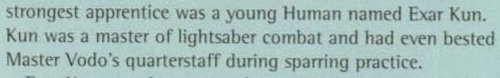
- **Vodo-Siosk Baas; Ulic Qel-Droma**: "The assembly granted the Jedi permission, but Master Vodo warned them again: "If Ulic Qel-Droma is destroyed, he will destroy himself."" Source: Power of the Jedi Sourcebook, p.102
  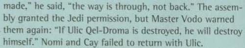
- **Vodo-Siosk Baas; Exar Kun**: "The two fought, and Vodo-Siosk Baas was no match for Exar Kun's doublebladed lightsaber and deep reserve of dark side power." Source: Power of the Jedi Sourcebook, p.102
  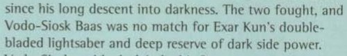
- **Ulic Qel-Droma**: "The two of them nearly brought the Republic to ruin before Kun was defeated and Ulic was redeemed." Source: Power of the Jedi Sourcebook, p.102
  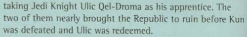

## p.103 (scan page 105)

Page contents: 748 words, 17 paragraphs | headings/entries: Ulic Qel-Droma,

- **Queen Amanoa**: "The assembled beast armies could not withstand Queen Amanoa's technologically advanced forces, and their defeat was inevitable." Source: Power of the Jedi Sourcebook, p.103
  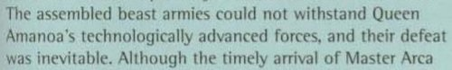
- **Ulic Qel-Droma; Freedon Nadd** — entry/section: Ulic Qel-Droma,: "The spirit of Freedon Nadd appeared before Ulic and proclaimed he would one day become one of the most powerful Sith Lords in history." Source: Power of the Jedi Sourcebook, p.103
  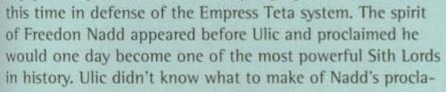
- **Ulic Qel-Droma; Arca Jeth** — entry/section: Ulic Qel-Droma,: "Among the casualties was Arca Jeth, who was killed after saving Ulic's life." Source: Power of the Jedi Sourcebook, p.103
  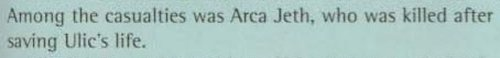
- **Ulic Qel-Droma** — entry/section: Ulic Qel-Droma,: "Although Ulic Qel-Droma eventually becomes one of the most powerful Sith Lords of his time, his reign was brief." Source: Power of the Jedi Sourcebook, p.103
  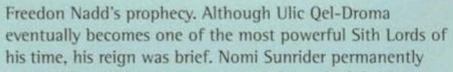

## p.104 (scan page 106)

Page contents: 725 words, 19 paragraphs | headings/entries: Nomi Sunrider, Jedi Knight; Cay Gel-Droma, Jedi Knight

- **Andur Sunrider**: "Greedy gangsters discovered their hidden treasure and killed Andur." Source: Power of the Jedi Sourcebook, p.104
  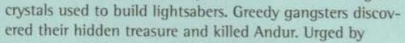
- **Nomi Sunrider; Andur Sunrider; Master Thon** — entry/section: Nomi Sunrider, Jedi Knight: "Andur's killers followed Nomi to Ambria and were defeated by Master Thon." Source: Power of the Jedi Sourcebook, p.104
  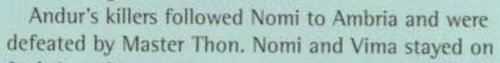
- **Nomi Sunrider** — entry/section: Nomi Sunrider, Jedi Knight: "Nomi discovered she had a natural talent for the art of Jedi battle meditation when she unconsciously used the technique to save her daughter from a dark side dragon." Source: Power of the Jedi Sourcebook, p.104
  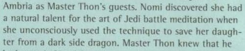
- **Nomi Sunrider** — entry/section: Nomi Sunrider, Jedi Knight: "When a Hutt crime lord named Great Bogga made a final attempt to steal the Adegan crystals, Nomi responded by using an application of Jedi battle meditation to influence the outcome of the battle." Source: Power of the Jedi Sourcebook, p.104
  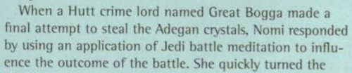
- **Cay Qel-Droma** — entry/section: Cay Gel-Droma, Jedi Knight: "While his brother perfected his combat skills by defeating training droids, Cay was more interested in putting the dismantled droids back together." Source: Power of the Jedi Sourcebook, p.104
  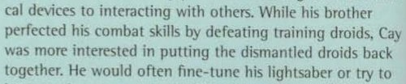
- **Cay Qel-Droma; King Ommin; Freedon Nadd** — entry/section: Cay Gel-Droma, Jedi Knight: "Cay Qel-Droma was among the many Jedi who helped defeat Lord Ommin's sect of Naddist worshipers during the Freedon Nadd uprising." Source: Power of the Jedi Sourcebook, p.104
  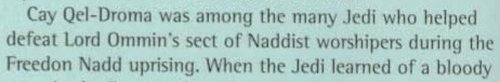

## p.105 (scan page 107)

Page contents: 733 words, 22 paragraphs | headings/entries: Tott Doneeta, Jedi Knight; Oss Wilum, Jedi Knight

- **Cay Qel-Droma; Ulic Qel-Droma** — entry/section: Cay Gel-Droma, Jedi Knight: "The Sith poison coursing through Ulic's blood controlled his actions as he cut down Cay Qel-Droma in a fit of anger." Source: Power of the Jedi Sourcebook, p.105
  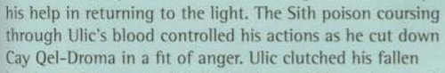
- **Cay Qel-Droma; Nomi Sunrider; Ulic Qel-Droma** — entry/section: Cay Gel-Droma, Jedi Knight: "Moments later, Nomi Sunrider avenged Cay by severing Ulic's connection to the Force." Source: Power of the Jedi Sourcebook, p.105
  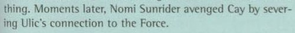

## p.106 (scan page 108)

Page contents: 752 words, 20 paragraphs | headings/entries: JAC; Dace Diath, Jedi Knight

- **Oss Wilum; Master Thon**: "They defeated Oss in combat, but Master Thon, who drove the gangsters off, spared the young Jedi's life." Source: Power of the Jedi Sourcebook, p.106
  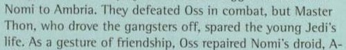
- **Dace Diath; Freedon Nadd** — entry/section: Dace Diath, Jedi Knight: "The Jedi forces defeated the Naddists and entombed Freedon Nadd's remains on Onderon's beast moon, Dxun." Source: Power of the Jedi Sourcebook, p.106
  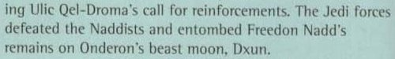
- **Dace Diath** — entry/section: Dace Diath, Jedi Knight: "Dace was one of the Jedi who survived." Source: Power of the Jedi Sourcebook, p.106
  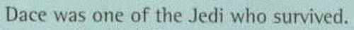
- **Dace Diath** — entry/section: Dace Diath, Jedi Knight: "The starfighter exploded on impact, but Dace ejected and used the Force to break his fall." Source: Power of the Jedi Sourcebook, p.106
  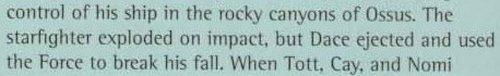

## p.107 (scan page 109)

Page contents: 485 words, 14 paragraphs | headings/entries: Shoaneb Culu, Jedi Knight

- **Aleema Keto**: "Aleema used the ancient Sith weapon to obliterate the detachment and ultimately destroy the Library of Ossus." Source: Power of the Jedi Sourcebook, p.107
  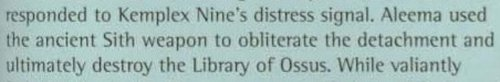
- **Dace Diath** — entry/section: Dace Diath, Jedi Knight: "While valiantly fighting for justice, Dace was vaporized along with the rest of the Republic ships." Source: Power of the Jedi Sourcebook, p.107
  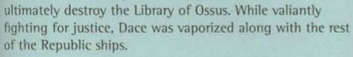

## p.108 (scan page 110)

Page contents: 714 words, 20 paragraphs | headings/entries: The Halcyon Bloodline; Kieran Halcyon, Jedi Knight

- **Aleema Keto**: "Piloted by Aleema, an ancient starship ripped the core out of one of the ten suns of the Cron Cluster and caused a conflagration that destroyed the Library of Ossus." Source: Power of the Jedi Sourcebook, p.108
  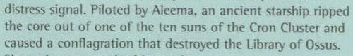
- **Shoaneb Culu** — entry/section: Shoaneb Culu, Jedi Knight: "Shoaneb was vaporized instantly." Source: Power of the Jedi Sourcebook, p.108
  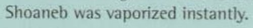

## p.109 (scan page 111)

Page contents: 1003 words, 22 paragraphs | headings/entries: EFFECTS OF THE HALCYON BLOODLINE; Around the time of the Clone Wars,; Nejaa Halcyon and the Caamasi Jedi

## p.110 (scan page 112)

Page contents: 942 words, 26 paragraphs | headings/entries: Ylenic It'kla, Jedi Knight; The Jedi Council

- **Yoda; Mace Windu**: "The venerable Master Yoda and the formidable Master Mace Windu are the recognized authorities on the Council." Source: Power of the Jedi Sourcebook, p.110
  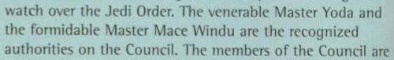

## p.111 (scan page 113)

Page contents: 717 words, 20 paragraphs | headings/entries: Yoda, Jedi Instructor

## p.112 (scan page 114)

Page contents: 728 words, 23 paragraphs | headings/entries: OB; Mace Windu, Jedi Swordmaster; Atk +21/+16/+11/+6" melee (6d8+1/17-20, lightsaber); Equipment: Lightsaber", Jedi robes,; Yaddle, Jedi Master

- **Mace Windu** — entry/section: Mace Windu, Jedi Swordmaster: "Windu was recognized throughout the Order as the master of combat tactics, a Jedi Master who never cracked under pressure, even when the odds were overwhelmingly against him." Source: Power of the Jedi Sourcebook, p.112
  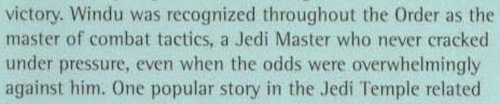
- **Mace Windu** — entry/section: Mace Windu, Jedi Swordmaster: "One popular story in the Jedi Temple related how Master Windu was surrounded by a cadre of Gank killers—some of the galaxy's most formidable warriors—all of whom had blasters drawn and pointed at him." Source: Power of the Jedi Sourcebook, p.112
  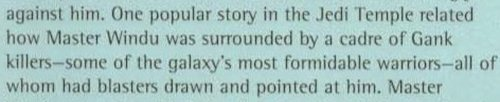
- **Mace Windu** — entry/section: Mace Windu, Jedi Swordmaster: "Master Windu was also known within the Order for his unusual fighting style, one that he developed after studying the dueling styles of various lightsaber masters." Source: Power of the Jedi Sourcebook, p.112
  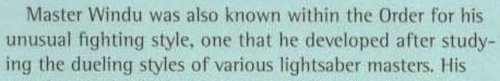

## p.113 (scan page 115)

Page contents: 718 words, 17 paragraphs | headings/entries: Yaddle: Female Jedi Consular 3/Jedi Scholar 8/; Plo Koon, Jedi Master

- **Yaddle** — entry/section: Yaddle, Jedi Master: "Kut was killed and Yaddle was captured." Source: Power of the Jedi Sourcebook, p.113
  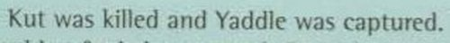
- **Yaddle** — entry/section: Yaddle, Jedi Master: "Yaddle defeated Kalut in combat and liberated the Kobans from the Advozse warlords." Source: Power of the Jedi Sourcebook, p.113
  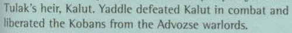
- **Yaddle** — entry/section: Yaddle, Jedi Master: "The Council members were overwhelmingly in favor of Yaddle's advancement and appointment." Source: Power of the Jedi Sourcebook, p.113
  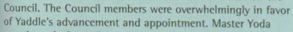

## p.114 (scan page 116)

Page contents: 690 words, 24 paragraphs | headings/entries: Depa Billaba, Jedi Master; Force Skills: Affect Mind +12, Battlemind +9,; Eeth Koth, Jedi Master

- **Mace Windu**: "Mace Windu rescued her before she could be killed." Source: Power of the Jedi Sourcebook, p.114
  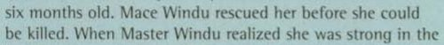

## p.115 (scan page 117)

Page contents: 456 words, 19 paragraphs | headings/entries: Yarael Poof, Jedi Master; Yarael Poof: Male Quermian Jedi Consular 10/Jedi

- **Yarael Poof** — entry/section: Yarael Poof, Jedi Master: "During the Stark Hyperspace Conflict, Master Yarael used battle meditation to ensure a Republic victory." Source: Power of the Jedi Sourcebook, p.115
  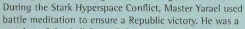

## p.116 (scan page 118)

Page contents: 662 words, 28 paragraphs | headings/entries: Adi Gallia, Jedi Master; The two contributed to a Jedi; Feats: Exotic Weapon Proficiency (lightsaber), Force-Sensitive, Persuasive,

- **Adi Gallia**: "One of the bounty hunter's booby traps defeated Adi Gallia, but failed to kill her." Source: Power of the Jedi Sourcebook, p.116
  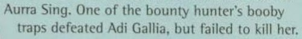
- **Adi Gallia** — entry/section: Adi Gallia, Jedi Master: "Adi Gallia's parents were nearly killed by Red laro terrorists." Source: Power of the Jedi Sourcebook, p.116
  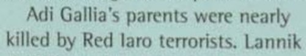

## p.117 (scan page 119)

Page contents: 713 words, 22 paragraphs | headings/entries: Even Piell, Jedi Master; Oppo Rancisis, Jedi Commander

- **Even Piell** — entry/section: Even Piell, Jedi Master: "Piell single-handedly defeated seven attackers, Only one terrorist escaped with his life." Source: Power of the Jedi Sourcebook, p.117
  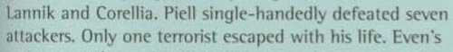

## p.118 (scan page 120)

Page contents: 436 words, 19 paragraphs | headings/entries: 

- **Saesee Tiin**: "Saesee Tiin was among the many Jedi killed during the Battle of Geonosis." Source: Power of the Jedi Sourcebook, p.118
  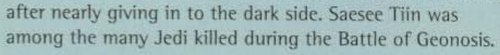

## p.119 (scan page 121)

Page contents: 682 words, 25 paragraphs | headings/entries: Ki-Adi-Mundi, Jedi Knight; Force Skills: Affect Mind +11, Battlemind +6,

## p.120 (scan page 122)

Page contents: 734 words, 15 paragraphs | headings/entries: Twilight of the Jedi; The Dark Woman, Jedi Master

- **An'ya Kuro (Dark Woman)** — entry/section: The Dark Woman, Jedi Master: "Her apprentices could expect at least one lightsaber duel with her every week." Source: Power of the Jedi Sourcebook, p.120
  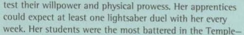
- **An'ya Kuro (Dark Woman)** — entry/section: The Dark Woman, Jedi Master: "Though she knew she had not killed Aurra, the Dark Woman began to wonder if Aurra had left to avoid the punishing exercises." Source: Power of the Jedi Sourcebook, p.120
  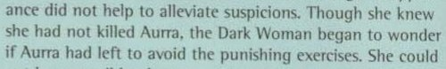

## p.121 (scan page 123)

Page contents: 747 words, 16 paragraphs | headings/entries: Darsha Assant, Jedi Padawan

- **Anoon Bondara**: "Turning the skycar around, she returned to the platform where Master Bondara and the Sith had landed and were dueling." Source: Power of the Jedi Sourcebook, p.121
  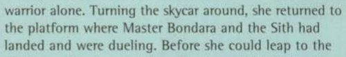
- **Anoon Bondara**: "Worse still, Master Bondara had died trying to destroy his opponent—and the Sith warrior survived." Source: Power of the Jedi Sourcebook, p.121
  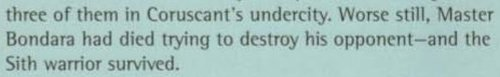

## p.122 (scan page 124)

Page contents: 721 words, 21 paragraphs | headings/entries: Anoon Bandara: Male Twi'lek Jedi Guardian 5/; Force Skills: Affect Mind +6, Battlemind +12,

- **Anoon Bondara**: "To Padawan Darsha, of course, Master Bondara's prowess was unmatched." Source: Power of the Jedi Sourcebook, p.122
  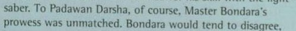

## p.123 (scan page 125)

Page contents: 745 words, 19 paragraphs | headings/entries: Thracia Cho Leem, Jedi Master; Quinlan Vos, Amnesiac Jedi

## p.124 (scan page 126)

Page contents: 770 words, 16 paragraphs | headings/entries: Bultar Swan, Jedi Knight

## p.125 (scan page 127)

Page contents: 648 words, 22 paragraphs | headings/entries: Kit Fisto, Jedi Master

## p.126 (scan page 128)

Page contents: 492 words, 12 paragraphs | headings/entries: Shaak Ti, Jedi Master; OE

- **Shaak Ti** — entry/section: Shaak Ti, Jedi Master: "The Togruta species is also rumored to be venomous, and Master Shaak Ti made no real effort to dispel this rumor, Shaak Ti used her species' reputation to its full advantage when it was convenient to do so, frequently stealing up behind people before speaking to them or baring her sharp incisors in a grotesque approximation of a human smile, though she was entirely capable of managing a perfectly ordinary smile." Source: Power of the Jedi Sourcebook, p.126
  

## p.127 (scan page 129)

Page contents: 502 words, 25 paragraphs | headings/entries: Luminara Unduli, Jedi Master; The effect was

## p.128 (scan page 130)

Page contents: 984 words, 32 paragraphs | headings/entries: M42 ER ie; Barriss Offee, Jedi Padawan; Force Skills: Affect Mind +6, Battlemind +6,; The Last of the Jedi; Obi-Wan Kenobi, Force Spirit

- **Obi-Wan Kenobi; Darth Vader (Anakin Skywalker)** — entry/section: Obi-Wan Kenobi, Force Spirit: "When old Ben Kenobi died aboard the Death Star, cut down by Darth Vader's lightsaber, Kenobi's spirit became one with the Force." Source: Power of the Jedi Sourcebook, p.128
  

## p.129 (scan page 131)

Page contents: 723 words, 27 paragraphs | headings/entries: Ikrit, Jedi Master; Ikrit: Male Kushiban Fringer 2/Jedi Consular 11/; Bie SE

## p.130 (scan page 132)

Page contents: 946 words, 21 paragraphs | headings/entries: The New Jedi; Cilghal, Jedi Healer

- **Obi-Wan Kenobi; Yoda**: "He soon discovered that Obi-Wan and Yoda were not the only Jedi Knights to have survived the Emperor's Purge." Source: Power of the Jedi Sourcebook, p.130
  
- **Mara Jade Skywalker**: "Mara had miraculously survived a Yuuzhan Vong poison in her system with the aid of a chemical compound known as Vergere's Tears." Source: Power of the Jedi Sourcebook, p.130
  

## p.131 (scan page 133)

Page contents: 764 words, 16 paragraphs | headings/entries: Kyle Katarn, Combat Instructor; Kyle Katarn: Male Human Scoundrel 5/Soldier 6/

- **Kyle Katarn** — entry/section: Kyle Katarn, Combat Instructor: "Before reporting to his first post, he was shown irrefutable evidence that the Empire, not the Rebellion, killed Morgan Katarn." Source: Power of the Jedi Sourcebook, p.131
  
- **Kyle Katarn; Jerec** — entry/section: Kyle Katarn, Combat Instructor: "Kyle easily defeated Jerec's minions and sought out the Dark Jedi for revenge." Source: Power of the Jedi Sourcebook, p.131
  
- **Kyle Katarn; Jerec** — entry/section: Kyle Katarn, Combat Instructor: "Kyle's yearning for revenge was nearly his undoing, but he ultimately prevailed, defeating Jerec without giving into hatred and thus fulfilling a thousand-year-old prophecy." Source: Power of the Jedi Sourcebook, p.131
  
- **Kyle Katarn** — entry/section: Kyle Katarn, Combat Instructor: "During the Emperor's resurrection, Kyle was lured to a long-forgotten Sith world and seduced by the dark side." Source: Power of the Jedi Sourcebook, p.131
  
