# Owner Material 033 — Power of the Jedi Sourcebook (d20, 2002): Chapter Seven: Where the Force is strong; Index

- **Source:** *Power of the Jedi Sourcebook* by JD Wiker, Michael Mikaelian, Jeff Grubb, Owen K.C. Stephens and James Maliszewski (Wizards of the Coast, 2002), for the Star Wars Roleplaying Game (d20). Secondary source (licensed Legends reference). Scan OCR'd on the box; the scan stays box-only and is **not** published.
- **Method:** every scanned page was OCR'd and machine-screened sentence by sentence for power-relevant statements (fights, kills, defeats, Force feats, rankings, superweapons) that name a character on our roster; each kept sentence is quoted verbatim from the OCR text and has a crop of the printed passage directly under it. Pages with nothing power-relevant are still listed with what is on them.
- **Citation:** "Power of the Jedi Sourcebook, p.X" by printed page ("scan p.X" where no printed number applies). **Weight:** Licensed RPG sourcebook: a secondary source. Its narrative text sums up Legends history; game statistics are rules for players, not canon power levels.

## p.132 (scan page 134)

Page contents: 968 words, 15 paragraphs | headings/entries: SAS 4an | REZ; Chapter Seven: Where the Force Is Strong; Chu'unthor; History

## p.133 (scan page 135)

Page contents: 511 words, 13 paragraphs | headings/entries: 

## p.134 (scan page 136)

Page contents: 426 words, 16 paragraphs | headings/entries: Ikm Main lon/ Hunan; Chu"unthor Side View; Sensor/Communications ste; Adventure Hooks

## p.135 (scan page 137)

Page contents: 768 words, 15 paragraphs | headings/entries: Great Library at Ossus; History; TLE

- **Odan-Urr**: "Before departing the planet, he slew Odan-Urr and stole a Sith holocron from the Chamber of Antiquities." Source: Power of the Jedi Sourcebook, p.135
  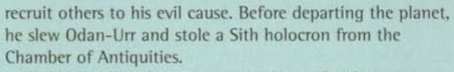

## p.136 (scan page 138)

Page contents: 602 words, 26 paragraphs | headings/entries: Description; Great Library at Ossus; Spiral Staircase; Reader Tape Stacks); Side View ] Level 4; LZ

- **Exar Kun; Ulic Qel-Droma**: "Space transports quickly carried away as many of the library's antiquities as possible—but then Exar Kun returned to Ossus with the Dark Jedi Ulic Qel-Droma to loot the library of its remaining treasures before the supernova's shockwave destroyed it." Source: Power of the Jedi Sourcebook, p.136
  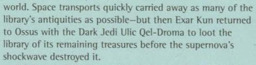
- **Ood Bnar**: "When the shockwave struck, Ood's tree survived to stand over the ruins of the oncegreat planet." Source: Power of the Jedi Sourcebook, p.136
  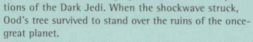
- **Palpatine (Darth Sidious)**: "So it continued for thousands of years, until the death and resurrection of Palpatine." Source: Power of the Jedi Sourcebook, p.136
  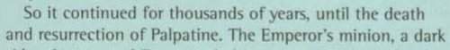
- **Palpatine (Darth Sidious)**: "His captives would serve as the basis of future clone bodies for Palpatine." Source: Power of the Jedi Sourcebook, p.136
  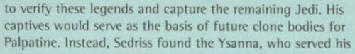
- **Ood Bnar**: "Using his Force powers, Ood destroyed himself and Sedriss forever." Source: Power of the Jedi Sourcebook, p.136
  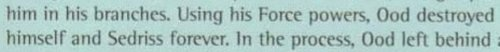

## p.137 (scan page 139)

Page contents: 1012 words, 20 paragraphs | headings/entries: Inhabitants; Adventure Hooks; NNO a eA

## p.138 (scan page 140)

Page contents: 1044 words, 15 paragraphs | headings/entries: Jedi Academy on Yavin 4; History

- **Naga Sadow**: "Approximately four thousand years before the fall of the Old Republic, Dark Lord of the Sith Naga Sadow and his followers fled to Yavin 4 to escape the Jedi, who had defeated him in battle." Source: Power of the Jedi Sourcebook, p.138
  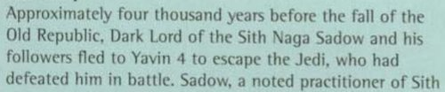
- **Naga Sadow**: "When Sadow finally met his end, the Massassi devolved into a primitive species, although they were still capable of using the dark side as their ancestors had." Source: Power of the Jedi Sourcebook, p.138
  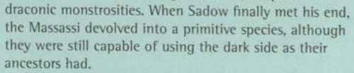
- **Grand Moff Tarkin**: "Grand Moff Tarkin maneuvered the dreaded Death Star into position to destroy the moon with its superlaser." Source: Power of the Jedi Sourcebook, p.138
  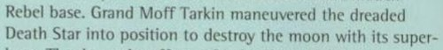
- **Luke Skywalker; Han Solo**: "Thanks to the efforts of Luke Skywalker and Han Solo, the Battle of Yavin proved a defeat for the Empire." Source: Power of the Jedi Sourcebook, p.138
  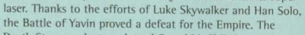
- **Grand Moff Tarkin**: "The Death Star was destroyed—and Grand Moff Tarkin along with it." Source: Power of the Jedi Sourcebook, p.138
  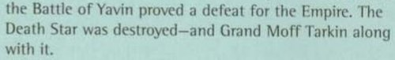

## p.139 (scan page 141)

Page contents: 518 words, 8 paragraphs | headings/entries: Description

- **Darth Vader (Anakin Skywalker)**: "After Anakin's rescue, Talon Karrde's fleet destroyed the shaper base—and the remains of the academy along with it." Source: Power of the Jedi Sourcebook, p.139
  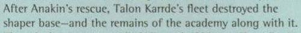

## p.140 (scan page 142)

Page contents: 1019 words, 15 paragraphs | headings/entries: Inhabitants; Adventure Hooks

## p.141 (scan page 143)

Page contents: 1043 words, 12 paragraphs | headings/entries: Jedi Temple on Coruscant; History

## p.142 (scan page 144)

Page contents: 509 words, 8 paragraphs | headings/entries: Description

- **Palpatine (Darth Sidious)**: "He also wonders if perhaps the Temple's existence was somehow a betrayal of the Jedi's traditions and ideals, one that made it all too easy for Palpatine to destroy the Order." Source: Power of the Jedi Sourcebook, p.142
  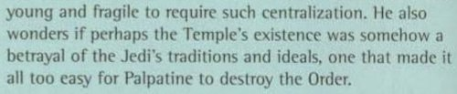

## p.143 (scan page 145)

Page contents: 585 words, 14 paragraphs | headings/entries: Jedi i\Temple'o on So aner af; Sa; Jedi Statue

## p.144 (scan page 146)

Page contents: 1024 words, 15 paragraphs | headings/entries: Efe TAA "aT; Inhabitants; Adventure Hooks

## p.145 (scan page 147)

Page contents: 1050 words, 14 paragraphs | headings/entries: History; Description

- **Palpatine (Darth Sidious)**: "Palpatine never made an effort to destroy the Meditative Canyon, so it remained untouched for years, occasionally providing solace for Jedi on the run from the Emperor's Jedi Purge." Source: Power of the Jedi Sourcebook, p.145
  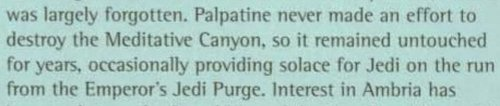

## p.146 (scan page 148)

Page contents: 553 words, 21 paragraphs | headings/entries: Waterfall; Ym 4uoo so; Cross-Section; Rock Formations; Water; Crystal ) Stalagmite; Crystal; Formations; A; Inhabitants

## p.147 (scan page 149)

Page contents: 1041 words, 21 paragraphs | headings/entries: Adventure Hooks; The Oracle at Pelgrin; History

## p.148 (scan page 150)

Page contents: 1114 words, 10 paragraphs | headings/entries: Description

## p.149 (scan page 151)

Page contents: 518 words, 12 paragraphs | headings/entries: Hexagonal Chamber; Upper Floor; Middle; Meters 88; Inhabitants

## p.150 (scan page 152)

Page contents: 988 words, 13 paragraphs | headings/entries: Adventure Hooks; The School of Hidden Wisdom; History

- **Palpatine (Darth Sidious)**: "Once Palpatine became Emperor, only one survived—the School of Hidden Wisdom on Baltimn." Source: Power of the Jedi Sourcebook, p.150
  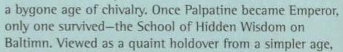

## p.151 (scan page 153)

Page contents: 83 words, 35 paragraphs | headings/entries: Upper; Level Library; Master !; Guest Room i; School of Hidden Wisdom; Us; Conference Room; Turbolift) os; Turbolift; Side View; Bath; Audience i; Chamber i Meditation; Chamber; Sitting Game Room! Foyer Room; Platform; Equipment @ Storage; Training Area; Utility Storage; Storage

## p.152 (scan page 154)

Page contents: 1055 words, 13 paragraphs | headings/entries: Description

## p.153 (scan page 155)

Page contents: 1044 words, 16 paragraphs | headings/entries: Inhabitants; Adventure Hooks; The Valley of the Jedi; History

- **Lord Kaan**: "A thousand years before the fall of the Old Republic, a Sith Lord named Kaan survived the best efforts of the Jedi Order to destroy the dark side cult to which he had devoted his life." Source: Power of the Jedi Sourcebook, p.153
  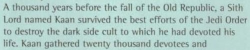
- **Lord Kaan**: "Hoth proved a wily opponent, taking advantage of Kaan's belief that the Jedi were weak and unwilling to pay the price necessary to defeat him." Source: Power of the Jedi Sourcebook, p.153
  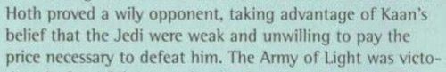

## p.154 (scan page 156)

Page contents: 835 words, 13 paragraphs | headings/entries: Ss; TERT; CHAPTER; Description

## p.155 (scan page 157)

Page contents: 622 words, 25 paragraphs | headings/entries: Valley of the Jedi; Upper Level; Ruined; Lower Level; Compl B. Hell Dragon Lairs eld sa; Inhabitants

- **Lord Kaan**: "Here Hoth and Kaan squared off before the Sith Lord destroyed both assembled armies in a torrent of hatred." Source: Power of the Jedi Sourcebook, p.155
  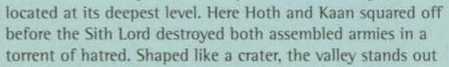

## p.156 (scan page 158)

Page contents: 775 words, 17 paragraphs | headings/entries: BN; Adventure Hooks

## p.157 (scan page 159)

Page contents: 0 words, 0 paragraphs | headings/entries: 

## p.158 (scan page 160)

Page contents: 893 words, 159 paragraphs | headings/entries: Ae; Ne sey aS / ar; Index; Abhean 132; Abraxin 79; Ackbar, Admiral 130; Adega system 135; Adegan crystals 104, 107, 155; Advozse 112, 113; Afarathu 108; AgriCorps worker 86; Alderaan 10, 64, 110; Aleema 107; Almania 83, 127; Amanoa, Queen 7, 100, 103, 104, 105; Ambria 101, 104, 105, 106, 145-147; Anselmi 71; Arkanian 64, 73, 100; Ashla, the 6; Asmeru 113, 114, 118; Assant, Darsha 121; Auril sector 135; Baltimn 150, 151; Bane, Darth 9; Battle Influence 12; Battle Meditation 15; Beast Language 15; Belasco 116; Bespin 128; Billaba, Depa 114; Black Sun 121; Bnar, Ood 136; Bondara, Anoon 121, 122, 124; Bouri, Omo 118; Brotherhood of Darkness 9, 141, 153; Caamasi 64, 110; Callista 9, 130; Carida 131; Cathar 65; Celegian 66, 98; Cerean 119; Chalactan 114; Chatos Academy 6; Chewbacca 11; Cho Leem, Thracia 123; Chu'unthor 132-135; Cilghal 11, 130; Cinnagar 8, 98, 103; Core Worlds 6, 7, 9, 70, 130

## p.159 (scan page 161)

Page contents: 977 words, 210 paragraphs | headings/entries: Kenzon, Ephaan 152, 153; Kerilt 64; Keto, Aleema 8; Keto, Satal 8; Khommite 67; Ki-Adi-Mundi 117, 119, 120; Kiffar 17, 123, 124; Kil'qiy, Surenit 32; Kirrek 7, 98; Koba system 112; Koon, Plo 113, 117, 124; Koros system 98, 99; Koros Major 103, 106; Korriban 102; Koth, Eeth 114; Krevaaki 68, 102; Kushiban 68, 129; Kut, Plovin 112; Lah, Tsavong 139; Lannik 69, 113, 117; Lowbacca 11; Madine, Crix 131; Malacia 13, 118; Malastare 113, 116, 117; Mandalore 102; Mar, Easal 132; Marspa, Master 33; Massassi 7, 8, 98, 138, 139; Maul, Darth 43; MedCorps worker 94; Meditative Canyon on Ambria 145-147; Mid Rim 76, 79, 132, 153; Miraluka 70, 107; Mirial 127, 128; Mon Calamari 130; Mon, Ephant 119; Morichro 16, 113; Mothma, Mon 11, 130, 131; Nadill, Memit 7, 99; Nam Chorios 78; Nam Priax 77; Nar Shaddaa 114, 123; Nautolan 71, 125; Nazzar 72; Nebulon Front 113, 114; Nebulon Ranger 59, 103, 104, 105; Neti

## p.160 (scan page 162)

Page contents: 95 words, 6 paragraphs | headings/entries: A Cast of Thousands; Starring You!; RIK or

## scan p.163 (scan page 163)

Page contents: 178 words, 14 paragraphs | headings/entries: L/

