# Owner Material 034 — The New Essential Guide to Characters (2002): scan pages 1–30

- **Source:** *Star Wars: The New Essential Guide to Characters* by Daniel Wallace, illustrated by Michael Sutfin (Del Rey, 2002). Secondary source (licensed Legends reference). Scan OCR'd on the box; the scan stays box-only and is **not** published.
- **Method:** every scanned page was OCR'd and machine-screened sentence by sentence for power-relevant statements (fights, kills, defeats, Force feats, rankings, superweapons) that name a character on our roster; each kept sentence is quoted verbatim from the OCR text and has a crop of the printed passage directly under it. Pages with nothing power-relevant are still listed with what is on them.
- **Citation:** "The New Essential Guide to Characters, p.X" by printed page ("scan p.X" where no printed number applies). **Weight:** Lucasfilm-licensed character guide: a secondary, in-universe summary of Legends and prequel-era material. Where the original story is in our notes, that source is the stronger citation.

## p.8 (scan page 1)

Page contents: 35 words, 3 paragraphs | headings/entries: 

## p.9 (scan page 2)

Page contents: 241 words, 74 paragraphs | headings/entries: Acknowledgments; Pronunciation Guide; Introduction; A General Time Line of Galactic History; Admiral Ackbar; Padmé Naberrie Amidala; Nom Anor; Wedge Antillies; Darth Bane; Jar Jar Binks; Bossk; Brakiss; Shira Brie; C-3P0; Callista; Lando Calrissian; Gaeriel Captison; Tycho Celchu; Chewbacca; Admiral Daala; Jori and Gav Daragon; Gavin Darklighter; Dengar; General Jan Dodonna; Count Dooku; Droma; Durga the Hutt; Kyp Durron; Baron Fel; Boba Fett; Jango Fett; Borsk Fey'lya; Bib Fortuna; Rokur Gepta; Greedo; Nute Gunray; Corran Horn; Sebulba; Executor Sedriss; Senator Viqi Shesh; Darth Sidious; Raith Sienar; Aurra Sing; Anakin Skywalker/ Darth Vader; Luke Skywalker; Mara Jade Skywalker; Anakin Solo; Han Solo; Jacen Solo; Jaina Solo; Leia Organa Solo; Kam Solusar; Nil Spaar; Grand Moff Wilhuff Tarkin; Booster Terrik; Bria Tharen; Grand Admiral Thrawn; Supreme Chancellor Finis Valorum; General 

## p.10 (scan page 3)

Page contents: 377 words, 6 paragraphs | headings/entries: AutHor's ACKNOWLEDGMENTS; ILLUSTRATOR'S ACKNOWLEDGMENTS

## p.11 (scan page 4)

Page contents: 272 words, 22 paragraphs | headings/entries: Sanne; PRONUNCIATION GUIDE

## p.12 (scan page 5)

Page contents: 399 words, 11 paragraphs | headings/entries: INTRODUCTION; Daniel Wallace Detroit, Michigan

## p.13 (scan page 6)

Page contents: 658 words, 47 paragraphs | headings/entries: 

- **Qui-Gon Jinn; Darth Maul**: "Qui-Gon Jinn is killed by Darth Maul." Source: The New Essential Guide to Characters, p.13
  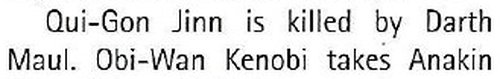
- **Jango Fett; Mace Windu**: "Jango Fett is killed by Mace Windu." Source: The New Essential Guide to Characters, p.13
  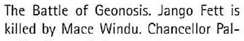
- **Luke Skywalker; Han Solo; Leia Organa Solo**: "The first Death Star is destroyed thanks to the efforts of Luke Skywalker, Han Solo, and Princess Leia Organa." Source: The New Essential Guide to Characters, p.13
  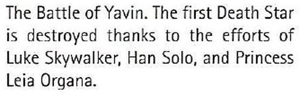

## p.14 (scan page 7)

Page contents: 702 words, 52 paragraphs | headings/entries: Grand Admiral Thrawn declares war; REY ETT EET

- **Kyle Katarn**: "Kyle Katarn leads the mission to destroy the Empire's dark troopers." Source: The New Essential Guide to Characters, p.14
  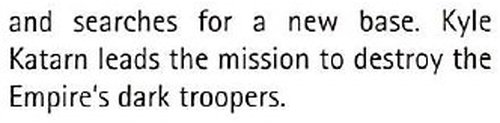
- **Lando Calrissian**: "The second Death Star is destroyed by Lando Calrissian and Wedge Antilles." Source: The New Essential Guide to Characters, p.14
  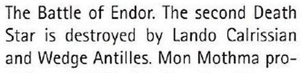
- **Jerec; Kyle Katarn**: "Jerec tries to unlock the power of Ruusan's Valley of the Jedi but is defeated by Kyle Katarn." Source: The New Essential Guide to Characters, p.14
  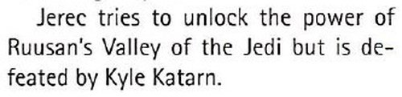
- **Palpatine (Darth Sidious); Kir Kanos**: "After Palpatine's final defeat, former Royal Guardsman Kir Kanos assassinates all members of the Imperial Interim Ruling Council." Source: The New Essential Guide to Characters, p.14
  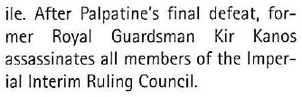
- **Grand Admiral Thrawn; Han Solo** — entry/section: Grand Admiral Thrawn declares war: "He is defeated by his cousin Han Solo and Gaeriel Captison's Bakuran navy." Source: The New Essential Guide to Characters, p.14
  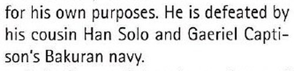
- **Chewbacca**: "Chewbacca is killed on Sernpidal." Source: The New Essential Guide to Characters, p.14
  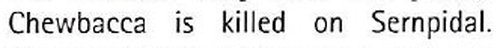
- **Grand Admiral Thrawn** — entry/section: Grand Admiral Thrawn declares war: "The Jedi academy is evacuated and the Great Temple is destroyed." Source: The New Essential Guide to Characters, p.14
  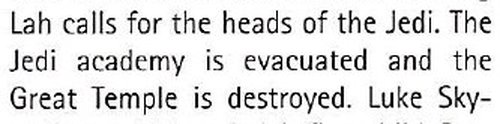

## p.15 (scan page 8)

Page contents: 8 words, 4 paragraphs | headings/entries: CHA; THE NEW RAC GUIDE TO; CTERS

## p.16 (scan page 9)

Page contents: 558 words, 20 paragraphs | headings/entries: DMIRAL ACKBAR; Ire TS 377

- **Admiral Ackbar**: "After the destruction of the first Death Star, Ackbar and the Calamarian Council survived a harrowing Imperial hunt on the planet Daluuj, and the council agreed to formally support the Alliance." Source: The New Essential Guide to Characters, p.16
  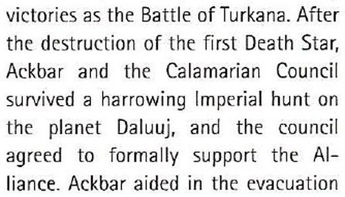
- **Admiral Ackbar**: "Admiral Ackbar won his greatest victory at Endor, where he defeated Admiral Piett and routed the best elements of the mighty Imperial fleet." Source: The New Essential Guide to Characters, p.16
  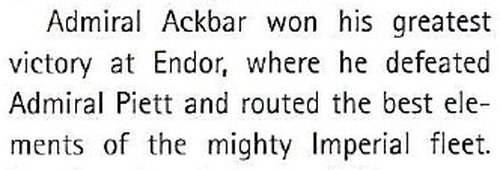

## p.17 (scan page 10)

Page contents: 451 words, 11 paragraphs | headings/entries: STAR WARS

- **Admiral Ackbar; Grand Admiral Thrawn**: "Despite a political smear campaign orchestrated by Borsk Fey'lya, Ackbar played a key role in the defeat of Thrawn at Bilbringi and Admiral Krennel at Ciutric." Source: The New Essential Guide to Characters, p.17
  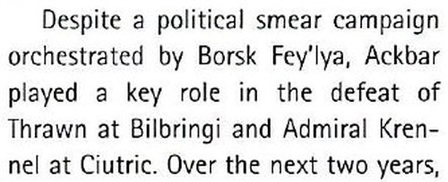
- **Admiral Ackbar**: "The resurrected Emperor drove Ackbar from Victory Lake during his reconquest of Coruscant, then focused his malevolence on Mon Calamari." Source: The New Essential Guide to Characters, p.17
  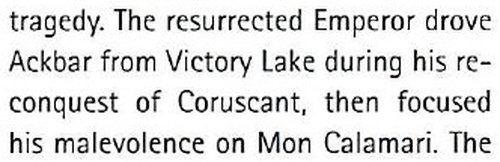
- **Leia Organa Solo; Admiral Ackbar; Admiral Daala**: "Leia Organa Solo convinced him of his responsibilities to the greater galaxy, and Ackbar reclaimed his New Republic rank just in time to defeat Admiral Daala." Source: The New Essential Guide to Characters, p.17
  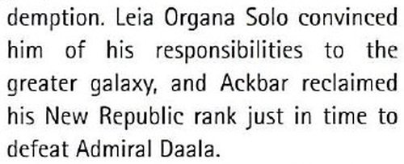

## p.18 (scan page 11)

Page contents: 466 words, 26 paragraphs | headings/entries: PADME; King Veruna had held the throne; Drs proud, passionate, and; NABERRIE AMIDA; PRONUNCIATION Pad'-ma Na-be'-re Am' é da-la; SPECIES Human; SEH Female; Havin CoLor Brown; Eve CoLon Brown; HEIGHT 1.65 meters; HomMEWORLD Naboo; Ass 4b ROSH ER

## p.19 (scan page 12)

Page contents: 626 words, 14 paragraphs | headings/entries: The last time she'd seen Anakin,

## p.20 (scan page 13)

Page contents: 481 words, 18 paragraphs | headings/entries: ITER TET g; RUEEY TEER AGT TPIT TITTIES

- **Mara Jade Skywalker**: "Of the hundred victims, only Mara Jade Skywalker survived, and she suffered for years before beating the disease." Source: The New Essential Guide to Characters, p.20
  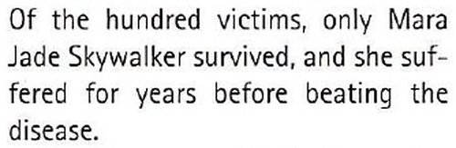

## p.21 (scan page 14)

Page contents: 498 words, 12 paragraphs | headings/entries: 

## p.22 (scan page 15)

Page contents: 459 words, 15 paragraphs | headings/entries: SSE MEMY HITTER TTD

## p.23 (scan page 16)

Page contents: 580 words, 16 paragraphs | headings/entries: SI RETIIS HRT ITS SF 5

- **Lando Calrissian**: "Antilles and Calrissian earned joint credit for the annihilation of the second Death Star." Source: The New Essential Guide to Characters, p.23
  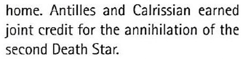

## p.24 (scan page 17)

Page contents: 534 words, 14 paragraphs | headings/entries: Antilles separated from Qwi Xux

- **Grand Admiral Thrawn**: "Following Thrawn's defeat, Antilles finally accepted a long-overdue promotion to general." Source: The New Essential Guide to Characters, p.24
  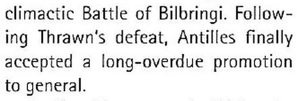
- **Kyp Durron**: "With the invasion of the Yuuzhan Vong, Antilles returned, helping Kyp Durron destroy a supposed enemy superweapon created from the remains of the planet Sernpidal." Source: The New Essential Guide to Characters, p.24
  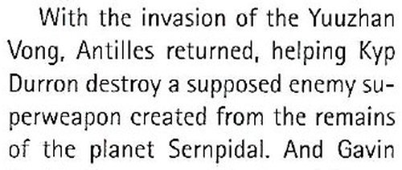

## p.25 (scan page 18)

Page contents: 485 words, 13 paragraphs | headings/entries: I] arth Bane lived a millennium ago,

- **Lord Kaan**: "Bane represented a threat to Kaan's leadership, and on the eve of battle against a Jedi battalion, Kaan had his rival poisoned." Source: The New Essential Guide to Characters, p.25
  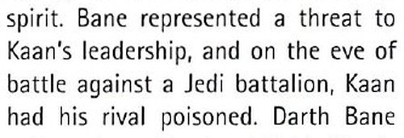
- **Darth Bane**: "Darth Bane tried to rally the Sith Lords around an aggressive Force technique that, if properly executed, would annihilate the Army of Light." Source: The New Essential Guide to Characters, p.25
  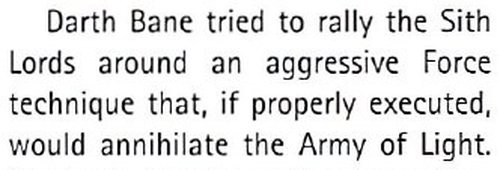

## p.26 (scan page 19)

Page contents: 447 words, 20 paragraphs | headings/entries: Jar Jar's parents, and partly on the; De tent nee abo See ee; Te) er ererr Perey Sree; SSeS SETS STIS ISS LN ETF PTT)

## p.27 (scan page 20)

Page contents: 508 words, 18 paragraphs | headings/entries: Hedenss

## p.28 (scan page 21)

Page contents: 474 words, 24 paragraphs | headings/entries: Bossk; PRONUNCIATION Bosk; SPECIES Trandoshan; SEH Male; Hain CoLor None; Eve CoLton Red; HEIGHT 1.9 meters; HomEWOARLD Trandosha (Dosha); A i ES eed tf; Ey

## p.29 (scan page 22)

Page contents: 498 words, 12 paragraphs | headings/entries: Back in the hunt once again,

- **Darth Vader (Anakin Skywalker); Bossk**: "As he prepared to leave Vader's Super Star Destroyer, Bossk ran into Tinian l'att and her Wookiee partner Chenlambec, two hunters who had failed to make Vader's cut." Source: The New Essential Guide to Characters, p.29
  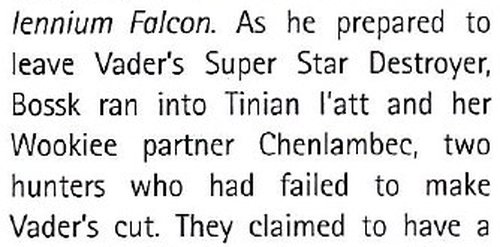
- **Bossk**: "During a quick stopover on Corellia, Bossk shot and killed CorSec officer Hal Horn." Source: The New Essential Guide to Characters, p.29
  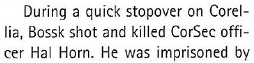

## p.30 (scan page 23)

Page contents: 378 words, 9 paragraphs | headings/entries: STAR WARS: THE New ESSENTIAL GUIDE TO; Immediately following the death of; CHARACTERS

- **Bossk**: "Believing Fett to be a permanent resident in the Sarlacc's belly, Bossk attempted to steal the ship, but was tricked into thinking the Hound's Tooth was wired to explode." Source: The New Essential Guide to Characters, p.30
  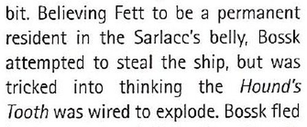

## p.31 (scan page 24)

Page contents: 426 words, 14 paragraphs | headings/entries: Brakiss made his way to the Deep

- **Brakiss**: "Brakiss sat out the campaign of the resurrected Emperor." Source: The New Essential Guide to Characters, p.31
  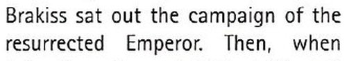

## p.32 (scan page 25)

Page contents: 522 words, 12 paragraphs | headings/entries: 

- **Brakiss** — entry/section: Brakiss made his way to the Deep: "Brakiss became a neutral intermediary between these rival camps." Source: The New Essential Guide to Characters, p.32
  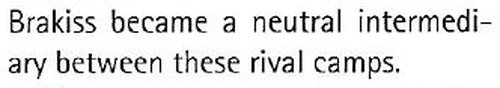
- **Brakiss** — entry/section: Brakiss made his way to the Deep: "Brakiss gave Zekk a lightsaber, and when Zekk proved his skill in a duel to the death against a fellow student, he became Brakiss's "Darkest Knight."" Source: The New Essential Guide to Characters, p.32
  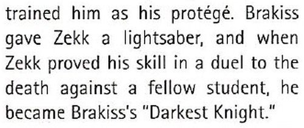
- **Brakiss** — entry/section: Brakiss made his way to the Deep: "When the tide of battle turned against the Second Imperium, Brakiss cut down two of the false Royal Guards who were guarding the "Emperor," only to learn the truth behind their deception." Source: The New Essential Guide to Characters, p.32
  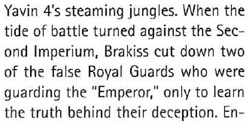
- **Brakiss** — entry/section: Brakiss made his way to the Deep: "Enraged by how easily he'd been taken in, Brakiss killed another guardsman, but the final pretender escaped his fury and triggered the station's selfdestruct mechanism." Source: The New Essential Guide to Characters, p.32
  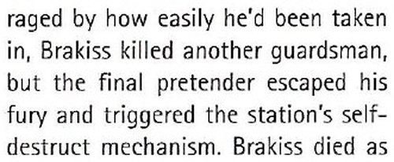

## p.33 (scan page 26)

Page contents: 455 words, 11 paragraphs | headings/entries: Le Mara Jade, Shira Brie was

- **Mara Jade Skywalker; Lumiya** — entry/section: Le Mara Jade, Shira Brie was: "Lumiya committed herself to exterminating the Rebels who had destroyed what she believed was the galaxy's natural order." Source: The New Essential Guide to Characters, p.33
  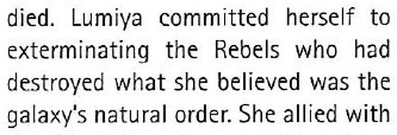
- **Mara Jade Skywalker; Lumiya; Leia Organa Solo; Luke Skywalker** — entry/section: Le Mara Jade, Shira Brie was: "On Herdessa she nearly killed Leia Organa, while on Kinooine she dueled with Luke Skywalker and revealed to him her past life as Shira Brie." Source: The New Essential Guide to Characters, p.33
  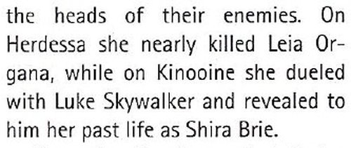

## p.34 (scan page 27)

Page contents: 468 words, 19 paragraphs | headings/entries: Wars: THE NEw ESSENTIAL GUIDE TO CHARACTERS; C-3PO and R2-D2 reunited on the

## p.35 (scan page 28)

Page contents: 518 words, 13 paragraphs | headings/entries: Governor Wena, a panjandrum

- **Darth Vader (Anakin Skywalker)**: "When Darth Vader's Star Destroyer seized the Tantive !V, R2-D2 insisted they eject in an escape pod." Source: The New Essential Guide to Characters, p.35
  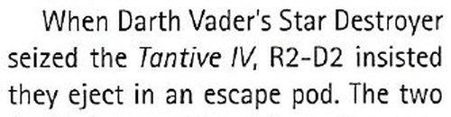

## p.36 (scan page 29)

Page contents: 491 words, 11 paragraphs | headings/entries: C-3PO accompanied the Princess

## p.37 (scan page 30)

Page contents: 467 words, 17 paragraphs | headings/entries: Callista was trained by a maver-

