# Owner Material 034 — The New Essential Guide to Characters (2002): scan pages 31–60

- **Source:** *Star Wars: The New Essential Guide to Characters* by Daniel Wallace, illustrated by Michael Sutfin (Del Rey, 2002). Secondary source (licensed Legends reference). Scan OCR'd on the box; the scan stays box-only and is **not** published.
- **Method:** every scanned page was OCR'd and machine-screened sentence by sentence for power-relevant statements (fights, kills, defeats, Force feats, rankings, superweapons) that name a character on our roster; each kept sentence is quoted verbatim from the OCR text and has a crop of the printed passage directly under it. Pages with nothing power-relevant are still listed with what is on them.
- **Citation:** "The New Essential Guide to Characters, p.X" by printed page ("scan p.X" where no printed number applies). **Weight:** Lucasfilm-licensed character guide: a secondary, in-universe summary of Legends and prequel-era material. Where the original story is in our notes, that source is the stronger citation.

## p.38 (scan page 31)

Page contents: 511 words, 11 paragraphs | headings/entries: STAR WARS: THE NEW ESSENTIAL; GUIDE TO CHARACTERS

- **Luke Skywalker**: "Luke had to eliminate the Emperor's superweapon before it killed again, but by destroying the Fye, he would destroy Callista." Source: The New Essential Guide to Characters, p.38
  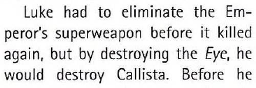
- **Palpatine (Darth Sidious)**: "When Skywalker awoke, he watched as the Eye of Palpatine exploded." Source: The New Essential Guide to Characters, p.38
  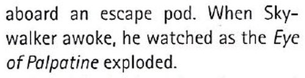
- **Admiral Daala**: "During Admiral Daala's assault on the academy, Callista single-handedly sabotaged the Super Star Destroyer Knight Hammer and boldly faced down Daala." Source: The New Essential Guide to Characters, p.38
  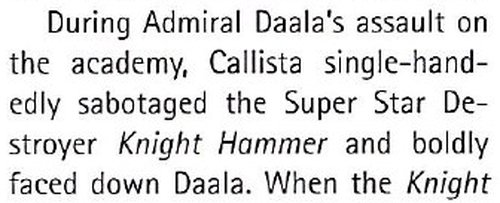

## p.39 (scan page 32)

Page contents: 485 words, 15 paragraphs | headings/entries: 

## p.40 (scan page 33)

Page contents: 668 words, 13 paragraphs | headings/entries: Joining the Rebel Al-

- **Lando Calrissian**: "Calrissian worked closely with Lobot for more than two years, battling a bounty hunter when Raynor put out a contract on his life, and stopping the crazed droid EV-9D9 before she destroyed all of the city's automaton population." Source: The New Essential Guide to Characters, p.40
  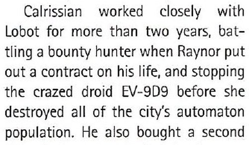
- **Lando Calrissian**: "Calrissian destroyed the castle by dropping a thermal detonator down the garbage chute." Source: The New Essential Guide to Characters, p.40
  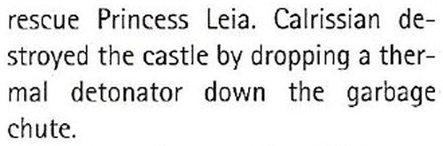

## p.41 (scan page 34)

Page contents: 685 words, 19 paragraphs | headings/entries: He also embarked on a wife hunt

## p.42 (scan page 35)

Page contents: 448 words, 16 paragraphs | headings/entries: 

## p.43 (scan page 36)

Page contents: 443 words, 13 paragraphs | headings/entries: 

## p.44 (scan page 37)

Page contents: 493 words, 19 paragraphs | headings/entries: Fis men have more reason to

## p.45 (scan page 38)

Page contents: 421 words, 16 paragraphs | headings/entries: EWBACCA; Weridddes

- **Chewbacca**: "Once, when Trandoshan slavers attacked his home city, Chewbacca ripped the leader's arms from their sockets, saving a beautiful Wookiee named Mallatobuck." Source: The New Essential Guide to Characters, p.45
  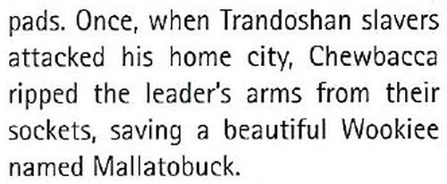
- **Chewbacca**: "Chewbacca dismembered the head slaver, who survived to regenerate his limbs years later." Source: The New Essential Guide to Characters, p.45
  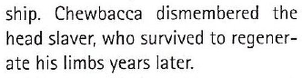

## p.46 (scan page 39)

Page contents: 585 words, 14 paragraphs | headings/entries: Beli ys

- **Chewbacca**: "Chewbacca killed a quillarat for the lovely Mallatobuck and she ate from it, signifying their love." Source: The New Essential Guide to Characters, p.46
  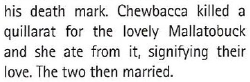

## p.47 (scan page 40)

Page contents: 473 words, 10 paragraphs | headings/entries: 

- **Chewbacca**: "Chewbacca helped destroy the probe droid that uncovered Echo Base on Hoth, and endured torture in a Cloud City holding cell." Source: The New Essential Guide to Characters, p.47
  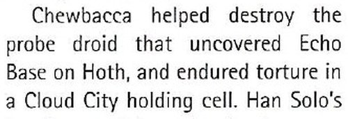

## p.48 (scan page 41)

Page contents: 442 words, 14 paragraphs | headings/entries: Pesta

- **Admiral Daala**: "Daala's four Star Destroyers waited at Maw Installation for eleven excruciating years, until at last an Imperial shuttle arrived from the outside." Source: The New Essential Guide to Characters, p.48
  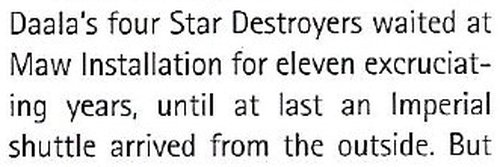
- **Grand Moff Tarkin**: "From them, she learned of Tarkin's death and the Empire's defeat at Yavin." Source: The New Essential Guide to Characters, p.48
  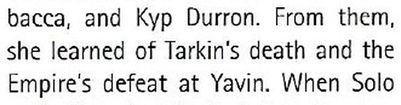

## p.49 (scan page 42)

Page contents: 485 words, 13 paragraphs | headings/entries: ER PRETE VEER TTNLT TT)

- **Admiral Daala**: "Daala struck at Dantooine and Mon Calamari, but lost two more Star Destroyers in the fierce fighting." Source: The New Essential Guide to Characters, p.49
  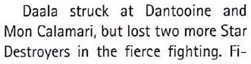

## p.50 (scan page 43)

Page contents: 461 words, 14 paragraphs | headings/entries: ORI AND Gav DAR; Je and Gav Daragon have been; AGI

## p.51 (scan page 44)

Page contents: 457 words, 20 paragraphs | headings/entries: Biggs fought alongside Luke Sky-

## p.52 (scan page 45)

Page contents: 493 words, 12 paragraphs | headings/entries: 

- **Luke Skywalker; Jaina Solo; Kyp Durron** — entry/section: Biggs fought alongside Luke Sky-: "He teamed with Jaina, Kyp Durron, and the legendary Wedge Antilles to destroy a supposed Yuuzhan Vong superweapon created from the remains of the shattered planet Sernpidal." Source: The New Essential Guide to Characters, p.52
  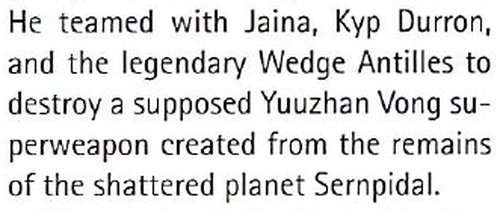

## p.53 (scan page 46)

Page contents: 418 words, 12 paragraphs | headings/entries: I]: many humans approaching

- **Luke Skywalker** — entry/section: Biggs fought alongside Luke Sky-: "He survived, but his participation in the illegal race marked the end of his professional career." Source: The New Essential Guide to Characters, p.53
  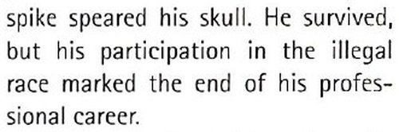

## p.54 (scan page 47)

Page contents: 526 words, 15 paragraphs | headings/entries: 

- **Dengar; Darth Vader (Anakin Skywalker)**: "A Star Destroyer seized Dengar's ship, and only the indulgence of Lord Vader saved Dengar from execution for treason." Source: The New Essential Guide to Characters, p.54
  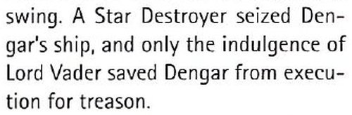
- **Dengar**: "Jabba, however, foresaw Dengar's betrayal and staked the bounty hunter out in the desert to die." Source: The New Essential Guide to Characters, p.54
  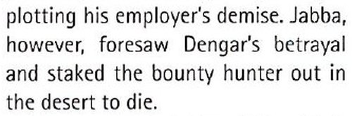
- **Dengar**: "Dengar survived, but Jabba didn't return from his trip to the Great Pit of Carkoon." Source: The New Essential Guide to Characters, p.54
  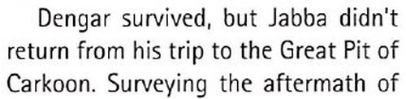
- **Dengar; Mara Jade Skywalker**: "Lesser bounty hunters tried to trade off his fame, including the hunter Gunner Groth, who posed as Dengar but was killed by Mara Jade on Rishi." Source: The New Essential Guide to Characters, p.54
  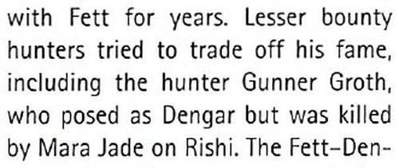

## p.55 (scan page 48)

Page contents: 480 words, 16 paragraphs | headings/entries: ENERAL JAN DODONNA,; Mon Mothma placed General

## p.56 (scan page 49)

Page contents: 529 words, 13 paragraphs | headings/entries: 

- **Darth Vader (Anakin Skywalker)**: "Dodonna maintained the besieged base for six months until Darth Vader moved to crush the Yavin Rebels with his Super Star Destroyer Executor." Source: The New Essential Guide to Characters, p.56
  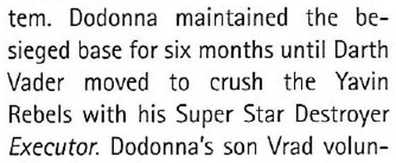

## p.57 (scan page 50)

Page contents: 505 words, 21 paragraphs | headings/entries: Masters line the walls of the Jedi; R ronzium busts of many great Jedi; Count Dooku; PRUE CMY TET ROVLDE STILE TT TET

## p.58 (scan page 51)

Page contents: 507 words, 21 paragraphs | headings/entries: STAR WARS: THE NEw ESSENTIAL GUIDE TO; DROMA; CHARACTERS Ss; =

## p.59 (scan page 52)

Page contents: 425 words, 14 paragraphs | headings/entries: Fe all his infamy, Jabba the Hutt; CH ae a as,

## p.60 (scan page 53)

Page contents: 432 words, 12 paragraphs | headings/entries: SALLI; A New Republic commando team

## p.61 (scan page 54)

Page contents: 460 words, 13 paragraphs | headings/entries: E asily one of the most polarizing; Nags

- **Kyp Durron**: "Carida's sun exploded, annihilating the planet and killing billions, including Kyp's brother." Source: The New Essential Guide to Characters, p.61
  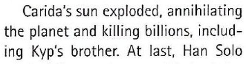

## p.62 (scan page 55)

Page contents: 542 words, 15 paragraphs | headings/entries: STAR WARS: THE NEw Es; SENTIAL GUIDE TO CHARACTERS; Bothered terrasse eereeen

- **Kyp Durron**: "Kyp Durron and Miko Reglia grew into a formidable team." Source: The New Essential Guide to Characters, p.62
  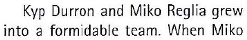
- **Lando Calrissian; Jaina Solo**: "With his Jedi reflexes, Durron became a hotshot pilot, posting the highest score in Lando Calrissian's "running-the-belt" game at Dubrillion, at least until his time was bested by Jaina Solo." Source: The New Essential Guide to Characters, p.62
  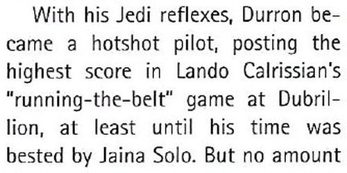
- **Jaina Solo**: "There they discovered that the Yuuzhan Vong had created a shipwomb amid Sernpidal's remains, and Durron enlisted Wedge Antilles and Jaina Solo to help in destroying it by telling them the enemy had created a superweapon." Source: The New Essential Guide to Characters, p.62
  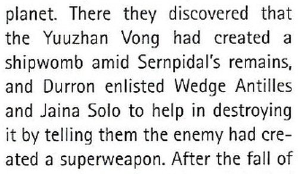

## p.63 (scan page 56)

Page contents: 495 words, 15 paragraphs | headings/entries: F our-LOM should never have had

## p.64 (scan page 57)

Page contents: 484 words, 18 paragraphs | headings/entries: PSSA EPRTRET ACSIA PTET ASSIST 1); Hele bhi Nedtnme bib: ete

## p.65 (scan page 58)

Page contents: 531 words, 12 paragraphs | headings/entries: 

## p.66 (scan page 59)

Page contents: 455 words, 16 paragraphs | headings/entries: PPT ETE Fee VETEEe; BRTET I er Ey eamisesane

## p.67 (scan page 60)

Page contents: 597 words, 11 paragraphs | headings/entries: 

- **Kyle Katarn**: "He tracked Katarn to Coruscant but botched the kill, and Katarn went on to destroy Mohc's Dark Trooper Project." Source: The New Essential Guide to Characters, p.67
  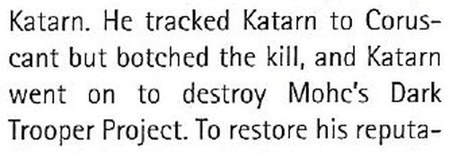
- **Boba Fett**: "To restore his reputation, Boba Fett wiped out an entire Imperial garrison on Vryssa in order to nab a bounty who'd hidden there for protection." Source: The New Essential Guide to Characters, p.67
  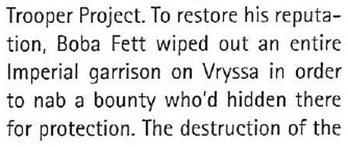
