# Owner Material 034 — The New Essential Guide to Characters (2002): scan pages 61–90

- **Source:** *Star Wars: The New Essential Guide to Characters* by Daniel Wallace, illustrated by Michael Sutfin (Del Rey, 2002). Secondary source (licensed Legends reference). Scan OCR'd on the box; the scan stays box-only and is **not** published.
- **Method:** every scanned page was OCR'd and machine-screened sentence by sentence for power-relevant statements (fights, kills, defeats, Force feats, rankings, superweapons) that name a character on our roster; each kept sentence is quoted verbatim from the OCR text and has a crop of the printed passage directly under it. Pages with nothing power-relevant are still listed with what is on them.
- **Citation:** "The New Essential Guide to Characters, p.X" by printed page ("scan p.X" where no printed number applies). **Weight:** Lucasfilm-licensed character guide: a secondary, in-universe summary of Legends and prequel-era material. Where the original story is in our notes, that source is the stronger citation.

## p.68 (scan page 61)

Page contents: 764 words, 13 paragraphs | headings/entries: STAR WARS:; The galaxy at large thought Boba; THE New ESSENTIAL GUIDE TO CHARACTERS

- **Bossk**: "For the mission Fett stole the freighter Hound's Tooth from his rival Bossk, leaving Slave | behind on Tatooine." Source: The New Essential Guide to Characters, p.68
  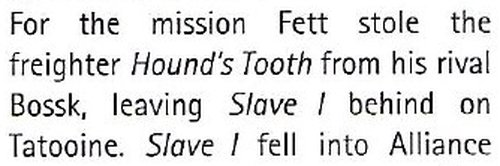
- **Boba Fett**: "When Jodo Kast threatened to blow his cover by encouraging people to believe that he was Boba Fett, Fett ambushed Kast and killed him." Source: The New Essential Guide to Characters, p.68
  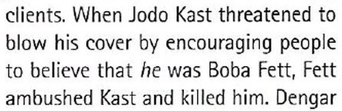

## p.69 (scan page 62)

Page contents: 483 words, 17 paragraphs | headings/entries: STAR WARS:; NGO FETT; Fatah omsanayaaias Hedi Fe; Pre Tenre Te lmersttit tie reine!

- **Jango Fett**: "Orphaned when his settler parents were killed in an uprising, Jango Fett joined the Mandalorian peacekeepers, a group of nomadic mercenaries with whom he traveled for a few years." Source: The New Essential Guide to Characters, p.69
  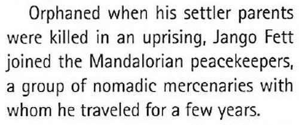
- **Jaster Mereel**: "Years before, Montross had killed Mandalorian officer Jaster Mereel and mounted his armor—bearing the skull insignia of Mereel's regiment—in his home as a grim trophy." Source: The New Essential Guide to Characters, p.69
  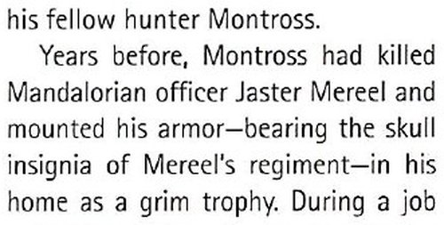

## p.70 (scan page 63)

Page contents: 487 words, 19 paragraphs | headings/entries: FRE TITTY; Bee Fey'lya was like a carnival; His Bothan faction gave the Re-

## p.71 (scan page 64)

Page contents: 539 words, 15 paragraphs | headings/entries: Disgraced among the New Repub-

## p.72 (scan page 65)

Page contents: 467 words, 20 paragraphs | headings/entries: STAR WARS:; THE New ESSENTIAL GUIDE TO CHARACTERS; Praise spilled forth from Jabba's

## p.73 (scan page 66)

Page contents: 576 words, 14 paragraphs | headings/entries: HARACTERS; SAS

## p.74 (scan page 67)

Page contents: 504 words, 16 paragraphs | headings/entries: R okur Gepta, self-proclaimed Sor-; VEDS Bowne tied ed bale Ribak aid; H Li ' 3

- **Rokur Gepta**: "Gepta joined their society, learned their secrets, then annihilated them—and all life on their planet—with the radiation of a unique bioweapon." Source: The New Essential Guide to Characters, p.74
  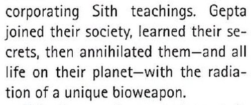
- **Rokur Gepta**: "As Emperor, he took a personal interest in Rokur Gepta, making him one of the most powerful individuals in the Centrality region." Source: The New Essential Guide to Characters, p.74
  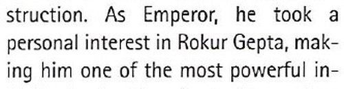
- **Rokur Gepta; Lando Calrissian** — entry/section: R okur Gepta, self-proclaimed Sor-: "Gepta teamed up with Mer to obtain the legendary Mindharp of Sharu by exploiting Lando Calrissian." Source: The New Essential Guide to Characters, p.74
  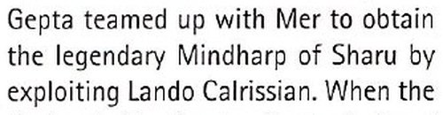
- **Lando Calrissian**: "The sorcerer killed billionaire Bohhuah Mutdah in the Oseon system and arranged for Lando Calrissian to make a delivery to the dead man's estate." Source: The New Essential Guide to Characters, p.74
  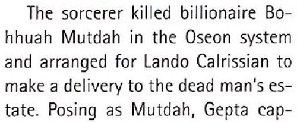
- **Rokur Gepta; Lando Calrissian** — entry/section: R okur Gepta, self-proclaimed Sor-: "During the laser duel Calrissian shot Gepta in the ankle, where the actual Croke lay nestled within his larger phantom form." Source: The New Essential Guide to Characters, p.74
  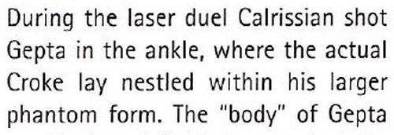
- **Rokur Gepta; Lando Calrissian** — entry/section: R okur Gepta, self-proclaimed Sor-: "The "body" of Gepta vanished, and Calrissian crushed the tiny Croke between his gloves." Source: The New Essential Guide to Characters, p.74
  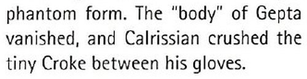

## p.75 (scan page 68)

Page contents: 483 words, 18 paragraphs | headings/entries: PRONUNCIATION ' Gré'-do; SEH"; HrAin CoL_or None; Eve CoLorn Purple; HEIGHT 1.65 meters; HomEWORLD Rodia

## p.76 (scan page 69)

Page contents: 416 words, 14 paragraphs | headings/entries: NS Se:

## p.77 (scan page 70)

Page contents: 567 words, 13 paragraphs | headings/entries: Fa NNER ER TS eevee; RS RAD BAH IB Haas

- **Padmé Amidala**: "Against all odds, Padmé survived." Source: The New Essential Guide to Characters, p.77
  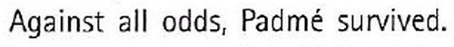

## p.78 (scan page 71)

Page contents: 438 words, 15 paragraphs | headings/entries: Pres officer. Ace pilot. Com-

## p.79 (scan page 72)

Page contents: 474 words, 18 paragraphs | headings/entries: TEAR ts; ERP ND TIR TPCT AS FT; Corran joined the; Pars ECTS; PUNE S ST SES

- **Corran Horn**: "Kirtan Loor, now working directly for Ysanne Isard, tried to destroy Corran and his squadron mates." Source: The New Essential Guide to Characters, p.79
  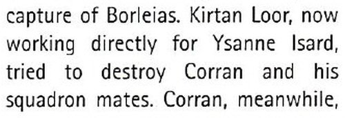

## p.80 (scan page 73)

Page contents: 609 words, 16 paragraphs | headings/entries: SITET?; Jedi academy. He spent much of his; Sree; STS ETT

- **Corran Horn**: "Eventually he rescued Mirax from Tavira's "Jedi advisers"—members of the hidden Jensaarai sect founded by a Dark Jedi whom Corran's grandfather had killed." Source: The New Essential Guide to Characters, p.80
  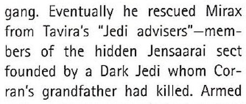
- **Corran Horn**: "Though Corran had no talent for telekinesis, he became one of the academy's experts at projecting images into the minds of others." Source: The New Essential Guide to Characters, p.80
  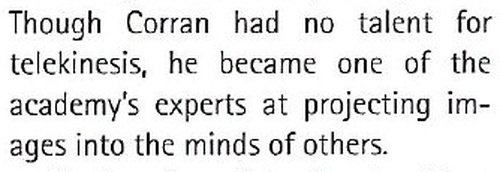
- **Corran Horn**: "The Yuuzhan Vong were also looking for the skeleton, and Corran killed two of them—almost at the expense of his own life." Source: The New Essential Guide to Characters, p.80
  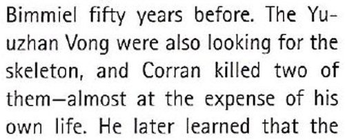
- **Corran Horn**: "Knowing his actions skirted dangerously close to the dark side, Corran challenged Shedao Shai to a duel." Source: The New Essential Guide to Characters, p.80
  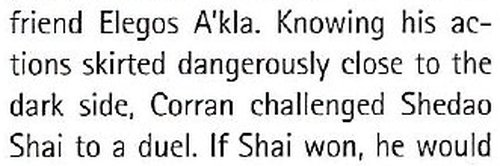
- **Corran Horn**: "Corran won the fatal contest, but Shai's treacherous assistant destroyed Ithor anyway." Source: The New Essential Guide to Characters, p.80
  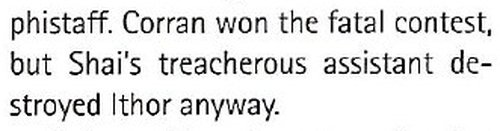

## p.81 (scan page 74)

Page contents: 472 words, 17 paragraphs | headings/entries: STAR WARS: THE NEw ESSENTIAL GUIDE TO; Oi have suggested that IG-88; CHARACTERS; To prevent anyone from stumbling; F 3 3 2 H :

## p.82 (scan page 75)

Page contents: 532 words, 14 paragraphs | headings/entries: STAR WARS: THE; New ESSENTIAL GUIDE TO CHARACTERS

## p.83 (scan page 76)

Page contents: 442 words, 15 paragraphs | headings/entries: T hey called her "Iceheart," for she

- **Palpatine (Darth Sidious); Darth Vader (Anakin Skywalker)**: "Impressed with her suggestion to build a combination internment center and _ brainwashing facility, Palpatine gave her the Super Star Destroyer Executor from the Kuat shipyards—a twin to Vader's Executor from Fondor." Source: The New Essential Guide to Characters, p.83
  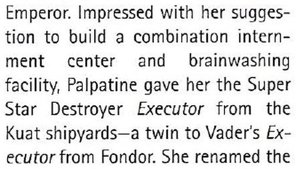

## p.84 (scan page 77)

Page contents: 548 words, 10 paragraphs | headings/entries: 

## p.85 (scan page 78)

Page contents: 431 words, 10 paragraphs | headings/entries: 

- **Corran Horn**: "Rogue pilot Corran Horn—making it appear as if he'd been killed in a crash—and retreated to the buried Lusankya." Source: The New Essential Guide to Characters, p.85
  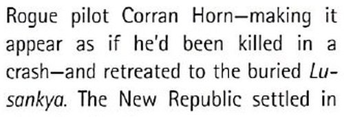
- **Palpatine (Darth Sidious)**: "To her shock Emperor Palpatine, reborn in a clone body, contacted her to demand her fealty." Source: The New Essential Guide to Characters, p.85
  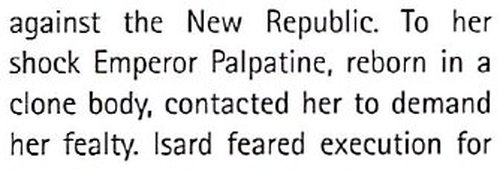
- **Grand Admiral Thrawn**: "After Thrawn's defeat, Ysanne Isard's TIE defenders rescued Rogue Squadron from an ambush at Corvis Minor." Source: The New Essential Guide to Characters, p.85
  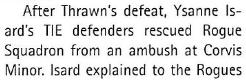

## p.86 (scan page 79)

Page contents: 466 words, 21 paragraphs | headings/entries: PRINCE ISOLDER-

## p.87 (scan page 80)

Page contents: 576 words, 20 paragraphs | headings/entries: ERSARO NE ITAA TTT}; CHARACTERS; Presryes; STPSTTE NY ERECT ss

- **Leia Organa Solo**: "A noninterventionist Hapan ambassador, Archon Beed Thane of Vergill, deliberately insulted Leia in order to provoke Isolder into an honor duel." Source: The New Essential Guide to Characters, p.87
  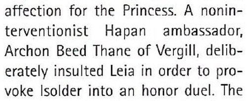

## p.88 (scan page 81)

Page contents: 430 words, 13 paragraphs | headings/entries: J abba Desilijic Tiure was approxi-; ABBA THE HuTT-

- **Ki-Adi-Mundi**: "Ki-Adi-Mundi opposed him again, and Jabba fought off a takeover attempt raised by his rival Gardulla." Source: The New Essential Guide to Characters, p.88
  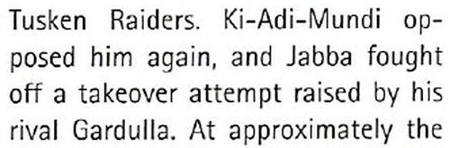

## p.89 (scan page 82)

Page contents: 493 words, 14 paragraphs | headings/entries: Solo's friends in the Rebel Alliance

## p.90 (scan page 83)

Page contents: 410 words, 10 paragraphs | headings/entries: With word of Jabba's demise,

- **Leia Organa Solo**: "He died when Leia Organa strangled him with her own chain." Source: The New Essential Guide to Characters, p.90
  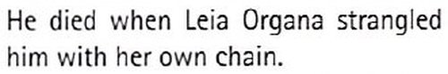

## p.91 (scan page 84)

Page contents: 415 words, 20 paragraphs | headings/entries: Old Republic, the Jedi Council; Depa Billaba; Adi Gallia; Ki-Adi-Mundi (Ke-a-dé-miin'-dé); As a Jedi Master, Ki-Adi-Mundi

## p.92 (scan page 85)

Page contents: 537 words, 20 paragraphs | headings/entries: Plo Koon; Eeth Koth; Even Piell; Oppo Rancisis

- **Yarael Poof**: "During the Stark Hyperspace Conflict, Yarael Poof's use of Jedi battle meditation helped ensure a victoryfor the Republic." Source: The New Essential Guide to Characters, p.92
  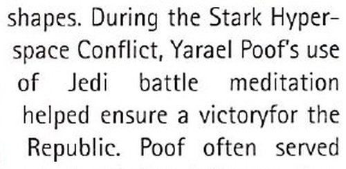

## p.93 (scan page 86)

Page contents: 371 words, 12 paragraphs | headings/entries: Saesee Tiin

## p.94 (scan page 87)

Page contents: 382 words, 19 paragraphs | headings/entries: Jie. vers; Kit Fisto; Barriss Offee; Shaak Ti

## p.95 (scan page 88)

Page contents: 457 words, 15 paragraphs | headings/entries: J betrayed the Jedi Order. He

- **Kyle Katarn; Jerec**: "He killed Morgan Katarn, father to Imperial Cadet Kyle Katarn, then a short time later Jerec decorated Kyle at the Caridan Academy's graduation ceremony." Source: The New Essential Guide to Characters, p.95
  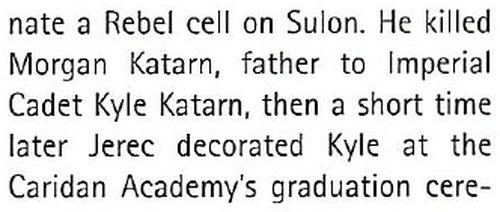

## p.96 (scan page 89)

Page contents: 451 words, 12 paragraphs | headings/entries: 

- **Jerec**: "Jerec planned to use Spore's contaminated army to overthrow the Emperor, but space slugs in Ithor's asteroid field destroyed the Vengeance." Source: The New Essential Guide to Characters, p.96
  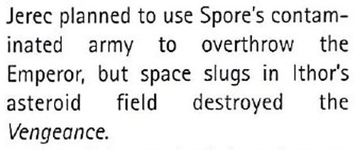
- **Jerec**: "Though he survived, Jerec became more cautious, and he postponed further coup attempts." Source: The New Essential Guide to Characters, p.96
  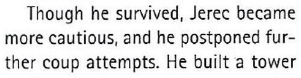
- **Kyle Katarn; Jerec; Yun (Dark Jedi)**: "Katarn had already defeated three of Jerec's allies, Yun, Gore, and Pic, and Jerec set a trap for the Jedi initiate at the Ruusan tower, threatening the life of Katarn's partner in the hope of luring Katarn to the dark side." Source: The New Essential Guide to Characters, p.96
  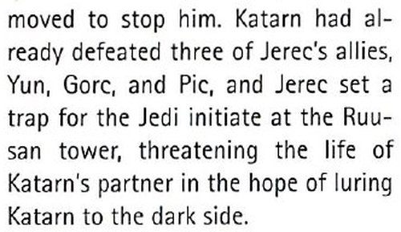

## p.97 (scan page 90)

Page contents: 457 words, 14 paragraphs | headings/entries: TRSRSS ESE FETE ECTS PS 77 FY; Gon Jinn always ended up re-

