# Owner Material 034 — The New Essential Guide to Characters (2002): scan pages 91–120

- **Source:** *Star Wars: The New Essential Guide to Characters* by Daniel Wallace, illustrated by Michael Sutfin (Del Rey, 2002). Secondary source (licensed Legends reference). Scan OCR'd on the box; the scan stays box-only and is **not** published.
- **Method:** every scanned page was OCR'd and machine-screened sentence by sentence for power-relevant statements (fights, kills, defeats, Force feats, rankings, superweapons) that name a character on our roster; each kept sentence is quoted verbatim from the OCR text and has a crop of the printed passage directly under it. Pages with nothing power-relevant are still listed with what is on them.
- **Citation:** "The New Essential Guide to Characters, p.X" by printed page ("scan p.X" where no printed number applies). **Weight:** Lucasfilm-licensed character guide: a secondary, in-universe summary of Legends and prequel-era material. Where the original story is in our notes, that source is the stronger citation.

## p.98 (scan page 91)

Page contents: 376 words, 11 paragraphs | headings/entries: 

- **Qui-Gon Jinn**: "Qui-Gon, a master duelist by anyone's standards, no longer had the stamina of youth." Source: The New Essential Guide to Characters, p.98
  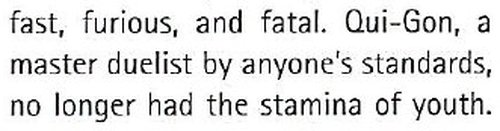

## p.99 (scan page 92)

Page contents: 466 words, 15 paragraphs | headings/entries: 

- **Kir Kanos; Darth Vader (Anakin Skywalker)**: "As Kanos stood over his partner's broken body, Darth Vader attacked and defeated the victorious guardsman, leaving Kanos with a jagged facial scar—and a reminder of his place in the Emperor's hierarchy." Source: The New Essential Guide to Characters, p.99
  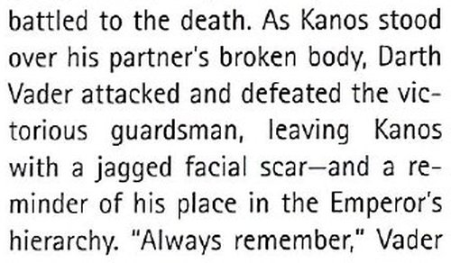
- **Palpatine (Darth Sidious)**: "They knew Palpatine's power was great, and their faith was rewarded when the Emperor returned from death ina clone body." Source: The New Essential Guide to Characters, p.99
  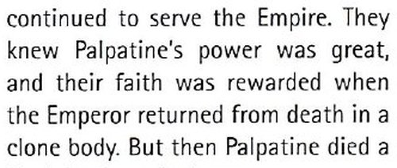
- **Kir Kanos**: "Kanos won the duel, and in doing so became the last Royal Guard." Source: The New Essential Guide to Characters, p.99
  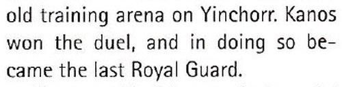

## p.100 (scan page 93)

Page contents: 471 words, 18 paragraphs | headings/entries: STAR WARS:; THE New ESSENTIAL GUIDE TO CHARACTERS; PSTETESECIERT DT IETS

## p.101 (scan page 94)

Page contents: 558 words, 14 paragraphs | headings/entries: STAR WARS: THE NEw ESSENTIAL GUID; E TO CHARACTERS

- **Grand Admiral Thrawn**: "Now set firmly against Grand Admiral Thrawn, Karrde convinced several rival smuggling kingpins to work with him against the Empire." Source: The New Essential Guide to Characters, p.101
  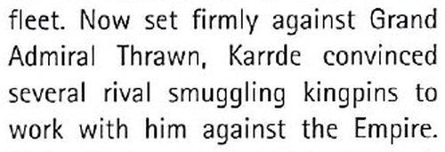
- **Grand Admiral Thrawn**: "Their efforts proved vital in Thrawn's defeat at the Battle of Bilbringi." Source: The New Essential Guide to Characters, p.101
  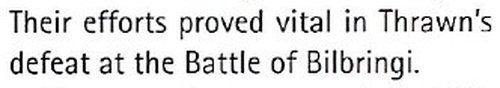
- **Han Solo; Kueller**: "Karrde helped Han Solo obtain the ysalamiri used to defeat the tyrant Kueller during the Almanian crisis." Source: The New Essential Guide to Characters, p.101
  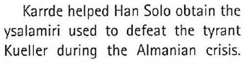

## p.102 (scan page 95)

Page contents: 464 words, 21 paragraphs | headings/entries: ARYLE Katarn; Si AAD bah abt reeeebore ae

- **Kyle Katarn** — entry/section: ARYLE Katarn: "Moments after graduation, Kyle learned that his father was dead—"killed by Rebels," as the official Imperial report stated." Source: The New Essential Guide to Characters, p.102
  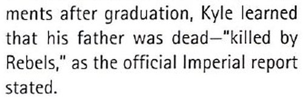

## p.103 (scan page 96)

Page contents: 537 words, 13 paragraphs | headings/entries: TRISSS FTES

- **Jerec**: "One year after Endor, he learned from the droid information broker 8t88 that Jerec—the same Dark Jedi who had awarded him his Imperial medal—had been the one who'd killed his father." Source: The New Essential Guide to Characters, p.103
  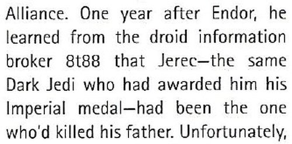
- **Jerec; Yun (Dark Jedi); Sariss; Boc Aseca; Kyle Katarn**: "Jerec's six underlings—Yun, Gore, Pic, Maw, Sariss, and Boc the Crude— proved no match for Katarn, inexperienced though he was." Source: The New Essential Guide to Characters, p.103
  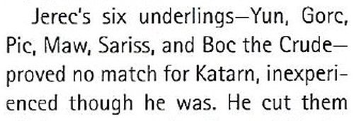
- **Jerec**: "In the final showdown with Jerec, in the Valley of the Jedi, he put aside his hatred, refusing to kill Jerec in cold blood and defeating him in fair combat." Source: The New Essential Guide to Characters, p.103
  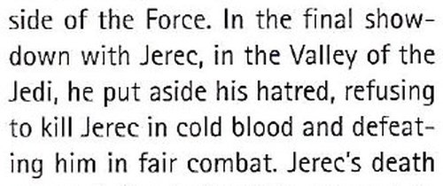
- **Kyle Katarn**: "During the resurrected Emperor's campaign, Captain Katarn helped defend a New Republic outpost on Altyr 5." Source: The New Essential Guide to Characters, p.103
  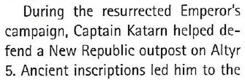

## p.104 (scan page 97)

Page contents: 468 words, 11 paragraphs | headings/entries: BI- Wan KENOB; Vos knowledge is impressive,

## p.105 (scan page 98)

Page contents: 601 words, 13 paragraphs | headings/entries: 

- **Obi-Wan Kenobi**: "As the years passed Kenobi grew skilled in Force techniques including speed, healing, and telekinesis." Source: The New Essential Guide to Characters, p.105
  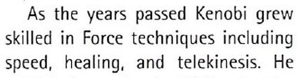

## p.106 (scan page 99)

Page contents: 765 words, 13 paragraphs | headings/entries: 

- **Quinlan Vos** — entry/section: Vos knowledge is impressive,: "The Jedi who survived the Clone Wars saw their numbers decimated by the Emperor's Jedi Purge." Source: The New Essential Guide to Characters, p.106
  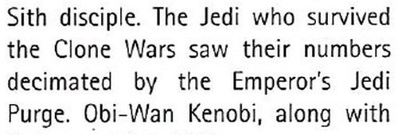

## p.107 (scan page 100)

Page contents: 493 words, 18 paragraphs | headings/entries: TSS TOTS SSeS TSSees Sst; L uke Skywalker first knew Kueller; Ne

- **Kueller**: "Skywalker had already escaped from Kueller's dungeon, but Kueller intercepted him and forced a lightsaber duel." Source: The New Essential Guide to Characters, p.107
  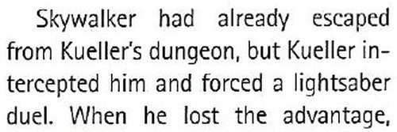

## p.108 (scan page 101)

Page contents: 503 words, 23 paragraphs | headings/entries: BSE BAA al baa id hes dis; Gib dues acicga 44s saa eaabaed shad; XAR KUN

- **Freedon Nadd; Exar Kun**: "After obliterating Nadd's lingering spirit, Exar Kun made Yavin 4 the new fulcrum of Sith power." Source: The New Essential Guide to Characters, p.108
  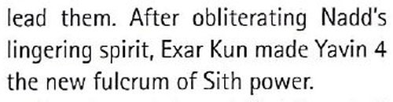
- **Vodo-Siosk Baas**: "Kun strode into the heart of Coruscant and slew his former Master Vodo Siosk-Baas on the floor of the Senate chamber." Source: The New Essential Guide to Characters, p.108
  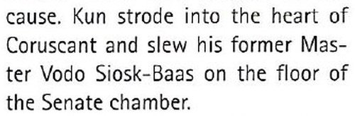
- **Luke Skywalker; Exar Kun; Kyp Durron**: "When Luke Skywalker's Jedi academy set up shop in the same Massassi temples, Exar Kun took possession of Luke's most powerful student, Kyp Durron, driving Skywalker into a state of near death." Source: The New Essential Guide to Characters, p.108
  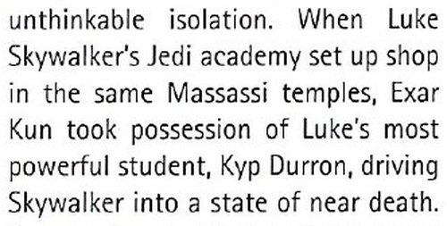

## p.109 (scan page 102)

Page contents: 420 words, 19 paragraphs | headings/entries: PRONUNCIATION V Sa'-v6ng Lah; SPECIES Yuuzhan Vong; SEH Male; Hnrin CoLcor Black; Eve CoLorn Black; HEIGHT 1.96 meters; HomMEWORLD Unknown

## p.110 (scan page 103)

Page contents: 485 words, 11 paragraphs | headings/entries: 

## p.111 (scan page 104)

Page contents: 474 words, 19 paragraphs | headings/entries: PRONUNCIATION; ST reentry irene tty i

## p.112 (scan page 105)

Page contents: 480 words, 16 paragraphs | headings/entries: R evel Lemelisk wasn't the only sci-; NCEE ed

- **Palpatine (Darth Sidious)**: "Emperor Palpatine approved the construction of a Death Star prototype—the first weapon ever to wield a superlaser—and later gave his blessing to a production version." Source: The New Essential Guide to Characters, p.112
  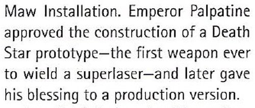
- **Grand Moff Tarkin**: "Motivated by fear, he set to work designing the second Death Star, and also built the Tarkin superlaser." Source: The New Essential Guide to Characters, p.112
  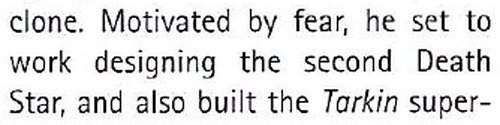
- **Palpatine (Darth Sidious)**: "The second Death Star was destroyed at Endor—taking Palpatine with it—and Lemelisk joined the Imperial design team at Kuat." Source: The New Essential Guide to Characters, p.112
  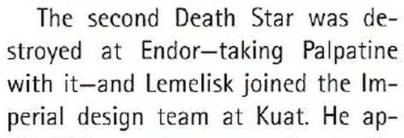

## p.113 (scan page 106)

Page contents: 487 words, 16 paragraphs | headings/entries: OBOT; Pee rerent tint site tents; EyIOTE Ty

## p.114 (scan page 107)

Page contents: 534 words, 29 paragraphs | headings/entries: Eisabr bess; ESYIBITOT TEMS TAA TIT TEA TET; ITN PR TENS we; Lope rare ces ray reT TT; RST NCT AE; PEsrrrerervazee:; SRT SYST ET OSSST TT ET srTSTS}

## p.115 (scan page 108)

Page contents: 464 words, 19 paragraphs | headings/entries: I mre; ENERAL Crix MADIN

## p.116 (scan page 109)

Page contents: 443 words, 11 paragraphs | headings/entries: 

## p.117 (scan page 110)

Page contents: 462 words, 26 paragraphs | headings/entries: ARACTERS; PRONUNCIATION; Darth Mal; SEH Male; Hain CoLtor None; Eve Coior Yellow; HEIGHT; HomeEWORLD lridonia

- **Darth Maul; Palpatine (Darth Sidious)**: "When Maul was struck down on Naboo, Sidious cast him aside like a broken blade and quickly obtained a replacement." Source: The New Essential Guide to Characters, p.117
  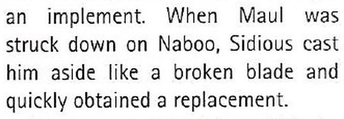
- **Palpatine (Darth Sidious); Darth Maul**: "On one occasion, as punishment for flinching at a dinko's bite, Sidious filled young Maul's quarters with scores of dinkos and locked him in the room until he had killed every last one." Source: The New Essential Guide to Characters, p.117
  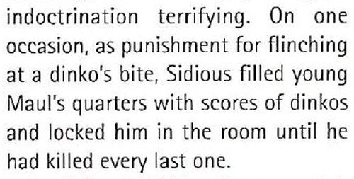
- **Darth Maul**: "Maul persevered, but his final test was to battle his Master in a lightsaber duel." Source: The New Essential Guide to Characters, p.117
  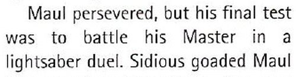

## p.118 (scan page 111)

Page contents: 433 words, 10 paragraphs | headings/entries: 

- **Darth Maul**: "Darth Maul killed Monchar with ease, but as more people exposed themselves to the Neimoidian's information, Maul had to add more bodies to the pile." Source: The New Essential Guide to Characters, p.118
  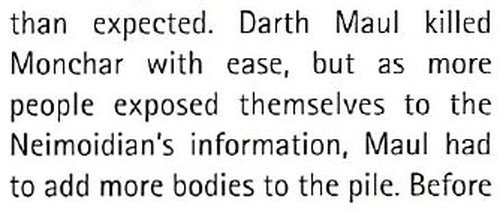

## p.119 (scan page 112)

Page contents: 477 words, 14 paragraphs | headings/entries: ON MOTHMA

## p.120 (scan page 113)

Page contents: 511 words, 13 paragraphs | headings/entries: AAR a RARER Riera aioe

- **Palpatine (Darth Sidious)**: "But even his forces could not hold off the armies of the resurrected Emperor Palpatine." Source: The New Essential Guide to Characters, p.120
  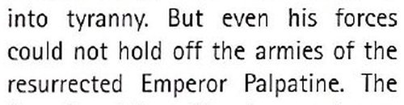
- **Ambassador Furgan**: "Not even a year into her term as Chief of State, Mon Mothma survived a second assassination attempt, this time by Ambassador Furgan of Carida." Source: The New Essential Guide to Characters, p.120
  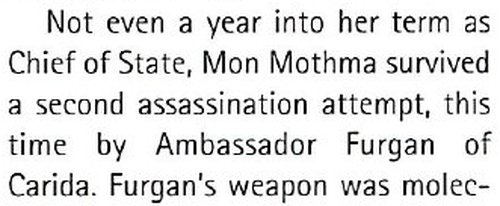

## p.121 (scan page 114)

Page contents: 508 words, 23 paragraphs | headings/entries: PRONUNCIATION; None -Eve CoLonr; Orange HEIGHT; Hain CoLor 'Naboo

## p.122 (scan page 115)

Page contents: 534 words, 21 paragraphs | headings/entries: Scommeaaeecehiaet

- **Jaina Solo; Lowbacca**: "Nunb, along with the Jedi Knights Jaina Solo and Lowbacca, defeated Czethros and booted his henchmen off Kessel for good." Source: The New Essential Guide to Characters, p.122
  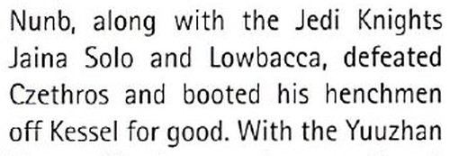

## p.123 (scan page 116)

Page contents: 459 words, 18 paragraphs | headings/entries: Nym and his new allies hit Trade; ESHER ASSO TCO RANCH LOT a OE; ET ESTs)

- **Darth Vader (Anakin Skywalker)**: "With the Trade Federation's flanking forces decimated, the Gungans survived long enough for Anakin Skywalker to destroy the Droid Control Ship." Source: The New Essential Guide to Characters, p.123
  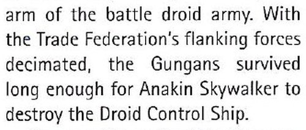

## p.124 (scan page 117)

Page contents: 469 words, 17 paragraphs | headings/entries: 

## p.125 (scan page 118)

Page contents: 461 words, 16 paragraphs | headings/entries: Sri paps rere ag mrp; ROSSER TE TIVES EEPESTE TF; STREETER; SAO REIT ONO EYEE UT TTP?

- **Palpatine (Darth Sidious)**: "Early in Palpatine's career, no one ever thought that this subdued politician from backwater Naboo could ascend to the most powerful office in the galaxy." Source: The New Essential Guide to Characters, p.125
  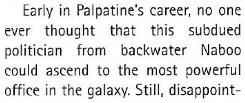

## p.126 (scan page 119)

Page contents: 582 words, 24 paragraphs | headings/entries: Emperor Palpatine named Sate

## p.127 (scan page 120)

Page contents: 794 words, 12 paragraphs | headings/entries: 

- **Palpatine (Darth Sidious)** — entry/section: Emperor Palpatine named Sate: "Palpatine commissioned the vast flagship Eclipse—though it would be years before his vessel would see completion—and survived a coup attempt when Grand Admiral Zaarin tried to kidnap him on Coruscant." Source: The New Essential Guide to Characters, p.127
  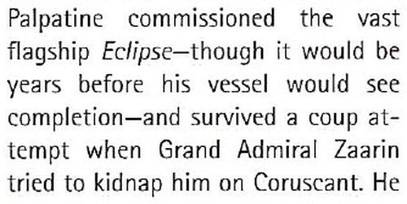
- **Palpatine (Darth Sidious); Darth Vader (Anakin Skywalker); Prince Xizor** — entry/section: Emperor Palpatine named Sate: "He also enjoyed pitting Darth Vader against Black Sun leader Prince Xizor, a game that ended when Vader vaporized his rival." Source: The New Essential Guide to Characters, p.127
  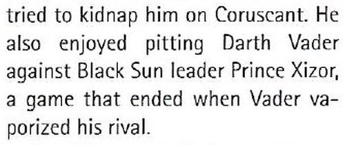
- **Palpatine (Darth Sidious); Darth Vader (Anakin Skywalker); Luke Skywalker** — entry/section: Emperor Palpatine named Sate: "Palpatine dreamed of replacing Vader with someone even more powerful— Anakin Skywalker's son, Luke." Source: The New Essential Guide to Characters, p.127
  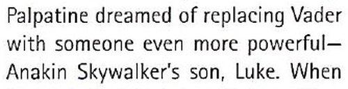
- **Luke Skywalker**: "Luke Skywalker went to Byss to stop the Emperor, and instead joined his cause, hoping he could defeat the dark side from within." Source: The New Essential Guide to Characters, p.127
  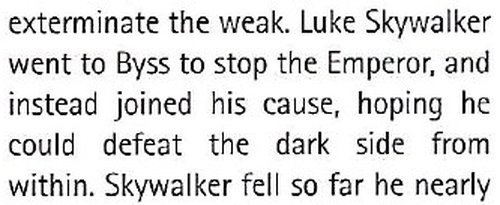
- **Palpatine (Darth Sidious)** — entry/section: Emperor Palpatine named Sate: "The Emperor died aboard his flagship the Eclipse when brother and sister turned Palpatine's all-consuming Force storm back on its maker." Source: The New Essential Guide to Characters, p.127
  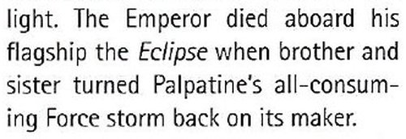
- **Palpatine (Darth Sidious)** — entry/section: Emperor Palpatine named Sate: "His spirit had survived disembodiment once before, so Palpatine had little difficulty inhabiting a fresh clone on Byss and returning to menace the New Republic." Source: The New Essential Guide to Characters, p.127
  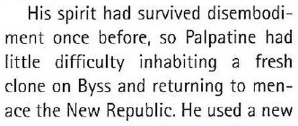
- **Palpatine (Darth Sidious); Han Solo** — entry/section: Emperor Palpatine named Sate: "On Onderon, Palpatine tried to take possession of the baby, but Han Solo shot him dead." Source: The New Essential Guide to Characters, p.127
  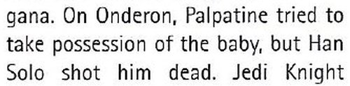
