# Owner Material 034 — The New Essential Guide to Characters (2002): scan pages 121–150

- **Source:** *Star Wars: The New Essential Guide to Characters* by Daniel Wallace, illustrated by Michael Sutfin (Del Rey, 2002). Secondary source (licensed Legends reference). Scan OCR'd on the box; the scan stays box-only and is **not** published.
- **Method:** every scanned page was OCR'd and machine-screened sentence by sentence for power-relevant statements (fights, kills, defeats, Force feats, rankings, superweapons) that name a character on our roster; each kept sentence is quoted verbatim from the OCR text and has a crop of the printed passage directly under it. Pages with nothing power-relevant are still listed with what is on them.
- **Citation:** "The New Essential Guide to Characters, p.X" by printed page ("scan p.X" where no printed number applies). **Weight:** Lucasfilm-licensed character guide: a secondary, in-universe summary of Legends and prequel-era material. Where the original story is in our notes, that source is the stronger citation.

## p.128 (scan page 121)

Page contents: 480 words, 17 paragraphs | headings/entries: PTAIN PANAKA; Tr

## p.129 (scan page 122)

Page contents: 543 words, 14 paragraphs | headings/entries: Six months before the Battle of

## p.130 (scan page 123)

Page contents: 466 words, 23 paragraphs | headings/entries: IDMIRAL GILAD PEL; AEO}

## p.131 (scan page 124)

Page contents: 562 words, 12 paragraphs | headings/entries: 

## p.132 (scan page 125)

Page contents: 484 words, 15 paragraphs | headings/entries: Palpatine, it was Sate Pestage. He; Pestage realized his hold on the

- **Palpatine (Darth Sidious)**: "On Byss, Pestage helped bring about Palpatine's own resurrection through cloning." Source: The New Essential Guide to Characters, p.132
  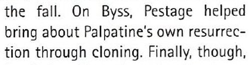

## p.133 (scan page 126)

Page contents: 496 words, 19 paragraphs | headings/entries: Piett." Few captains ever achieve; Ecorspre renccer pn parepraccag message; PERRO ERNE EE StOSEE? SE077F 27

- **Darth Vader (Anakin Skywalker)**: "Vader assigned Piett to his personal fleet of Star Destroyers, to command the Accuser under the fleet leadership of Admiral Griff." Source: The New Essential Guide to Characters, p.133
  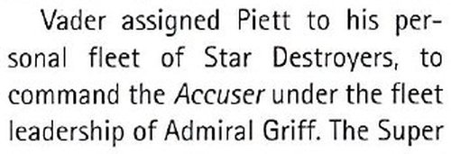

## p.134 (scan page 127)

Page contents: 379 words, 17 paragraphs | headings/entries: Aldar Beedo; Dud Bolt; Tr ETT aes ee ee Ceres tor

## p.135 (scan page 128)

Page contents: 752 words, 26 paragraphs | headings/entries: Gasgano; Mars Guo; Clegg Holdfast; Neva Kee; Elan Mak; Ody Mandrell; Teemto Pagalies (Tém'-to Pa'-ga-léz)

## p.136 (scan page 129)

Page contents: 755 words, 21 paragraphs | headings/entries: Ben Quadinaros; Boles Roor; Ark "Bumpy" Roose; Wan Sandage; Ratts Tyerell

## p.137 (scan page 130)

Page contents: 548 words, 22 paragraphs | headings/entries: Pb tb mb eat des; Oe PS TPIS AEE OOO

- **Ulic Qel-Droma**: "The Sith seductions he enjoyed as a Krath disciple overwhelmed Ulic." Source: The New Essential Guide to Characters, p.137
  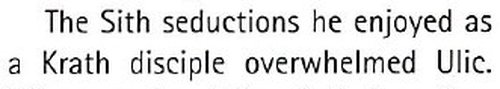

## p.138 (scan page 131)

Page contents: 409 words, 14 paragraphs | headings/entries: Ses St

- **Darth Vader (Anakin Skywalker)**: "During the battle to reclaim Naboo from the Trade Federation, Artoo and young Anakin Skywalker flew together inside an N-1 starfighter—firing the proton torpedoes that destroyed the enemy's mightiest battleship." Source: The New Essential Guide to Characters, p.138
  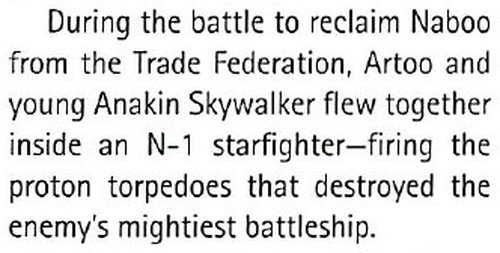

## p.139 (scan page 132)

Page contents: 634 words, 19 paragraphs | headings/entries: 

## p.140 (scan page 133)

Page contents: 341 words, 9 paragraphs | headings/entries: 

## p.141 (scan page 134)

Page contents: 488 words, 25 paragraphs | headings/entries: Hi: Solo knew Dash Rendar for; PRONUNCIATION Dash Rén'-dar; SPECIES Human; SEH Male; Hnrin CoLtor Red; Eve CoL.or; Green HEIGHT; Corellia

## p.142 (scan page 135)

Page contents: 507 words, 19 paragraphs | headings/entries: SADOW

- **Naga Sadow; Ludo Kressh**: "Sadow schemed to become the next Dark Lord by discrediting his rival Ludo Kressh, and the arrival of Republic explorers Jori and Gav Daragon provided the needed catalyst." Source: The New Essential Guide to Characters, p.142
  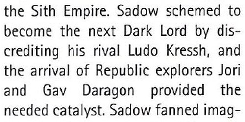

## p.143 (scan page 136)

Page contents: 462 words, 19 paragraphs | headings/entries: HRACKAN SAL-; FY i = 2 3

## p.144 (scan page 137)

Page contents: 448 words, 12 paragraphs | headings/entries: 

## p.145 (scan page 138)

Page contents: 465 words, 16 paragraphs | headings/entries: SEBULBA —; Sebulba was born in Pixelito, a

## p.146 (scan page 139)

Page contents: 502 words, 13 paragraphs | headings/entries: 

- **Darth Vader (Anakin Skywalker)**: "Anakin Skywalker's upset victory in the Boonta Eve Classic wounded Sebulba's pride and destroyed his Split-X Mammoth." Source: The New Essential Guide to Characters, p.146
  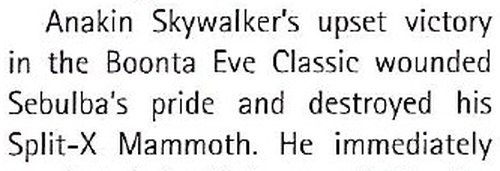

## p.147 (scan page 140)

Page contents: 455 words, 18 paragraphs | headings/entries: ERTIES PETTY; Bobeahebhi ahh sheds Btdieaiea moulds ee; Gigtibabobhaates Lckitabiabbasisiunaas batastaonaabiaaaaeabaasibaid

- **Palpatine (Darth Sidious)**: "When Palpatine awoke in a new clone body, he rewarded Sedriss by absorbing him into his will and making him the leader of the Dark Side Elite." Source: The New Essential Guide to Characters, p.147
  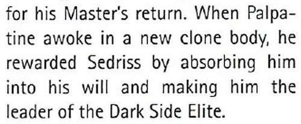

## p.148 (scan page 141)

Page contents: 482 words, 16 paragraphs | headings/entries: ENATOR Viol Si; Vigi Shesh. Though not sadistic

## p.149 (scan page 142)

Page contents: 474 words, 12 paragraphs | headings/entries: PALA ODE IM A EET RES IS; TERI TY

## p.150 (scan page 143)

Page contents: 518 words, 20 paragraphs | headings/entries: DARTH Sipious"; On the surface,; L* a dejarik grandmaster, the; Lord Sidious's; Lasashai bard asada densa sainaye

- **Palpatine (Darth Sidious); Obi-Wan Kenobi** — entry/section: Lord Sidious's: "His pawns were captured by Queen Amidala; his apprentice was cut down by Obi-Wan Kenobi." Source: The New Essential Guide to Characters, p.150
  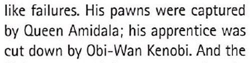

## p.151 (scan page 144)

Page contents: 428 words, 20 paragraphs | headings/entries: RR; PRONUNCIATION Rath S@-nar; SPECIES Human; SEX Male; Hain CoLor Black; Eve Co.L_onr Blue; HEIGHT 1.8 meters

## p.152 (scan page 145)

Page contents: 481 words, 11 paragraphs | headings/entries: 

## p.153 (scan page 146)

Page contents: 472 words, 20 paragraphs | headings/entries: PERTNETE SESPSIET STS ESTE TSS We; The Hutt wanted his own personal; Espo we rrce sete; Nn sere wet bet ted abet

## p.154 (scan page 147)

Page contents: 473 words, 11 paragraphs | headings/entries: 

- **Darth Krayt; Ki-Adi-Mundi**: "She killed Hett, but his son A'Sharad survived and became the Padawan learner of Ki-Adi-Mundi." Source: The New Essential Guide to Characters, p.154
  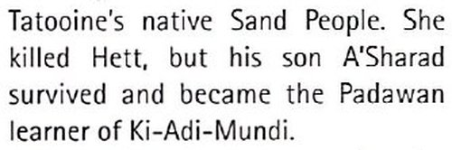

## p.155 (scan page 148)

Page contents: 496 words, 15 paragraphs | headings/entries: Dan

- **Darth Vader (Anakin Skywalker)**: "The slave dealers implanted in Anakin's body a tracking device that would explode should he ever escape." Source: The New Essential Guide to Characters, p.155
  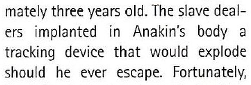
- **Darth Vader (Anakin Skywalker)**: "Fortunately, Gardulla had also bought Anakin's mother, Shmi, and their strong bond made it possible for Anakin to survive his enslavement with remarkable good humor." Source: The New Essential Guide to Characters, p.155
  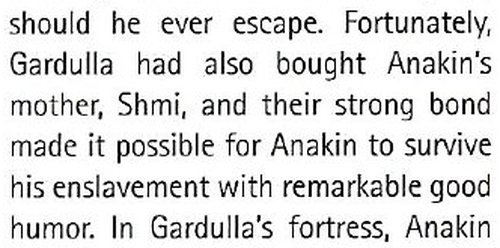

## p.156 (scan page 149)

Page contents: 854 words, 14 paragraphs | headings/entries: Sb bb Bee oo seeps +

- **Count Dooku; Darth Vader (Anakin Skywalker)**: "Dooku, far superior to Anakin in the art of the duel, severed the young man's right arm, which would later be replaced with a crude metal one." Source: The New Essential Guide to Characters, p.156
  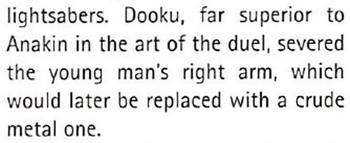
- **Darth Vader (Anakin Skywalker); An'ya Kuro (Dark Woman)**: "Shortly before the Battle of Yavin, Vader killed the Dark Woman, one of the last stragglers from the Jedi Purge and a woman who'd known Anakin when he was still an uncorrupted boy." Source: The New Essential Guide to Characters, p.156
  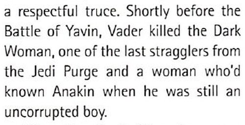

## p.157 (scan page 150)

Page contents: 680 words, 24 paragraphs | headings/entries: At Fondor, the Super Star Destroyer; Luke fell into an open air; Luke's severed hand. He presented; SEURETpSSPTT TNE FFs FLT FT PTET TTT]

- **Darth Vader (Anakin Skywalker)**: "Vader made the mighty vessel his flagship and roared to Yavin to annihilate the Rebel base." Source: The New Essential Guide to Characters, p.157
  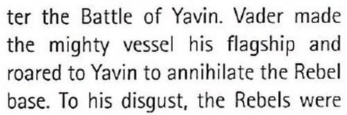
- **Luke Skywalker; Leia Organa Solo; Darth Vader (Anakin Skywalker); Obi-Wan Kenobi**: "When his underlings captured Luke Skywalker and Princess Leia on Mimban, Vader rushed to the world and engaged both Rebels in combat, but the spirit of Obi-Wan Kenobi, fighting through Skywalker, defeated Vader and cut through his mechanical right arm." Source: The New Essential Guide to Characters, p.157
  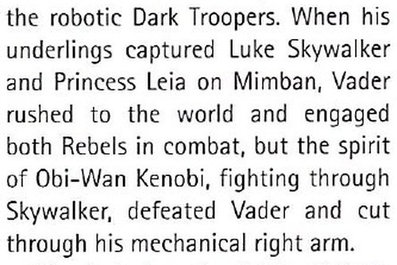
- **Darth Vader (Anakin Skywalker); Prince Xizor**: "Vader refused to allow anyone to touch Skywalker before he had a chance to recruit him, and he punished Xizor by vaporizing the Falleen crime lord aboard his luxury skyhook." Source: The New Essential Guide to Characters, p.157
  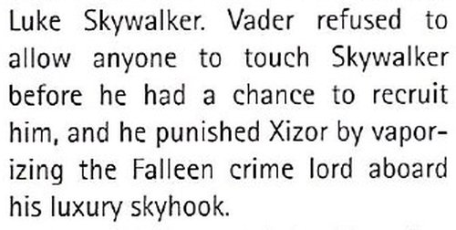
- **Luke Skywalker; Darth Vader (Anakin Skywalker)** — entry/section: Luke's severed hand. He presented: "Luke tried to reach the core of goodness that had once been Anakin Skywalker, but when Vader learned he had a daughter and threatened to drive her to the dark side, an enraged Luke overwhelmed his father and cut off Vader's right hand." Source: The New Essential Guide to Characters, p.157
  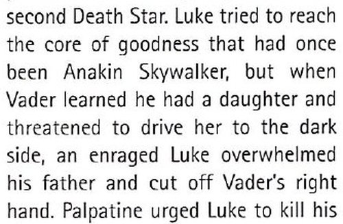
- **Palpatine (Darth Sidious); Darth Vader (Anakin Skywalker)**: "As Palpatine tortured the younger Skywalker with Force lightning, Anakin seized the tyrannical sorcerer and cast him down the Death Star's reactor shaft." Source: The New Essential Guide to Characters, p.157
  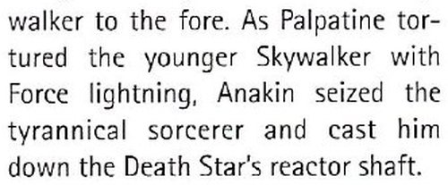
