# Owner Material 034 — The New Essential Guide to Characters (2002): scan pages 151–180

- **Source:** *Star Wars: The New Essential Guide to Characters* by Daniel Wallace, illustrated by Michael Sutfin (Del Rey, 2002). Secondary source (licensed Legends reference). Scan OCR'd on the box; the scan stays box-only and is **not** published.
- **Method:** every scanned page was OCR'd and machine-screened sentence by sentence for power-relevant statements (fights, kills, defeats, Force feats, rankings, superweapons) that name a character on our roster; each kept sentence is quoted verbatim from the OCR text and has a crop of the printed passage directly under it. Pages with nothing power-relevant are still listed with what is on them.
- **Citation:** "The New Essential Guide to Characters, p.X" by printed page ("scan p.X" where no printed number applies). **Weight:** Lucasfilm-licensed character guide: a secondary, in-universe summary of Legends and prequel-era material. Where the original story is in our notes, that source is the stronger citation.

## p.158 (scan page 151)

Page contents: 510 words, 29 paragraphs | headings/entries: UKE SKYWALKER-; T ragedy has shaped much of Luke; The adventure he longed for even-; PRONUNCIATION L6Ok Ski'-walk-ar; SPECIES Human; SEH Male; Harin CoLor Blond; Eve CoLton Blue; HEIGHT 1.72 meters; HomeEWORLD; Tatooine; Whey baja otal

- **Luke Skywalker** — entry/section: T ragedy has shaped much of Luke: "Even now, the Yuuzhan Vong threaten to destroy the Jedi Order Luke has worked so hard to restore." Source: The New Essential Guide to Characters, p.158
  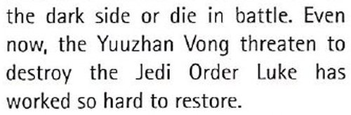

## p.159 (scan page 152)

Page contents: 654 words, 12 paragraphs | headings/entries: 

- **Luke Skywalker; Leia Organa Solo; Darth Vader (Anakin Skywalker); Obi-Wan Kenobi**: "While the Alliance fleet hopped across the galaxy, Luke volunteered for missions to worlds such as Mimban, where he and Leia Organa faced Vader with unusual help from the spirit of Obi-Wan Kenobi, who actually possessed Luke's body during a duel." Source: The New Essential Guide to Characters, p.159
  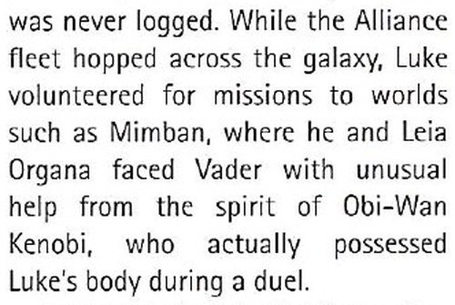
- **Luke Skywalker; Darth Vader (Anakin Skywalker)**: "Luke had suffered a stinging defeat from the Dark Lord, and in the process learned that Darth Vader was his father." Source: The New Essential Guide to Characters, p.159
  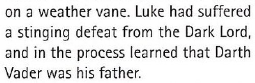
- **Lumiya**: "He flew many missions with Rebel pilot and double agent Shira Brie, and was nearly courtmatialed when it appeared he had killed her in a dogfight." Source: The New Essential Guide to Characters, p.159
  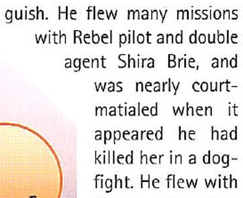
- **Luke Skywalker**: "In some ways Luke had never felt more alone than after the defeat of the Empire and the redemption of his father, but there was no time for contemplation." Source: The New Essential Guide to Characters, p.159
  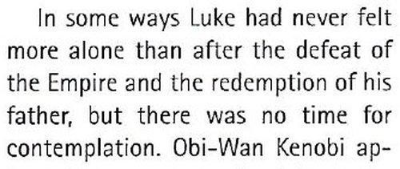

## p.160 (scan page 153)

Page contents: 875 words, 19 paragraphs | headings/entries: 

- **Luke Skywalker; Palpatine (Darth Sidious)**: "As the most powerful light-side Jedi in the galaxy, Luke Skywalker seemed preordained to oppose the Emperor's clone, but he remained haunted by thoughts of his father, who had served Palpatine only to destroy his Master when Palpatine had least expected it." Source: The New Essential Guide to Characters, p.160
  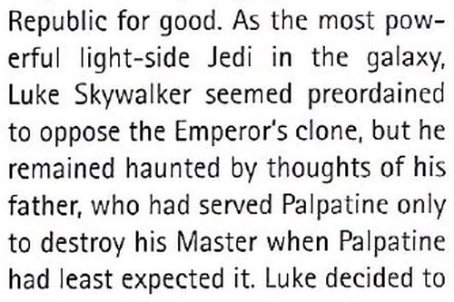
- **Luke Skywalker; Exar Kun**: "What Luke didn't realize was that trapped within the stone walls of many of the buildings on Yavin 4 thrived the spirit of Dark Lord Exar Kun, who soon killed one of Luke's students." Source: The New Essential Guide to Characters, p.160
  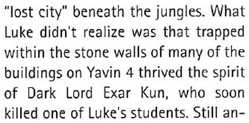

## p.161 (scan page 154)

Page contents: 489 words, 24 paragraphs | headings/entries: Jape Skyw; PRONUNCIATION Ma'-ra Jad Ski'-walk-tr; SPECIES Human; SEH Female; Hrin CoLtor Red-gold; Green; HEIGHT 1.6 meters; HomMEWORLD Unknown; We perry

- **Palpatine (Darth Sidious); Mara Jade Skywalker**: "Raised on Palpatine's estate, Mara became an expert combatant, spy, and assassin, and an excellent blade duelist wielding her blue-hued lightsaber." Source: The New Essential Guide to Characters, p.161
  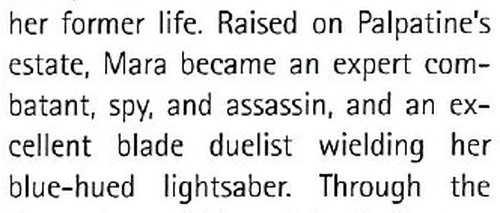
- **An'ya Kuro (Dark Woman); Darth Vader (Anakin Skywalker)**: "Rumor has it that she located the legendary Jedi Master known as the Dark Woman hiding on Cophrigin V, but the Emperor gave that particular extermination job to Darth Vader." Source: The New Essential Guide to Characters, p.161
  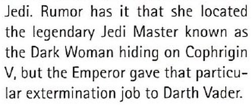
- **Mara Jade Skywalker; Palpatine (Darth Sidious); Darth Vader (Anakin Skywalker); Prince Xizor**: "Her mission a failure, Mara accepted Palpatine's alternate assignment to assassinate Dequc, a criminal underlord who'd been trying to fill the power vacuum left behind after Darth Vader killed Prince Xizor." Source: The New Essential Guide to Characters, p.161
  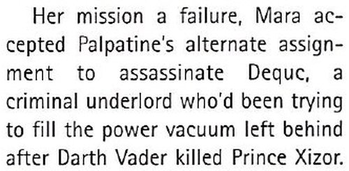

## p.162 (scan page 155)

Page contents: 647 words, 25 paragraphs | headings/entries: STAR WARS: THE; New ESSENTIAL GUIDE TO CHARACTERS; A short time later, Grand Admiral

- **Mara Jade Skywalker; Joruus C'baoth; Luke Skywalker**: "Inside Wayland's Mount Tantiss complex, Mara killed two clones— the mad Jedi Master Joruus C'baoth and a clone duplicate of Luke Skywalker, thus fulfilling—on a technicality—the Emperor's final command." Source: The New Essential Guide to Characters, p.162
  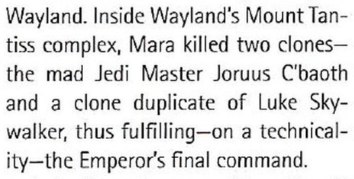
- **Palpatine (Darth Sidious); Mara Jade Skywalker**: "When Emperor Palpatine came back in a new clone body, Mara refused to believe it was really him." Source: The New Essential Guide to Characters, p.162
  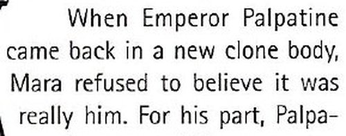

## p.163 (scan page 156)

Page contents: 720 words, 16 paragraphs | headings/entries: 

- **Admiral Daala; Mara Jade Skywalker; Lando Calrissian**: "After Admiral Daala's first defeat, Mara entered into a partnership with Lando Calrissian for the administration of the spice mines of Kessel." Source: The New Essential Guide to Characters, p.163
  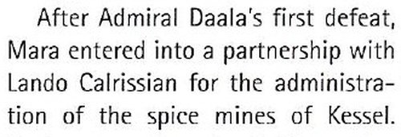
- **Grand Admiral Thrawn; Mara Jade Skywalker**: "In order to prevent Thrawn's followers from reaching the outer galaxy, Mara remote-siteered the Jade's Fire into the base's docking bay, destroying her most cherished possession." Source: The New Essential Guide to Characters, p.163
  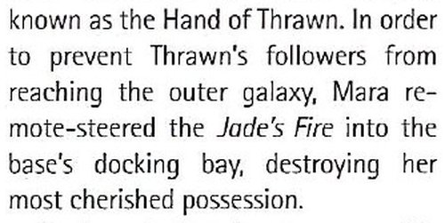

## p.164 (scan page 157)

Page contents: 482 words, 18 paragraphs | headings/entries: Solo constantly struggled to; The Corellian insurrection further; Sea STS EEE STENT ST ET!

## p.165 (scan page 158)

Page contents: 445 words, 15 paragraphs | headings/entries: 

- **Chewbacca**: "Sernpidal's falling moon killed Chewbacca." Source: The New Essential Guide to Characters, p.165
  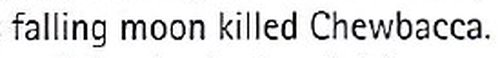

## p.166 (scan page 159)

Page contents: 554 words, 14 paragraphs | headings/entries: Tahiri suffered badly during her

## p.167 (scan page 160)

Page contents: 508 words, 20 paragraphs | headings/entries: STAR WARS:; SUE; THE New ESSENTIAL GUIDE TO CHARACTERS; Tey

## p.168 (scan page 161)

Page contents: 644 words, 9 paragraphs | headings/entries: Solo spent years aiding the emerg-

## p.169 (scan page 162)

Page contents: 814 words, 17 paragraphs | headings/entries: PIERRE RannO IR RENO LETH

## p.170 (scan page 163)

Page contents: 453 words, 14 paragraphs | headings/entries: STAR Wars: THE NEW ESSENTIAL GO $

- **Luke Skywalker**: "Luke linked his spirit with his nephew's, and the two-year-old boy took up a lightsaber and killed several attacking Sith battle hydras." Source: The New Essential Guide to Characters, p.170
  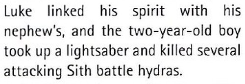

## p.171 (scan page 164)

Page contents: 557 words, 18 paragraphs | headings/entries: SESE PET TTS NTI TE TT; SRY

- **Jacen Solo (Darth Caedus)**: "In a furious rush of power, Jacen defeated Tsavong Lah, earning himself a Yuuzhan Vong death mark." Source: The New Essential Guide to Characters, p.171
  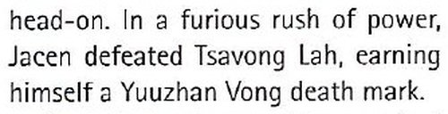
- **Darth Vader (Anakin Skywalker)**: "Aboard a Yuuzhan Vong worldship near Myrkr, Anakin died in order to destroy the enemy's voxyn genetic storehouse." Source: The New Essential Guide to Characters, p.171
  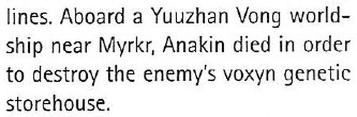

## p.172 (scan page 165)

Page contents: 460 words, 13 paragraphs | headings/entries: AINA SOLO

## p.173 (scan page 166)

Page contents: 583 words, 15 paragraphs | headings/entries: STAR WARS:; THE NEw ESSENTIAL GUIDE TO CHARACTERS

- **Leia Organa Solo; Jaina Solo**: "When Warmaster Tsavong Lah nearly killed Leia in a gruesome bloodletting ritual, Jaina helped move her mother to safety." Source: The New Essential Guide to Characters, p.173
  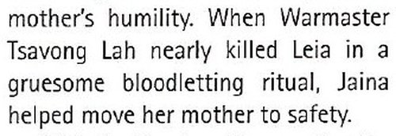
- **Jaina Solo**: "Jaina enlisted help from Gavin Darklighter and Wedge Antilles in destroying the construct, which proved to be nothing more than an elaborate worldship." Source: The New Essential Guide to Characters, p.173
  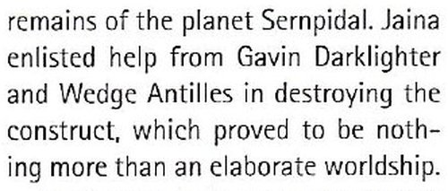
- **Jaina Solo**: "During the Jedi mission to destroy the Yuuzhan Vong voxyn laboratories, Jaina watched her younger brother Anakin die before her eyes." Source: The New Essential Guide to Characters, p.173
  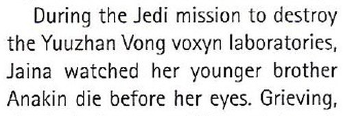

## p.174 (scan page 167)

Page contents: 476 words, 18 paragraphs | headings/entries: EIA OrGANA SOLO; RET ERTG ETO TTS TTT

- **Darth Vader (Anakin Skywalker)**: "This act of espionage marked her vessel, the Tantive IV, as suspect and Darth Vader's Star Destroyer Devastator captured her corvette above Tatooine." Source: The New Essential Guide to Characters, p.174
  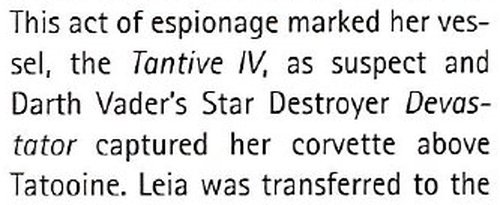

## p.175 (scan page 168)

Page contents: 861 words, 18 paragraphs | headings/entries: 

- **Leia Organa Solo; Luke Skywalker**: "Leia bided her time until Luke Skywalker made his move at the Sarlacc pit, then took her revenge on the Hutt by strangling him with the very chain that bound her." Source: The New Essential Guide to Characters, p.175
  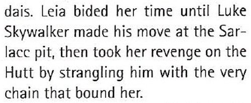
- **Leia Organa Solo**: "Following the Emperor's final defeat, Leia placed all three children on the safeworld of Anoth." Source: The New Essential Guide to Characters, p.175
  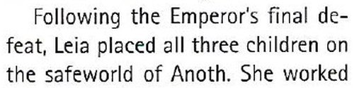

## p.176 (scan page 169)

Page contents: 659 words, 14 paragraphs | headings/entries: 

- **Leia Organa Solo**: "When the Yuuzhan Vong's Jedihunting voxyn were traced to the Myrkr system, Leia hesitantly permitted her three children to lead a Jedi strike force and destroy the voxyn threat." Source: The New Essential Guide to Characters, p.176
  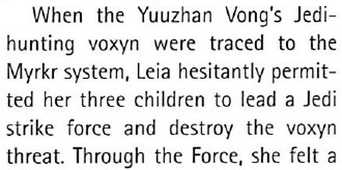

## p.177 (scan page 170)

Page contents: 519 words, 22 paragraphs | headings/entries: AM SOLUSAR; H am Solusar has beaten the odds; Ladsaab etaedede- despa aabnneaie

- **Palpatine (Darth Sidious); Kam Solusar; Luke Skywalker**: "After Palpatine's defeat and apparent death at the New Republic's Pinnacle Base, Solusar encountered Luke Skywalker on the abandoned space city Nespis VIII." Source: The New Essential Guide to Characters, p.177
  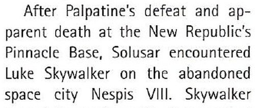
- **Kam Solusar**: "Skywalker sensed the goodness the Emperor had smothered, and bested Solusar in the ancient Jedi game of lightsider." Source: The New Essential Guide to Characters, p.177
  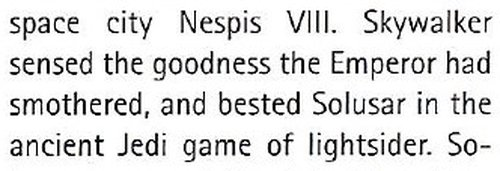

## p.178 (scan page 171)

Page contents: 547 words, 29 paragraphs | headings/entries: PRONUNCIATION Nil Spar SPECIES Yevethan SEH Male; Hain CoLor; None; Eve CoLor * Black; HEIGHT; Ga biahebei tat

- **Leia Organa Solo**: "Leia responded with force, but the New Republic's strongest fleet suffered a stunning defeat at Doornik- 319." Source: The New Essential Guide to Characters, p.178
  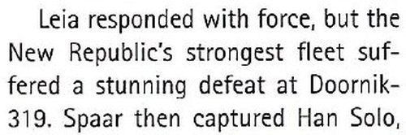
- **Chewbacca; Han Solo**: "Chewbacca rescued Han Solo from Spaar's Super Star Destroyer." Source: The New Essential Guide to Characters, p.178
  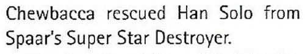

## p.179 (scan page 172)

Page contents: 490 words, 28 paragraphs | headings/entries: Spbtabd dunia bse batio; Tatisahed Chalets hanae lab esbsie-tibeate; PRONUNCIATION Wil'-huf Tar'-kin; SPECIES Human; SEH "Male; HrvAin Coror Black; Eve CoL_on Blue; HEIGHT 1.8 meters; HoMEWORLD Eriadu-; Eee pentset serene traroressset steam

- **Grand Moff Tarkin**: "And had the Rebels not destroyed the Death Star, Tarkin might have been the ruler of the galaxy." Source: The New Essential Guide to Characters, p.179
  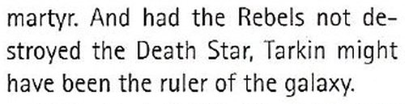

## p.180 (scan page 173)

Page contents: 607 words, 18 paragraphs | headings/entries: Five years before the Battle of; Tarkin moved back to Eriadu full; TT penne wow enmeere yeh berh midlet

- **Grand Moff Tarkin**: "Three years after the Battle of Naboo, Tarkin saw an opportunity for advancement if he could acquire one of the legendary "living starships" from the hidden world Zonama Sekot." Source: The New Essential Guide to Characters, p.180
  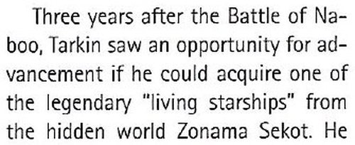
- **Grand Moff Tarkin; Darth Vader (Anakin Skywalker)**: "Tarkin briefly met young Anakin, who tried to use a Force chokehold on the older man." Source: The New Essential Guide to Characters, p.180
  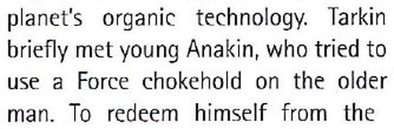

## p.181 (scan page 174)

Page contents: 410 words, 11 paragraphs | headings/entries: 

- **Grand Moff Tarkin**: "Tarkin's first act as commander of the Death Star was to destroy the penal planet around which it orbited." Source: The New Essential Guide to Characters, p.181
  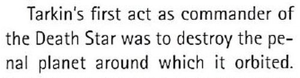
- **Grand Moff Tarkin**: "Tarkin couldn't help but imagine what a colossal bargaining chip he would hold should he train the Death Star's superlaser on Coruscant." Source: The New Essential Guide to Characters, p.181
  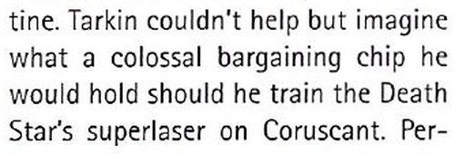
- **Leia Organa Solo; Grand Moff Tarkin**: "When Princess Leia refused to divulge the location of the main Rebel base, Tarkin destroyed the peaceful world of Alderaan on his own initiative, without consulting the Emperor, then moved against the Rebel base on Yavin 4." Source: The New Essential Guide to Characters, p.181
  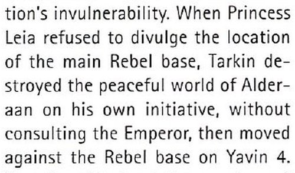
- **Grand Moff Tarkin**: "More than three years after Tarkin's death, Imperial officers honored his memory by naming an experimental superlaser test bed— essentially a scaled-down Death Star—for the late Grand Moff." Source: The New Essential Guide to Characters, p.181
  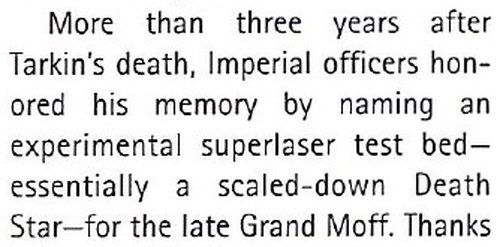

## p.182 (scan page 175)

Page contents: 460 words, 16 paragraphs | headings/entries: PRE OESTERSTT NETS TTF TI

## p.183 (scan page 176)

Page contents: 576 words, 17 paragraphs | headings/entries: S

- **Grand Admiral Thrawn**: "When Ysanne Isard returned from the grave immediately after the Thrawn crisis, Terrik provided invaluable assistance to New Republic Intelligence by figuring out Isard's "dream ladder"—her step-by-step plan for retaking the Super Star Destroyer Lusankya." Source: The New Essential Guide to Characters, p.183
  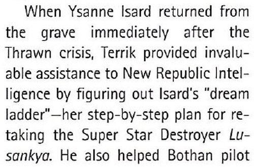

## p.184 (scan page 177)

Page contents: 496 words, 14 paragraphs | headings/entries: Tharen started her own Rebel at-

## p.185 (scan page 178)

Page contents: 456 words, 20 paragraphs | headings/entries: Mitth'raw'nuruodo possessed the; H n outcast from his own people,; RAND ADMIRAL THRAWK; SESS LS SPSS 28 TEES LISTE LT)

- **Grand Admiral Thrawn**: "Even in death, he had a plan for domination, and it's only through luck that citizens across the galaxy weren't forced to pledge their allegiance to Grand Admiral Thrawn." Source: The New Essential Guide to Characters, p.185
  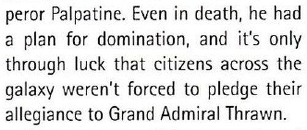
- **Palpatine (Darth Sidious)**: "Prior to the Battle of Yavin, Mitth'raw'nuruodo came upon a force of foreign raiders, dispatched by Palpatine to destroy the Jedi mission known as the Outbound Flight Project." Source: The New Essential Guide to Characters, p.185
  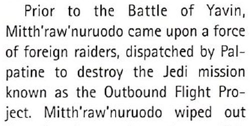
- **Palpatine (Darth Sidious)**: "Mitth'raw'nuruodo wiped out these invaders, sparing only one—Palpatine's adviser Kinman Doriana, who explained to him the purpose of the mission." Source: The New Essential Guide to Characters, p.185
  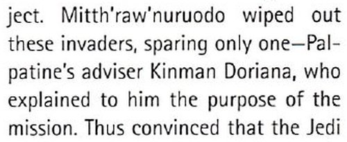
- **Grand Admiral Thrawn**: "By the Battle of Yavin, Thrawn was captain of the Imperial Star Destroyer Vengeance." Source: The New Essential Guide to Characters, p.185
  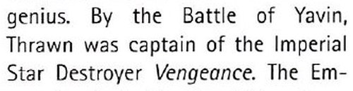

## p.186 (scan page 179)

Page contents: 660 words, 13 paragraphs | headings/entries: He came back virtually alone,

- **Grand Admiral Thrawn**: "Ten months after Yavin, Captain Thrawn survived an insect infestation among the alien S'krrr." Source: The New Essential Guide to Characters, p.186
  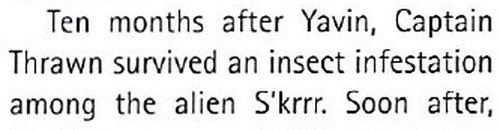
- **Grand Admiral Thrawn**: "Four years after Endor, following Isard's defeat in the Bacta War, word reached Thrawn that the Empire was on the verge of extinction." Source: The New Essential Guide to Characters, p.186
  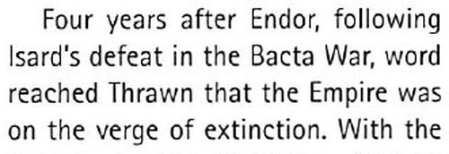

## p.187 (scan page 180)

Page contents: 366 words, 9 paragraphs | headings/entries: 

