# Owner Material 034 — The New Essential Guide to Characters (2002): scan pages 181–210

- **Source:** *Star Wars: The New Essential Guide to Characters* by Daniel Wallace, illustrated by Michael Sutfin (Del Rey, 2002). Secondary source (licensed Legends reference). Scan OCR'd on the box; the scan stays box-only and is **not** published.
- **Method:** every scanned page was OCR'd and machine-screened sentence by sentence for power-relevant statements (fights, kills, defeats, Force feats, rankings, superweapons) that name a character on our roster; each kept sentence is quoted verbatim from the OCR text and has a crop of the printed passage directly under it. Pages with nothing power-relevant are still listed with what is on them.
- **Citation:** "The New Essential Guide to Characters, p.X" by printed page ("scan p.X" where no printed number applies). **Weight:** Lucasfilm-licensed character guide: a secondary, in-universe summary of Legends and prequel-era material. Where the original story is in our notes, that source is the stronger citation.

## p.188 (scan page 181)

Page contents: 459 words, 21 paragraphs | headings/entries: PRONUNCIATION Fé'-nés Val-6r'-tim; SPECIES Human; SEH Male; Hrin CoLon White; Eve CoLior Blue; HEIGHT 1.7 meters; HomEWORLD Coruscant; OES?; Seabeiebian babiait HAGIRH Da RSE HONDA ORSHHD

## p.189 (scan page 182)

Page contents: 415 words, 10 paragraphs | headings/entries: RS

## p.190 (scan page 183)

Page contents: 468 words, 13 paragraphs | headings/entries: GENERAL MAXIMILIAN VEER; IWESTRELED ET? TEE

## p.191 (scan page 184)

Page contents: 438 words, 9 paragraphs | headings/entries: While serving under the resur-

- **Grand Admiral Thrawn**: "Shortly before the Battle of Derra IV, Colonel Veers's soldiers obliterated the fortified estate of Black Sun Lieutenant Zekka Thyne, greatly impressing Admiral Thrawn." Source: The New Essential Guide to Characters, p.191
  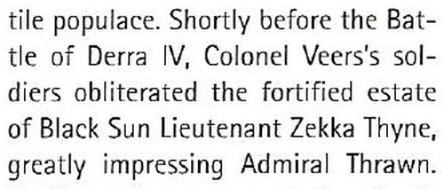
- **Grand Admiral Thrawn; Darth Vader (Anakin Skywalker)**: "On Thrawn's recommendation, Darth Vader reassigned Veers to the Super Star Destroyer Executor to replace a general who had "retired" one month prior." Source: The New Essential Guide to Characters, p.191
  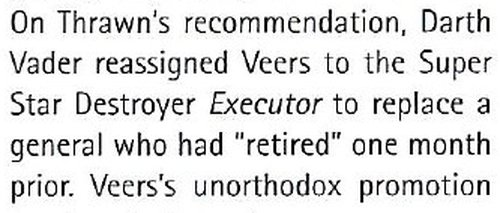
- **Darth Vader (Anakin Skywalker)**: "He returned to Lord Vader's service, but his troops were on a planetside mission when the Executor was destroyed at Endor." Source: The New Essential Guide to Characters, p.191
  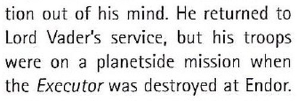

## p.192 (scan page 185)

Page contents: 522 words, 24 paragraphs | headings/entries: VERGERE; Nee; She bith Lmaatiobael; ON BY EGy SYEETE FCT 77?

## p.193 (scan page 186)

Page contents: 530 words, 21 paragraphs | headings/entries: Vos, Quinlan Vos came from the; UINLAN Vos —

- **Quinlan Vos** — entry/section: Vos, Quinlan Vos came from the: "Enraged, Vos tortured the Twi'lek leader with Force lightning until he divulged the name of the mastermind of the glitteryll plot—Republic Senator Chom Frey Kaa." Source: The New Essential Guide to Characters, p.193
  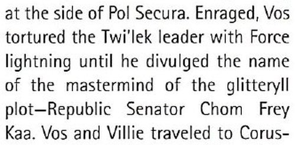
- **Quinlan Vos** — entry/section: UINLAN Vos —: "Zalem directed an Infinity Wave to destroy Coruscant, but Vos redirected the stream of energy to wipe out the Gate itself." Source: The New Essential Guide to Characters, p.193
  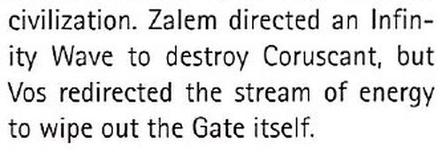

## p.194 (scan page 187)

Page contents: 465 words, 23 paragraphs | headings/entries: PIE Tt; PRONUNCIATION Wa'-to; SPECIES Toydarian; SER Male; Hain Coton None; Eve CoLor Unknown; HomeEWORLD Toydaria

## p.195 (scan page 188)

Page contents: 521 words, 11 paragraphs | headings/entries: 

## p.196 (scan page 189)

Page contents: 498 words, 16 paragraphs | headings/entries: ZL Wesell" wasn't her real name;; Terrie yt) rerere tn Sire; Bier tere vette) ent tren net

- **Darth Vader (Anakin Skywalker)**: "Wesell used one of her remote probe droids to release crawling kouhuns into Senator Amidala's toplevel Coruscant apartment, but the Senator's Jedi guardian, Anakin Skywalker, wiped out the insects." Source: The New Essential Guide to Characters, p.196
  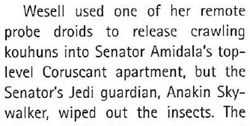

## p.197 (scan page 190)

Page contents: 467 words, 15 paragraphs | headings/entries: T he story goes that Mace Windu; Gee SE tio Aa ae eae; Be eet rere ares re

- **Mace Windu**: "Not even a Jedi Master could deflect that many blaster bolts at once, but Windu slowly turned to make eye contact with each Gank, placed one hand on the lightsaber hanging at his hip, and spoke only three words: "It's your decision."" Source: The New Essential Guide to Characters, p.197
  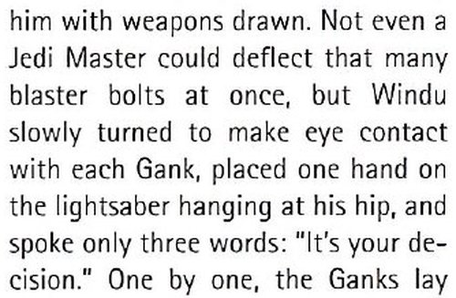

## p.198 (scan page 191)

Page contents: 528 words, 12 paragraphs | headings/entries: 

## p.199 (scan page 192)

Page contents: 429 words, 15 paragraphs | headings/entries: Prince XizoR; W izor, the Dark Prince, was once

## p.200 (scan page 193)

Page contents: 463 words, 9 paragraphs | headings/entries: 

- **Lando Calrissian**: "On his way out, Calrissian dropped a thermal detonator down a waste chute, and the castle imploded." Source: The New Essential Guide to Characters, p.200
  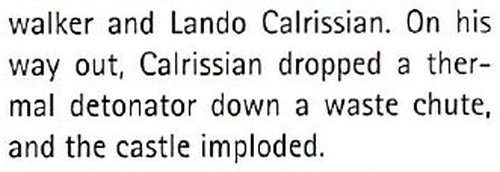
- **Prince Xizor**: "Xizor escaped to the Falleen's Fist and ordered his private navy to destroy the fleeing Millennium Falcon." Source: The New Essential Guide to Characters, p.200
  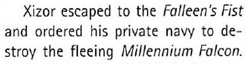
- **Darth Vader (Anakin Skywalker)**: "With pleasure, Vader destroyed the skyhook and everyone aboard it." Source: The New Essential Guide to Characters, p.200
  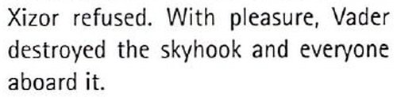

## p.201 (scan page 194)

Page contents: 472 words, 18 paragraphs | headings/entries: YODA

## p.202 (scan page 195)

Page contents: 516 words, 12 paragraphs | headings/entries: The Clone Wars began, pitting the; TNT LOPES Tee Sr ae es

- **Yoda**: "A year later, not long before the Battle of Naboo, Yoda exterminated a squad of Bartokk assassins and foiled their plot to destroy the Corulag academy." Source: The New Essential Guide to Characters, p.202
  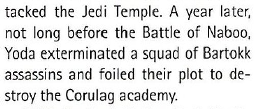
- **Yoda; Count Dooku**: "When war could be postponed no longer, General Yoda led a clone army against Dooku's forces on Geonosis, and nearly bested the separatist leader in personal lightsaber combat." Source: The New Essential Guide to Characters, p.202
  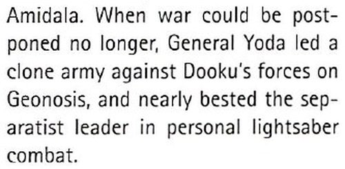

## p.203 (scan page 196)

Page contents: 513 words, 12 paragraphs | headings/entries: ST; So APOLLO

- **Yoda**: "Yoda defeated the Bpfasshi in a titanic Force battle and healed the injured Car'das, who went on to found a smuggling empire." Source: The New Essential Guide to Characters, p.203
  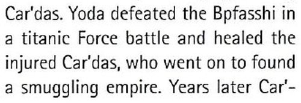
- **Yoda; Obi-Wan Kenobi; Luke Skywalker; Darth Vader (Anakin Skywalker)**: "Yoda and Kenobi talked of Luke Skywalker and the youth's great potential to defeat the evil of Vader." Source: The New Essential Guide to Characters, p.203
  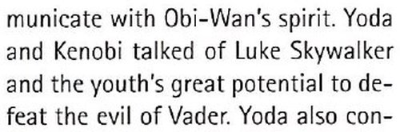

## p.204 (scan page 197)

Page contents: 447 words, 24 paragraphs | headings/entries: Zinj; SPECIES; SEH Male; Hain CoLaon Brown (graying); Eve CoL_or Brown; HEIGHT 1.68 meters; HomEWORLD 'Fondor

## p.205 (scan page 198)

Page contents: 549 words, 19 paragraphs | headings/entries: Eg 3 4 {

- **Gethzerion**: "Gethzerion and her followers made it as far as Dathomir orbit, where Zsinj's Star Destroyers blasted them to bits." Source: The New Essential Guide to Characters, p.205
  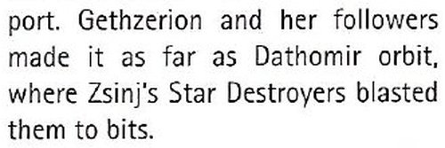

## p.206 (scan page 199)

Page contents: 480 words, 11 paragraphs | headings/entries: 

- **Boba Fett**: "Rival hunter Boba Fett outsmarted and humiliated them both." Source: The New Essential Guide to Characters, p.206
  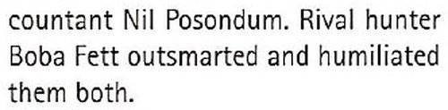

## p.207 (scan page 200)

Page contents: 603 words, 17 paragraphs | headings/entries: NRNPTRE PENS TESTE ET TT Ty; Tey ye rrererrenss

- **Darth Vader (Anakin Skywalker)**: "Thus, when they met with Darth Vader aboard the Super Star Destroyer Executor, Zuckuss was afraid the Dark Lord would call him out on the Nardix bounty, but Vader let them go in peace." Source: The New Essential Guide to Characters, p.207
  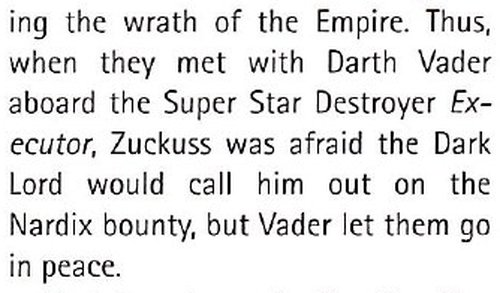

## p.208 (scan page 201)

Page contents: 613 words, 33 paragraphs | headings/entries: APPENDIR:; Nns AMEDDA Mis A-mé'-di; Ace AZZAMEEN As A'-za-én; BLACKHOLE Blak-hal'; Other Personages of Note; EmpnrntToJjnvos BRAND Em-pa-t6-ja'-yos Brind; AvDALRIc BRANDL A-dal'-ric Bran'-dil; Jornuus C'BAoTH J6-166s' Sti-ba'-dth; CILGHAL Sil'-gal; GENERAL AIREN CRACKHEN; A'-rén Kra'-kén; THE DraAarnk Woman; ADMIRAL HIRAM DRAYSON; Hi'-rdm Dra'-stin; Hounss "RuNT™ EXWESH; Ho'-hiis Ek'-wésh

- **Joruus C'baoth; Grand Admiral Thrawn; Mara Jade Skywalker**: "An insane clone of the Jedi Master Jorus C'baoth, Joruus assisted Grand Admiral Thrawn in waging war against the New Republic before being killed by Mara Jade on Wayland." Source: The New Essential Guide to Characters, p.208
  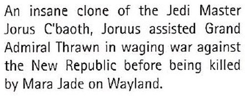
- **Grand Admiral Thrawn**: "Following the defeat of Thrawn, Drayson helped create the top-secret intelligence agency Alpha Blue, which uncovered vital information on Nil Spaar during the Black Fleet Crisis." Source: The New Essential Guide to Characters, p.208
  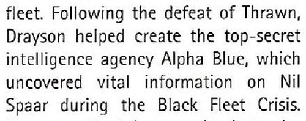

## p.209 (scan page 202)

Page contents: 431 words, 21 paragraphs | headings/entries: JAGGED FEL; Jag'-géd Fel; GALLANDRO Ga-lan'-dro; ZAKARISZ GHENT Za-kar'-iz Gént; WiLmMARH "UILLIc" GRAHRK Vil'=mar "Vil'-l@" Gra-rkh; A'SHARAD HETT A'-sha-rad Hét; Lornp HoTH Hoth; QueEN JAMILLIA; Ja-mil'-la; DEXTER JETTSTER Déx'-tiir Jét'-stair

- **Han Solo**: "He was survived by his infant daughter Anja, who grew up blaming Han Solo for her father's death." Source: The New Essential Guide to Characters, p.209
  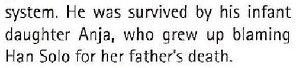

## p.210 (scan page 203)

Page contents: 571 words, 24 paragraphs | headings/entries: TENEL Kav Té'-nél Ka; Lonp KAAN Kan; KADANN Ka-dan'; Jooo KAsT Jo'-d6 Kast; CuiecGc LARS Klég Lars; UmnAbtw LETH 0a'-mak Léth; ARoEN LYN Ar'-dén Lin; NIANDALORE; Man'-da-lér; Brit ORGANA Bal Or-ga'-na

- **Lord Kaan; Darth Bane**: "Weak-willed leader of the Brotherhood of Darkness, Lord Kaan poisoned his rival Darth Bane but failed to kill him, and ultimately perished in a "thought bomb" explosion on Ruusan." Source: The New Essential Guide to Characters, p.210
  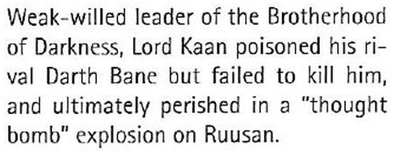

## p.211 (scan page 204)

Page contents: 685 words, 33 paragraphs | headings/entries: LIEUTENANT PAGE; Paj; POGGLE THE LESSER Pég'-til; DANN! QUEE; Dan'-né Kwé; GENERAL CARLIST RIEEKRN Kar'-list Ri'-kan; SUPREME OQUERLORD SHIMRAR; Shimi'-ra; BEN SKHYWALKER Bén Ski'-walk-ar; SHMI SKYWALKER; Shne Ski'-walk-ar; NMAAREK STELE Ma'-rék Stél; LamnvA Su; La'-ma S66; UimnA SUNRIDER; Ve"-ma Stin'-rid-tr; OnRN FREE TAR Orn Fre Ta

## p.212 (scan page 205)

Page contents: 621 words, 26 paragraphs | headings/entries: SIRI TACHI; S@'-ré; Empress TETRA; CAPTAIN TYPHO; Ti-fo; TRHIAI UDEILA Ta-he'-ré Vay'-luh; UimnA-DrA-Bobnr Vé'-ma-da-bo'-da; ALEX WINGER A'-léx Win'-gtir; LUINTER Win-tar; Za"-na-tos; NEN Yim Nén Yim; GRAND ADMIRAL ZARRIN Za'-rn

## p.213 (scan page 206)

Page contents: 577 words, 80 paragraphs | headings/entries: BIBLIOGRA; Ambush at Corellia, volume 1 of; AOTC; AS; ASDBH; ASSDV; BFDLT; BFEE; BFTED; BHAS; PHY; BHKK; BHMA; BHSS; BHSW; BP; BS; CCG; Cloak of Deception, James Luceno, Del; CE; CE2; The Jedi Academy Trilogy, Kevin J. An-; CPL; CSSB; CSW; CSWEA; CTGD; D; DA; DE; DE2; DESB; DF; Dark Forces PC game, LucasArts, 1995. DF2; DF2MS

## p.214 (scan page 207)

Page contents: 590 words, 84 paragraphs | headings/entries: DFJK; DFRA; DHEHC; DHTCH; DJ; DMC; DMS; DMSH; DS; DSTC; Death Star Technical Companion, Bill; DTO; DTR; DTV; EC; EE; EGAS; EGC; EGV; EIA; EIR; EISF; EITI; ESB, ESBN; ESBR; EVC; EVR; FC; FP; GDV; GF; GG4; GG12; GOF; HE; HG; HLL; HSE; HSR

## p.215 (scan page 208)

Page contents: 593 words, 84 paragraphs | headings/entries: IF; IG; J; ISWU; JA; JAL; JCAW; JHAD; JHIT; JJAO; JJKB; Junior Jedi Knights: Lyric's World,; SSS; SIP; JQPT; JS; JVS; KT; LC; LCF; LCJ; LCM; LCS; LCSB; MJBEH; MMY; MTK; MTSB; NR; PDS; POT; PS; OE; RD; RJ, RJN; RP; RS; RSB

## p.216 (scan page 209)

Page contents: 618 words, 86 paragraphs | headings/entries: RSVG; SA; SAC; SBS; SME; SOL; SOTE; SOTEALB; SOTEE; SOTESB; SOTEVG; SOTS; SP; SW, SWN; SWAJ; SWC; SWD; SWJDM; SWJOQA; SWO; SWPT; SWSB; SWT; SWU; SWVO; SWXS; TAB; TABSB; TAS; TBH; TFNR; TFTE; TIP; TOS; TOJC; TOJFN; TOJFSE

## p.217 (scan page 210)

Page contents: 607 words, 42 paragraphs | headings/entries: TOJGA; TOJR; TPM, TPMN; TPO; TSC; TT; TTSB; UYV; VF; WEGCTD; WCSWG; WG; WS; XW; XWA; YIK

