# Owner Material 035 — Dark Side Sourcebook (d20, 2001): Chapter One: The Dark Side (timeline)

- **Source:** *Dark Side Sourcebook* by Bill Slavicsek and JD Wiker (Wizards of the Coast, 2001), for the Star Wars Roleplaying Game (d20). Secondary source (licensed Legends reference). Scan OCR'd on the box; the scan stays box-only and is **not** published.
- **Method:** every scanned page was OCR'd and machine-screened sentence by sentence for power-relevant statements (fights, kills, defeats, Force feats, rankings, superweapons) that name a character on our roster; each kept sentence is quoted verbatim from the OCR text and has a crop of the printed passage directly under it. Pages with nothing power-relevant are still listed with what is on them.
- **Citation:** "Dark Side Sourcebook, p.X" by printed page ("scan p.X" where no printed number applies). **Weight:** Licensed RPG sourcebook: a secondary source. Its narrative text sums up Legends history; game statistics are rules for players, not canon power levels.

## p.6 (scan page 7)

Page contents: 827 words, 19 paragraphs | headings/entries: Chapter One: The Dark Side; The Force; The Dark Time; Timeline History of the Dark Side; Yavin

- **Luke Skywalker**: "Approximately 25,000 years before the first Death Star was destroyed through the efforts of a young Jedi-intraining named Luke Skywalker, sentients perfected the hyperdrive engine." Source: Dark Side Sourcebook, p.6
  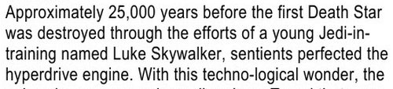

## p.7 (scan page 8)

Page contents: 893 words, 12 paragraphs | headings/entries: 

- **Naga Sadow; Ludo Kressh**: "As rival leaders Naga Sadow and Ludo Kressh struggled for the Dark Lord's crown, a pair of Republic hyper-space mappers arrived in Sith territory in their ship, Starbreaker 12." Source: Dark Side Sourcebook, p.7
  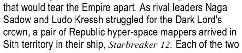

## p.8 (scan page 9)

Page contents: 827 words, 17 paragraphs | headings/entries: Yavin

- **Exar Kun; Freedon Nadd**: "Exar Kun next traveled to Yavin 4, where he used his newfound Sith powers to destroy the spirit of Freedon Nadd." Source: Dark Side Sourcebook, p.8
  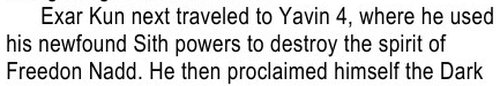
- **Ulic Qel-Droma; Cay Qel-Droma**: "The bitter war continued until Ulic Qel-Droma killed his own brother, the Jedi Cay." Source: Dark Side Sourcebook, p.8
  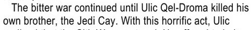

## p.9 (scan page 10)

Page contents: 423 words, 13 paragraphs | headings/entries: Yavin

- **Lord Kaan**: "Sith Lord Kaan survived this bloodbath and gath-ered twenty thousand devotees to establish an empire dedicated to rule by the strong." Source: Dark Side Sourcebook, p.9
  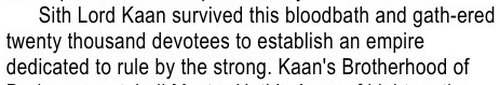

## p.10 (scan page 11)

Page contents: 796 words, 19 paragraphs | headings/entries: 

- **Darth Vader (Anakin Skywalker)**: "Details of this dark time have been lost, but its repercussions affected the galaxy for decades to come: The Jedi Knights were wiped out, the Empire seized power, and Anakin Skywalker embraced the dark side, becoming Darth Vader." Source: Dark Side Sourcebook, p.10
  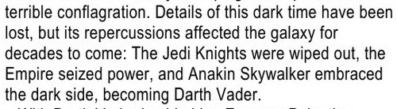
- **Leia Organa Solo**: "The first great victory of the Alliance occurred at Yavin, where Rebels led by Princess Leia Organa destroyed the Death Star battle station." Source: Dark Side Sourcebook, p.10
  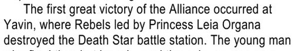
- **Luke Skywalker**: "Luke was able to defeat his father, but he refused to strike the killing blow." Source: Dark Side Sourcebook, p.10
  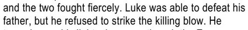
- **Darth Vader (Anakin Skywalker)**: "He would have killed young Skywalker if not for the intervention of a wounded and dying Vader." Source: Dark Side Sourcebook, p.10
  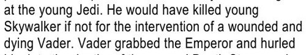
- **Darth Vader (Anakin Skywalker)**: "Vader grabbed the Emperor and hurled him into the depths of the second Death Star, causing Vader to suffer further damage from a backlash of Force lightning." Source: Dark Side Sourcebook, p.10
  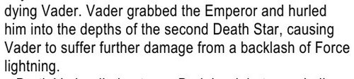
- **Luke Skywalker**: "He saved his son, destroyed the Emperor, and found redemption due to the efforts of Luke Skywalker." Source: Dark Side Sourcebook, p.10
  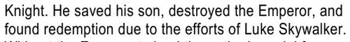
