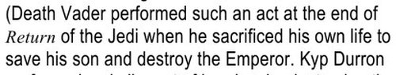
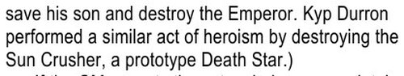

# Owner Material 035 — Dark Side Sourcebook (d20, 2001): Chapter Two: Playing the Dark Side

- **Source:** *Dark Side Sourcebook* by Bill Slavicsek and JD Wiker (Wizards of the Coast, 2001), for the Star Wars Roleplaying Game (d20). Secondary source (licensed Legends reference). Scan OCR'd on the box; the scan stays box-only and is **not** published.
- **Method:** every scanned page was OCR'd and machine-screened sentence by sentence for power-relevant statements (fights, kills, defeats, Force feats, rankings, superweapons) that name a character on our roster; each kept sentence is quoted verbatim from the OCR text and has a crop of the printed passage directly under it. Pages with nothing power-relevant are still listed with what is on them.
- **Citation:** "Dark Side Sourcebook, p.X" by printed page ("scan p.X" where no printed number applies). **Weight:** Licensed RPG sourcebook: a secondary source. Its narrative text sums up Legends history; game statistics are rules for players, not canon power levels.

## p.11 (scan page 12)

Page contents: 756 words, 31 paragraphs | headings/entries: Chapter Two:; Playing the Dark Side; Dark Side Templates; Tainted Characters; Creating a Tainted Character; Dark Side Characters; Creating a Dark Side Character

## p.12 (scan page 13)

Page contents: 846 words, 37 paragraphs | headings/entries: HOK-FONE SENSITIVE CANBAGTENS; New Dark Side Skills; Skill Descriptions; Knowledge (Sith Lore) [Int]; Trained Only; Read/Write Language (Sith) [none] Trained Only

- **Darth Vader (Anakin Skywalker)**: "(Death Vader performed such an act at the end of Return of the Jedi when he sacrificed his own life to save his son and destroy the Emperor." Source: Dark Side Sourcebook, p.12
  
- **Kyp Durron; Sun Crusher (superweapon)**: "Kyp Durron performed a similar act of heroism by destroying the Sun Crusher, a prototype Death Star.)" Source: Dark Side Sourcebook, p.12
  

## p.13 (scan page 14)

Page contents: 820 words, 25 paragraphs | headings/entries: Force-Based Skills; Alchemy [Int]; Control Mind [Cha]; Sith freauentlv did with their weanons and; Oo

## p.14 (scan page 15)

Page contents: 384 words, 20 paragraphs | headings/entries: Number of Targets Vitality Point Cost/Minute; Drain Energy [Con]

## p.15 (scan page 16)

Page contents: 674 words, 17 paragraphs | headings/entries: Drain knowledge [Int]

## p.16 (scan page 17)

Page contents: 884 words, 17 paragraphs | headings/entries: Ho; DOM! ua. a >»; PORES ILLUSIONS; Transfer Essence [Cha]; Result Will Saving Throw DC

## p.17 (scan page 18)

Page contents: 590 words, 45 paragraphs | headings/entries: Table 2-1: Force-Based Skills; New Dark Side Feats; Drain Force; Affect Mind; Alchemyt; Battlemind; Control Mindt; IN JC | JG 3rd 4th 3rd; Enhance Senses; Drain Knowledget 5th Enhance Ability Con No; Wis No 3rd; Wi N 3rd; Farseeing; Feart; Force Defense; Force Gript; Force Stealth; Friendship; Heal Another; Heal Self; Move Object Alter 3rd; See Force Sense ms = 3rd 5th; Sth | 2nd = 3rd; Telepathy Sense Wis No 3rd 5th; Transfer Essencef | Force** Cha No

## p.18 (scan page 19)

Page contents: 847 words, 26 paragraphs | headings/entries: Lomi ss. cys *; Le ttt tit et; Hatred; Rage; Sith Sorcery; Sith Sword Defense; Sith Sword Expert Defense

## p.19 (scan page 20)

Page contents: 836 words, 20 paragraphs | headings/entries: Sith Sword Mastery; Summon Storm; Dark dide Prestige Glass; Dark Side Devotee

## p.20 (scan page 21)

Page contents: 467 words, 15 paragraphs | headings/entries: Layvao; A _

## p.21 (scan page 22)

Page contents: 658 words, 37 paragraphs | headings/entries: Skills: Intimidate 4 ranks; Table 2-2: The Dark Side Deuatee; Class Skills; Class Features; Reputation; Leve} Attack Bonus; Special Gain

## p.22 (scan page 23)

Page contents: 470 words, 11 paragraphs | headings/entries: HO; OMT waiay; A Se ~ h; Dark Side Marauder

## p.23 (scan page 24)

Page contents: 625 words, 36 paragraphs | headings/entries: Class Skills; Class Features; EAN ONES: OAH SIDE MARRODER; Group Proficiency (blaster rifles),; Table 2-3: The Dark Side Marauder; Level; Defense Reputation; Special; Control, Rage; Bonus feat; Alter; Bonus feat; Sense; Bonus feat +6 +5

## p.24 (scan page 25)

Page contents: 423 words, 9 paragraphs | headings/entries: AQIS ¥aVO SHI ONIAWId; We

## p.25 (scan page 26)

Page contents: 669 words, 27 paragraphs | headings/entries: Table 2-4: The Emperor's Hand; Class Skills; Class Features; Control, sneak attack+1d6 +0

## p.26 (scan page 27)

Page contents: 874 words, 13 paragraphs | headings/entries: GAM AOTES: GMPCROR'S HA; Dark Force Witch

## p.27 (scan page 28)

Page contents: 427 words, 15 paragraphs | headings/entries: Class Skills

## p.28 (scan page 29)

Page contents: 711 words, 16 paragraphs | headings/entries: Table 2-5: The Dark Poree Witch

## p.29 (scan page 30)

Page contents: 445 words, 8 paragraphs | headings/entries: Imperial Inquisitor

## p.30 (scan page 31)

Page contents: 643 words, 27 paragraphs | headings/entries: LOML saiayHe; Table 2-6: The Imperial Inquisitor; Class Skills; Class Features; Base Fort Ref Will lightsaber Defense Reputation

## p.31 (scan page 32)

Page contents: 870 words, 21 paragraphs | headings/entries: GAN NOTES: INPERIGL INQUISITOR; Sith Acolyte; CORRUPTED JEDI

## p.32 (scan page 33)

Page contents: 436 words, 13 paragraphs | headings/entries: 

## p.33 (scan page 34)

Page contents: 676 words, 33 paragraphs | headings/entries: Class Skills; Table 2-7: The Sith Acolyte; Class Features; Base Fort Ref | Will; Lightsaber | Defe | Reputation

## p.34 (scan page 35)

Page contents: 453 words, 16 paragraphs | headings/entries: OM) wdid Y 2; Sith Lord

## p.35 (scan page 36)

Page contents: 703 words, 53 paragraphs | headings/entries: Class Skills; Table 2-8: The Sith Lord; Level; Base Attack Bonus; Fort Save; Save; Save; Special; Lightsaber Damage*; Defense Bonus; Reputation Score; Resource access; Sith secrets; Minions; Sith battle +208 +7; Sith secrets; Exceptional minions; Sith battle; Sith Master

## p.36 (scan page 37)

Page contents: 843 words, 14 paragraphs | headings/entries: Table 2-9: The Sith Warrior; EAM MOTES: SITH LORD; Sith Warrior

## p.37 (scan page 38)

Page contents: 447 words, 14 paragraphs | headings/entries: 

## p.38 (scan page 39)

Page contents: 877 words, 36 paragraphs | headings/entries: Hala; Class Skills; Class Features; EAN NOTE: SITY WHARIO

