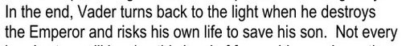
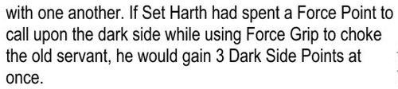
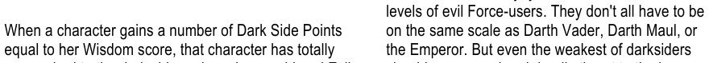
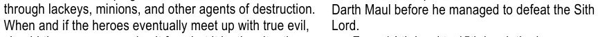

# Owner Material 035 — Dark Side Sourcebook (d20, 2001): Chapter Three: Gamemastering the Dark Side

- **Source:** *Dark Side Sourcebook* by Bill Slavicsek and JD Wiker (Wizards of the Coast, 2001), for the Star Wars Roleplaying Game (d20). Secondary source (licensed Legends reference). Scan OCR'd on the box; the scan stays box-only and is **not** published.
- **Method:** every scanned page was OCR'd and machine-screened sentence by sentence for power-relevant statements (fights, kills, defeats, Force feats, rankings, superweapons) that name a character on our roster; each kept sentence is quoted verbatim from the OCR text and has a crop of the printed passage directly under it. Pages with nothing power-relevant are still listed with what is on them.
- **Citation:** "Dark Side Sourcebook, p.X" by printed page ("scan p.X" where no printed number applies). **Weight:** Licensed RPG sourcebook: a secondary source. Its narrative text sums up Legends history; game statistics are rules for players, not canon power levels.

## p.39 (scan page 40)

Page contents: 890 words, 12 paragraphs | headings/entries: Chapter Three:; Gamemestering the Dark Side; Rules for the Dark Side; Long Term Effects of Using the Dark

- **Darth Vader (Anakin Skywalker)**: "In the end, Vader turns back to the light when he destroys the Emperor and risks his own life to save his son." Source: Dark Side Sourcebook, p.39
  

## p.40 (scan page 41)

Page contents: 862 words, 25 paragraphs | headings/entries: Bane. ws; Corruption and Tainted Characters; Gaining Force Points; Gaining Dark Side Points

## p.41 (scan page 42)

Page contents: 932 words, 16 paragraphs | headings/entries: Acts of Evil

- **Set Harth**: "If Set Harth had spent a Force Point to call upon the dark side while using Force Grip to choke the old servant, he would gain 3 Dark Side Points at once." Source: Dark Side Sourcebook, p.41
  

## p.42 (scan page 43)

Page contents: 424 words, 10 paragraphs | headings/entries: Built as wei; Anger "fear leads to anger" -Yoda; Hatred "anger leads to hate" -Yoda

## p.43 (scan page 44)

Page contents: 760 words, 16 paragraphs | headings/entries: Suffering; Pride; Aggression

## p.44 (scan page 45)

Page contents: 889 words, 20 paragraphs | headings/entries: Vengeance; Greed; Jealousy

## p.45 (scan page 46)

Page contents: 936 words, 12 paragraphs | headings/entries: Running Dark Side Heroes

## p.46 (scan page 47)

Page contents: 515 words, 9 paragraphs | headings/entries: Lovano

## p.47 (scan page 48)

Page contents: 938 words, 15 paragraphs | headings/entries: The Dark Side Hero: One Method; The Price of Darkness; Running Dark Side GM Characters

## p.48 (scan page 49)

Page contents: 955 words, 14 paragraphs | headings/entries: 

- **Darth Vader (Anakin Skywalker); Darth Maul**: "They don't all have to be When a character gains a number of Dark Side Points on the same scale as Darth Vader, Darth Maul, or equal to her Wisdom score, that character has totally the Emperor." Source: Dark Side Sourcebook, p.48
  
- **Darth Maul**: "Darth Maul before he managed to defeat the Sith When and if the heroes eventually meet up with true evil, Lord." Source: Dark Side Sourcebook, p.48
  

## p.49 (scan page 50)

Page contents: 925 words, 33 paragraphs | headings/entries: Running Dark Side Campaigns; The Evil Campaign; Beware the Dark Side; LJ =O =W); Li; OY; Le; Ww); LJ

## p.50 (scan page 51)

Page contents: 440 words, 13 paragraphs | headings/entries: The Underworld Campaign

## p.51 (scan page 52)

Page contents: 936 words, 16 paragraphs | headings/entries: The Imperial Campaign; The Darksider Campaign

## p.52 (scan page 53)

Page contents: 902 words, 15 paragraphs | headings/entries: PHM) lia; Controlling the Dark Side; Every Dark Side Campaign

## p.53 (scan page 54)

Page contents: 932 words, 14 paragraphs | headings/entries: Redemption; Blaze of Glory

## p.54 (scan page 55)

Page contents: 985 words, 38 paragraphs | headings/entries: S3qis ¥¥Vd AHL DNIYSLSVWAWYVD; Bul ws:; Four Stages of the Dark dide

## p.55 (scan page 56)

Page contents: 500 words, 10 paragraphs | headings/entries: Temptation

## p.56 (scan page 57)

Page contents: 980 words, 14 paragraphs | headings/entries: Imperilment

## p.57 (scan page 58)

Page contents: 980 words, 19 paragraphs | headings/entries: 

