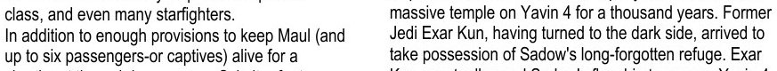

# Owner Material 035 — Dark Side Sourcebook (d20, 2001): Chapter Four: Dark Side Equipment, vehicles and starships

- **Source:** *Dark Side Sourcebook* by Bill Slavicsek and JD Wiker (Wizards of the Coast, 2001), for the Star Wars Roleplaying Game (d20). Secondary source (licensed Legends reference). Scan OCR'd on the box; the scan stays box-only and is **not** published.
- **Method:** every scanned page was OCR'd and machine-screened sentence by sentence for power-relevant statements (fights, kills, defeats, Force feats, rankings, superweapons) that name a character on our roster; each kept sentence is quoted verbatim from the OCR text and has a crop of the printed passage directly under it. Pages with nothing power-relevant are still listed with what is on them.
- **Citation:** "Dark Side Sourcebook, p.X" by printed page ("scan p.X" where no printed number applies). **Weight:** Licensed RPG sourcebook: a secondary source. Its narrative text sums up Legends history; game statistics are rules for players, not canon power levels.

## p.58 (scan page 59)

Page contents: 714 words, 21 paragraphs | headings/entries: J; O00 wa. aved; Chapter Four:; Dark Side Equipment; Obtaining Dark Side Equipment; Weapon and Armor Description; Table 4-1: Weapons; Lanuarok; Lightsaber, Double-Bladed

## p.59 (scan page 60)

Page contents: 373 words, 13 paragraphs | headings/entries: Double-bladed lightsaber and 4 4 Ambidexterity feat; Two-Weapon Fighting feat

## p.60 (scan page 61)

Page contents: 883 words, 16 paragraphs | headings/entries: Sith Sword; Dark Armor; Creating Dark Armor

## p.61 (scan page 62)

Page contents: 768 words, 25 paragraphs | headings/entries: Table: 4-2 Dark Armor Special Qualities; Increased might +2 Force bonus to Strength; Alchemy, DC 20; Alchemy, DC 25; Examples of Dark Armor; Vehicles and Starships; Sith Speeder

## p.62 (scan page 63)

Page contents: 390 words, 15 paragraphs | headings/entries: Sith Speeder; Sith Infiltrator; SITH INFLTRATOR; SITH BATTLESHIP

## p.63 (scan page 64)

Page contents: 846 words, 26 paragraphs | headings/entries: Sith Infiltrator; Weapon: 6 light laser cannons (fire-linked); Fire

- **Darth Maul; Exar Kun; Naga Sadow**: "Former In addition to enough provisions to keep Maul (and Jedi Exar Kun, having turned to the dark side, arrived to up to six passengers-or captives) alive for a take possession of Sadow's long-forgotten refuge." Source: Dark Side Sourcebook, p.63
  

## p.64 (scan page 65)

Page contents: 411 words, 13 paragraphs | headings/entries: SS ee; Sith Probe Droid

## p.65 (scan page 66)

Page contents: 841 words, 29 paragraphs | headings/entries: Skills: Hide +22*, Knowledge (Jedi lore) +10,; Feats: Alertness, Sharp-Eyed, Skill Emphasis (Spot),; Equipment; Alchemical Apparatus

## p.66 (scan page 67)

Page contents: 855 words, 21 paragraphs | headings/entries: A A ~ te; Artifacts; Sith Holocron; SITH HOLUGRON PERSONALITIES; Sith Fimulet

## p.67 (scan page 68)

Page contents: 506 words, 17 paragraphs | headings/entries: 

## p.68 (scan page 69)

Page contents: 536 words, 24 paragraphs | headings/entries: AG2 wa. ave te; Te ee ee; Percentage | -------esssseenssseecnnneennnnnecnnncnnnn HoSt SiZ@-------------------e-ee-00n====; Table 4-4: Orbalisks and Defense

