# Owner Material 035 — Dark Side Sourcebook (d20, 2001): Chapter Five: Dark Side Traditions (Sith Empire, Set Harth, prophets, Brakiss…)

- **Source:** *Dark Side Sourcebook* by Bill Slavicsek and JD Wiker (Wizards of the Coast, 2001), for the Star Wars Roleplaying Game (d20). Secondary source (licensed Legends reference). Scan OCR'd on the box; the scan stays box-only and is **not** published.
- **Method:** every scanned page was OCR'd and machine-screened sentence by sentence for power-relevant statements (fights, kills, defeats, Force feats, rankings, superweapons) that name a character on our roster; each kept sentence is quoted verbatim from the OCR text and has a crop of the printed passage directly under it. Pages with nothing power-relevant are still listed with what is on them.
- **Citation:** "Dark Side Sourcebook, p.X" by printed page ("scan p.X" where no printed number applies). **Weight:** Licensed RPG sourcebook: a secondary source. Its narrative text sums up Legends history; game statistics are rules for players, not canon power levels.

## p.69 (scan page 70)

Page contents: 836 words, 19 paragraphs | headings/entries: Chapter Five: Dark Side Traditions; The Sith Empire; Marka Ragnos, Sith Lord

- **Marka Ragnos** — entry/section: Marka Ragnos, Sith Lord: "He believed the Sith were not yet read to enter into a protracted war with the forces of the Republic, especially if the Jedi were still as strong as they had been when they defeated his ancestors." Source: Dark Side Sourcebook, p.69
  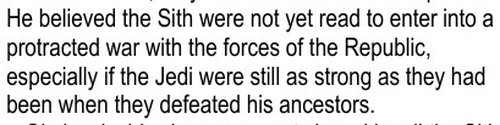

## p.70 (scan page 71)

Page contents: 623 words, 21 paragraphs | headings/entries: Naga Sadow. Sith Lord; When Marka Ragnos, the Dark Lord of

## p.71 (scan page 72)

Page contents: 833 words, 14 paragraphs | headings/entries: 

- **Ludo Kressh**: "Though Naga Sallow destroyed Ludo Kressh for certain this time, he could not enjoy his victory." Source: Dark Side Sourcebook, p.71
  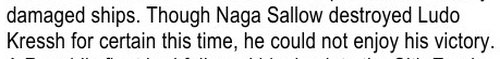
- **Ludo Kressh; Naga Sadow**: "Ludo Hressh, Aspiring Sith Lord The most powerful of the Sith to oppose Naga Sadow's rise to power was Ludo Kressh, a conservative among the Sith Lords, who believed that the Sith Empire must grow strong within itself before looking for new foes to conquer." Source: Dark Side Sourcebook, p.71
  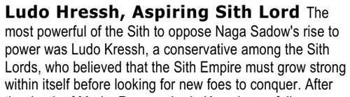
- **Ludo Kressh**: "Both ships were destroyed, along with Ludo KreSSh's dreams of ruling the Sith Empire." Source: Dark Side Sourcebook, p.71
  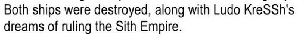

## p.72 (scan page 73)

Page contents: 656 words, 23 paragraphs | headings/entries: Freedon Nadd, Jedi Expatriate The

- **Freedon Nadd** — entry/section: Freedon Nadd, Jedi Expatriate The: "One gotten his start in the ways of the Sith, his spin such Jedi was Freedon Nadd, who slew his own master to was destroyed forever." Source: Dark Side Sourcebook, p.72
  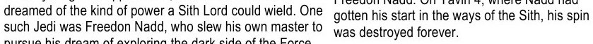

## p.73 (scan page 74)

Page contents: 814 words, 22 paragraphs | headings/entries: Queen Amanoa of Onderon, Sith Sorceress; Force Feats: Alter, Control, Rage,; King Ommin of Onderon, Sith Sorcerer

## p.74 (scan page 75)

Page contents: 876 words, 21 paragraphs | headings/entries: Sith Acolytes

- **Queen Amanoa; Freedon Nadd; Arca Jeth**: "After a fierce battle, the Jedi confronted Amanoa, who called upon the spirit of Freedon Nadd for aid-only to be defeated by the light side power of the Jedi Master Arca Jeth." Source: Dark Side Sourcebook, p.74
  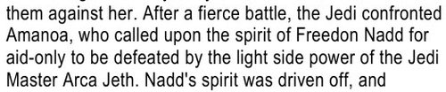
- **Freedon Nadd; Queen Amanoa**: "Nadd's spirit was driven off, and Amanoa was killed." Source: Dark Side Sourcebook, p.74
  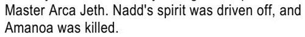
- **King Ommin; Ulic Qel-Droma** — entry/section: King Ommin of Onderon, Sith Sorcerer: "Though Ommin overcame Master Area with his dark side power, he himself was beaten when the Jedi Ulic Qel-Droma severed the connection to his support exoskeleton, leaving King Ommin barely able to speak or move, let alone draw upon the power of the dark side." Source: Dark Side Sourcebook, p.74
  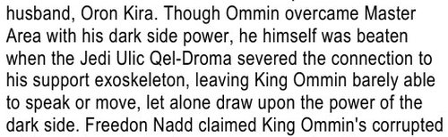
- **Freedon Nadd; King Ommin; Satal Keto; Aleema Keto**: "The specter of Freedon Nadd had been assisting King Ommin, but decided that Satal and Aleema held the key to resurrecting the golden age of the Sith." Source: Dark Side Sourcebook, p.74
  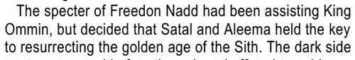

## p.75 (scan page 76)

Page contents: 861 words, 23 paragraphs | headings/entries: Ulic Qel-Droma, Former Jedi Hnight, Sith Lord

- **Aleema Keto**: "He killed the assassin and was accepted into the usurper's sect by the beautiful Aleema." Source: Dark Side Sourcebook, p.75
  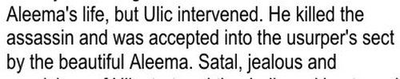
- **Satal Keto; Ulic Qel-Droma**: "When Satal Keto eventually discovered Ulic's true plans, he confronted the fallen Jedi in a great duel that had terrible repercussions: Ulic unleashed his fury, killing Satal but completing his slide to the dark side." Source: Dark Side Sourcebook, p.75
  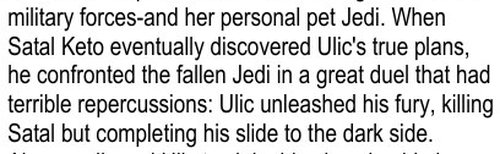
- **Ulic Qel-Droma; Exar Kun**: "She triggered an ancient Sith weapon-at the behest of Ulic and Exar Kun-that killed her as it destroyed the star systems of the Cron cluster." Source: Dark Side Sourcebook, p.75
  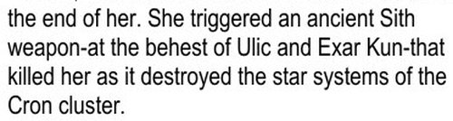
- **Ulic Qel-Droma; Satal Keto; Aleema Keto** — entry/section: Ulic Qel-Droma, Former Jedi Hnight, Sith Lord: "The other, Ulic Qel-Droma, sought to destroy the dark side sect of Satal and Aleema Keto frorn the inside, only to be turned to evil himself by dark side poison." Source: Dark Side Sourcebook, p.75
  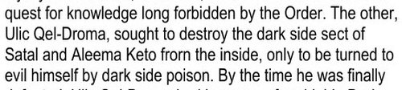
- **Ulic Qel-Droma; Exar Kun** — entry/section: Ulic Qel-Droma, Former Jedi Hnight, Sith Lord: "By the time he was finally defeated, Ulic Qel-Droma had become a formidable Dark Lord of the Sith, second only to his partner Exar Kun." Source: Dark Side Sourcebook, p.75
  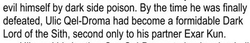

## p.76 (scan page 77)

Page contents: 741 words, 13 paragraphs | headings/entries: SANS suiay; Ss

- **Freedon Nadd; Ulic Qel-Droma**: "Nadd foretold that Ulic would one day be a great Sith Lord, equal to the mightiest Jedi masters." Source: Dark Side Sourcebook, p.76
  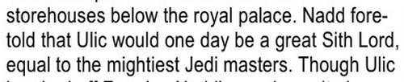
- **Arca Jeth; Ulic Qel-Droma**: "During the fight Arca Jeth was killed, and the loss of his master gave Ulic all the incentive he needed to carry out plan to infiltrate the sect and destroy it from within." Source: Dark Side Sourcebook, p.76
  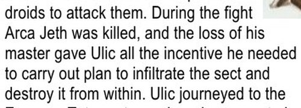
- **Ulic Qel-Droma**: "Ulic journeyed to the Empress Teta system. where he presented plan to infiltrate the sect and destroy it from within." Source: Dark Side Sourcebook, p.76
  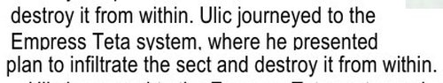
- **Exar Kun; Ulic Qel-Droma**: "Together, Exar Kun and Ulic Qel-Droma assembled vast armies with which to destroy the Jedi Order and establish the Sith as the rulers of the galaxy." Source: Dark Side Sourcebook, p.76
  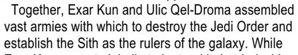
- **Exar Kun; Ulic Qel-Droma**: "With Exar Kun's help, Ulic escaped, and the dark side sect then moved against the Jedi learning center on Ossus, unleash ing a supernova that destroyed vast storehousesof Jedi relics and lore." Source: Dark Side Sourcebook, p.76
  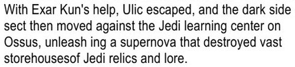
- **Ulic Qel-Droma**: "He failed, and Ulic killed him." Source: Dark Side Sourcebook, p.76
  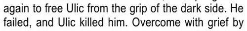

## p.77 (scan page 78)

Page contents: 867 words, 19 paragraphs | headings/entries: Exar Kun, Former Jedi Knight, Sith Lord

- **Ulic Qel-Droma**: "Broken and defeated, Ulic began wandering the galaxy, finally making his home on the frozen world of Rhen Var." Source: Dark Side Sourcebook, p.77
  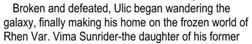
- **Exar Kun** — entry/section: Exar Kun, Former Jedi Knight, Sith Lord: "Tempted by the promise of powers he arrogantly believed he could control, Exar Kun went from promising Jedi apprentice to formidable Sith Lord with barely a backward glance." Source: Dark Side Sourcebook, p.77
  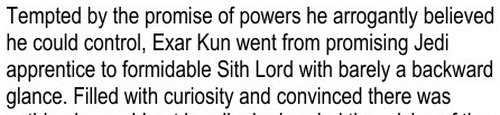
- **Exar Kun; Freedon Nadd** — entry/section: Exar Kun, Former Jedi Knight, Sith Lord: "He then turned the weapon on Freedon Nadd, destroying the dark side spirit forever." Source: Dark Side Sourcebook, p.77
  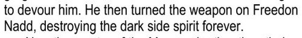

## p.78 (scan page 79)

Page contents: 842 words, 20 paragraphs | headings/entries: SNOILIGVSNL ACIS AdVa; I"; The New Sith; Darth Bane

- **Exar Kun**: "Seeing that the Jedi fleet in the skies above him was poised to destroy him, Exar Kun opted for a somewhat risky escape." Source: Dark Side Sourcebook, p.78
  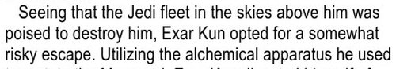
- **Lord Kaan**: "When the Jedi arrived for the final conflict, Lord Kaan detonated the device, destroying himself, his Sith army, and theJd Knights." Source: Dark Side Sourcebook, p.78
  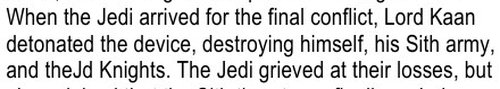
- **Darth Bane**: "One Sith Lord, Darth Bane survived." Source: Dark Side Sourcebook, p.78
  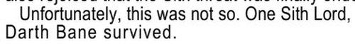

## p.79 (scan page 80)

Page contents: 432 words, 14 paragraphs | headings/entries: 

## p.80 (scan page 81)

Page contents: 834 words, 20 paragraphs | headings/entries: Sorcerers of Tund; Rokur Gepto

- **Rokur Gepta**: "Eager to extend his reach beyond the tiny world of Tund, Gepta exploited the Sorcerers' knowledge for his own plans of galactic dominatior After learning all the Sorcerers could teach him, Gepta killed the last of the Sorcerers and laid waste to their planet." Source: Dark Side Sourcebook, p.80
  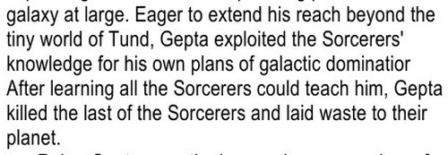
- **Lando Calrissian**: "He lost and was squeezed to a greasy slime in Calrissian's gloved hands, thus ending his dreams of galactic domination." Source: Dark Side Sourcebook, p.80
  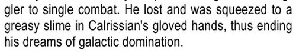

## p.81 (scan page 82)

Page contents: 628 words, 21 paragraphs | headings/entries: Force Skills: Affect Mind +12, Empathy +11,Fear; Gethzerion the Nightsister; Augwynne, the

- **Gethzerion**: "SkillEmphasis (Disguise), Skill Emphasis But Gethzerion (Illusion), and Augwynne Weapon Group Proficiency (blaster frequently pistols), Weapon Group Proficiency clashed on (primitive weapons), interpretations of Weapon Group Proficiency The Book of Law, (simple weapons). the text passed Force Feats: Alter, Control, Force down to the Mastery, Sense. witches of yi 3 Dathomir by the Nightsisters of original Force ' witch, Allya." Source: Dark Side Sourcebook, p.81
  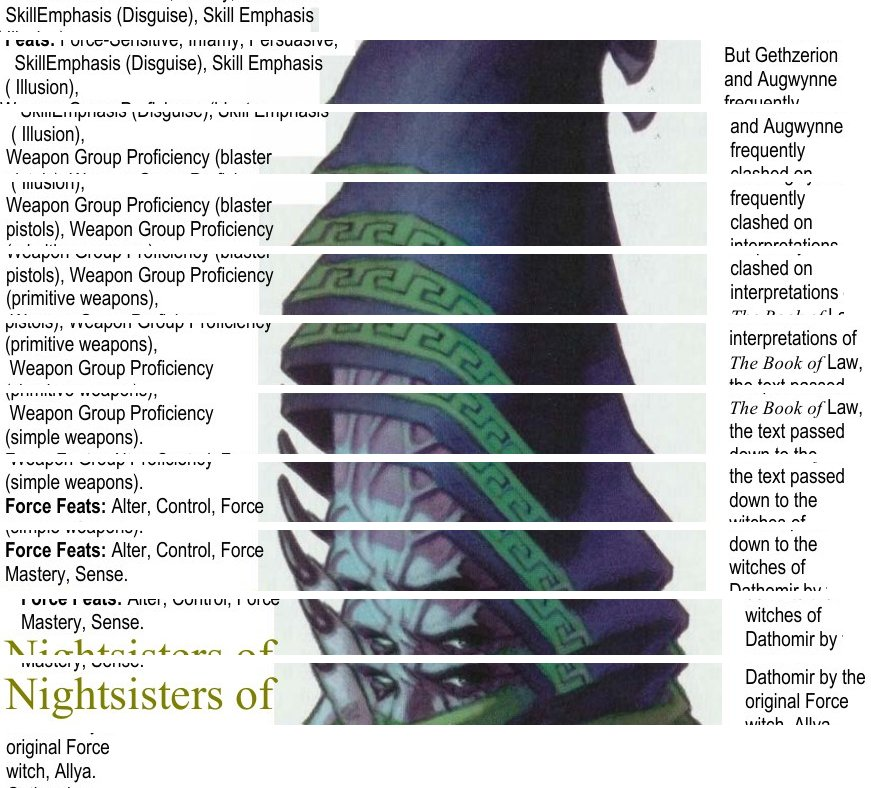

## p.82 (scan page 83)

Page contents: 901 words, 19 paragraphs | headings/entries: 

- **Gethzerion**: "Though Baritha wanted to kill the third one as well, Gethzerion realized that she did not need to rule the Singing Mountain Clan if she were leader of her own clan, a clan more powerful than Augwynne'sone that could take The Book of Law by force." Source: Dark Side Sourcebook, p.82
  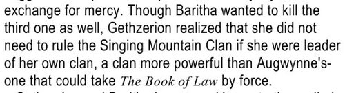

## p.83 (scan page 84)

Page contents: 847 words, 20 paragraphs | headings/entries: The Dark Jedi; Set Harth, Dark Jedi; Mn

- **Luke Skywalker**: "Zsinj reluctantly agreed, but their mutual plans were thwarted when Organa's brother, the new Jedi Knight Luke Skywalker, arrived on Dathomir with Prince Jsolder and helped the Force witches of the Singing Mountain Clan defeat the numerically superior Nightsisters." Source: Dark Side Sourcebook, p.83
  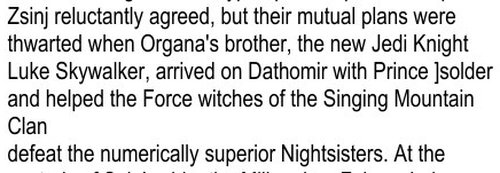
- **Set Harth** — entry/section: Set Harth, Dark Jedi: "When the Sith thought bomb destroyed the Jedi and Sith armies alike, Set Harth was left without an instructor." Source: Dark Side Sourcebook, p.83
  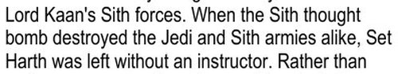
- **Set Harth** — entry/section: Set Harth, Dark Jedi: "He tracked down rumors of a Sith artifact from the battlefields of Ruusan, eventually dueling for its possession with a powerful dark side warrior in an abandoned Sith armory." Source: Dark Side Sourcebook, p.83
  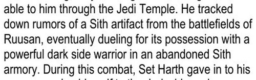
- **Set Harth** — entry/section: Set Harth, Dark Jedi: "Eventually, Set Harth grew disenchanted with the power of the artifact, and from his base on Nar Shaddaa, began investigating rumors of other Sith artifacts that survived the destruction on Ruusan." Source: Dark Side Sourcebook, p.83
  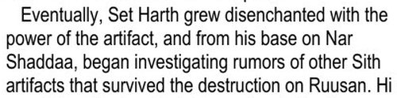

## p.84 (scan page 85)

Page contents: 900 words, 32 paragraphs | headings/entries: Qui-Gon and Obi-Wan confronted Xanatos a numb; Force Feats: Alter, Control, Rage, Sense. :

- **Qui-Gon Jinn; Obi-Wan Kenobi** — entry/section: Qui-Gon and Obi-Wan confronted Xanatos a numb: "He then stepped into a pool of black acid, presumed to have killed himself instead of surrendering." Source: Dark Side Sourcebook, p.84
  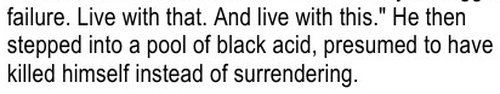

## p.85 (scan page 86)

Page contents: 599 words, 16 paragraphs | headings/entries: The Return of the Sith; Darth Sidious

- **Darth Maul**: "This Sith, Darth Maul, slew Jedi Master Qui- Gon Jinn-reminding the complacent Jedi that they were not the only Force wielders in the galaxy." Source: Dark Side Sourcebook, p.85
  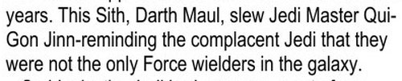
- **Palpatine (Darth Sidious)** — entry/section: Darth Sidious: "The most powerful of these was Darth Sidious, an ice-cold, diabolically calculating genius equipped with the strength of the dark side of the Force, as well as an enormous wealth of Sith artifacts, equipment, and knowledge." Source: Dark Side Sourcebook, p.85
  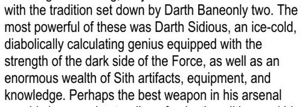
- **Palpatine (Darth Sidious); Darth Maul** — entry/section: Darth Sidious: "Darth Sidious planned to turn the Republic against the Jedi, since he knew that he could not singlehandedly destroy the entire Jedi Order-especially after having lost his apprentice Darth Maul during the Battle of Naboo." Source: Dark Side Sourcebook, p.85
  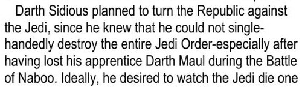

## p.86 (scan page 87)

Page contents: 665 words, 15 paragraphs | headings/entries: Note to Gamernasters; Darth Maul

- **Darth Maul; Palpatine (Darth Sidious)** — entry/section: Darth Maul: "At that point, Darth Sidious returned and challenged his apprentice to a lightsaber duel, telling Maul that he had secretly been training a second apprentice in case Maul failed his final test-which, by failing to kill Sidious in the duel, he just had." Source: Dark Side Sourcebook, p.86
  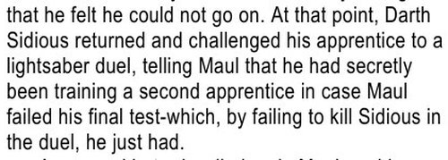
- **Palpatine (Darth Sidious)**: "Hurling himself at Darth Sidious, he nearly bested his master with a flurry of deadly lightsaber blows." Source: Dark Side Sourcebook, p.86
  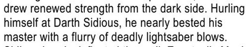
- **Palpatine (Darth Sidious)**: "Sidious barely deflected them all." Source: Dark Side Sourcebook, p.86
  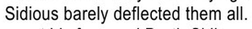
- **Darth Maul** — entry/section: Darth Maul: "He fought and slaughtered-countless foes, including politicians, warlords, merchants, and even all but destroying the fledgling Black Sun criminal cartel." Source: Dark Side Sourcebook, p.86
  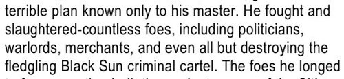

## p.87 (scan page 88)

Page contents: 846 words, 16 paragraphs | headings/entries: Note to Gamemesters; JEDI HUNTERS; Aurra Sing

## p.88 (scan page 89)

Page contents: 635 words, 15 paragraphs | headings/entries: R2Al2 ba. awHo; Equipment: Lightsabers (several), slugthrower rifle,; MANN BIGDMPOTED; Del Korrot

## p.89 (scan page 90)

Page contents: 603 words, 17 paragraphs | headings/entries: Te; The New Order; The Emperor

- **Darth Vader (Anakin Skywalker)**: "The Emperor ordered Darth Vader to destroy Del Korrot." Source: Dark Side Sourcebook, p.89
  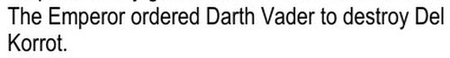
- **Darth Vader (Anakin Skywalker)**: "Vader destroyed each of the Cerean's weapons with his lightsaber in turn, then used his furious Force Grip ability to strangle Korrot, thus rewarding the Jedi hunter for his many months of service to the Empire with a slow and painful death." Source: Dark Side Sourcebook, p.89
  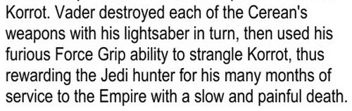
- **Palpatine (Darth Sidious)**: "Possessed of the boundless power of the Force and adept in the ways of the dark side, Emperor Palpatine was one of the most dangerous and evil Humans in galactic history." Source: Dark Side Sourcebook, p.89
  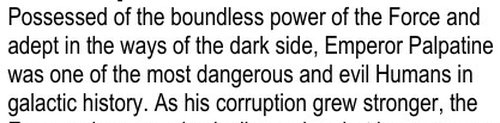

## p.90 (scan page 91)

Page contents: 649 words, 11 paragraphs | headings/entries: 

- **Darth Vader (Anakin Skywalker)**: "Skywalker turned to the dark outclassed by the pace and magnitude of the political side and became the dreaded Darth Vader, the arena into which he had been thrust when he became a Dark Lord of the Sith, feared by the entire galaxy. senator." Source: Dark Side Sourcebook, p.90
  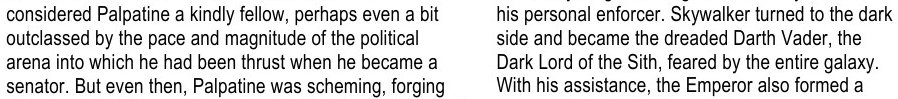
- **Palpatine (Darth Sidious)**: "Palpatine even had the ear of a powerful Jedi = them into the Emperor's fold or destroyed them." Source: Dark Side Sourcebook, p.90
  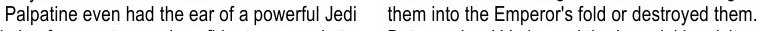

## p.91 (scan page 92)

Page contents: 600 words, 19 paragraphs | headings/entries: Note to Gamemasters

- **Luke Skywalker; Darth Vader (Anakin Skywalker)**: "The Emperor foresaw the return of the Jedi Knights in the form of Luke Skywalker, the son of his apprentice, Darth Vader." Source: Dark Side Sourcebook, p.91
  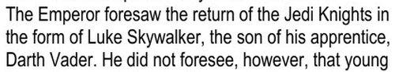
- **Darth Vader (Anakin Skywalker)**: "Fewer still knew that the formidable Darth Vader was once an idealistic little boy who wanted little more than to play with his friends and to make his mother proud." Source: Dark Side Sourcebook, p.91
  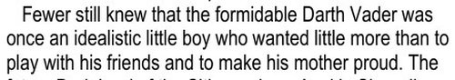

## p.92 (scan page 93)

Page contents: 933 words, 15 paragraphs | headings/entries: SAIS 5

- **Darth Vader (Anakin Skywalker)**: "On the Emperor's command, Vader hunted down the last of the Jedi Knights and destroyed them." Source: Dark Side Sourcebook, p.92
  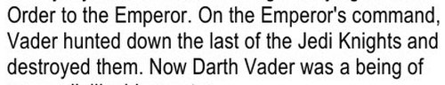
- **Grand Moff Tarkin; Leia Organa Solo**: "The evil Tarkin demonstrated the battle station's power to Rebel leader Princess Leia Organa by destroying her homeworld of Alderaan." Source: Dark Side Sourcebook, p.92
  
- **Luke Skywalker**: "Luke later returned as part of the force that defended the Rebellion's base on Yavin 4 from the Death Star, and fired the fateful shot that destroyed the Death Star." Source: Dark Side Sourcebook, p.92
  
- **Darth Vader (Anakin Skywalker)**: "Vader sensed the strength of the Force in the young pilot who destroyed the Death Star, but didn't know his name." Source: Dark Side Sourcebook, p.92
  

## p.93 (scan page 94)

Page contents: 573 words, 32 paragraphs | headings/entries: Darth Vader: Male Human, Fringer 1 /Jedi; DARTH VADER'S ARMOR; Note to Gamemosters; Lord Hethrir

## p.94 (scan page 95)

Page contents: 852 words, 19 paragraphs | headings/entries: Prophets of the Dark Side; Kadann

## p.95 (scan page 96)

Page contents: 485 words, 7 paragraphs | headings/entries: 

## p.96 (scan page 97)

Page contents: 858 words, 22 paragraphs | headings/entries: Jedgar; Azrakel the Dark Warrior

## p.97 (scan page 98)

Page contents: 511 words, 26 paragraphs | headings/entries: Emperor's most trusted

## p.98 (scan page 99)

Page contents: 570 words, 17 paragraphs | headings/entries: Force Skills: Battlemind +12, Enhance Ability +8,; The Emperor's Minions; Royal Guard

- **Darth Vader (Anakin Skywalker)**: "There, these stormtroopers honed their battle prowess so that they were almost a match for the formidable Darth Vader himself." Source: Dark Side Sourcebook, p.98
  

## p.99 (scan page 100)

Page contents: 818 words, 23 paragraphs | headings/entries: Imperial Sovereign Protector; Skills: Intimidate +9, Knowledge (nobility; Imperial Sentinel; Mara Jade, Emperor's Hand

## p.100 (scan page 101)

Page contents: 645 words, 17 paragraphs | headings/entries: Hoi dWHO; High Inquisitor Tremayne

- **Darth Vader (Anakin Skywalker)**: "Skywalker, the Jedi hero of the Rebellion who destroyed the first Death Star and escaped Darth Vader's clutches on Bespin." Source: Dark Side Sourcebook, p.100
  
- **Antinnis Tremayne; Darth Vader (Anakin Skywalker)** — entry/section: High Inquisitor Tremayne: "A former Jedi Knight, High Inquisitor Tremayne followed a path similar to Darth Vader's, being seduced by the dark side and serving the Emperorir hunting down and destroying other Jedi." Source: Dark Side Sourcebook, p.100
  
- **Antinnis Tremayne** — entry/section: High Inquisitor Tremayne: "Tremayne has at his disposal an imperial 11 Star Destroyer, Interrogator, and its crew and comple ment of support ships and weapons." Source: Dark Side Sourcebook, p.100
  

## p.101 (scan page 102)

Page contents: 653 words, 19 paragraphs | headings/entries: Jerec, Dark Jedi Master

- **Antinnis Tremayne** — entry/section: High Inquisitor Tremayne: "Tremayne once dueled a Jedi named Corwin Shelvay, who defeated Tremayne with a vicious lightsaber cut that took Tremayne's right arm and part of his face." Source: Dark Side Sourcebook, p.101
  

## p.102 (scan page 103)

Page contents: 919 words, 20 paragraphs | headings/entries: SAIS & i; Feats: Blind-Fight, Exotic Weapon Proficiency (lightsaber), Force-Sensitive,; Executor Sedriss

- **Jerec; Kyle Katarn**: "Jerec slew Rahn and Katarn and eventually discovered the location of the Valley of the Jedi on Ruusan." Source: Dark Side Sourcebook, p.102
  
- **Jerec; Kyle Katarn**: "But even with his increased might, Jerec was unable to defeat Kyle or to prevent him from freeing the Valley's trapped Jedi spirits." Source: Dark Side Sourcebook, p.102
  

## p.103 (scan page 104)

Page contents: 593 words, 15 paragraphs | headings/entries: Dark Side Adepts

- **Luke Skywalker**: "Sedriss slew the saboteurs, then accepted new orders from the Emperor: Capture Luke Skywalker and bring him to Byss." Source: Dark Side Sourcebook, p.103
  

## p.104 (scan page 105)

Page contents: 888 words, 24 paragraphs | headings/entries: Equipment: Hold-out blaster pistol, dark side; The Shadow Academy; Kyp Durron, Fallen Jedi

- **Brakiss; Luke Skywalker; Han Solo; Lando Calrissian**: "Dolph and the Imperial spy Brakiss, turned their backs on armed with nova-inducing resonance torpedoes Luke's training and set off to find their fortunes elsewhere. ang covered with impenetrable armor, the Sun Still others never came to Luke's school at all but studied the Crusher was invincible, and only when Han Solo Force on their own, giving the dark side easy targets. and Lando Calrissian sought him out to appeal to his better nature did he finally relent." Source: Dark Side Sourcebook, p.104
  
- **Exar Kun; Kyp Durron; Sun Crusher (superweapon)**: "Even then, it took the defeat of Exar Kun, back on Yavin 4, before Kyp could bring himself to surrender the Sun Crusher." Source: Dark Side Sourcebook, p.104
  

## p.105 (scan page 106)

Page contents: 813 words, 21 paragraphs | headings/entries: Exar Kun. Dark Side Spirit

- **Gantoris**: "Gantoris failed to defeat the Jedi Knight, however, and Kun was forced to punish him." Source: Dark Side Sourcebook, p.105
  
- **Admiral Daala; Sun Crusher (superweapon)**: "For the best revenge-to ensure that Daala's evil was eradicated from the galaxy-Kyp used her own superweapon against her: the Sun Crusher, a ship capable of launching nova-triggering resonance torpedoes and destroying entire systems with one shot." Source: Dark Side Sourcebook, p.105
  
- **Sun Crusher (superweapon); Kyp Durron**: "In acquiring the Sun Crusher, Kyp returned to Yavin 4, where he faced Skywalker in a duel that left the Jedi Master comatose, his spirit forced out of his body." Source: Dark Side Sourcebook, p.105
  
- **Exar Kun; Luke Skywalker** — entry/section: Exar Kun. Dark Side Spirit: "Combining their power-along with that of Kun's longdead former Jedi Master, Vodo-Siosk Baas- Skywalker's Jedi students destroyed Exar Kun's spirit and enabled Luke Skywalker's spirit to return to his body." Source: Dark Side Sourcebook, p.105
  

## p.106 (scan page 107)

Page contents: 832 words, 20 paragraphs | headings/entries: Irek Ismaren; Equipment: Lightsaber, assortment of Force "training toys."; Kueller

- **Kueller** — entry/section: Kueller: "He ruled the world of Almania-the homeworld of the people who slew his parents and set him on the path to the dark side." Source: Dark Side Sourcebook, p.106
  

## p.107 (scan page 108)

Page contents: 820 words, 17 paragraphs | headings/entries: Brakiss; DARK SIDE TRADITIONS

- **Kueller; Luke Skywalker** — entry/section: Kueller: "Doing so attracted the attention of Luke Skywalker, who followed the trail of clues back to Almania, where he was forced to bail out of his sabotaged X-wing fighter, leaving him injured and easy prey for a lightsaber duel with Kueller." Source: Dark Side Sourcebook, p.107
  
- **Kueller; Leia Organa Solo; Luke Skywalker** — entry/section: Kueller: "On Almania, Leia rescued Luke while Kueller's fleet of Victoryclass Star Destroyers and TIE fighters did battle with the New Republic forces Mon Mothma sent to help." Source: Dark Side Sourcebook, p.107
  
- **Kueller** — entry/section: Kueller: "He should not have been a match for either of them, but powered by his rage and with Skywalker still wounded, Kueller got the better of them." Source: Dark Side Sourcebook, p.107
  
- **Palpatine (Darth Sidious)**: "This group was under the leadership of Emperor Palpatine, who somehow managed to survive yet again after his defeat on Onderon." Source: Dark Side Sourcebook, p.107
  
- **Brakiss** — entry/section: Brakiss: "Having always been a loyal Imperial subject, Brakiss swore loyalty to the Second Imperium immediately, and the Emperor commanded him to begin work on an academy equal to Skywalker's-but devoted to the dark side." Source: Dark Side Sourcebook, p.107
  

## p.108 (scan page 109)

Page contents: 837 words, 21 paragraphs | headings/entries: LeAle wa.awne; Tamith Kai

- **Brakiss; Luke Skywalker**: "After one such mission during which the Jedi students thwarted Brakiss's plans, the Emperor grew impatient and declared that Brakiss must wipe out Luke Skywalker's new Jedi academy and end the interference of the Jedi once and for all." Source: Dark Side Sourcebook, p.108
  
- **Luke Skywalker; Brakiss**: "The assault was a disaster, with Tamith Kai's hovering battle platform being destroyed and Luke Skywalker himself defeating Brakiss in combat." Source: Dark Side Sourcebook, p.108
  
- **Luke Skywalker; Gethzerion**: "Most of their dark clan was killed when Luke Skywalker destroyed Gethzerion's transport." Source: Dark Side Sourcebook, p.108
  

## p.109 (scan page 110)

Page contents: 797 words, 25 paragraphs | headings/entries: Zekk

- **Jaina Solo**: "Zekk dueled with Jaina, but fled rather than deliberately injure her." Source: Dark Side Sourcebook, p.109
  

## p.110 (scan page 111)

Page contents: 1087 words, 39 paragraphs | headings/entries: SNOILIGVUL 3GIS MYVG; RATS b 31. c¥HS; The Book of Anger; The Weakness of Inferiors; The Creation of Monsters

