# Owner Material 035 — Dark Side Sourcebook (d20, 2001): Chapter Six: Creatures and Archetypes

- **Source:** *Dark Side Sourcebook* by Bill Slavicsek and JD Wiker (Wizards of the Coast, 2001), for the Star Wars Roleplaying Game (d20). Secondary source (licensed Legends reference). Scan OCR'd on the box; the scan stays box-only and is **not** published.
- **Method:** every scanned page was OCR'd and machine-screened sentence by sentence for power-relevant statements (fights, kills, defeats, Force feats, rankings, superweapons) that name a character on our roster; each kept sentence is quoted verbatim from the OCR text and has a crop of the printed passage directly under it. Pages with nothing power-relevant are still listed with what is on them.
- **Citation:** "Dark Side Sourcebook, p.X" by printed page ("scan p.X" where no printed number applies). **Weight:** Licensed RPG sourcebook: a secondary source. Its narrative text sums up Legends history; game statistics are rules for players, not canon power levels.

## p.111 (scan page 112)

Page contents: 790 words, 28 paragraphs | headings/entries: Chapter Six:; Creatures and Archetypes; Overview; The Physical World:; Dark Creatures Battle Hydra

- **Exar Kun; Naga Sadow**: "The battle hydra is an example of Exar Kun's alchemical mastery and Naga Sadow's dark legacy." Source: Dark Side Sourcebook, p.111
  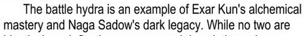
- **Exar Kun; Corran Horn**: "Exar Kun called up another swarm of the creatures to kill Skywalker, but these were destroyed by Rogue Squadron pilot Corran Horn in a borrowed Z-95 Headhunter." Source: Dark Side Sourcebook, p.111
  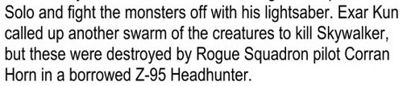

## p.112 (scan page 113)

Page contents: 918 words, 19 paragraphs | headings/entries: H3LowHo; His; Sa nn erin cae = i ee; Dxun Tomb Beast

- **Exar Kun**: "Now that Exar Kun's spirit has been destroyed, the creatures may die out or even revert to their natural forms." Source: Dark Side Sourcebook, p.112
  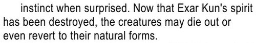

## p.113 (scan page 114)

Page contents: 674 words, 16 paragraphs | headings/entries: 

- **Exar Kun**: "When Exar Kun finally fought his way into Nadqd's resting place, he slew one of these Dxun tomb beasts." Source: Dark Side Sourcebook, p.113
  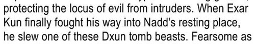

## p.114 (scan page 115)

Page contents: 883 words, 36 paragraphs | headings/entries: Special Qualities: Improved Grab-Opponents may not

## p.115 (scan page 116)

Page contents: 647 words, 15 paragraphs | headings/entries: Primitive Massassi

- **Freedon Nadd**: "When Kun destroyed the creature with an ancient Sith amulet, he won the approval of Nadd, the full strength of the dark side, and the worship of the Massassi." Source: Dark Side Sourcebook, p.115
  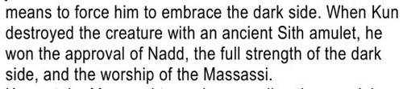

## p.116 (scan page 117)

Page contents: 900 words, 23 paragraphs | headings/entries: TUGHT BEAST: HALGRATH, THE LAST MASSASS

- **Exar Kun**: "One lone Massassi warrior survived Exar Kun's suicidal stand against the might of the Jedi: a hulking brute named Kalgrath." Source: Dark Side Sourcebook, p.116
  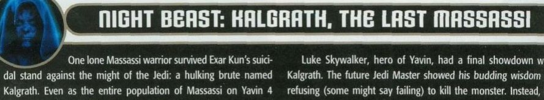

## p.117 (scan page 118)

Page contents: 902 words, 15 paragraphs | headings/entries: 

- **Freedon Nadd**: "Since Bane's own master had been killed at Ruusan, he journeyed to Dxun, the legendary demon moon of Onderon, to find what knowledge he could at the tomb of Freedon Nadd." Source: Dark Side Sourcebook, p.117
  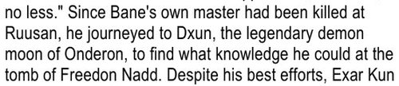
- **Darth Bane**: "Darth Bane barely survived the impact by using all the Sith power at his command." Source: Dark Side Sourcebook, p.117
  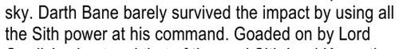
- **Freedon Nadd**: "However, since Kun had destroyed Nadd's spirit on Yavin 4, the entity no longer lurked in its crypt." Source: Dark Side Sourcebook, p.117
  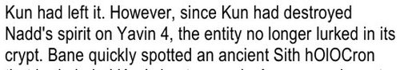

## p.118 (scan page 119)

Page contents: 850 words, 21 paragraphs | headings/entries: LL A ttt i eat ae; Initial Secondary Poison Type Damage Damage; Sith Mutants; Massassi Abomination

- **Exar Kun**: "Although the Massassi pledged their loyalty to Exar Kun after he defeated the Sith wyrm, the Dark Jedi was still not satisfied." Source: Dark Side Sourcebook, p.118
  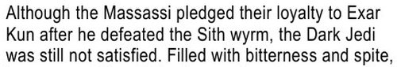

## p.119 (scan page 120)

Page contents: 577 words, 13 paragraphs | headings/entries: 

## p.120 (scan page 121)

Page contents: 893 words, 18 paragraphs | headings/entries: 

## p.121 (scan page 122)

Page contents: 966 words, 18 paragraphs | headings/entries: Sith War Droid; Sith Wyrm

- **Ulic Qel-Droma**: "An army of skeletal war droids dropped onto the planet Deneba ultimately slew the Jedi Master Area Jeth, driving his apprentice Ulic Qel-Droma to the dark side." Source: Dark Side Sourcebook, p.121
  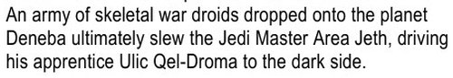
- **Freedon Nadd**: "Freedon Nadd knew that Kun could only defeat the wyrm by taking up an ancient Sith amulet and focusing the energy of the dark side in concentrated blasts." Source: Dark Side Sourcebook, p.121
  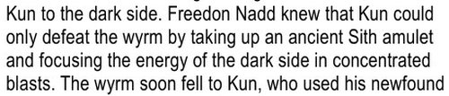
- **Freedon Nadd**: "The wyrm soon fell to Kun, who used his newfound power to destroy the spirit of Freedou Nadd as well." Source: Dark Side Sourcebook, p.121
  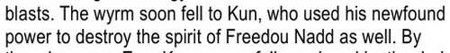
- **Exar Kun**: "By then, however, Exar Kun was so fully enslaved by the dark side that it dominated his destiny forever." Source: Dark Side Sourcebook, p.121
  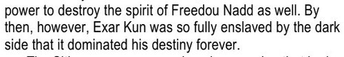
- **Naga Sadow**: "Sadow, failing to tame the creature and seeing little other use for it, chose to mutate it into a colossal monster capable of swallowing a Jedi in one gulp." Source: Dark Side Sourcebook, p.121
  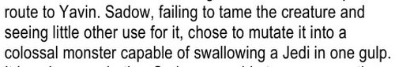

## p.122 (scan page 123)

Page contents: 912 words, 16 paragraphs | headings/entries: The Supernatural: Dark Spirits Dark Side Spirit

- **Luke Skywalker**: "Many ghostly manifestations exist within the dark side, from Luke Skywalker's illusionary dueling opponent in the Dagobah cave to powerful avatars capable of utterly annihilating a Jedi Knight in a flash." Source: Dark Side Sourcebook, p.122
  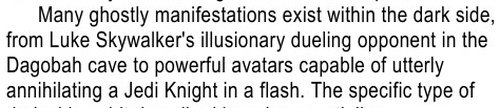

## p.123 (scan page 124)

Page contents: 989 words, 46 paragraphs | headings/entries: DESTROYING; DARH SIDE SPIRIT; Vv) i 0. >; I; Zz; Ww); O

## p.124 (scan page 125)

Page contents: 628 words, 25 paragraphs | headings/entries: RTE usicvKS; Dark Side Save; Power Level Modifier Example

## p.125 (scan page 126)

Page contents: 880 words, 20 paragraphs | headings/entries: Guardian Spirit; GM Archetypes

## p.126 (scan page 127)

Page contents: 733 words, 14 paragraphs | headings/entries: Who; Dark Jedi

## p.127 (scan page 128)

Page contents: 530 words, 59 paragraphs | headings/entries: Dark Side Adept; Blaster pistol +3 ranged Damage: spear 1d8-1; Feats: Force-Sensitive, Iron Will,; Alter, Control, Force Mind, Sense; Force Feats:; Equipment: Spear, blaster pistol, dark side; Force Adept 6/; Dark force Devotee 2; Spear +4 melee; Blaster pistol +8 ranged spear 1d8-1; Blaster pistol 3d6; Cc; Str 9, Dex 11, Con 14,; Int 14, Wis 15, Cha 14; Alter, Control, Force Mind, Prolong Force, Sense; Spear, blaster pistol, dark side talisman, robes; Spear +7 melee; Blaster pistol +18 ranged spear 1d8-1; Blaster pistol 3d6; Force weapon (+2d4) F+8,R +6, W +15; D; Str 9, Dex 11, Con 14,; Spear, blaster pistol, dark side talisman, robes

## p.128 (scan page 129)

Page contents: 677 words, 26 paragraphs | headings/entries: Dark Side Avatar; Soldier 4/Force Adept 1/; Blaster rifle 3d8; F+14,R +8, W +7 (by species) E

## p.129 (scan page 130)

Page contents: 636 words, 74 paragraphs | headings/entries: Dark Side Spirit; Various Generic Dark Side Spirits; Initiative: Defense: Speed: VP/WP: Attacks:; Damage:; Special Qualities:; Saves:; Size:; Challenge Code: Force Points:; Dark Side Points:; Reputation: Abilities:; Skills:; Force Skills:; Feats:; Force Feats:; Equipment:; D; Str 9, Dex 11, Con -,; Enhance Ability +10; Dark robes; Dark Jedi Spirit Jedi Consular 12; F+8*,R +7, W +10 (by species); D; Battlemind +13, Enhance Ability +13; Jedi robes; Sith Lord Spirit; Sword Defense); Enemy bonus +1; Sith armor

## p.130 (scan page 131)

Page contents: 711 words, 76 paragraphs | headings/entries: B21 ave; Emperor's Hand; Initiative: Defense: Speed: VP/WP: Attacks:; Damage:; Special Qualities:; Saves:; Size:; Challenge Code: Force Points:; Dark Side Points:; Reputation: Abilities:; Skills:; Force Skills:; Feats:; Force Feats: Equipment:; Scoundrel 6/; Emperor's Hand 2; Hold-out blaster 3d4; F +3,R+11,W +3 Medium; D; Scoundrel 6/ Emperor's Hand 6; F+5,R+14,W +5 Medium; Ei; Str 12, Dex 18, Con 12,; Scoundrel 6/ Emperor's Hand 10; Blaster pistol 3d6 Hold-out blaster 3d4; F +6,R +16, W +6; Medium; F; Str 12, Dex 18, Con 13,; Alter, Control, Sense; Lightsaber, blaster pistol, hold-out blaster

## p.131 (scan page 132)

Page contents: 515 words, 26 paragraphs | headings/entries: Tainted Jedi; Jedi Guardian 4; Heavy blaster pistol 3d8; Jedi Guardian 5/Scoundrel 3; Heavy blaster pistol 3d8; Jedi Guardian 6/Scoundrel 6; Heavy blaster pistol 3d8; CREATURES AND ARCHETYPES; Initiative: +2 +3 +3; VP/WP: 35/14 62/14 82/14 :; Special Qualities:; Illicit barter, better lucky

## p.132 (scan page 133)

Page contents: 732 words, 33 paragraphs | headings/entries: Imperial Inquisitor; Saves: F+8,R +5, W +10 F+9,R+5,W +11; Size: Medium Medium; Challenge Code: D E; Force Points: 4 5; Dark Side Points: 8 12; Reputation: 6 12; Force Whirlwind, Sense Force Whirlwind, Sense; Equipment: Lightsaber, blaster pistol, Lightsaber, blaster pistol,

## p.133 (scan page 134)

Page contents: 500 words, 32 paragraphs | headings/entries: Jedi Knight; Jedi Guardian 6; Jedi Guardian 10; Jedi Guardian 14; Initiative: +1 +1 +1; VP/WP: 46/10 78/10 110/10; Damage: Lightsaber 3d8-1 Lightsaber 4d8-1 Lightsaber 4d8-1; Special Qualities:; Size: (by species) (by species) (by species); Challenge Code: Cc D E; Force Points: 4 6 8; Dark Side Points: 0 1 2; Reputation: 10 12 15

## p.134 (scan page 135)

Page contents: 749 words, 53 paragraphs | headings/entries: Nightsister; False Prophet of the Dark Side; Throughout this conflict, Emperor Palpatine ensured that; Dathomir remained a primitive, rancor; Force Adept 2/; Int 13, Wis 15, Cha 14; Feats: Athletic, Animal Affinity,; Force Adept 2/; Dark Force Witch 4; Spear +4 melee; Spear 1 d8; Inspire fear (-1 ), spider walk; F +6, R+5, W +9; Medium; B; Alter, Control, Force Whirlwind, Sense, Summon; Spear, rancor mount,; Alter, Control, Force Whirlwind, Sense

- **Luke Skywalker; Gethzerion**: "Luke Skywalker later rediscovered the clan, but when Gethzerion and her followers attempted to escape into the greater galaxy, Luke was forced to destroy their starship." Source: Dark Side Sourcebook, p.134
  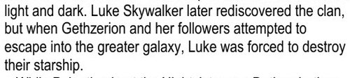

## p.135 (scan page 136)

Page contents: 338 words, 61 paragraphs | headings/entries: Initiative: Defense: Speed: VP/WP: Attacks:; Damage:; Special Qualities:; Saves:; Size:; Challenge Code: Force Points:; Dark Side Points:; Reputation: Abilities:; Skills:; Force Skills: Feats:; Force Feats: Equipment:; Noble 2/Scoundrel 2 +0; Unarmed +1 melee Blaster pistol +2 ranged; Search +8, Sense Motive +11, Spot +7; Blaster pistol, dark robes; Noble 4/Scoundrel 4 +0 18 (+8 class); Call in a favor (2),; Command (+2); F+2,R+6,W +7 Medium; B; Noble 8/Scoundrel 4 +0; Unarmed +8/+3 melee Blaster pistol +9/+4 ranged; F+3,R+8,W +9 Medium; B; Spot +9; Blaster pistol, dark robes; Search +14, Sense Motive +22,; Spot +13; Blaster pistol, dark robes; ER SIA

## p.136 (scan page 137)

Page contents: 744 words, 53 paragraphs | headings/entries: Lawne; Shadow Academy Student; Sith Apprentice; Jedi Guardian 1; Jedi Guardian 2; Lightsaber +2 melee by weapon +3 ranged; Special Qualities:; Lightsaber 2d8; Lightsaber 2d8; Saves: F+3,R +3, W +0 F+4,R+4,W +1; Size: (by species) (by species); Challenge Code: A A; Force Points: 1 1; Dark Side Points: 2 4; Reputation: 0 1; Force Feats: Control Control; Equipment: Lightsaber Lightsaber; Jedi Guardian 4; Lightsaber +5 melee by weapon +5 ranged; Lightsaber 2d8+1; F+5,R +5, W +l (by species) A; Computer Use +3,; Alter, Control, Rage, Sense Lightsaber

## p.137 (scan page 138)

Page contents: 599 words, 55 paragraphs | headings/entries: Sith Minion; Initiative: Defense: Speed: VP/WP: Attacks:; Damage:; Special Qualities:; Saves:; Size:; Challenge Code: Force Points:; Dark Side Points:; Reputation: Abilities: Skills:; Force Skills:; Feats:; Force Feats:; Equipment:; Force Adept 2; Blaster pistol 3d6; F+3,R+2,W+5 (by species) A; Knowledge (Sith lore) +6, Read/Write Sith; Alter, Sense; Blaster pistol, dark robes; Force Adept 4; Blaster pistol 3d6; F+3,R +2, W +6 (by species) A; Alter, Control, Sense; Blaster pistol, dark robes; Blaster pistol 3d6; F+6,R +4, W +9 (by species) B; Alter, Control, Dissipate Energy, Sense, Sith Sorcery; Blaster pistol, dark robes

## p.138 (scan page 139)

Page contents: 691 words, 23 paragraphs | headings/entries: Sith Lord; Soldier 3/Force Adept 1; Soldier 4/Force Adept 1/ Sith Warrior 3; Soldier 4/Force Adept 1/ Sith Warrior 7; Special Qualities:; Blaster pistol 3d6; Sith lanvarok 3d4; Blaster pistol 3d6; Sith lanvarok; Sith lanvarok

## p.139 (scan page 140)

Page contents: 479 words, 10 paragraphs | headings/entries: Generic Sith Lord, male or female, Sith; Special Qualities: resource access; Enemy bonus +1,; Minions; Sith sword, dark armor (DR 10),

