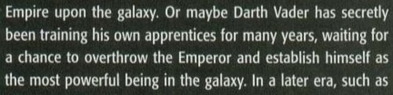
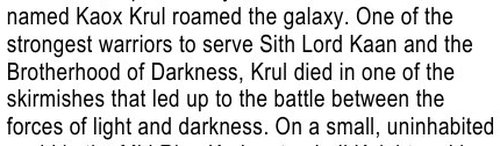
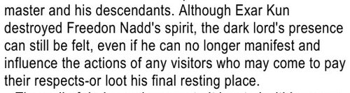
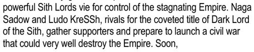
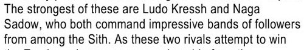
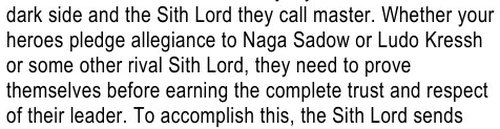

# Owner Material 035 — Dark Side Sourcebook (d20, 2001): Chapter Seven: Dark Side Campaigns; back matter

- **Source:** *Dark Side Sourcebook* by Bill Slavicsek and JD Wiker (Wizards of the Coast, 2001), for the Star Wars Roleplaying Game (d20). Secondary source (licensed Legends reference). Scan OCR'd on the box; the scan stays box-only and is **not** published.
- **Method:** every scanned page was OCR'd and machine-screened sentence by sentence for power-relevant statements (fights, kills, defeats, Force feats, rankings, superweapons) that name a character on our roster; each kept sentence is quoted verbatim from the OCR text and has a crop of the printed passage directly under it. Pages with nothing power-relevant are still listed with what is on them.
- **Citation:** "Dark Side Sourcebook, p.X" by printed page ("scan p.X" where no printed number applies). **Weight:** Licensed RPG sourcebook: a secondary source. Its narrative text sums up Legends history; game statistics are rules for players, not canon power levels.

## p.140 (scan page 141)

Page contents: 825 words, 20 paragraphs | headings/entries: Chapter Seven:; Dark Side Campaigns; Pick an Era, Any Era; The Old Republic; The Rise of the Empire; The Rebellion Era

## p.141 (scan page 142)

Page contents: 449 words, 6 paragraphs | headings/entries: 

## p.142 (scan page 143)

Page contents: 971 words, 18 paragraphs | headings/entries: PLAYING WITH HISTORY; Dark Side Sites

- **Darth Vader (Anakin Skywalker)**: "Or maybe Darth Vader has secretly been training his own apprentices for many years, waiting for a chance to overthrow the Emperor and establish himself as the most powerful being in the galaxy." Source: Dark Side Sourcebook, p.142
  

## p.143 (scan page 144)

Page contents: 429 words, 10 paragraphs | headings/entries: Dark Side Sites and Non-Force- Sensitives; Dark Side Sites and Force- Sensitives

## p.144 (scan page 145)

Page contents: 886 words, 21 paragraphs | headings/entries: Table 7-1: Dark Side Site Saying Throws; Dark Side Site Examples; Minor Site: Lake Krul

- **Darth Krul; Lord Kaan** — entry/section: Minor Site: Lake Krul: "One of the strongest warriors to serve Sith Lord Kaan and the Brotherhood of Darkness, Krul died in one of the skirmishes that led up to the battle between the forces of light and darkness." Source: Dark Side Sourcebook, p.144
  

## p.145 (scan page 146)

Page contents: 458 words, 12 paragraphs | headings/entries: 

## p.146 (scan page 147)

Page contents: 486 words, 13 paragraphs | headings/entries: HaAde wr. avn; A = i i; Using a Dark Side Cave in Your; Campaign

## p.147 (scan page 148)

Page contents: 927 words, 16 paragraphs | headings/entries: Extreme Site: The Demon Moon

- **Exar Kun; Freedon Nadd**: "Although Exar Kun destroyed Freedon Nadd's spirit, the dark lord's presence can still be felt, even if he can no longer manifest and influence the actions of any visitors who may come to pay their respects-or loot his final resting place." Source: Dark Side Sourcebook, p.147
  

## p.148 (scan page 149)

Page contents: 958 words, 12 paragraphs | headings/entries: The Sith Campaign

## p.149 (scan page 150)

Page contents: 448 words, 9 paragraphs | headings/entries: 

## p.150 (scan page 151)

Page contents: 875 words, 25 paragraphs | headings/entries: Manas; TIMELINE; Pre-5,000 Years before the Battle of Yavin

- **Naga Sadow; Ludo Kressh**: "Naga Sadow and Ludo KreSSh, rivals for the coveted title of Dark Lord of the Sith, gather supporters and prepare to launch a civil war that could very well destroy the Empire." Source: Dark Side Sourcebook, p.150
  

## p.151 (scan page 152)

Page contents: 849 words, 12 paragraphs | headings/entries: Technology of the Age; The Factions of the Age

## p.152 (scan page 153)

Page contents: 881 words, 18 paragraphs | headings/entries: Mande; The Republic; The Sith; Criminal Organizations

- **Ludo Kressh; Naga Sadow**: "The strongest of these are Ludo Kressh and Naga Sadow, who both command impressive bands of followers from among the Sith." Source: Dark Side Sourcebook, p.152
  

## p.153 (scan page 154)

Page contents: 424 words, 7 paragraphs | headings/entries: Corporations

## p.154 (scan page 155)

Page contents: 921 words, 17 paragraphs | headings/entries: Traders; Jedi

## p.155 (scan page 156)

Page contents: 886 words, 22 paragraphs | headings/entries: Running a Hyperspace Wars Campaign; Adventure Hooks; Prove Your Loyalty

- **Naga Sadow; Ludo Kressh**: "Whether your heroes pledge allegiance to Naga Sadow or Ludo Kressh or some other rival Sith Lord, they need to prove themselves before earning the complete trust and respect of their leader." Source: Dark Side Sourcebook, p.155
  

## p.156 (scan page 157)

Page contents: 935 words, 17 paragraphs | headings/entries: Hans sa. ovHd; Capture the Invaders; This Weakness. This Republic

## p.157 (scan page 158)

Page contents: 715 words, 11 paragraphs | headings/entries: Jedi Guardian 4; Jedi Guardian 8; Jedi Guardian 12

## p.158 (scan page 159)

Page contents: 715 words, 16 paragraphs | headings/entries: Jedi Hunt; Jedi Consular 4; Jedi Consular 8; Jedi Consular 12; Medpac; Medpac

## p.159 (scan page 160)

Page contents: 1258 words, 121 paragraphs | headings/entries: Index; Drain Energy 14, 17; Drain Force 17; Drain Knowledge 15, 17, 40; Durron, Kyp 12, 104, 105; Dxun tomb beast 112; Emperor Reborn 120, 126; Empress Teta system 8, 74, 75, 76; Endor 10, 91, 92, 94, 110; Force, the 6, 7, 40, 55; Force illusions 16; Force Points, gaining 40; Force-based skills 13, 17; Gepta, Rokur 80; Gethzerion 81, 82, 108, 134; Great Hyperspace War, the 7,; Harth, Set 83; Hatred (feat) 18; Hethrir, Lord 92, 93; Illusion (feat) 15, 17; Imperial campaign 51; Imperial Sentinel 99; Imperial Sovereign Protector 92, 99; Interrogator droid 63; Ismaren, trek 106; Jade, Mara 26, 53, 99; Jedgar 94, 96; Jedi characters 20; Jedi consular 158; Jedi, corrupted 31; Jedi guardian 157; Jedi, history of 7; Jedi hunters 87; Jerec 101; Kadanm 94, 96, 97 Kai,; Tamith 108, 109; Kalgrath 116; Sedriss, Executor 99, 102; Sense (feat) 54; Sing, Aurra 87, 88; Sith acolyte 31, 74; Skywalker, Luk

## p.160 (scan page 161)

Page contents: 200 words, 15 paragraphs | headings/entries: THIS SOURCEBOOK FEATURES:; Printed in U.S.A WTC11849 Ge

