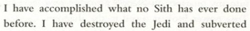
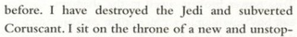
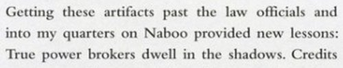
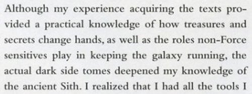
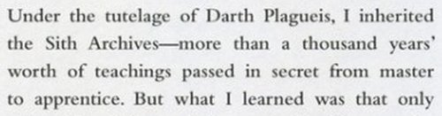
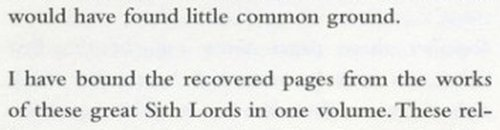

# Owner Material 036 — Book of Sith: Secrets from the Dark Side (2012): Darth Sidious preface and front matter

- **Source:** *Book of Sith: Secrets from the Dark Side* by Daniel Wallace (becker&mayer!, 2012). Secondary source (licensed Legends reference). Scan OCR'd on the box; the scan stays box-only and is **not** published.
- **Method:** every scanned page was OCR'd and machine-screened sentence by sentence for power-relevant statements (fights, kills, defeats, Force feats, rankings, superweapons) that name a character on our roster; each kept sentence is quoted verbatim from the OCR text and has a crop of the printed passage directly under it. Pages with nothing power-relevant are still listed with what is on them.
- **Citation:** "Book of Sith, p.X" by printed page ("scan p.X" where no printed number applies). **Weight:** Lucasfilm-licensed in-universe artefact book: each section is written in character by a Sith (Sorzus Syn, Darth Malgus, Darth Bane, Mother Talzin, Darth Plagueis, Darth Sidious) with a preface by Darth Sidious and margin notes by others. Treat first-person claims as what the character says about themself, not as narrated fact.

## scan p.1 (scan page 1)

Page contents: 0 words, 0 paragraphs | headings/entries: 

## scan p.2 (scan page 2)

Page contents: 0 words, 0 paragraphs | headings/entries: 

## scan p.3 (scan page 3)

Page contents: 244 words, 21 paragraphs | headings/entries: SHARING ISTORICAL; PREFACE; By Dartu Sipious

- **Palpatine (Darth Sidious)**: "I have accomplished what no Sith has ever done before." Source: Book of Sith, scan p.3
  
- **Palpatine (Darth Sidious)**: "I have destroyed the Jedi and subverted Coruscant." Source: Book of Sith, scan p.3
  

## scan p.4 (scan page 4)

Page contents: 200 words, 9 paragraphs | headings/entries: 

- **Palpatine (Darth Sidious)**: "Getting these artifacts past the law officials and into my quarters on Naboo provided new lessons: True power brokers dwell in the shadows." Source: Book of Sith, scan p.4
  
- **Palpatine (Darth Sidious)**: "Although my experience acquiring the texts provided a practical knowledge of how treasures and secrets change hands, as well as the roles non-Force sensitives play in keeping the galaxy running, the actual dark side tomes deepened my knowledge of the ancient Sith." Source: Book of Sith, scan p.4
  
- **Palpatine (Darth Sidious); Darth Plagueis**: "Under the tutelage of Darth Plagueis, I inherited the Sith Archives—more than a thousand years' worth of teachings passed in secret from master to apprentice." Source: Book of Sith, scan p.4
  

## scan p.5 (scan page 5)

Page contents: 170 words, 10 paragraphs | headings/entries: Yt the time

## scan p.6 (scan page 6)

Page contents: 257 words, 17 paragraphs | headings/entries: THE COMMENTS oF; YEAR OVER, THE SUBSEQUENT *TEARS-; THE NEW TRUTHS

- **Palpatine (Darth Sidious)**: "I have bound the recovered pages from the works of these great Sith Lords in one volume." Source: Book of Sith, scan p.6
  

## scan p.7 (scan page 7)

Page contents: 345 words, 18 paragraphs | headings/entries: 

## scan p.8 (scan page 8)

Page contents: 329 words, 48 paragraphs | headings/entries: W; DEATH MAtY NOT HAVE; AeNp IT Is; PALPATINE CAME To STUDY; Ll 'a; STILL. SOMETHING OF A MYSTERY HOW; Daert Pracues'

## scan p.9 (scan page 9)

Page contents: 115 words, 4 paragraphs | headings/entries: Exife Year One, Months 3-4; Exile and Arrival

