# Owner Material 036 — Book of Sith: Secrets from the Dark Side (2012): Sorzus Syn: chronicle and Sith alchemy

- **Source:** *Book of Sith: Secrets from the Dark Side* by Daniel Wallace (becker&mayer!, 2012). Secondary source (licensed Legends reference). Scan OCR'd on the box; the scan stays box-only and is **not** published.
- **Method:** every scanned page was OCR'd and machine-screened sentence by sentence for power-relevant statements (fights, kills, defeats, Force feats, rankings, superweapons) that name a character on our roster; each kept sentence is quoted verbatim from the OCR text and has a crop of the printed passage directly under it. Pages with nothing power-relevant are still listed with what is on them.
- **Citation:** "Book of Sith, p.X" by printed page ("scan p.X" where no printed number applies). **Weight:** Lucasfilm-licensed in-universe artefact book: each section is written in character by a Sith (Sorzus Syn, Darth Malgus, Darth Bane, Mother Talzin, Darth Plagueis, Darth Sidious) with a preface by Darth Sidious and margin notes by others. Treat first-person claims as what the character says about themself, not as narrated fact.

## scan p.10 (scan page 10)

Page contents: 212 words, 4 paragraphs | headings/entries: 

- **Sorzus Syn**: "As the last survivors of those who sought a new path to power, we ultimately fell victim to the military excess of the Jedi at the Rout of Corbos." Source: Book of Sith, scan p.10
  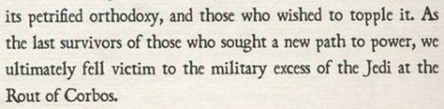
- **Sorzus Syn**: "For years, I extracted information from refugees and cataloged rumors, searching for proof that the kingdom of Sith—Sith Purebloods—existed." Source: Book of Sith, scan p.10
  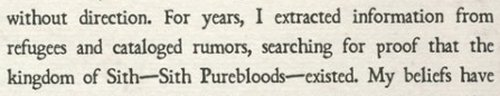
- **Sorzus Syn**: "What lies before us is a limitless pool of steadfast warriors and an untapped wealth of knowledge about the dark side of the Force." Source: Book of Sith, scan p.10
  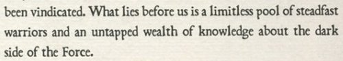
- **Sorzus Syn; Ajunta Pall**: "XKoKaan, myself, Ajunta Pall, an Drey par—not our Pending but rather our triumph over the Sith eee marked our arrival." Source: Book of Sith, scan p.10
  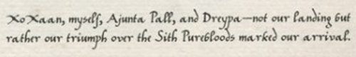

## scan p.11 (scan page 11)

Page contents: 0 words, 0 paragraphs | headings/entries: 

## scan p.12 (scan page 12)

Page contents: 216 words, 4 paragraphs | headings/entries: Be

- **Sorzus Syn**: "I foresee what 3 y 3 will become a magnificent Sith Empire. < While Corbos was the last battle of the Hundred-Year Darkness, 5 : eS the conflict began with the most recent Great Schism." Source: Book of Sith, scan p.12
  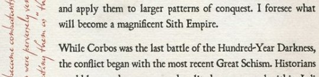

## scan p.13 (scan page 13)

Page contents: 184 words, 11 paragraphs | headings/entries: Yjaee; Compromise

## scan p.14 (scan page 14)

Page contents: 231 words, 10 paragraphs | headings/entries: The Hundred-Year Darkness; Moe; Krespuckfe the Ever-Hungry, my favord Leviathan

- **Sorzus Syn**: "It was the Jedi who took up arms to keep us from revealing the truth about the Force." Source: Book of Sith, scan p.14
  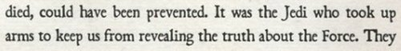
- **Sorzus Syn**: "By boldly venturing into the Force's expanse, we gained powers that no Jedi had ever possessed." Source: Book of Sith, scan p.14
  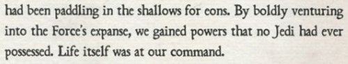
- **Sorzus Syn**: "Until we annihilate the old Order, the pattern will continue repeating forever." Source: Book of Sith, scan p.14
  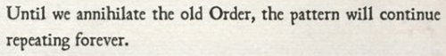

## scan p.15 (scan page 15)

Page contents: 0 words, 0 paragraphs | headings/entries: 

## scan p.16 (scan page 16)

Page contents: 168 words, 8 paragraphs | headings/entries: Proud Teopbe of the Sith; The Vale of Stecping Kings, Korrigan

## scan p.17 (scan page 17)

Page contents: 121 words, 3 paragraphs | headings/entries: 

- **Sorzus Syn**: "Despite our obvious superior powers, we were not hailed as gods when we arrived." Source: Book of Sith, scan p.17
  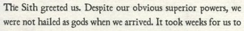
- **Sorzus Syn**: "It took weeks for us to understand the power structure of their culture, to undermine it, and to annihilate the current king." Source: Book of Sith, scan p.17
  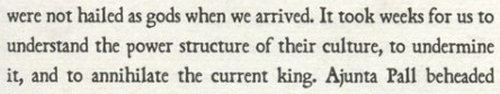
- **Sorzus Syn; Ajunta Pall; King Adas**: "Ajunta Pall beheaded their ruler, Hakagram Graush, and claimed the throne as the blood heir to the ancestral King Adas—and we became his Shadow Hands." Source: Book of Sith, scan p.17
  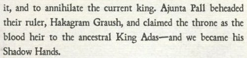
- **Sorzus Syn**: "From that time on, I made it my goal to understand the Sith, Sith Space, and the treasures that might await us in this realm." Source: Book of Sith, scan p.17
  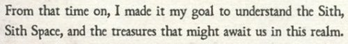

## scan p.18 (scan page 18)

Page contents: 93 words, 4 paragraphs | headings/entries: Cf

- **Sorzus Syn**: "It is where we erected our own palaces to rule as Sith % Lords." Source: Book of Sith, scan p.18
  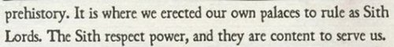
- **Sorzus Syn**: "The Sith respect power, and they are content to serve us." Source: Book of Sith, scan p.18
  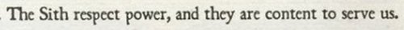

## scan p.19 (scan page 19)

Page contents: 187 words, 6 paragraphs | headings/entries: 

- **Sorzus Syn**: "I know Dreypa, for one, has had his eye on a Sith" a we priestess." Source: Book of Sith, scan p.19
  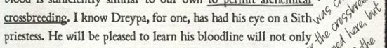
- **Sorzus Syn**: "They are rooted in primitivism, while we were ofé ww once the Republic's greatest Jedi." Source: Book of Sith, scan p.19
  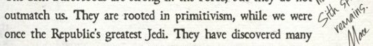

## scan p.20 (scan page 20)

Page contents: 222 words, 10 paragraphs | headings/entries: Creruthing the dark side cleuds,; Uncever the

- **Sorzus Syn**: "Those of us who came to this world with rank and ambition make up Ziost's new Sith Council." Source: Book of Sith, scan p.20
  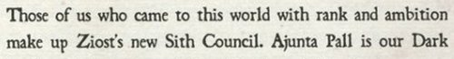
- **Sorzus Syn**: "The Sith caste system under our rufe—our will is imposed on the Kisses priests, the Zuguruk engineers, an) the Massassi warriors." Source: Book of Sith, scan p.20
  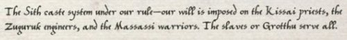

## scan p.21 (scan page 21)

Page contents: 0 words, 0 paragraphs | headings/entries: 

## scan p.22 (scan page 22)

Page contents: 224 words, 7 paragraphs | headings/entries: Sith "Weapons

- **Sorzus Syn**: "Sith Sword: While we exiles wielded lightsabers when we fought the Hundred-Year Darkness, the Sith have developed edged weapons honed and strengthened through the Force— mirrors of the swords carried by the first Jedi on Tython." Source: Book of Sith, scan p.22
  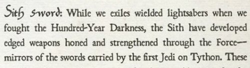

## scan p.23 (scan page 23)

Page contents: 249 words, 9 paragraphs | headings/entries: 

## scan p.24 (scan page 24)

Page contents: 207 words, 13 paragraphs | headings/entries: Day; To.,7; Ks, One Lht/; A; Sith Amubets

- **Sorzus Syn**: "Sith abbatar: Were it not for this relic, I would not have attained such easy mastery of the Sith tongue." Source: Book of Sith, scan p.24
  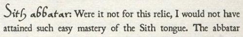

## scan p.25 (scan page 25)

Page contents: 110 words, 5 paragraphs | headings/entries: My study of the Heart of Graush; Mfoee

## scan p.26 (scan page 26)

Page contents: 165 words, 5 paragraphs | headings/entries: SURVIVED THE CENTURIES: —-Lu<zé; The inner mechanisen of the Muur Talisman

- **Sorzus Syn**: "The third shall be far stronger than the others, and it shall be mine alone." Source: Book of Sith, scan p.26
  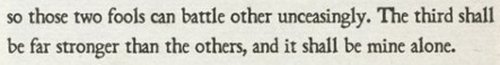

## scan p.27 (scan page 27)

Page contents: 299 words, 16 paragraphs | headings/entries: Exife Year Two, Months 7-9; Nyce fl 6

## scan p.28 (scan page 28)

Page contents: 72 words, 5 paragraphs | headings/entries: 

## scan p.29 (scan page 29)

Page contents: 112 words, 6 paragraphs | headings/entries: Sith Hofocrons; Afchemic scroffs protected by an insanity curse

- **Sorzus Syn**: "Here I found scrolls detailing Sith alchemy." Source: Book of Sith, scan p.29
  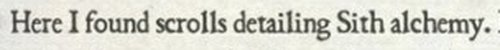

## scan p.30 (scan page 30)

Page contents: 233 words, 5 paragraphs | headings/entries: EWN < > \V7

- **Sorzus Syn**: "I believe the Sith Purebloods may have built their first holocron after wresting the secret from the ancient alien conquerors, the Rakata." Source: Book of Sith, scan p.30
  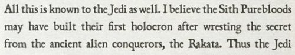

## scan p.31 (scan page 31)

Page contents: 66 words, 2 paragraphs | headings/entries: Basic Sith Hofocron structure

## scan p.32 (scan page 32)

Page contents: 262 words, 8 paragraphs | headings/entries: Nepe f te Ax; Noe

- **Sorzus Syn**: "Within the Nakgru Holocron, I learned the history of the Sith Purebloods in vivid detail not found through oral histories or brittle scrolls." Source: Book of Sith, scan p.32
  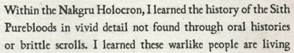
- **Sorzus Syn**: "I learned these warlike people are living proof that the smug Jedi who banished us are wrong about the dark side." Source: Book of Sith, scan p.32
  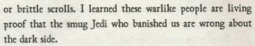
- **King Adas**: "More than three millennia before the Republic's founding, a prodigious Sith arose—his named was Adas." Source: Book of Sith, scan p.32
  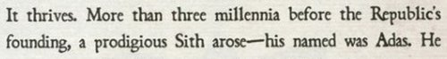

## scan p.33 (scan page 33)

Page contents: 46 words, 1 paragraphs | headings/entries: 

## scan p.34 (scan page 34)

Page contents: 150 words, 4 paragraphs | headings/entries: Cronquests of the Su; Onsfaught of the Massassi

## scan p.35 (scan page 35)

Page contents: 259 words, 3 paragraphs | headings/entries: 

- **Sorzus Syn**: "Since gaining this knowledge, I have sought out these conquered Sith worlds to gather information." Source: Book of Sith, scan p.35
  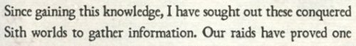
- **Sorzus Syn**: "I confirmed the Sith indeed struck the Republic world of Draethos, though the time frame remains murky." Source: Book of Sith, scan p.35
  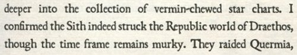

## scan p.36 (scan page 36)

Page contents: 118 words, 4 paragraphs | headings/entries: Warb: <asts; Sifooth

## scan p.37 (scan page 37)

Page contents: 143 words, 10 paragraphs | headings/entries: The guardian beasts called tuk'ata; Stitt gronl Korriban, the

## scan p.38 (scan page 38)

Page contents: 91 words, 3 paragraphs | headings/entries: Terentatek

## scan p.39 (scan page 39)

Page contents: 204 words, 10 paragraphs | headings/entries: TO TAKE ONE &S

## scan p.40 (scan page 40)

Page contents: 151 words, 9 paragraphs | headings/entries: Sih Alchemy; None of these creatures j; A Sith sword is enhanced by submerging

- **Sorzus Syn**: "Sith alchemists have had ages to perfect their art, and their knowledge is now mine." Source: Book of Sith, scan p.40
  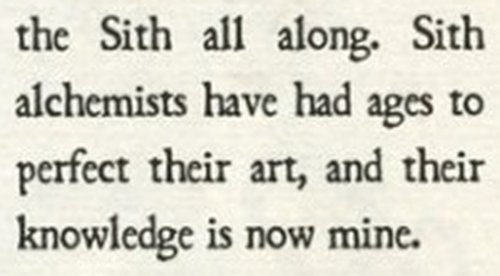

## scan p.41 (scan page 41)

Page contents: 96 words, 3 paragraphs | headings/entries: 

## scan p.42 (scan page 42)

Page contents: 245 words, 7 paragraphs | headings/entries: Sa Incantations

- **Sorzus Syn**: "Alchemy is my science, yet I have found the Sith Purebloods possess a new understanding of how to manipulate the dark side." Source: Book of Sith, scan p.42
  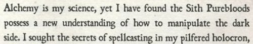

## scan p.43 (scan page 43)

Page contents: 188 words, 11 paragraphs | headings/entries: A!; Ny be

## scan p.44 (scan page 44)

Page contents: 103 words, 15 paragraphs | headings/entries: OwomvuTsiqsa Summon Otmon; PELE VBR: SEER; LiTTCR ont StDey- torn; Weyvneks hiTTuska AhajonTo LiTTLR ont; Pins Pek; Chyd, kin Tk , blacktst tmbtr; By SbE

- **Sorzus Syn**: "Proof is in the Sith scrolls I acquired." Source: Book of Sith, scan p.44
  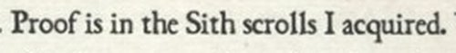

## scan p.45 (scan page 45)

Page contents: 273 words, 10 paragraphs | headings/entries: 

## scan p.46 (scan page 46)

Page contents: 254 words, 14 paragraphs | headings/entries: There is no passion, there is serenity,; Noe; ZR < > \V7

- **Sorzus Syn**: "If we were to create a Sith Code, it must point to the failings of Jedi beliefs while laying bare a path to mastery of the Force." Source: Book of Sith, scan p.46
  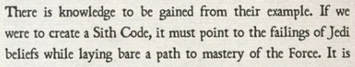

## scan p.47 (scan page 47)

Page contents: 177 words, 6 paragraphs | headings/entries: 

- **Sorzus Syn**: "Through victory my chains are broken, The Force shall 'free me." Source: Book of Sith, scan p.47
  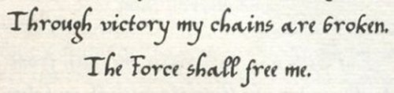
- **Sorzus Syn**: "I know the Jedi myth of Mortis, of a Chosen One who will destroy the dark side and bring balance to the Force." Source: Book of Sith, scan p.47
  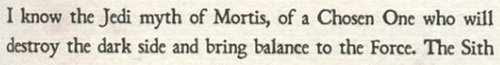

## scan p.48 (scan page 48)

Page contents: 206 words, 13 paragraphs | headings/entries: Wee > tof 4 free Z

- **Sorzus Syn**: "I admire the first tenet, because breaking chains is the essence of the dark side and the foundation of my own Sith Code." Source: Book of Sith, scan p.48
  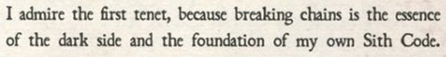
- **Sorzus Syn**: "Though I have never put my faith in farseeing, I remain convinced the Force called me here." Source: Book of Sith, scan p.48
  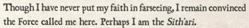
