# Owner Material 036 — Book of Sith: Secrets from the Dark Side (2012): Darth Malgus: journal

- **Source:** *Book of Sith: Secrets from the Dark Side* by Daniel Wallace (becker&mayer!, 2012). Secondary source (licensed Legends reference). Scan OCR'd on the box; the scan stays box-only and is **not** published.
- **Method:** every scanned page was OCR'd and machine-screened sentence by sentence for power-relevant statements (fights, kills, defeats, Force feats, rankings, superweapons) that name a character on our roster; each kept sentence is quoted verbatim from the OCR text and has a crop of the printed passage directly under it. Pages with nothing power-relevant are still listed with what is on them.
- **Citation:** "Book of Sith, p.X" by printed page ("scan p.X" where no printed number applies). **Weight:** Lucasfilm-licensed in-universe artefact book: each section is written in character by a Sith (Sorzus Syn, Darth Malgus, Darth Bane, Mother Talzin, Darth Plagueis, Darth Sidious) with a preface by Darth Sidious and margin notes by others. Treat first-person claims as what the character says about themself, not as narrated fact.

## scan p.49 (scan page 49)

Page contents: 350 words, 14 paragraphs | headings/entries: RIM CAMPAIGN — DAY 133 — MALCUS

- **Darth Malgus**: "When both transports exploded at our backs, I knew the « (4,,,/ 1/4 Republic's gunners had chosen the wrong targets." Source: Book of Sith, scan p.49
  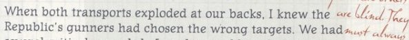
- **Darth Malgus**: "Had they fired at the two Sith Lords teed Af leading the way, our assault would have ended there." Source: Book of Sith, scan p.49
  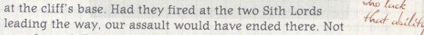
- **Darth Malgus**: "Leading the remaining troops up the mountain trail, a tremor in the Force echoed through me." Source: Book of Sith, scan p.49
  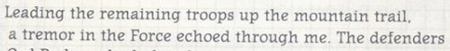
- **Darth Malgus**: "I then slowly rolled it twenty paces ahead of our own progress, using focused mental energy channeled through the dark side." Source: Book of Sith, scan p.49
  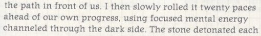

## scan p.50 (scan page 50)

Page contents: 194 words, 7 paragraphs | headings/entries: 

## scan p.51 (scan page 51)

Page contents: 318 words, 10 paragraphs | headings/entries: RIM CAMPAIGN — DAY 152 — MALCUS; JAN \

- **Darth Malgus**: "The tactic choked traffic along the Hydian Way and made our current campaign possible." Source: Book of Sith, scan p.51
  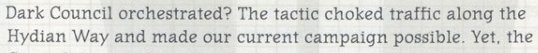

## scan p.52 (scan page 52)

Page contents: 221 words, 10 paragraphs | headings/entries: Adraas—oblivious to our strategizing; RIM CAMPAIGN — DAY 179 — MALCUS

## scan p.53 (scan page 53)

Page contents: 328 words, 13 paragraphs | headings/entries: INNIM OL WILIE? 51 53!

- **Darth Malgus**: "For we Sith Lords are elevated above the non-Force users who staff our galactic regime." Source: Book of Sith, scan p.53
  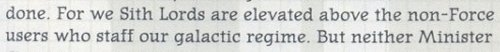
- **Darth Malgus**: "But neither Minister Shareis nor his Grand Moffs can do anything for me if other Sith Lords have already placed claims on his resources." Source: Book of Sith, scan p.53
  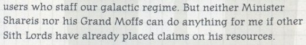

## scan p.54 (scan page 54)

Page contents: 322 words, 13 paragraphs | headings/entries: RIM CAMPAIGN — DAY 215 — MALCUS

## scan p.55 (scan page 55)

Page contents: 164 words, 9 paragraphs | headings/entries: 

## scan p.56 (scan page 56)

Page contents: 179 words, 11 paragraphs | headings/entries: RIM CAMPAIGN — DAY 22! — MALCUS; Interesting that ahi 2 combat; ISF Sith Interceptor

## scan p.57 (scan page 57)

Page contents: 317 words, 11 paragraphs | headings/entries: 

## scan p.58 (scan page 58)

Page contents: 213 words, 7 paragraphs | headings/entries: Sith siege tanks at the shield's edge

- **Darth Malgus**: "They have often stood in opposition to our Emperor—but today, we are all Sith." Source: Book of Sith, scan p.58
  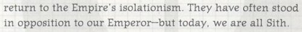

## scan p.59 (scan page 59)

Page contents: 313 words, 12 paragraphs | headings/entries: RIM CAMPAIGN — DAY 315 — MALCUS; Seremno cas

- **Darth Malgus**: "The Emperor, in his wisdom, spent many decades installing Sith infiltrators in positions of power across the galaxy—long before our armada fired its first shot." Source: Book of Sith, scan p.59
  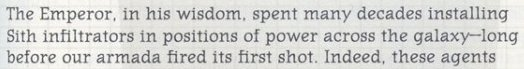

## scan p.60 (scan page 60)

Page contents: 334 words, 17 paragraphs | headings/entries: 

## scan p.61 (scan page 61)

Page contents: 209 words, 8 paragraphs | headings/entries: RIM CAMPAIGN — DAY 399 — MALCUS; Gl

- **Darth Malgus; Vitiate**: "The Sith Emperor has ordered us to recapture Ord Radama." Source: Book of Sith, scan p.61
  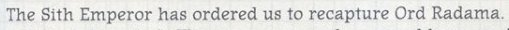
- **Darth Malgus**: "There are rumors that some blame me for the death of Lord Venemal and the defeat we suffered there." Source: Book of Sith, scan p.61
  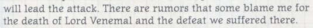
- **Darth Malgus**: "This campaign shall restore my honor and prove the fitness of the Sith Empire." Source: Book of Sith, scan p.61
  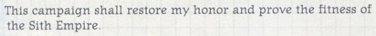
- **Darth Malgus**: "Typical soldiers do not use the dark side, and Sith Inquisitors are too hands-off for my tastes." Source: Book of Sith, scan p.61
  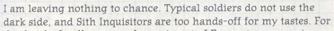

## scan p.62 (scan page 62)

Page contents: 252 words, 9 paragraphs | headings/entries: 

- **Darth Malgus**: "A Sith warrior embodies purity. oe be I will lead the assault on Ord Radama's relocated capital As "~~ city of New Raido." Source: Book of Sith, scan p.62
  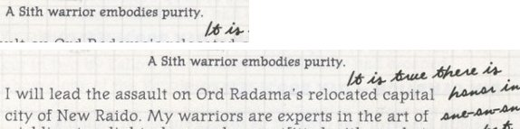

## scan p.63 (scan page 63)

Page contents: 252 words, 12 paragraphs | headings/entries: 

- **Darth Malgus**: "Now we have lightsaber combat and Force dueling on a grand scale." Source: Book of Sith, scan p.63
  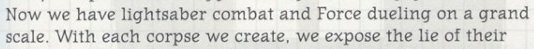

## scan p.64 (scan page 64)

Page contents: 231 words, 14 paragraphs | headings/entries: List

