# Owner Material 036 — Book of Sith: Secrets from the Dark Side (2012): Darth Bane: the Rule of Two

- **Source:** *Book of Sith: Secrets from the Dark Side* by Daniel Wallace (becker&mayer!, 2012). Secondary source (licensed Legends reference). Scan OCR'd on the box; the scan stays box-only and is **not** published.
- **Method:** every scanned page was OCR'd and machine-screened sentence by sentence for power-relevant statements (fights, kills, defeats, Force feats, rankings, superweapons) that name a character on our roster; each kept sentence is quoted verbatim from the OCR text and has a crop of the printed passage directly under it. Pages with nothing power-relevant are still listed with what is on them.
- **Citation:** "Book of Sith, p.X" by printed page ("scan p.X" where no printed number applies). **Weight:** Lucasfilm-licensed in-universe artefact book: each section is written in character by a Sith (Sorzus Syn, Darth Malgus, Darth Bane, Mother Talzin, Darth Plagueis, Darth Sidious) with a preface by Darth Sidious and margin notes by others. Treat first-person claims as what the character says about themself, not as narrated fact.

## scan p.65 (scan page 65)

Page contents: 2 words, 1 paragraphs | headings/entries: THE RULE

## scan p.66 (scan page 66)

Page contents: 262 words, 12 paragraphs | headings/entries: POWER OF THE SITH; THe —Jep! were He —Jei —-Lu<ze

## scan p.67 (scan page 67)

Page contents: 126 words, 10 paragraphs | headings/entries: 

## scan p.68 (scan page 68)

Page contents: 334 words, 26 paragraphs | headings/entries: Ss F 2 —; Ss; THE MISTAKES OF RUUSAN

- **Darth Bane**: "Coruscant's throat lay bare beneath our blades, but the Sith plunged their knives into one another's backs instead!" Source: Book of Sith, scan p.68
  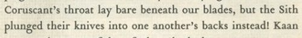
- **Lord Kaan; Lord Hoth**: "Kaan's third and final mistake came at Ruusan, a worthless world where he hoped to defeat Lord Hoth and the Jedi Army of Light." Source: Book of Sith, scan p.68
  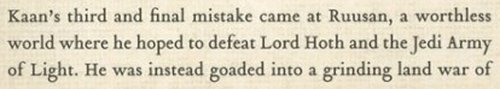

## scan p.69 (scan page 69)

Page contents: 10 words, 2 paragraphs | headings/entries: 

## scan p.70 (scan page 70)

Page contents: 126 words, 6 paragraphs | headings/entries: THE THOUGHT BOMB AT RUUSAN

- **Darth Bane**: "I watched it unfold and knew the Sith had become like the Jedi—too numerous and too weak." Source: Book of Sith, scan p.70
  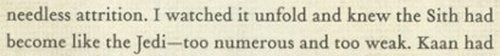
- **Darth Bane; Lord Kaan**: "In the end, Kaan followed my suggestion and pooled the abilities of the other Sith Lords to create a brute-force wonder: the thought bomb." Source: Book of Sith, scan p.70
  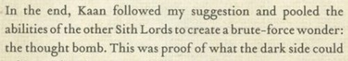

## scan p.71 (scan page 71)

Page contents: 169 words, 7 paragraphs | headings/entries: THE TITLE OF DARTH; W

- **Darth Bane; Darth Zannah**: "I, Darth Bane, and my apprentice, Darth Zannah, survived and returned the potency of the Sith to our hands, so the Rule of Two could be instituted." Source: Book of Sith, scan p.71
  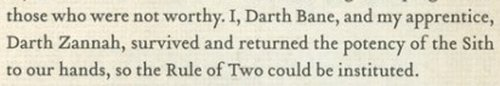
- **Darth Bane; Lord Kaan**: "It is no accident that I took the title of Darth when I gained a mastery of the dark side, nor is it an accident that Kaan and his followers rejected it." Source: Book of Sith, scan p.71
  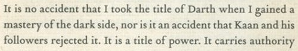

## scan p.72 (scan page 72)

Page contents: 292 words, 39 paragraphs | headings/entries: Z; Jur; Fo ach use; Act nen Ad; Ww; SY; FINALLY PUT AN END TO IT- —Lu<z&

## scan p.73 (scan page 73)

Page contents: 343 words, 28 paragraphs | headings/entries: STRIKING FROM THE SHADOWS

- **Darth Bane**: "My apprentice and I concocted a ruse in which she drove her brother insane and made him appear to be the terrible "Sith Lord."" Source: Book of Sith, scan p.73
  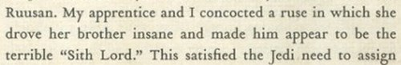

## scan p.74 (scan page 74)

Page contents: 80 words, 5 paragraphs | headings/entries: 

## scan p.75 (scan page 75)

Page contents: 353 words, 26 paragraphs | headings/entries: SELECTING AN APPRENTICE '<:4:"; PUCCejfOn

## scan p.76 (scan page 76)

Page contents: 74 words, 9 paragraphs | headings/entries: 

## scan p.77 (scan page 77)

Page contents: 347 words, 33 paragraphs | headings/entries: THE REVENGE OF THE SITH; Lup;; As 'arAws; Ib es { 424s; YX yy;

- **Darth Bane; Count Dooku**: "Ob-Man Kiled one Sith on Naboo. | think we could end it al by wiring out Dooku, too." Source: Book of Sith, scan p.77
  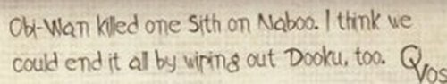

## scan p.78 (scan page 78)

Page contents: 101 words, 4 paragraphs | headings/entries: PERSONAL COMBAT

- **Darth Bane**: "Lord, you realize the truth in my words, You cannot dilute our power!" Source: Book of Sith, scan p.78
  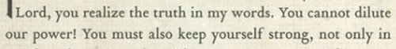

## scan p.79 (scan page 79)

Page contents: 233 words, 27 paragraphs | headings/entries: LIGHTSABER CONSTRUCTION; A

## scan p.80 (scan page 80)

Page contents: 192 words, 8 paragraphs | headings/entries: SITH LIGHTSABER VARIANTS

## scan p.81 (scan page 81)

Page contents: 152 words, 8 paragraphs | headings/entries: STUDENTS, BUILT

## scan p.82 (scan page 82)

Page contents: 147 words, 8 paragraphs | headings/entries: LIGHTSABER COMBAT

- **Darth Bane**: "With some exceptions- -such as the tactics of my own apprentice—Fast style is rarely suited for a Sith." Source: Book of Sith, scan p.82
  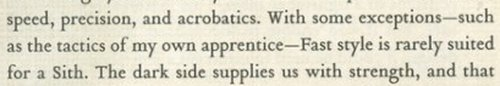
- **Darth Bane**: "The dark side supplies us with strength, and that strength must be used." Source: Book of Sith, scan p.82
  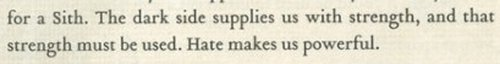

## scan p.83 (scan page 83)

Page contents: 311 words, 28 paragraphs | headings/entries: My strce is 4% Hrseip, aut rr'; H { d s : ;; CONSIDERED THE Je; D; Ss ows,; WEL,; Ze < > \V7

## scan p.84 (scan page 84)

Page contents: 272 words, 21 paragraphs | headings/entries: U; Lorps WiLL EVENTUALLY Lose IN © LIGHTSABER; DUEL. W/itHouT PEACE,; THEY OVERWHELM AN; UNvEess Srte

## scan p.85 (scan page 85)

Page contents: 162 words, 10 paragraphs | headings/entries: USING THE SABERSTAFF

## scan p.86 (scan page 86)

Page contents: 142 words, 9 paragraphs | headings/entries: 

## scan p.87 (scan page 87)

Page contents: 100 words, 5 paragraphs | headings/entries: 

## scan p.88 (scan page 88)

Page contents: 252 words, 10 paragraphs | headings/entries: SITH ARMOR

## scan p.89 (scan page 89)

Page contents: 224 words, 33 paragraphs | headings/entries: SY; Pay x hos; L torment +0; On; Ath,; LD c=

## scan p.90 (scan page 90)

Page contents: 306 words, 22 paragraphs | headings/entries: DARK SIDE COMBAT; ING DOWN OPPONENTS; X; SETTER THan INTURING

## scan p.91 (scan page 91)

Page contents: 109 words, 9 paragraphs | headings/entries: 

## scan p.92 (scan page 92)

Page contents: 226 words, 9 paragraphs | headings/entries: Convection: A concentration of Force energy that

## scan p.93 (scan page 93)

Page contents: 8 words, 2 paragraphs | headings/entries: TARGETS NEUTRALIZED THROUGH CONVECTION, LIGHTNING, AND CRYOKINESIS

## scan p.94 (scan page 94)

Page contents: 292 words, 19 paragraphs | headings/entries: 

## scan p.95 (scan page 95)

Page contents: 14 words, 3 paragraphs | headings/entries: 

## scan p.96 (scan page 96)

Page contents: 172 words, 13 paragraphs | headings/entries: Now

