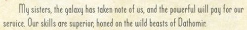
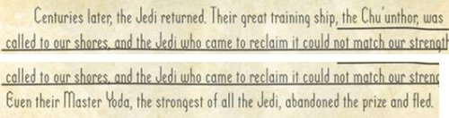
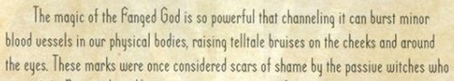
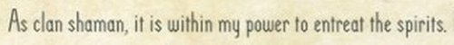
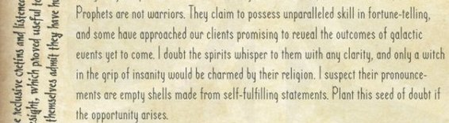

# Owner Material 036 — Book of Sith: Secrets from the Dark Side (2012): Mother Talzin: Wild Power (Nightsisters)

- **Source:** *Book of Sith: Secrets from the Dark Side* by Daniel Wallace (becker&mayer!, 2012). Secondary source (licensed Legends reference). Scan OCR'd on the box; the scan stays box-only and is **not** published.
- **Method:** every scanned page was OCR'd and machine-screened sentence by sentence for power-relevant statements (fights, kills, defeats, Force feats, rankings, superweapons) that name a character on our roster; each kept sentence is quoted verbatim from the OCR text and has a crop of the printed passage directly under it. Pages with nothing power-relevant are still listed with what is on them.
- **Citation:** "Book of Sith, p.X" by printed page ("scan p.X" where no printed number applies). **Weight:** Lucasfilm-licensed in-universe artefact book: each section is written in character by a Sith (Sorzus Syn, Darth Malgus, Darth Bane, Mother Talzin, Darth Plagueis, Darth Sidious) with a preface by Darth Sidious and margin notes by others. Treat first-person claims as what the character says about themself, not as narrated fact.

## scan p.97 (scan page 97)

Page contents: 5 words, 2 paragraphs | headings/entries: WILD POWER; By Motwer Tavain

## scan p.98 (scan page 98)

Page contents: 325 words, 7 paragraphs | headings/entries: THE WRITINGS OF THE NIGHTSISTERS

- **Mother Talzin**: "My sisters, the galaxy has taken note of us, and the powerful will pay for our service." Source: Book of Sith, scan p.98
  

## scan p.99 (scan page 99)

Page contents: 88 words, 4 paragraphs | headings/entries: Veto

## scan p.100 (scan page 100)

Page contents: 194 words, 6 paragraphs | headings/entries: THE SPIRITS BESTOW THEIR BLESSINGS. 4

## scan p.101 (scan page 101)

Page contents: 300 words, 10 paragraphs | headings/entries: THE LIVING FORCE AND THE DARK SIDE

## scan p.102 (scan page 102)

Page contents: 220 words, 8 paragraphs | headings/entries: THE HISTORY OF DATHOMIR

## scan p.103 (scan page 103)

Page contents: 238 words, 11 paragraphs | headings/entries: MOTHER ALLYA'S ARRIVAL ON DATHOMIR

- **Yoda**: "Their great training ship, the Chu'unthor was called t ho came to reclaim it Even their Master Yoda, the strongest of all the Jedi, abandoned the prize and fled." Source: Book of Sith, scan p.103
  

## scan p.104 (scan page 104)

Page contents: 292 words, 13 paragraphs | headings/entries: THE HISTORY OF THE NIGHTSISTERS; Gohisters he / wll conte

## scan p.105 (scan page 105)

Page contents: 138 words, 7 paragraphs | headings/entries: AA ~; The Nightbtothess ate They could learn muc

## scan p.106 (scan page 106)

Page contents: 327 words, 22 paragraphs | headings/entries: THE WINGED GODDESS

## scan p.107 (scan page 107)

Page contents: 185 words, 5 paragraphs | headings/entries: QF v eS OT

## scan p.108 (scan page 108)

Page contents: 171 words, 5 paragraphs | headings/entries: THE FANGED GOD

- **Mother Talzin**: "The magic of the Fanged God is so powerful that channeling it can burst minor blood vessels in our physical bodies, raising telltale bruises on the cheeks and around the eyes." Source: Book of Sith, scan p.108
  

## scan p.109 (scan page 109)

Page contents: 255 words, 6 paragraphs | headings/entries: 

## scan p.110 (scan page 110)

Page contents: 105 words, 4 paragraphs | headings/entries: 

## scan p.111 (scan page 111)

Page contents: 256 words, 9 paragraphs | headings/entries: 

- **Mother Talzin**: "As clan shaman, it is within my power to entreat the spirits." Source: Book of Sith, scan p.111
  

## scan p.112 (scan page 112)

Page contents: 194 words, 11 paragraphs | headings/entries: Wad $ possessed this as 4; Master,

## scan p.113 (scan page 113)

Page contents: 276 words, 9 paragraphs | headings/entries: BEASTS OF DATHOMIR

## scan p.114 (scan page 114)

Page contents: 170 words, 3 paragraphs | headings/entries: 

## scan p.115 (scan page 115)

Page contents: 203 words, 10 paragraphs | headings/entries: Are 0; Rhys are we

## scan p.116 (scan page 116)

Page contents: 344 words, 8 paragraphs | headings/entries: NATURE'S VIGOR

## scan p.117 (scan page 117)

Page contents: 5 words, 1 paragraphs | headings/entries: THE TOUCH OF THE KIIN'DRAY

## scan p.118 (scan page 118)

Page contents: 179 words, 3 paragraphs | headings/entries: 

## scan p.119 (scan page 119)

Page contents: 211 words, 5 paragraphs | headings/entries: TRAINING A WARRIOR

## scan p.120 (scan page 120)

Page contents: 159 words, 6 paragraphs | headings/entries: Lchore Ulochaling Dathom in 4 d; V7

## scan p.121 (scan page 121)

Page contents: 194 words, 5 paragraphs | headings/entries: INSTRUCTION AND TRANSFORMATION

## scan p.122 (scan page 122)

Page contents: 229 words, 15 paragraphs | headings/entries: Our warriors wear the cuffs and

## scan p.123 (scan page 123)

Page contents: 242 words, 10 paragraphs | headings/entries: THOSE Wito FoLLow THE DARK SIDE ALWays

## scan p.124 (scan page 124)

Page contents: 279 words, 7 paragraphs | headings/entries: COMPETING DARK SIDE TRADITIONS; But; PROPHET OF THE DARK SIDE

- **Mother Talzin**: "They claim to possess unparalleled skill in fortune-telling, ts and some have approached our clients promising to reveal the outcomes of galactic 2s ar events yet to come. | doubt the spirits whisper to them with any clarity, and only a witch ss = inthe grip of insanity would be charmed by their religion. | suspect their pronounce- * z ments are empty shells made from self-fulfilling statements." Source: Book of Sith, scan p.124
  

## scan p.125 (scan page 125)

Page contents: 274 words, 8 paragraphs | headings/entries: 

## scan p.126 (scan page 126)

Page contents: 206 words, 8 paragraphs | headings/entries: A MEMBER OF THE (NECROSA ORDER

## scan p.127 (scan page 127)

Page contents: 215 words, 8 paragraphs | headings/entries: The Blackguard)operates from

## scan p.128 (scan page 128)

Page contents: 128 words, 4 paragraphs | headings/entries: Talzin shows wore concern

