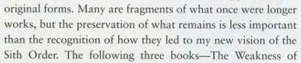

# Owner Material 036 — Book of Sith: Secrets from the Dark Side (2012): Darth Plagueis: notes on the Force and life (handwritten lettering)

- **Source:** *Book of Sith: Secrets from the Dark Side* by Daniel Wallace (becker&mayer!, 2012). Secondary source (licensed Legends reference). Scan OCR'd on the box; the scan stays box-only and is **not** published.
- **Method:** every scanned page was OCR'd and machine-screened sentence by sentence for power-relevant statements (fights, kills, defeats, Force feats, rankings, superweapons) that name a character on our roster; each kept sentence is quoted verbatim from the OCR text and has a crop of the printed passage directly under it. Pages with nothing power-relevant are still listed with what is on them.
- **Citation:** "Book of Sith, p.X" by printed page ("scan p.X" where no printed number applies). **Weight:** Lucasfilm-licensed in-universe artefact book: each section is written in character by a Sith (Sorzus Syn, Darth Malgus, Darth Bane, Mother Talzin, Darth Plagueis, Darth Sidious) with a preface by Darth Sidious and margin notes by others. Treat first-person claims as what the character says about themself, not as narrated fact.

## scan p.129 (scan page 129)

Page contents: 132 words, 2 paragraphs | headings/entries: 

## scan p.130 (scan page 130)

Page contents: 188 words, 5 paragraphs | headings/entries: 

## scan p.131 (scan page 131)

Page contents: 71 words, 6 paragraphs | headings/entries: P kaha; EA0WAD

## scan p.132 (scan page 132)

Page contents: 109 words, 5 paragraphs | headings/entries: 

## scan p.133 (scan page 133)

Page contents: 154 words, 11 paragraphs | headings/entries: S

## scan p.134 (scan page 134)

Page contents: 147 words, 4 paragraphs | headings/entries: 

## scan p.135 (scan page 135)

Page contents: 246 words, 4 paragraphs | headings/entries: 

## scan p.136 (scan page 136)

Page contents: 148 words, 4 paragraphs | headings/entries: 

## scan p.137 (scan page 137)

Page contents: 199 words, 3 paragraphs | headings/entries: 

## scan p.138 (scan page 138)

Page contents: 207 words, 12 paragraphs | headings/entries: 

## scan p.139 (scan page 139)

Page contents: 226 words, 3 paragraphs | headings/entries: 

## scan p.140 (scan page 140)

Page contents: 210 words, 6 paragraphs | headings/entries: 

## scan p.141 (scan page 141)

Page contents: 154 words, 6 paragraphs | headings/entries: 

## scan p.142 (scan page 142)

Page contents: 73 words, 4 paragraphs | headings/entries: 

## scan p.143 (scan page 143)

Page contents: 154 words, 7 paragraphs | headings/entries: 

## scan p.144 (scan page 144)

Page contents: 114 words, 7 paragraphs | headings/entries: 

## scan p.145 (scan page 145)

Page contents: 181 words, 13 paragraphs | headings/entries: Bote] Lack on these wore; ABSOLUTE POWER; By Dart Sipious

- **Darth Plagueis**: "Many are fragments of what once were longer works, but the preservation of what remains is less important than the recognition of how they led to my new vision of the Sith Order." Source: Book of Sith, scan p.145
  
