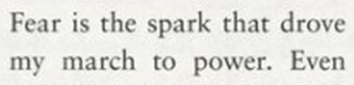
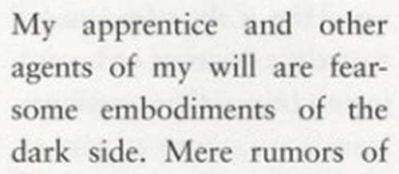
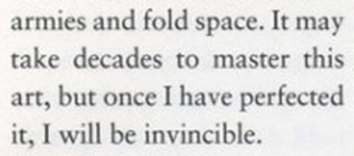
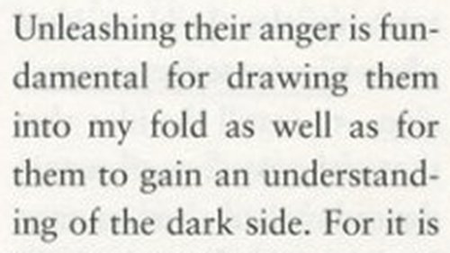
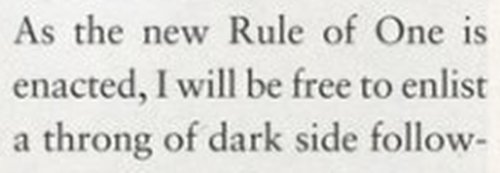
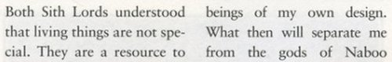
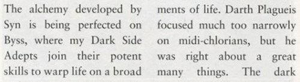

# Owner Material 036 — Book of Sith: Secrets from the Dark Side (2012): Darth Sidious: The Weakness of Inferiors; back matter

- **Source:** *Book of Sith: Secrets from the Dark Side* by Daniel Wallace (becker&mayer!, 2012). Secondary source (licensed Legends reference). Scan OCR'd on the box; the scan stays box-only and is **not** published.
- **Method:** every scanned page was OCR'd and machine-screened sentence by sentence for power-relevant statements (fights, kills, defeats, Force feats, rankings, superweapons) that name a character on our roster; each kept sentence is quoted verbatim from the OCR text and has a crop of the printed passage directly under it. Pages with nothing power-relevant are still listed with what is on them.
- **Citation:** "Book of Sith, p.X" by printed page ("scan p.X" where no printed number applies). **Weight:** Lucasfilm-licensed in-universe artefact book: each section is written in character by a Sith (Sorzus Syn, Darth Malgus, Darth Bane, Mother Talzin, Darth Plagueis, Darth Sidious) with a preface by Darth Sidious and margin notes by others. Treat first-person claims as what the character says about themself, not as narrated fact.

## scan p.146 (scan page 146)

Page contents: 246 words, 14 paragraphs | headings/entries: THE WEAKNESS OF INFERIORS; Coast; CORUSCANT UNDER MY RULE, DARTH BANE BEHELD

- **Palpatine (Darth Sidious)**: "Fear is the spark that drove my march to power." Source: Book of Sith, scan p.146
  

## scan p.147 (scan page 147)

Page contents: 0 words, 0 paragraphs | headings/entries: 

## scan p.148 (scan page 148)

Page contents: 130 words, 15 paragraphs | headings/entries: THE FALse War; My apprentice Count Dooku; Rim This; It did not matter at all; It+8

## scan p.149 (scan page 149)

Page contents: 257 words, 15 paragraphs | headings/entries: 

## scan p.150 (scan page 150)

Page contents: 445 words, 92 paragraphs | headings/entries: Tue UsreruL BUREAUCRATS; Control; Nv; S; Nd; Ay &; Led to ry Likely; Loye of mone; K; AS Pure; Vida i fac perro 2); Uod; TT AA,; P27

## scan p.151 (scan page 151)

Page contents: 185 words, 16 paragraphs | headings/entries: Princ; Me cles, her "BS

## scan p.152 (scan page 152)

Page contents: 145 words, 11 paragraphs | headings/entries: The weak do not understand

- **Palpatine (Darth Sidious)**: "My apprentice and other agents of my will are fearsome embodiments of the dark side." Source: Book of Sith, scan p.152
  

## scan p.153 (scan page 153)

Page contents: 282 words, 23 paragraphs | headings/entries: 

## scan p.154 (scan page 154)

Page contents: 192 words, 11 paragraphs | headings/entries: THE BOOK OF ANGER

## scan p.155 (scan page 155)

Page contents: 383 words, 36 paragraphs | headings/entries: Indeed, my; X; PaLeAaTine's

- **Palpatine (Darth Sidious)**: "It may take decades to master this art, but once I have perfected it, I will be invincible." Source: Book of Sith, scan p.155
  

## scan p.156 (scan page 156)

Page contents: 342 words, 20 paragraphs | headings/entries: Order; Although the Jedi; ATONEMENT: Bry DESTRO

- **Palpatine (Darth Sidious)**: "Unleashing their anger is fundamental for drawing them into my fold as well as for them to gain an understanding of the dark side." Source: Book of Sith, scan p.156
  
- **Palpatine (Darth Sidious)**: "As the new Rule of One is enacted, I will be free to enlist a throng of dark side followers." Source: Book of Sith, scan p.156
  

## scan p.157 (scan page 157)

Page contents: 259 words, 26 paragraphs | headings/entries: The red-robed Royal Guard; Side Adepts. Until I have use ers; St

## scan p.158 (scan page 158)

Page contents: 354 words, 23 paragraphs | headings/entries: THE MANIPULATION OF LIFE; Ue Asters,; Soc 14 WOu Ll; S8

- **Palpatine (Darth Sidious)**: "Both Sith Lords understood beings of my own design. that living things are not spe- | What then will separate me cial." Source: Book of Sith, scan p.158
  
- **Palpatine (Darth Sidious); Darth Plagueis**: "Darth Plagueis Syn is being perfected on focused much too narrowly Byss, where my Dark Side on midi-chlorians, but he Adepts join their potent was right about a great skills to warp lifeona broad many things." Source: Book of Sith, scan p.158
  

## scan p.159 (scan page 159)

Page contents: 296 words, 27 paragraphs | headings/entries: My &; I have centuries to expound; SBHILSNOS |

## scan p.160 (scan page 160)

Page contents: 39 words, 7 paragraphs | headings/entries: EDITION Delia Grev; Rosar

## scan p.161 (scan page 161)

Page contents: 2 words, 1 paragraphs | headings/entries: 

## scan p.162 (scan page 162)

Page contents: 0 words, 0 paragraphs | headings/entries: 

