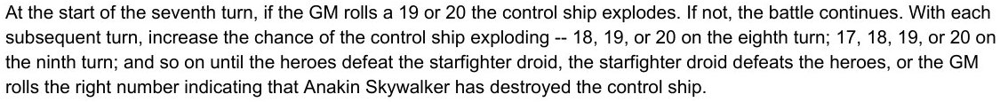
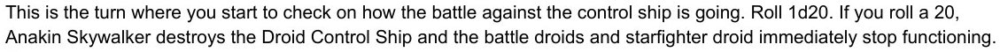

# Owner Material 037 — Star Wars D20 Drive folder (Core, Revised Core and Saga Edition): Adventures/Battle in the Streets.pdf [Star Wars Roleplaying Game (d20, 2000)]

- **Source:** Wizards of the Coast Star Wars Roleplaying Game books, web enhancements, Living Force campaign modules and articles (2000–2010), from the owner's "Star Wars D20" Drive folder (only the three edition subfolders; "General" was not read, as instructed). Secondary source (licensed Legends reference). Scan OCR'd on the box; the scan stays box-only and is **not** published.
- **Method:** every scanned page was OCR'd and machine-screened sentence by sentence for power-relevant statements (fights, kills, defeats, Force feats, rankings, superweapons) that name a character on our roster; each kept sentence is quoted verbatim from the OCR text and has a crop of the printed passage directly under it. Pages with nothing power-relevant are still listed with what is on them.
- **Citation:** "*Battle in the Streets* (SWRPG d20), p.X" by printed page ("scan p.X" where no printed number applies). **Weight:** Licensed RPG material: a secondary source. Narrative text sums up Legends lore; game statistics are rules for players, not canon power levels, and rank lowest.

## scan p.1 (scan page 1)

Page contents: Framing text: during the battle 'two Jedi Knights fight for their lives against a Dark Lord of the Sith' (TPM). (hand-read)

- **Darth Vader (Anakin Skywalker)**: "Anakin Skywalker flies one of the Naboo starfighters, doing his part to defeat the invaders." Source: *Battle in the Streets* (SWRPG d20), scan p.1
  
- **Darth Vader (Anakin Skywalker)**: "With each subsequent turn, increase the chance of the control ship exploding -- 18, 19, or 20 on the eighth turn; 17, 18, 19, or 20 on the ninth turn; and so on until the heroes defeat the starfighter droid, the starfighter droid defeats the heroes, or the GM rolls the right number indicating that Anakin Skywalker has destroyed the control ship." Source: *Battle in the Streets* (SWRPG d20), scan p.1
  

## scan p.2 (scan page 2)

Page contents: 385 words, 11 paragraphs | headings/entries: Encounter: The Last Desperate Battle!

## scan p.3 (scan page 3)

Page contents: 203 words, 27 paragraphs | headings/entries: Wound Points: 8; Attack: None; Damage: None; Initiative: 10; Vitality Points: 0; Wound Points: 8; Speed: 3 spaces; Defense: 11; Attack: None; Damage: None; Saves: Fortitude 1d20+2, Reflex 1d20+0, Will 1d20+1; Initiative: 10; Vitality Points: 10; Wound Points: 12; Speed: 5 spaces; Defense: 12; Attack: Blaster 1d20+2; Damage: 3d6 (blaster)

## scan p.4 (scan page 4)

Page contents: 164 words, 27 paragraphs | headings/entries: Initiative: 8; Vitality Points: 0; Wound Points: 6; Speed: 5 spaces; Defense: 10; Attack: none; Damage: none; Initiative: 11; Vitality Points: 0; Wound Points: 8; Speed: 4 spaces; Defense: 12; Attack: Blaster 1d20+2; Damage: 3d6; Initiative: 10; Vitality Points: 0; Wound Points: 55; Speed: 4 spaces; Defense: 17; Attack: Blaster 1d20+2; Damage: 3d6

## scan p.5 (scan page 5)

Page contents: 534 words, 30 paragraphs | headings/entries: Battle Outline; Turn 1; Turn 2; Turn 3; Turn 4; Turn 5; Turn 6; Turn 7; Turn 8; Turn 9; Turn 10 and Beyond

- **Darth Vader (Anakin Skywalker)**: "If you roll a 20, Anakin Skywalker destroys the Droid Control Ship and the battle droids and starfighter droid immediately stop functioning." Source: *Battle in the Streets* (SWRPG d20), scan p.5
  

## scan p.6 (scan page 6)

Page contents: 551 words, 12 paragraphs | headings/entries: The End?; Not the End!; What Data Does the R2 Unit Contain?; What's In the Diplomatic Pouch?

