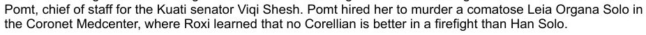
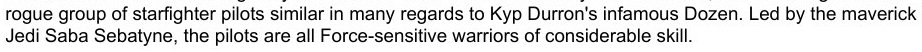
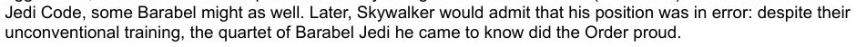

# Owner Material 037 — Star Wars D20 Drive folder (Core, Revised Core and Saga Edition): Sourcebooks/Sourcebook Web Enhancements/Making a Full Recovery.pdf [Star Wars Roleplaying Game (d20, 2000)]

- **Source:** Wizards of the Coast Star Wars Roleplaying Game books, web enhancements, Living Force campaign modules and articles (2000–2010), from the owner's "Star Wars D20" Drive folder (only the three edition subfolders; "General" was not read, as instructed). Secondary source (licensed Legends reference). Scan OCR'd on the box; the scan stays box-only and is **not** published.
- **Method:** every scanned page was OCR'd and machine-screened sentence by sentence for power-relevant statements (fights, kills, defeats, Force feats, rankings, superweapons) that name a character on our roster; each kept sentence is quoted verbatim from the OCR text and has a crop of the printed passage directly under it. Pages with nothing power-relevant are still listed with what is on them.
- **Citation:** "*Making a Full Recovery* (SWRPG d20), p.X" by printed page ("scan p.X" where no printed number applies). **Weight:** Licensed RPG material: a secondary source. Narrative text sums up Legends lore; game statistics are rules for players, not canon power levels, and rank lowest.

## scan p.1 (scan page 1)

Page contents: Coronet Medcenter premium bacta restores 5 VP + 2 WP per hour (typical bacta 3/1). (hand-read)

## scan p.2 (scan page 2)

Page contents: 877 words, 22 paragraphs | headings/entries: Repulsor Chair; Cybernetic Exercise Braces; Roxi Barl; Staff Chief Pomt

- **Han Solo** — entry/section: Roxi Barl learns Han's firefight reputation: "Pomt hired her to murder a comatose Leia Organa Solo in the Coronet Medcenter, where Roxi learned that no Corellian is better in a firefight than Han Solo." Source: *Making a Full Recovery* (SWRPG d20), scan p.2
  

### Stat block notes (game mechanics, not feats)

- Roxi Barl: Human Noble 2/Soldier 6; VP/WP 41/10 (Source: *Making a Full Recovery* (SWRPG d20), scan p.2)

## scan p.3 (scan page 3)

Page contents: Thrackan at Centerpoint 'wiped out a good portion of the Yuuzhan Vong invasion fleet' (with Hapan armada destroyed by friendly fire). (hand-read)

### Stat block notes (game mechanics, not feats)

- Eelysa: Human Jedi Guardian 12; VP/WP 106/16; Challenge Code F; lightsaber 4d8+1; Battlemind +11, Enhance Ability +11; Saba Sebatyne's master; killed by a voxyn (Source: *Making a Full Recovery* (SWRPG d20), scan p.3)
- Thrackan Sal-Solo: Human Noble 4/Scoundrel 5; VP/WP 32/11; Rep +10; DSP 7 (Source: *Making a Full Recovery* (SWRPG d20), scan p.3)

## scan p.4 (scan page 4)

Page contents: 861 words, 19 paragraphs | headings/entries: The Wild Knights; Izal Waz; The Barabel

- **Saba Sebatyne** — entry/section: Wild Knights led by Saba: "Led by the maverick Jedi Saba Sebatyne, the pilots are all Force-sensitive warriors of considerable skill." Source: *Making a Full Recovery* (SWRPG d20), scan p.4
  

### Stat block notes (game mechanics, not feats)

- Izal Waz: Arcona Jedi Guardian 4; VP/WP 30/15; Pilot +12; Wild Knight (Source: *Making a Full Recovery* (SWRPG d20), scan p.4)

## scan p.5 (scan page 5)

Page contents: Barabel Jedi (Tesar Sebatyne, Bela and Krasov Hara) 'were able to meld their minds with an ease and effectiveness that some human Jedi Masters would have had trouble matching', and lent that strength to the Myrkr strike team. (hand-read)

- **Luke Skywalker** — entry/section: Luke admits error about Barabel Jedi: "Later, Skywalker would admit that his position was in error: despite their unconventional training, the quartet of Barabel Jedi he came to know did the Order proud." Source: *Making a Full Recovery* (SWRPG d20), scan p.5
  

## scan p.6 (scan page 6)

Page contents: 100 words, 5 paragraphs | headings/entries: Cinnabar Moon Cloud Car

