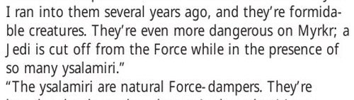

# Owner Material 037 — Star Wars D20 Drive folder (Core, Revised Core and Saga Edition): Sourcebooks/Sourcebook Web Enhancements/Mission to Myrkr.pdf [Star Wars Roleplaying Game (d20, 2000)]

- **Source:** Wizards of the Coast Star Wars Roleplaying Game books, web enhancements, Living Force campaign modules and articles (2000–2010), from the owner's "Star Wars D20" Drive folder (only the three edition subfolders; "General" was not read, as instructed). Secondary source (licensed Legends reference). Scan OCR'd on the box; the scan stays box-only and is **not** published.
- **Method:** every scanned page was OCR'd and machine-screened sentence by sentence for power-relevant statements (fights, kills, defeats, Force feats, rankings, superweapons) that name a character on our roster; each kept sentence is quoted verbatim from the OCR text and has a crop of the printed passage directly under it. Pages with nothing power-relevant are still listed with what is on them.
- **Citation:** "*Mission to Myrkr* (SWRPG d20), p.X" by printed page ("scan p.X" where no printed number applies). **Weight:** Licensed RPG material: a secondary source. Narrative text sums up Legends lore; game statistics are rules for players, not canon power levels, and rank lowest.

## scan p.1 (scan page 1)

Page contents: 318 words, 33 paragraphs | headings/entries: ROLEPLAYING GAMeE; Mission to Muyrkr; A New Jedi Order Sourcebook Web Enhancement; DESIGN; JD WIKER; EDITING; RAY AND VALERIE VALLESE; TYPESETTING; SUE WEINLEIN COOK; WEB PRODUCTION; DANIEL STAHL; WEB DEVELOPMENT; THOM BECKMAN; ART DIRECTION; SEAN GLENN; LUCAS LICENSING EDITORS; MICHELLE VUCKOVICH AND LELAND CHEE; STAR WARS RPG CREATIVE DIRECTOR; CHRIS PERHINS; VICE PRESIDENT AND DIRECTOR OF RPG R&D; BILL SLAVICSEK; AP? OSw.25; WEB ENHANCEMENT; MISSION TO MYRKR

## scan p.2 (scan page 2)

Page contents: Intro: Yuuzhan Vong ships and defense platforms 'can only slow' the Vong; 'the Force is a power they don't understand and can't counter—at least, not until they discover vornskrs.' Voxyn 'can track—and kill-Jedi with frightening ease'. (hand-read)

- **Luke Skywalker** — entry/section: Luke on vornskrs and ysalamiri: "I ran into them several years ago, and they're formida- ble creatures. They're even more dangerous on Myrkr; a Jedi is cut off from the Force while in the presence of so many ysalamiri." Source: *Mission to Myrkr* (SWRPG d20), scan p.2
  

## scan p.3 (scan page 3)

Page contents: Ysalamiri sidebar: 10 m null-Force bubble each; no Force skills, feats or Force Points inside; Force effects from outside do not penetrate. Ysalamiri: Herd animal 1, CC A. (hand-read)

## scan p.4 (scan page 4)

Page contents: 1092 words, 33 paragraphs | headings/entries: AadAW OL NOISSIN; QLgeL U's2e; Az?; AN3M32NVYHN3 G3n; The Yuuzhan Vong; The Voxyn

### Stat block notes (game mechanics, not feats)

- Voxyn: Predator 12; VP/WP 88/12 (+20 bonus VP), fast healing 2; Def 20; claws +16 1d6+4; immune to Force Sense and Alter; See Force +15; sonic screech (10 m, Fort DC 16 or deafened), poison spit (Con damage, blindness), poison tail; CC F (Source: *Mission to Myrkr* (SWRPG d20), scan p.4)
- Vornskr: Jungle predator 8; VP/WP 57/17; See Force +12; preferentially attacks Force-users; CC E (Source: *Mission to Myrkr* (SWRPG d20), scan p.4)
- Yuuzhan Vong warrior (generic): Soldier 4; VP/WP 30/12; DR 5 vonduun crab armor; immune to Force Sense and Alter; CC C (Source: *Mission to Myrkr* (SWRPG d20), scan p.4)

## scan p.5 (scan page 5)

Page contents: 496 words, 22 paragraphs | headings/entries: Scene 4: Escape from Myrkr; Rewards; About the Author; Ash?; Ht Ci} |; WEB ENHANCEMENT; MISSION TO MYRKR

