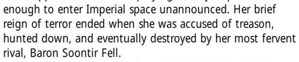

# Owner Material 037 — Star Wars D20 Drive folder (Core, Revised Core and Saga Edition): Sourcebooks/Sourcebook Web Enhancements/More Starships!.pdf [Star Wars Roleplaying Game (d20, 2000)]

- **Source:** Wizards of the Coast Star Wars Roleplaying Game books, web enhancements, Living Force campaign modules and articles (2000–2010), from the owner's "Star Wars D20" Drive folder (only the three edition subfolders; "General" was not read, as instructed). Secondary source (licensed Legends reference). Scan OCR'd on the box; the scan stays box-only and is **not** published.
- **Method:** every scanned page was OCR'd and machine-screened sentence by sentence for power-relevant statements (fights, kills, defeats, Force feats, rankings, superweapons) that name a character on our roster; each kept sentence is quoted verbatim from the OCR text and has a crop of the printed passage directly under it. Pages with nothing power-relevant are still listed with what is on them.
- **Citation:** "*More Starships!* (SWRPG d20), p.X" by printed page ("scan p.X" where no printed number applies). **Weight:** Licensed RPG material: a secondary source. Narrative text sums up Legends lore; game statistics are rules for players, not canon power levels, and rank lowest.

## scan p.1 (scan page 1)

Page contents: 273 words, 43 paragraphs | headings/entries: STAR.WARS; ROLEPLAYING; MICED; GAMeE; DESIGN; BRIAN CAMPBELL AND OWEN H.C. STEPHENS; EDITING AND WEB PRODUCTION; SUE WEINLEIN COOK; WEB DEVELOPMENT; THOM BECKMAN; ART DIRECTION; SEAN GLENN; LUCAS LICENSING EDITORS; BEf HARPER AND LELAND CHEE; STAR WARS RPG CREATIVE DIRECTOR; THOMAS M. REID; VICE PRESIDENT AND DIRECTOR OF RPG R&D; BILL SLAVICSEK; U.S., CANADA; P.O. Box 707; Renton, WA 98057-0707 Questions? 1-800-324-6496; Belgium; WEB ENHANCEMENT; MORE STARSHIPS; Arh? OSw.25

## scan p.2 (scan page 2)

Page contents: TIE defender: +3 equipment bonus to Pilot checks and attacks, 60 shields, 100 hull, hyperdrive x2; 'Had the Empire not begun to collapse following the Battle of Endor, these ships would no doubt have inflicted serious damage to the Alliance.' (hand-read)

- **Soontir Fel** — entry/section: Fel destroys Countess Ryad: "Her brief reign of terror ended when she was accused of treason, hunted down, and eventually destroyed by her most fervent rival, Baron Soontir Fell." Source: *More Starships!* (SWRPG d20), scan p.2
  

## scan p.3 (scan page 3)

Page contents: 1030 words, 30 paragraphs | headings/entries: Shieldship; WEB ENHANCEMENT; MORE STARSHIPS; AP? OSw.25; Wl (sc)LI Nh:

### Stat block notes (game mechanics, not feats)

- Countess Iran Ryad: Human Noble 8/Starfighter Ace 1; VP/WP 36/10; Pilot +18; Red Star 1 maneuvers +26, attack +23; led Red Star Squadron; killed by Soontir Fel (Source: *More Starships!* (SWRPG d20), scan p.3)
- Zan Ransom: Human Scout 4/Scoundrel 2/Bounty Hunter 2/Big Game Hunter 1; VP 55/12; Def 22 (Source: *More Starships!* (SWRPG d20), scan p.3)

## scan p.4 (scan page 4)

Page contents: Nkllon shieldships (Lando's Nomad City) protect up to Huge craft from the sun; shieldship 550 m, 300 shields, 600 hull, DR 35. (hand-read)

### Stat block notes (game mechanics, not feats)

- Neen Niuv: Sullustan Scoundrel 5/Noble 2/Crimelord 1; VP/WP 22/9 (Source: *More Starships!* (SWRPG d20), scan p.4)
