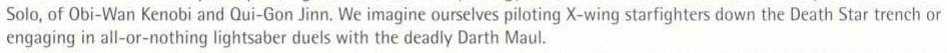
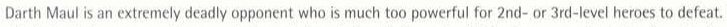
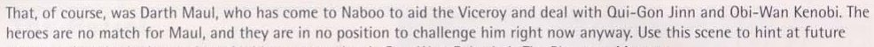
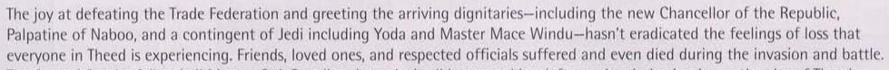

# Owner Material 037 — Star Wars D20 Drive folder (Core, Revised Core and Saga Edition): Sourcebooks/Invasion Of Theed.pdf [Star Wars Roleplaying Game (d20, 2000)] (scan pages 1–60)

- **Source:** Wizards of the Coast Star Wars Roleplaying Game books, web enhancements, Living Force campaign modules and articles (2000–2010), from the owner's "Star Wars D20" Drive folder (only the three edition subfolders; "General" was not read, as instructed). Secondary source (licensed Legends reference). Scan OCR'd on the box; the scan stays box-only and is **not** published.
- **Method:** every scanned page was OCR'd and machine-screened sentence by sentence for power-relevant statements (fights, kills, defeats, Force feats, rankings, superweapons) that name a character on our roster; each kept sentence is quoted verbatim from the OCR text and has a crop of the printed passage directly under it. Pages with nothing power-relevant are still listed with what is on them.
- **Citation:** "*Invasion Of Theed* (SWRPG d20), p.X" by printed page ("scan p.X" where no printed number applies). **Weight:** Licensed RPG material: a secondary source. Narrative text sums up Legends lore; game statistics are rules for players, not canon power levels, and rank lowest.

## scan p.1 (scan page 1)

Page contents: 39 words, 9 paragraphs | headings/entries: TAR. WA; ADVENTURE GAME; INCLUDES EVERYTHING YOU NEED TO PLAY; Ny Op; A. WARNING:

## scan p.2 (scan page 2)

Page contents: 413 words, 16 paragraphs | headings/entries: STOP!

## scan p.3 (scan page 3)

Page contents: 711 words, 42 paragraphs | headings/entries: Gamemaster Summary; Choose a Weapon; Who Goes First?; What Can | Do?; Making an Attack Roll; Using the Force; Shooting into a Pight; Flanking; Reloading; What Can a Character Do?

## scan p.4 (scan page 4)

Page contents: 41 words, 4 paragraphs | headings/entries: AR.WARS NVASION OF THEED; A DBD™MEN TU RE GAME

## scan p.5 (scan page 5)

Page contents: 76 words, 6 paragraphs | headings/entries: Introduction oo3 (| Characters oou

## scan p.6 (scan page 6)

Page contents: 742 words, 28 paragraphs | headings/entries: Introduction; Introduction; Have You Played Before?; The Gamemaster; The Players; What's in this Box?; The Mext Step

- **Darth Maul**: "We imagine ourselves piloting X-wing starfighters down the Death Star trench or engaging in all-or-nothing lightsaber duels with the deadly Darth Maul." Source: *Invasion Of Theed* (SWRPG d20), scan p.6
  

## scan p.7 (scan page 7)

Page contents: 713 words, 24 paragraphs | headings/entries: Characters; Characters; Humans; Gungans; Twi'leks; Classes; Jedi Guardians; Scoundrels; Scouts; OOW rucesoon

## scan p.8 (scan page 8)

Page contents: 594 words, 18 paragraphs | headings/entries: Vitality and Wounds; Level; Skills; Weapons and Gear; Rutcesook OOS GQ

## scan p.9 (scan page 9)

Page contents: 377 words, 26 paragraphs | headings/entries: Wound Points; Attacks; Saving Throws; Skills; Force Points; HUth-Level Characters

## scan p.10 (scan page 10)

Page contents: 719 words, 19 paragraphs | headings/entries: Skills; Making a Skill Check; General Skills

## scan p.11 (scan page 11)

Page contents: 618 words, 38 paragraphs | headings/entries: Computer Use Cintelligence); Difficulty Task; Diplomacy (Charisma); Disable Device (Dexterity); Difficulty Complexity id Simple; Time; Hide (Dexterity); Intimidate (Charisma); OOS rutesooun

## scan p.12 (scan page 12)

Page contents: 821 words, 24 paragraphs | headings/entries: Pilot (Dexterity); Ride (Dexterity); Rucesook OOS

## scan p.13 (scan page 13)

Page contents: 609 words, 17 paragraphs | headings/entries: Difficulty Task; Force Skills; G10 rutesoor

## scan p.14 (scan page 14)

Page contents: 532 words, 24 paragraphs | headings/entries: Result Bonus o-13 No Bonus 10-14 +2; Rucesoor O11 G@——

## scan p.15 (scan page 15)

Page contents: 472 words, 18 paragraphs | headings/entries: 

## scan p.16 (scan page 16)

Page contents: 671 words, 31 paragraphs | headings/entries: Mew Weapons; A; Equ; Adventuring Gear

## scan p.17 (scan page 17)

Page contents: 274 words, 11 paragraphs | headings/entries: Weapons Table; Cost; Weapons Table; O14 rucesooru

## scan p.18 (scan page 18)

Page contents: 678 words, 18 paragraphs | headings/entries: Combat; Combat; How Combat Works; Choose a Weapon; Who Goes First?

## scan p.19 (scan page 19)

Page contents: 672 words, 20 paragraphs | headings/entries: Switch Weapons; Special Combat Rules; Flee; O16 rutesoorn

## scan p.20 (scan page 20)

Page contents: Rulebook: 'Even powerful Jedi can't leap a 100-meter chasm, no matter how strong they are in the Force.' (hand-read)

## scan p.21 (scan page 21)

Page contents: 459 words, 3 paragraphs | headings/entries: 

## scan p.22 (scan page 22)

Page contents: 763 words, 23 paragraphs | headings/entries: Building Mew Adventures; Building New Adventures; What's Space Fantasy?; Plenty of Action; Epic Plots; What Is an Adventure?

## scan p.23 (scan page 23)

Page contents: 743 words, 18 paragraphs | headings/entries: Encounters; NMoncombat Encounters; What Isn't an Encounter?; How Much Experience?; Random Adventures; O20 ruresoon

## scan p.24 (scan page 24)

Page contents: 719 words, 27 paragraphs | headings/entries: Adventure Building; An espionage mission; Random Mission Tables; Z2nd-Level Missions 1d10 Mission; Srd-Level Missions id10 Mission; RuLesoor O21 QG———

## scan p.25 (scan page 25)

Page contents: 435 words, 99 paragraphs | headings/entries: Adventure Location Tables; Space Station Cantina; City; Research Outpost Criminal Base Pirate Cove; Smuggler Den; Alien Warlord's Stronghold; Slaver Camp; Planet Type Id10 Planet Type; Desert; Ice; Water; Jungle; Swamp; Forest; City-world; Gas; Hostile Environment* Dead Planet*; Random Opponent Tables; Random Opponents, 2nd-Level Characters; Challenging; Random Opponents, 3rd-Level Characters; O22 ruresoou; Challenging; L; Asteroid Field Volcano Underwater Mountaintop Island; Cliffside; Floating in Clouds Underground Ancient Ruins; Floating on Water; Extreme; Pirate Leader (Major Villain); Extreme; Pirate Leader and 3 Pirates

## scan p.26 (scan page 26)

Page contents: 588 words, 30 paragraphs | headings/entries: Random Encounters; Random Encounter Tables; Spaceport; Simple: 2 Pirates; Simple: 2 Thugs (Soldiers, Typical); Simple: 2 Pirates; Simple: 2 Battle Droids (infantry); Simple: 1 Battle Droid (Security); Challenging: 4 Battle Droids (Infantry); Extreme: 2 Battle Droids (with STAPs); Extreme: AAT Battle Tank; SP®avanrcann

## scan p.27 (scan page 27)

Page contents: 432 words, 15 paragraphs | headings/entries: 

## scan p.28 (scan page 28)

Page contents: Generic Dark Side Adept (Level 3): calls on dark side twice per battle (+2d6 to rolls); Adventure Game Destroyer droid shields = 20 VP. (hand-read)

## scan p.29 (scan page 29)

Page contents: 384 words, 16 paragraphs | headings/entries: 

- **Darth Maul** — entry/section: Invasion Of Theed: "Darth Maul is an extremely deadly opponent who is much too powerful for 2nd- or 3rd-level heroes to defeat." Source: *Invasion Of Theed* (SWRPG d20), scan p.29
  

### Stat block notes (game mechanics, not feats)

- Darth Maul: Adventure Game stats: Level 12; VP 65, WP 52; Init 19; Def 24; three lightsaber attacks +16/+11/+6 for 4d8 each; Battlemind/Force Push/Force Stealth/Move Object +15; can call on the dark side 4 times per battle (+5d6 to all rolls that round) (Source: *Invasion Of Theed* (SWRPG d20), scan p.29)

## scan p.30 (scan page 30)

Page contents: 333 words, 34 paragraphs | headings/entries: O4 Level: 1; O-— Attack: 1d20+1 Ccesta); O- Damage: 2dH4 (cesta); O- Level: 1; O- Vitality Points: O; O- Speed: 5S spaces; O- Attack: 1d20+0 (unarmed); O-+ Damage: 1d3 (unarmed); RuLesoor O27 @

## scan p.31 (scan page 31)

Page contents: Elite handmaidens 'never leave the queen's side'; Royal Security Force and N-1 pilots called 'perhaps the only true warriors among the humans of Naboo.' (hand-read)

## scan p.32 (scan page 32)

Page contents: 379 words, 28 paragraphs | headings/entries: O- Level: 1; O- Initiative: 8; O- Vitality Points: 0; O- Speed: 5 spaces; O-| Attack: None; O-| Damage: Mone

## scan p.33 (scan page 33)

Page contents: 390 words, 35 paragraphs | headings/entries: Oo; OQ oO; O; Oo; Oo-; O-; O-; Attack: 1d20+2 (blaster); Damage: 306 (blaster); Level: M/A; Initiative: 10; Vitality Points: O; Wound Points: 8; Speed: 3 spaces; Defense: 11; Damage: 1d6 (arc welder)

## scan p.34 (scan page 34)

Page contents: 357 words, 36 paragraphs | headings/entries: Soldier, Typical; Speed: 5 spaces; Defense: 14; Attack: 1d20+3 (blaster); Noble, Typical Level: 1; Initiative: 8; Vitality Points: 0; Wound Paints: 5; Speed: 5 spaces; Defense: 12; Scout, Typical Level: 1; Initiative: 12; Vitality Points: O; Attack: 1d20+2 (blaster); Damage: 306 (blaster); Saves: Fortitude 1d20+1, Reflex 1d20+1, Will 1ld20+0; Rutepook OS1

## scan p.35 (scan page 35)

Page contents: 227 words, 28 paragraphs | headings/entries: Editing: Penny Williams; Box Cover Art: Adam Hughes; Illustrations: Adam Hughes; Cartography: [odd Gamble; Graphic Design: Mary Kysar and Sean Glenn; Lisa Stevens, JD Wiker, Steve Miller,; P.O. Box 707; Renton WA 98057-0707; Belgium 4+32-70-23-32-77; SS

## scan p.36 (scan page 36)

Page contents: 40 words, 5 paragraphs | headings/entries: ADVENTURE GAME; Adventures Book

## scan p.37 (scan page 37)

Page contents: 53 words, 14 paragraphs | headings/entries: Table; Adventure 1: Battle Droid Invasion O03; Blank Character Sheet

## scan p.38 (scan page 38)

Page contents: 784 words, 24 paragraphs | headings/entries: Adventure l; Introduction; Adventure lL: Battle Droid Invasion; Players' Introduction; Apventures Boor OOS G——-

## scan p.39 (scan page 39)

Page contents: 737 words, 22 paragraphs | headings/entries: Set-Up; Invasion; Encounter 1: Battle Droids in the Streets

## scan p.40 (scan page 40)

Page contents: 669 words, 23 paragraphs | headings/entries: Speeder +2%; Saves: Fortitude 1d20+1, Reflex 1d20+0, Will 1d20+0; Skills: Listen 1d20+4, Search 1d20+4, Spot 1d20+4; The End!

## scan p.41 (scan page 41)

Page contents: 727 words, 19 paragraphs | headings/entries: Adventure 2: Recovery; Gamemaster's Secret Information; Players' Introduction; What do you do?; GOOG aovenrtures soor

## scan p.42 (scan page 42)

Page contents: 843 words, 19 paragraphs | headings/entries: Distract the Guards; Using Affect Mind; Sneak Attack!; Slip Past the Guards!

## scan p.43 (scan page 43)

Page contents: 835 words, 24 paragraphs | headings/entries: Neimodian 1 Ooo00000 Neimodian 2 Oooo0000

## scan p.44 (scan page 44)

Page contents: 686 words, 24 paragraphs | headings/entries: The Door into the Building; The Door to the Weapons Stash; Listening at the Door

## scan p.45 (scan page 45)

Page contents: 337 words, 13 paragraphs | headings/entries: See St * > J) © Security/Droids; SecurityiD roids) pomEntemieres; O10 apventures Book

## scan p.46 (scan page 46)

Page contents: 364 words, 15 paragraphs | headings/entries: Experience; Defeating the security droids—1200 XP;; Recovering the weapons stash—400 XP;

## scan p.47 (scan page 47)

Page contents: 836 words, 19 paragraphs | headings/entries: Adventure 3: Rescue; Players' Introduction; What do you do?; O12 aovenrtures Boor

## scan p.48 (scan page 48)

Page contents: 521 words, 30 paragraphs | headings/entries: Set-Up; Encounter lL: Break In!; DAMAGE TRACK; Security Droid 1 Security Droid 2; NEIMOIDIAN OUBRSBERS (2); DAMAGE TRACK; Neimoidian 1 Neimoidian 2

## scan p.49 (scan page 49)

Page contents: 838 words, 19 paragraphs | headings/entries: 

## scan p.50 (scan page 50)

Page contents: 801 words, 16 paragraphs | headings/entries: Rescuing the Prisoners

## scan p.51 (scan page 51)

Page contents: 734 words, 23 paragraphs | headings/entries: Encounter 2: The Patrol; The End!; Experience; Rest

## scan p.52 (scan page 52)

Page contents: 721 words, 22 paragraphs | headings/entries: Adventure 3A: Escape!; Players' Introduction; Encounter 1: Inside the Cage; Apventures Book O17

## scan p.53 (scan page 53)

Page contents: 714 words, 19 paragraphs | headings/entries: O-| The Prison Gate; Stealthy Attempt; OO} Opening the Gate; O18 aoventures Boon

- **Darth Maul** — entry/section: Heroes glimpse Maul at the prison: "That, of course, was Darth Maul, who has come to Naboo to aid the Viceroy and deal with Qui-Gon Jinn and Obi-Wan Kenobi. The heroes are no match for Maul, and they are in no position to challenge him right now anyway." Source: *Invasion Of Theed* (SWRPG d20), scan p.53
  

## scan p.54 (scan page 54)

Page contents: 624 words, 29 paragraphs | headings/entries: SECURITY BATTLE DROIDS (2); DAMAGE TRACK; OoOoooOooooOooooOoo DOOOOOOOoOOOoOoOoOo; Security Droid | Security Droid 2; Encounter 2: Run For It!; The Patrol; Moving the Prisoners; INFANTRY BATTLE DAOIDS (4); Attack: Blaster 1d20+2 Damage: Blaster 3d6; DAMAGE TRACK; DOoOoOoO DOoOOoo DOOOooO DOoOoOoo

## scan p.55 (scan page 55)

Page contents: 352 words, 13 paragraphs | headings/entries: The End!; Adventure 4H: Aid the Queen; Aid. The Queen

## scan p.56 (scan page 56)

Page contents: 745 words, 20 paragraphs | headings/entries: Players' Introduction; Set-Up; Encounter 1: Fight and Flight!; Abventures soon O21 G—_—

## scan p.57 (scan page 57)

Page contents: Sabé as decoy 'Queen Amidala' in the Aid the Queen adventure; attack +4, Move Silently +6. (hand-read)

## scan p.58 (scan page 58)

Page contents: 295 words, 21 paragraphs | headings/entries: Skills: Listen 1d20+4, Search 1d20+4, Spot 1d20+4; UND POINTS; Saves: Fortitude 1d20+1, Reflex 1d20+0, Will 1d20+0; BATTLE DROID ON STAP; DAMAGE TRACK; STAP OOOODOOOoOOoOoOoOoOoOonoo; AAT BATTLE TANK; DAMAGE TRACK; ADvEentTuRES BOOK O23

## scan p.59 (scan page 59)

Page contents: 870 words, 18 paragraphs | headings/entries: Adventure 5: Renegade; Gamemaster's Secret Information; Players' Introduction; Will you agree to help Sabé?; What Sabé Knows; O24 apventures Book

- **Palpatine (Darth Sidious); Yoda; Mace Windu**: "The joy at defeating the Trade Federation and greeting the arriving dignitaries—including the new Chancellor of the Republic, Palpatine of Naboo, and a contingent of Jedi including Yoda and Master Mace Windu—hasn't eradicated the feelings of loss that everyone in Theed is experiencing." Source: *Invasion Of Theed* (SWRPG d20), scan p.59
  

## scan p.60 (scan page 60)

Page contents: 868 words, 18 paragraphs | headings/entries: What Headmaster Dannt Knows; Encounter 2: Dangers in the Swamp; LIALLA TANE Starting Out; Attack: Blaster 1d20+3 Damage: Blaster 3d6

