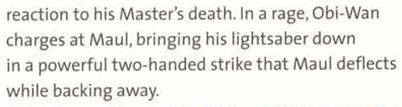
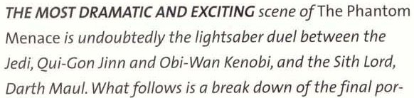
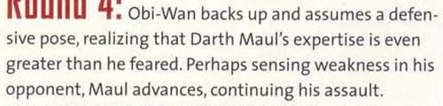

# Owner Material 037 — Star Wars D20 Drive folder (Core, Revised Core and Saga Edition): Sourcebooks/Invasion Of Theed.pdf [Star Wars Roleplaying Game (d20, 2000)] (scan pages 61–120)

- **Source:** Wizards of the Coast Star Wars Roleplaying Game books, web enhancements, Living Force campaign modules and articles (2000–2010), from the owner's "Star Wars D20" Drive folder (only the three edition subfolders; "General" was not read, as instructed). Secondary source (licensed Legends reference). Scan OCR'd on the box; the scan stays box-only and is **not** published.
- **Method:** every scanned page was OCR'd and machine-screened sentence by sentence for power-relevant statements (fights, kills, defeats, Force feats, rankings, superweapons) that name a character on our roster; each kept sentence is quoted verbatim from the OCR text and has a crop of the printed passage directly under it. Pages with nothing power-relevant are still listed with what is on them.
- **Citation:** "*Invasion Of Theed* (SWRPG d20), p.X" by printed page ("scan p.X" where no printed number applies). **Weight:** Licensed RPG material: a secondary source. Narrative text sums up Legends lore; game statistics are rules for players, not canon power levels, and rank lowest.

## scan p.61 (scan page 61)

Page contents: 785 words, 22 paragraphs | headings/entries: 

## scan p.62 (scan page 62)

Page contents: 988 words, 16 paragraphs | headings/entries: Beating the Quicksand; Apventures Boon O27

## scan p.63 (scan page 63)

Page contents: Savor Kibbs (rejected by the Jedi Council, renegade on Naboo after the invasion) projects an illusory Darth Maul powered by a dark side nexus; illusion double lightsaber 1d20+10 and 1d20+7, 3d8+2; Kibbs uses Force powers without spending VP near the nexus. (hand-read)

## scan p.64 (scan page 64)

Page contents: 774 words, 19 paragraphs | headings/entries: Encounter 4: The Renegade's Base; Tough-Looking Woman; Angry Young Man; Scene 2: Destroyer Droid; ADventurRes Book O2Y

## scan p.65 (scan page 65)

Page contents: 678 words, 18 paragraphs | headings/entries: DESTROYER DROID; WOUND POINTS; Saves: Fortitude 1d20+4, Reflex 1d20+4, Will 1d20+4; Experience; S O30 adventures soon

### Stat block notes (game mechanics, not feats)

- Savor Kibbs: Adventure Game villain: Force Push 1d20+7 (2d6), Move Object 1d20+9; VP 20, WP 12; Def 16 (Source: *Invasion Of Theed* (SWRPG d20), scan p.65)

## scan p.66 (scan page 66)

Page contents: 326 words, 22 paragraphs | headings/entries: HL314> IP 1¢; DAMAGE TRACK; QOQQOOOOOOOO QOQQOQOOOOOO0O OQOOQOOOOOOO OQOQOQOQOOOOO0O0O; WEAPONS; Attack: Roll 1d20+_-- Damage: Roll; STRENGTH Attack: Roll 1d20+___~—s- Damage: Roll; DEXTERITY Attack: Roll 1d20+__~—- Damage: Roll; Attack: Roll 1d20+___- Damage: Roll CONSTITUTION; INTELLIGENCE WISDOM; CHARISMA; FORTITUDE: 120+ To resist poison, disease or; REFLEH: 1d20+ To avoid hazards and

## scan p.67 (scan page 67)

Page contents: 224 words, 23 paragraphs | headings/entries: Se; This product isa work o

## scan p.68 (scan page 68)

Page contents: 721 words, 37 paragraphs | headings/entries: Choose a Weapon; Who Goes First?; What Can Sia-Lan Do?; Attacking; Shooting into a Fight; Fleeing; What Can Sia-Lan Do?; Here are some noncombat options for Sia-Lan:; O Listen at s door; O Search a defeated opponent; O Access a secured computer file; O Bargain with a trader; Rules Summary

## scan p.69 (scan page 69)

Page contents: 292 words, 19 paragraphs | headings/entries: Initiative 16

## scan p.70 (scan page 70)

Page contents: 353 words, 30 paragraphs | headings/entries: Fortitude: 1d20+3; Reflex: 1d20+4; To avoid hazards or explosions; Will: ld20+2; To resist mental distress or Force attacks; Force Points: 2; Bonus Applies To*; Lightsaber attack, fist attack, fist damage; Defense, Reflex saving throw; Heal Another skill, Will saving throw; Affect Mind skill

## scan p.71 (scan page 71)

Page contents: 636 words, 31 paragraphs | headings/entries: Hide 1d20+2; Search ld20+1; Spot 1d20+1; Force Skills*; Affect Mind 1d20+6; Force Push 1d20+6; Heal Another 1d20+5; Heal Self 1d20+5; Move Object 1d20+6; Improving Skills

## scan p.72 (scan page 72)

Page contents: 632 words, 36 paragraphs | headings/entries: Choose a Weapon; Who Goes First?; What Can Rorworr Do?; O Switch weapons, but not move; Attacking; Fleeing; What Can Rorworr Do?; Here are some noncombat options for Rorworr:; O Search a defeated opponent; O Explore a location; O Question a local; O Bargain with a trader; Rules Summary

## scan p.73 (scan page 73)

Page contents: 313 words, 22 paragraphs | headings/entries: Initiative 18; Rorworr can move 5 spaces a turn,

## scan p.74 (scan page 74)

Page contents: 254 words, 23 paragraphs | headings/entries: Fortitude: 1d20+3; Reflex: 1d20+2; To avoid hazards or explosions; Will: Id20+1; To resist mental distress or Force attacks; Force Paints: 1; Ability Score Bonus Bonus Applies To*; Wisdom 10 +0; Charisma 10 +0

## scan p.75 (scan page 75)

Page contents: 337 words, 17 paragraphs | headings/entries: Pilot 1d20+5; Repair 1d20+5; Spot 1d20+4; Survival ld20+4; Improving Skills

## scan p.76 (scan page 76)

Page contents: 628 words, 32 paragraphs | headings/entries: Choose a Weapon; Who Goes First?; Attacking; Fleeing; What Can Deel Do?; Here are some noncombat options for Deel:; O Listen st a door; O Search a defested opponent; O Explore a location; O Question a local; O Bargain with a trader; Rules Summary

## scan p.77 (scan page 77)

Page contents: 348 words, 23 paragraphs | headings/entries: Twi'lek Scoundrel

## scan p.78 (scan page 78)

Page contents: 230 words, 22 paragraphs | headings/entries: Fortitude: ld20+1; Reflex: 1d20+5; To avoid hazards or explosions; Will: lId20; To resist mental distress or Force attacks; Force Points: l; Ability Score Bonus Bonus Applies To*; Strength 10 +0; Wisdom 10 +0

## scan p.79 (scan page 79)

Page contents: 494 words, 24 paragraphs | headings/entries: Computer Use 1d20+6; Diplomacy 1d20+4; Disable Device 1d20+6; Hide 1d20+7; Move Silently 1d20+7; Search 1d20+4

## scan p.80 (scan page 80)

Page contents: 620 words, 43 paragraphs | headings/entries: Choose a Weapon; Who Goes First?; What Can Galak Do?; O Move and Attack; O Switch weapons, but not move; Shooting into a Fight; Flanking; Reloading; Fleeing; What Can Galak Do?; Here are some noncombat options for Galak:; O Listen at a door; O Search a defeated opponent; O Explore a location; O Question a local; Rules Summary

## scan p.81 (scan page 81)

Page contents: 335 words, 15 paragraphs | headings/entries: Human Soldier; Initiative 14; OQOQOQOOOOCOO000O

## scan p.82 (scan page 82)

Page contents: 282 words, 25 paragraphs | headings/entries: Fortitude: 1d20+3; Reflex: ld20+2; To avoid hazards or explosions; Will: lId20+1; To resist mental distress or Force attacks; Force Points: 1; Ability Score Bonus Bonus Applies To*; Strength 14 +2 Fist attack, fist damage; Dexterity 14 +2 Defense, Reflex saving throw

## scan p.83 (scan page 83)

Page contents: 337 words, 24 paragraphs | headings/entries: Computer Use 1d20+4; Intimidate 1d20+4 -; Treat Injury 1d20+5

## scan p.84 (scan page 84)

Page contents: 713 words, 36 paragraphs | headings/entries: Choose a Weapon; Who Goes First?; What Gan Rann Do?; O Move and Attack; Shooting into a Fight; Fleeing; OMloncombat Encounters; What Can Rann Do?; Here are some noncombat options for Rann:; O Search a defeated opponent; O Access a secured computer file; Rules Summary

## scan p.85 (scan page 85)

Page contents: 291 words, 18 paragraphs | headings/entries: Human Jedi Guardian (Padawan); Initiative 13; Points 13

## scan p.86 (scan page 86)

Page contents: 355 words, 25 paragraphs | headings/entries: Fortitude: 1d20+3; Reflex: 1d20+3; To avoid hazards or explosions; Will: l1d20+4; To resist mental distress or Force attacks; Force Points: 2; Bonus Applies To*; Lightsaber attack, fist attack, fist damage; Defense, Reflex saving throw, Move Silently skill

## scan p.87 (scan page 87)

Page contents: 498 words, 27 paragraphs | headings/entries: Move Silently 1d20+3; Force Skills* Battlemind 1d20+5; Empathy 1d20+3; Force Stealth 1ld20+5; Heal Self 1d20+5; See Force 1d20+7; Telepathy 1d20+7; Improving Skills

## scan p.88 (scan page 88)

Page contents: 635 words, 37 paragraphs | headings/entries: Bite; Choose a Weapon; Who Goes First?; What Can Toba Do?; O Switch weapons, but not move; Attacking; Fleeing; What Can Toba Do?; Here are some noncombat options for Toba:; O Listen st a door; O Search a defeated opponent; O Bargain with a trader; Rules Summary

## scan p.89 (scan page 89)

Page contents: 331 words, 26 paragraphs | headings/entries: Initiative 19; Damage: Roll 2dH4+2; JC Oe KG ( )f JC jd

## scan p.90 (scan page 90)

Page contents: 203 words, 20 paragraphs | headings/entries: Fortitude: 1ld20+3; Reflex: 1d20+5; To avoid hazards or explosions; Will: l\d20+1; To resist mental distress or Force attacks; Force Points: 1; Ability Score Bonus Bonus Applies To*; Intelligence 10 +O; Wisdom 10 +0; Charisma il +0

## scan p.91 (scan page 91)

Page contents: 302 words, 18 paragraphs | headings/entries: Hide 1d20+7; Jump 1d20+6; Listen 1d20+6; Search 1d20+4; Survival 1d20+4; Swim 1d20+10

## scan p.92 (scan page 92)

Page contents: 627 words, 38 paragraphs | headings/entries: Choose a Weapon; Who Goes First?; What Can Arani Do?; O Move end Atteck; O Switch weapons, but not move; Attacking; Flanking; Fleeing; What Can Arani Do?; Here are some noncombat options for Arani:; O Listen at a door; O Search a defeated opponent; O Access a secured computer file; O Bargain with a trader; Rules Summary

## scan p.93 (scan page 93)

Page contents: 352 words, 18 paragraphs | headings/entries: Range: 10 Spaces; JI; OO

## scan p.94 (scan page 94)

Page contents: 298 words, 26 paragraphs | headings/entries: Fortitude: ld20+1; Reflex: 1d20+6; To avoid hazards or explosions; Will: 1d20; To resist mental distress or Force attacks; Force Points: 1; Ability Score Bonus Bonus Applies To*; Strength 10 +0; Wisdom 10 +0; Charisma 14 +2 Bluff skill, Diplomacy skill

## scan p.95 (scan page 95)

Page contents: 429 words, 20 paragraphs | headings/entries: Bluff 1d20+6; Diplomacy 1d20+4; Disable Device 1d20+7; Listen 1d20+4; Repair 1d20+7; Improving Skills

## scan p.96 (scan page 96)

Page contents: 622 words, 36 paragraphs | headings/entries: Choose a Weapon; Who Goes First?; Attacking; Shoating into a Fight; Flanking; Fleeing; What Can Dané Do?; Here are some noncombat options for Dané:; O Listen at a door; O Search a defeated opponent; O Access 2 secured computer file; O Explore a location; O Question a local; Rules Summary

## scan p.97 (scan page 97)

Page contents: Pregen Dané is secretly training to be one of Amidala's elite handmaidens under Captain Panaka; Galak trained by Panaka. (hand-read)

## scan p.98 (scan page 98)

Page contents: 217 words, 18 paragraphs | headings/entries: Fortitude: 1d20+3; Reflex: 1d20+3; To avoid hazards or explosions; Will: ld20; To resist mental distress or Force attacks; Force Points: 1; Ability Score Bonus Bonus Applies To*; Strength 13 +1 Fist attack, fist damage; Charisma is +2 Diplomacy skill

## scan p.99 (scan page 99)

Page contents: 414 words, 23 paragraphs | headings/entries: Computer Use 1d20+6; Hide 1d20+5; Listen ld20+2; Treat Injury 1d20+4

## scan p.100 (scan page 100)

Page contents: 13 words, 1 paragraphs | headings/entries: 

## scan p.101 (scan page 101)

Page contents: 0 words, 0 paragraphs | headings/entries: 

## scan p.102 (scan page 102)

Page contents: 13 words, 1 paragraphs | headings/entries: 

## scan p.103 (scan page 103)

Page contents: 5 words, 3 paragraphs | headings/entries: 

## scan p.104 (scan page 104)

Page contents: 0 words, 0 paragraphs | headings/entries: 

## scan p.105 (scan page 105)

Page contents: 0 words, 0 paragraphs | headings/entries: 

## scan p.106 (scan page 106)

Page contents: 0 words, 0 paragraphs | headings/entries: 

## scan p.107 (scan page 107)

Page contents: 0 words, 0 paragraphs | headings/entries: 

## scan p.108 (scan page 108)

Page contents: 0 words, 0 paragraphs | headings/entries: 

## scan p.109 (scan page 109)

Page contents: 0 words, 0 paragraphs | headings/entries: 

## scan p.110 (scan page 110)

Page contents: 0 words, 0 paragraphs | headings/entries: 

## scan p.111 (scan page 111)

Page contents: 0 words, 0 paragraphs | headings/entries: 

## scan p.112 (scan page 112)

Page contents: 41 words, 6 paragraphs | headings/entries: Be; The Jedi Code

## scan p.113 (scan page 113)

Page contents: 354 words, 24 paragraphs | headings/entries: HARD ROCK SAVES THE GALAXY!; BLACK HEAVEN

## scan p.114 (scan page 114)

Page contents: 754 words, 58 paragraphs | headings/entries: Advertising Sales Director:; Bob Henning; Sig or Scott Buchmayr,; Buchmayr Associates,; Rowayton, CT 06853; Phone 203-855-8834,; FAX 203-855-9138; Email: <[email removed]>; Star Wars Official Web Site: <www.starwars.com>; Editorial: <[email removed]>; For general information about the; Star Wars Adventure Game; NATIONAL AND INTERNATIONAL DISTRIBUTION Curtis Circulation Company; New Milford, Nj 07646; Tel: 201-634-7400; Fax: 201-634-7499; Wars Customizable Card; CWO Rue; Christopher Perkins Editor-in-Chief

## scan p.115 (scan page 115)

Page contents: Jedi Code commentary by Master Odan-Urr 'written almost four thousand years ago'; 'Many are taught the Jedi Code, but few fully understand it. Fewer still live by it. Those who do are truly Jedi Masters.' (hand-read)

## scan p.116 (scan page 116)

Page contents: 520 words, 20 paragraphs | headings/entries: Interpreting the Code; COUNSEL OF; THE FORCE, TO "THE DARK SIDE; LISTENS."; Meditation; WANT MORE? Order your premiere issue today!

## scan p.117 (scan page 117)

Page contents: 521 words, 26 paragraphs | headings/entries: EXPAND YOUR; GAMING UNIVERSE; Fates; Trapped between; STAR WARS GAMER SPECIAL EDITION 2000; Round 2: Continuing his assault, Obi-Wan; Round Sioncwat attacks the Sith Lord again,

- **Obi-Wan Kenobi; Darth Maul** — entry/section: Invasion Of Theed: "In a rage, Obi-Wan charges at Maul, bringing his lightsaber down in a powerful two-handed strike that Maul deflects while backing away." Source: *Invasion Of Theed* (SWRPG d20), scan p.117
  
- **Qui-Gon Jinn; Obi-Wan Kenobi; Darth Maul**: "THE MOST DRAMATIC AND EXCITING scene of The Phantom Menace is undoubtedly the lightsaber duel between the Jedi, Qui-Gon Jinn and Obi-Wan Kenobi, and the Sith Lord, Darth Maul." Source: *Invasion Of Theed* (SWRPG d20), scan p.117
  

## scan p.118 (scan page 118)

Page contents: 479 words, 38 paragraphs | headings/entries: Darth Maul; Obi-Wan Kenobi; Round E: Realizing that he can't; OBI-WAN KENOBI Jedi Guardian 6; DARTH MAUL Jedi Guardian 12; Vitality Points: 52 (currently 38); Wound Points: 14; Force Points: 3; Defense: Vitality Points: 120 (currently 63); Wound Points: 16; Force Points; o; Attacks: Double-bladed lightsaber +13/+9/+8/+4/+3 (crit 19+); Damage:; WANT MORE? Order your premiere issue today!

- **Darth Maul; Obi-Wan Kenobi** — entry/section: Invasion Of Theed: "Obi-Wan backs up and assumes a defensive pose, realizing that Darth Maul’s expertise is even greater than he feared. Perhaps sensing weakness in his opponent, Maul advances, continuing his assault." Source: *Invasion Of Theed* (SWRPG d20), scan p.118
  

### Stat block notes (game mechanics, not feats)

- Darth Maul: Gamer preview 'Duel of the Fates': Jedi Guardian 12; VP 120 (63 at start of final duel), WP 16; Def 24 (26 melee w/ saber); double-bladed lightsaber +13/+9/+8/+4/+3 (4d6) or single +11/+6/+1; Unarmed +15/+10/+5; Battlemind costs 8 VP for +6 to attacks 5 rounds (Source: *Invasion Of Theed* (SWRPG d20), scan p.118)
- Obi-Wan Kenobi: Gamer preview 'Duel of the Fates': Jedi Guardian 6; VP 52 (38 at start of final duel), WP 14; Def 20 (22 melee w/ saber); lightsaber +9/+4 (3d6); Force Points 3; total defense raises Def to 28 so all five of Maul's attacks miss; cuts Maul's saber hilt (12 dmg breaks it) and kicks him down (Source: *Invasion Of Theed* (SWRPG d20), scan p.118)

## scan p.119 (scan page 119)

Page contents: 702 words, 19 paragraphs | headings/entries: EXPLORE IN-DEPTH TECHNICAL DATA; SHIRDI «; The Mystic Burn: Your Transport To Adventure; STAR WARS GAMER SPECIAL EDITION 2000

## scan p.120 (scan page 120)

Page contents: 383 words, 13 paragraphs | headings/entries: WANT MORE? Order your pre; ACCESS TO BOOM; STAR WARS RPG comsBarT sTaTisTics; Small Light Freighter-class starship 35 meters

