# Owner Material 037 — Star Wars D20 Drive folder (Core, Revised Core and Saga Edition): Sourcebooks/Rebellion Era Sourcebook.pdf [Star Wars Roleplaying Game (d20, 2000)] (scan pages 1–60)

- **Source:** Wizards of the Coast Star Wars Roleplaying Game books, web enhancements, Living Force campaign modules and articles (2000–2010), from the owner's "Star Wars D20" Drive folder (only the three edition subfolders; "General" was not read, as instructed). Secondary source (licensed Legends reference). Scan OCR'd on the box; the scan stays box-only and is **not** published.
- **Method:** every scanned page was OCR'd and machine-screened sentence by sentence for power-relevant statements (fights, kills, defeats, Force feats, rankings, superweapons) that name a character on our roster; each kept sentence is quoted verbatim from the OCR text and has a crop of the printed passage directly under it. Pages with nothing power-relevant are still listed with what is on them.
- **Citation:** "*Rebellion Era Sourcebook* (SWRPG d20), p.X" by printed page ("scan p.X" where no printed number applies). **Weight:** Licensed RPG material: a secondary source. Narrative text sums up Legends lore; game statistics are rules for players, not canon power levels, and rank lowest.

## scan p.1 (scan page 1)

Page contents: 21 words, 6 paragraphs | headings/entries: AR WARS; ROLEPLAMING GAME; BILL SLAVIGQSEK, STEVE MILLER, OWEN K.C. STEPHENS

## scan p.2 (scan page 2)

Page contents: 31 words, 6 paragraphs | headings/entries: REBELLION ERA SBOURGCEBOUR

## scan p.3 (scan page 3)

Page contents: 423 words, 50 paragraphs | headings/entries: DEVELOPMENT AND EDITING; BILL SLAVICSBH; LUCAS LICENGING EDITOR; Ben HARPER; MANAGING EDITOR; Him MOHAN; CREATIVE OIRECTION; THOMAS M. RED; ART DIRECTION; SBAN GLENN; LUCAS LICENSING ART EDITOR; IAIN MORRIS; COVER ART; DREW STRUZAN; CARTOGRAPHY; RICK ACHBERGER; TYPOGRAPHY; SONYA PBRCIVAL; GRAPHIC OEBIGN; RICH ACHBERGER; BUBINESS MANAGER; PETER HIM; PROVECT MANAGERS; AMBER FULLERTON, DOUGLAS STBVES; PRODUCTION MANAGER; CHAS DELONG; U.S,, CANADA ASIA, PACIFIC, & LATIN AMERICA; Renton WA 98057-0707 Belgaum; Introd:; Ger Ole The Dre Co by

## scan p.4 (scan page 4)

Page contents: 487 words, 60 paragraphs | headings/entries: Introduction Chapter 1: A New Hope; Fall of the Republic; The Outer Rim; The Doctrine of Fear; Common Droids; Darth Vader: Dark Lord of the Sith; The End of the Senate; Death Star Personnel; The Milrtary-industrial Complex The Imperial Star Destroyer; Imperial intelligence Blackhole; The Corporate Sector Working for the CSA; Scouring the Galaxy Hoth; Echo Base; Probe Droid; AT-ATs; Cold Assault Trooper Rebel Forces; Vader's Fleet; Yoda's Tutelage Bespin; Cloud City; Heroes of Yavin: Update; Chapter 9: The Empire Strikes Back 88; Contents; Jabba the Hutt; Jabba's Court; The Rebel Fleet; Alliance Leaders; Strike Team; Rebel Commandos; A Second Death Star; The Emperor; Ewoks; Ewok Inventions; Ewoks at War; Ewok Heroes; The Battle of Endor; Luke Skywalker Update Leia Organa Update; Han Solo Update Chewbacca Update Bakura; Ssi-Ruu

## scan p.5 (scan page 5)

Page contents: 1031 words, 36 paragraphs | headings/entries: I} NOILONGAOALN! ||; The Rebellion Era Campaign; How to Use This Book; Species in the Rebellion Era; Be

## scan p.6 (scan page 6)

Page contents: 435 words, 7 paragraphs | headings/entries: Force-sensitive characters hiding from Imperial scrutiny

## scan p.7 (scan page 7)

Page contents: 669 words, 21 paragraphs | headings/entries: The Rebellion Era Campaign; Campaign in the Rebellion Era

## scan p.8 (scan page 8)

Page contents: 791 words, 20 paragraphs | headings/entries: The Rise of a New Order vue:; HOPE; W DID EVERYONE FOLLOW THE EMPEROR? ©&

## scan p.9 (scan page 9)

Page contents: 1001 words, 40 paragraphs | headings/entries: S3qd0H MAN V; Rebellion era campaign begin? Are the; Imperial Entanglements; Scene !: The Will; Ma mic the loc

## scan p.10 (scan page 10)

Page contents: 434 words, 15 paragraphs | headings/entries: Kwevron lettuce and stalks of; What are you going to do?; CMAPTER ONE

## scan p.11 (scan page 11)

Page contents: 815 words, 25 paragraphs | headings/entries: INO H3iavHO; MAN VW; Lt. Falto Dragen

## scan p.12 (scan page 12)

Page contents: 749 words, 31 paragraphs | headings/entries: W THE EARLY ALLIANCE &; The Birth of the Rebellion sax:; CHAPTER ONE; A NEW HOPE ||]

## scan p.13 (scan page 13)

Page contents: 1004 words, 27 paragraphs | headings/entries: S4ad0H; SNO HSiavMa; Getting the Heroes Involved

## scan p.14 (scan page 14)

Page contents: 667 words, 18 paragraphs | headings/entries: Midnight Star; W); One; Fore; Sa

## scan p.15 (scan page 15)

Page contents: Emperor called the Navy 'heirs to the role abandoned by the Jedi—protectors of the galaxy and its citizens' (hand-read)

## scan p.16 (scan page 16)

Page contents: 712 words, 26 paragraphs | headings/entries: W ABOUT THE DURDS &; Aliens and the New Order ivr:; CHAPTER ONE; A NEW HOPE ||]

## scan p.17 (scan page 17)

Page contents: 743 words, 10 paragraphs | headings/entries: The Outer

- **Leia Organa Solo** — entry/section: Leia as Senator: "From the moment Leia set foot on Coruscant, she proved to be a bigger irritant to the Emperor than her father had ever been." Source: *Rebellion Era Sourcebook* (SWRPG d20), scan p.17
  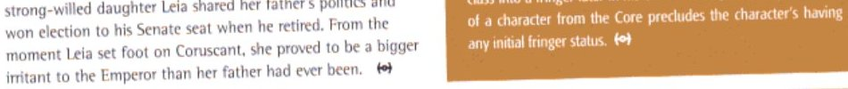

## scan p.18 (scan page 18)

Page contents: 856 words, 19 paragraphs | headings/entries: The Outer Rim | ic:; CHAPTER ONE; A NEW HOPE n> - J

## scan p.19 (scan page 19)

Page contents: 931 words, 27 paragraphs | headings/entries: Y crema,; IND ABiawHa; Tarkin and the New Order; Unknown to Thel or the Duros,; Se

- **Grand Moff Tarkin** — entry/section: Tarkin second only to the Emperor: "Although he spent little time on Coruscant, preferring to work from his Outer Rim home of Eriadu, Tarkin was nonetheless a powerful figure in the Emperor's court. In matters of philosophy and policy, only the Emperor's opinions carried more weight." Source: *Rebellion Era Sourcebook* (SWRPG d20), scan p.19
  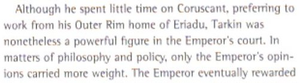
- **Grand Moff Tarkin; Darth Vader (Anakin Skywalker)** — entry/section: Tarkin's use of Vader: "He also kept the capabilities of Force-users keenly in mind, maintaining a close relationship with Darth Vader over the decades, and calling on the Dark Lord's services almost as frequently as the Emperor himself did." Source: *Rebellion Era Sourcebook* (SWRPG d20), scan p.19
  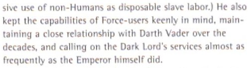

### Stat block notes (game mechanics, not feats)

- Grand Moff Tarkin: Noble 8/Soldier 1/Officer 6; VP/WP 68/11; Diplomacy +20, Intimidate +15; CC F (Source: *Rebellion Era Sourcebook* (SWRPG d20), scan p.19)
- Grand Moff Tarkin: Male Human, Nb! 8/Sol 1/Officer 6; Init +1 (+1 Dex); Def 20 (+9 class, +1 Dex}; Spd 10m; VP/WP 68/11; Atk +11/+6/+1 melee (1d3, unarmed), +12/+7/+2 ranged (3d4, hold-out blaster}; SQ Bonus class skill (Gather Information), call in a favor (x5), inspire confidence (+2), command (+4), leadership, requisition supplies, tactics; SV Fort +7, Ref +8, Will +12; SZ M; F (Source: *Rebellion Era Sourcebook* (SWRPG d20), scan p.19)
- Wilhuff Tarkin: Nbl 8/Sol 1/Officer 6; Def 20; VP/WP 68/11; Diplomacy +20, Intimidate +15, Bluff +14; Rep 12; Challenge Code F (Source: *Rebellion Era Sourcebook* (SWRPG d20), scan p.19)

## scan p.20 (scan page 20)

Page contents: Death Star's final test upon completion was the destruction of Horuz (penal system); Tarkin believed it 'invincible'; Bevel Lemelisk Expert 12 (hand-read)

- **Grand Moff Tarkin** — entry/section: Tarkin Doctrine (Rebellion Era Sourcebook, Ch1): "He believed that the fully functional battle station was invincible—the ultimate, impervious pinnacle of military technology." Source: *Rebellion Era Sourcebook* (SWRPG d20), scan p.20
  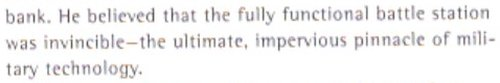

## scan p.21 (scan page 21)

Page contents: 686 words, 22 paragraphs | headings/entries: Tame; SNO HGiawHo; MAN V; Sacdqd0H; EOE—E—E——————————

## scan p.22 (scan page 22)

Page contents: 869 words, 45 paragraphs | headings/entries: Equipment: Slugthrower rifle, desert robes,; Natives of Tatooine |i: °; Ver'; TER CINE; HOPE; CMAPF; LA/ v; NE; A

## scan p.23 (scan page 23)

Page contents: Jabba has held his position as reigning Tatooine crime lord 'since well before the Clone Wars' (hand-read)

## scan p.24 (scan page 24)

Page contents: 534 words, 69 paragraphs | headings/entries: E istey, see; Species: Initiative: Defense: Speed: vP/wP Attacks:; Damage:; Special Qualities: Saves:; Skills; Feats:; Equipment; Info Broker (Diplomat 2) Any; Hold-out blaster 3d4 None; F=-2,R-1,W+3; A; Str 7, Dex 9, Con 6,; Weapon Group Proficiency (simple weapons); Hold-out blaster, comlink, datapad; Generic Spaceport Denizens; Spacer (Expert 4) Any; Punch +3 melee Blaster -1 ranged; Punch 1d3 Blaster 3d6 None F+1,R+1,W+3 B; Str 10, Dex 11, Con TT,; Spacer, Weapon Proficiency (simple weapons); Blaster, tool kit, comlink, datapad, medpac; Law Enforcer (Soldier 2) Any; None; F+3,R+2,W-1; B; Blast vest, blaster, vibrodagger, macrobinoculars, binders

## scan p.25 (scan page 25)

Page contents: Tionne's journal (multi-column, no clean crop): 'It does seem curious, however, that the Emperor or Darth Vader could have easily located Luke Skywalker had either chosen to go searching for him.' (hand-read)

## scan p.26 (scan page 26)

Page contents: 684 words, 46 paragraphs | headings/entries: The Last Voyage of Jantive /V; Once the ship was inside the blockade

## scan p.27 (scan page 27)

Page contents: 676 words, 12 paragraphs | headings/entries: Y rreeen. {<3

- **Jun Seros**: "Unknown to most situations where they can't help but of the inhabitants of Mos Eisley and deal with the Empire's representatives the surrounding countryside, a Star Destroyer has arrived in the system, Diner of Uespair hot on the tail of Tantive IV, Once the One day, while the heroes share a = Rebel ship has been thoroughly meal and visit with Jun Seros, unex ( (8) searched, the only possible place for pected visitors barge into the diner." Source: *Rebellion Era Sourcebook* (SWRPG d20), scan p.27
  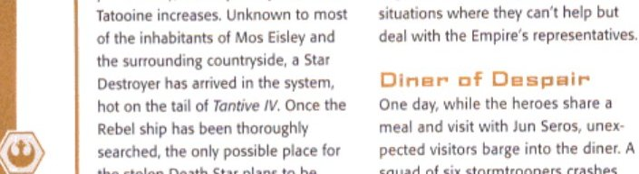

## scan p.28 (scan page 28)

Page contents: 774 words, 61 paragraphs | headings/entries: Common Droids ey,; Cybot Galactica models being most common. These; St: Computer Use +7,; Demol; Power droids are literally walking batteries,; Emphasis (tied to the skill programmed into

## scan p.29 (scan page 29)

Page contents: 615 words, 29 paragraphs | headings/entries: Initiative: Defense: Speed: VP/WP Attacks:; Abilities:; Skills:; Feats:; Equipmen; AN; At sc Seros them ir

## scan p.30 (scan page 30)

Page contents: Generic Stormtroopers Thug 4/8/12: 'Immune to bribes, blackmail, seduction, and routing'; storm commandos (Thug1/Sol7) reflec armor makes wearer 'virtually invisible' to most sensors; suspected of sabotaging Mon Cal hauler Blue Wave (hand-read)

## scan p.31 (scan page 31)

Page contents: 598 words, 65 paragraphs | headings/entries: The basic stormtrooper yuamMented Dy a \; Built-in sound baffling allow; Daltarra, it was; Initiative: Defense: Speed: VP/WwP Attacks:; Skills:; Feats:; Equipmen

## scan p.32 (scan page 32)

Page contents: 610 words, 78 paragraphs | headings/entries: Special Qualities; Abilities; Skills:; Feats:; Equipment:; Assault Trooper Thug 1/Soldier 3; Defense: 19 (+9 armor); Speed: 6m; VP/WP 20/14; Damage: Punch 1d3+1; Blaster rifle 3d8/19-20; Str 12, Dex 12, Con 11,; Int 10, Wis 10, Cha 10; Specialized Stormtroopers; Zero-g Space Trooper Thug 1/Soldier 5; Blaster cannon 4d8/19-20; F+6,R +2,W +1; D; Str 12, Dex 13, Con 10,; Hi ¢; Storm Commando; Thug 1/Soldier 7; Punch +9/+4 melee; Blaster carbine +9/+4 ranged Punch 1d6+1; Blaster carbine 3d8/19-20; F +7,R +3, W +2; E; Str 12, Dex 12, Con 12,; Knowledge (astronomy) +10, Pilot +8,

## scan p.33 (scan page 33)

Page contents: 894 words, 31 paragraphs | headings/entries: Unspent Skill Points: 0; Feats: Alertness, Track; Making Contact on IToOomMe; At this point, the heroes are probably; LE

## scan p.34 (scan page 34)

Page contents: 596 words, 30 paragraphs | headings/entries: Dposed; CHAPTER ONE

## scan p.35 (scan page 35)

Page contents: Vader's dark armor = padded battle armor 'imbued with dark side power', DR 10; without helmet loses 1 Con/round; without armor Str and Con -4 (hand-read)

- **Darth Vader (Anakin Skywalker)** — entry/section: Vader held everyone his inferior: "He refused to suffer incompetence, laziness, or disrespect from his inferiors. Indeed, with few exceptions, Vader believed that everyone was his inferior." Source: *Rebellion Era Sourcebook* (SWRPG d20), scan p.35
  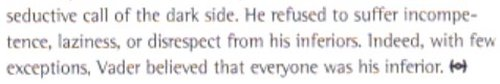
- **Obi-Wan Kenobi**: "Sometime on his climb to mastery of the Force, he failed to heed the teachings of his master, Obi-Wan Kenobi, and he succumbed to his fear and anger." Source: *Rebellion Era Sourcebook* (SWRPG d20), scan p.35
  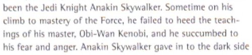

## scan p.36 (scan page 36)

Page contents: 879 words, 30 paragraphs | headings/entries: Note to Gamemasters; When the heroes dock with the; CHAPTER ONE; A NEW HOPE ||]

- **Darth Vader (Anakin Skywalker); Palpatine (Darth Sidious)** — entry/section: Darth Vader: Dark Lord of the Sith (Rebellion Era Sourcebook, Ch1): "In time, he became the personification of fear and evil that the Emperor used to rule the galaxy." Source: *Rebellion Era Sourcebook* (SWRPG d20), scan p.36
  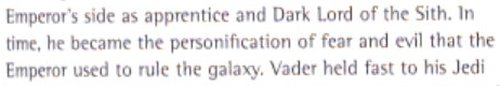
- **Darth Vader (Anakin Skywalker)** — entry/section: Darth Vader: The Last Jedi: "He also embraced the Sith teachings passed on to him by the Emperor, earning the title of Dark Lord through deeds and mastery, by utilizing the deep well of anger within him." Source: *Rebellion Era Sourcebook* (SWRPG d20), scan p.36
  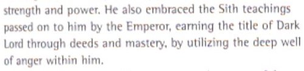
- **Darth Vader (Anakin Skywalker)** — entry/section: Darth Vader: The Last Jedi: "Vader took command of the Star Destroyer Devastator and a small! task force and went to retrieve the stolen plans." Source: *Rebellion Era Sourcebook* (SWRPG d20), scan p.36
  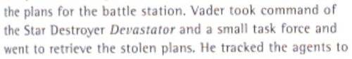

### Stat block notes (game mechanics, not feats)

- Darth Vader (Rebellion era): Fringer 1/Jedi Guardian 11/Sith Lord 6; VP/WP 122/17; Def 19; Atk +17/+12/+7/+2 melee (6d8+3/19-20 lightsaber); DR 10 (dark armor); Fort +17 Ref +15 Will +11; FP 10, DSP 16, Rep 10; Str 16 Dex 16 Con 17 Int 17; CC H; Force skills Affect Mind +8, Battlemind +11, Enhance Ability +13, Farseeing +6, Force Defense +13, Force Grip +15, Force Push +7, Move Object +20, See Force +13, Telepathy +14 (Source: *Rebellion Era Sourcebook* (SWRPG d20), scan p.36)
- Darth Vader: Rebellion Era SB: Fringer 1/Jedi Guardian 11/Sith Lord 6; VP/WP 122/17; Def 19; lightsaber +17/+12/+7/+2 (6d8+3, 19-20); DR 10 (dark armor); FP 10, DSP 16; Challenge Code H; Move Object +20, Force Grip +15, Telepathy +14, Enhance Ability +13, Force Defense +13, See Force +13, Battlemind +11; feats incl. Force Whirlwind, Rage, Burst of Speed, Knight Defense, Lightsaber Defense, Deflect Blasters; GM note: more 'holistic' than core-rulebook stats, using Dark Side Sourcebook material (Source: *Rebellion Era Sourcebook* (SWRPG d20), scan p.36)

## scan p.37 (scan page 37)

Page contents: Purge: 'How many Jedi survived the terrible Jedi Purge? Very few.' Empire hunted Force-users and destroyed, imprisoned, or turned them (hand-read)

## scan p.38 (scan page 38)

Page contents: 500 words, 24 paragraphs | headings/entries: Jedi Teachers and Students |\1r: >; ONE; APTER

## scan p.39 (scan page 39)

Page contents: 955 words, 36 paragraphs | headings/entries: P reap; MAN VW; IND ma; Luke Skywalker, Iradition's Heir; Force Feats: Alter, Control, Sense. ¢; Ben Ken young v told Luk; Path of the Jedi; Gruu Dunrik

- **Luke Skywalker; Obi-Wan Kenobi**: "When the droids R2-D2 and C-3P0 fell into possession of Owen Lars, destiny began to catch up with Luke, He discovered that the droids were on a mission for a beautiful young woman who sought the help of Obi-Wan Kenobi." Source: *Rebellion Era Sourcebook* (SWRPG d20), scan p.39
  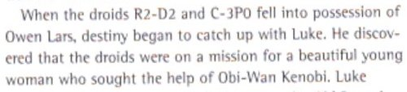

### Stat block notes (game mechanics, not feats)

- Luke Skywalker (end of Battle of Yavin): Fringer 2/Jedi Guardian 1; VP/WP 19/13; lightsaber -1 melee (2d8+1); Enhance Ability +3, Enhance Senses +2, See Force +2 (Source: *Rebellion Era Sourcebook* (SWRPG d20), scan p.39)
- Luke Skywalker: As of end of Battle of Yavin: Fringer 2/Jedi Guardian 1; VP/WP 19/13; Def 18; lightsaber -1 (2d8+1); Pilot +11; FP 5; uses Force Points as though three levels higher; Enhance Ability +3, Enhance Senses +2, See Force +2; Challenge Code B (Source: *Rebellion Era Sourcebook* (SWRPG d20), scan p.39)

## scan p.40 (scan page 40)

Page contents: Obi-Wan described Luke as 'the first of the new' Jedi Knights; Gruu Dunrik (failed Temple initiate) Jedi Guardian 1/Fringer 4 (hand-read)

- **Obi-Wan Kenobi; Luke Skywalker** — entry/section: Jedi heroes and Luke Skywalker sidebar (Rebellion Era Sourcebook): "Obi-Wan Kenobi described Luke Skywalker as “the first of the new” Jedi Knights," Source: *Rebellion Era Sourcebook* (SWRPG d20), scan p.40
  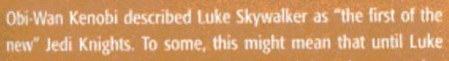

## scan p.41 (scan page 41)

Page contents: 913 words, 29 paragraphs | headings/entries: The garrison commanders were placed under the; As the heroes go about their; Why Disband the Senate?

## scan p.42 (scan page 42)

Page contents: Death Star I: 120 km diameter; >10,000 turbolasers, >700 tractor beams, 7,200 TIE fighters; superlaser focuses eight laser arrays 'with the intensity of a star's core', 'capable of blasting a planet into billions of asteroids with a single shot'; Tagge: land full troop complement in 30 minutes and subjugate any world within the following hour (hand-read)

- **Grand Moff Tarkin**: "Thanks to the twisted genius of Grand Moff Tarkin's -_- . think tank, the Death Star could be used to destroy any r 1¢ Death Star was created to be the ultimate too! of : es vorld that would not bend to Imperial might. ¢ conquest and subjugation, The original Death Star was the largest mobile space station ever built." Source: *Rebellion Era Sourcebook* (SWRPG d20), scan p.42
  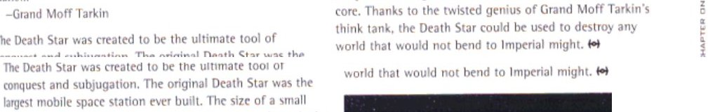

## scan p.43 (scan page 43)

Page contents: Destruction of Alderaan 'the single most pivotal event in the history of the Rebellion, eclipsing even the eventual demise of Emperor Palpatine himself' (hand-read)

- **Grand Moff Tarkin**: "The Death Star was designed to destroy planets, Most Imperial strategists assumed that the threat the battle station posed would be deterrent enough for most worlds and their populations, but Grand Moff Tarkin believed that the Rebellion was growing too audacious, too bold, Tarkin convinced the Emperor that the best course of action would be to demonstrate the full power of the Death Star by eliminating a Rebel target." Source: *Rebellion Era Sourcebook* (SWRPG d20), scan p.43
  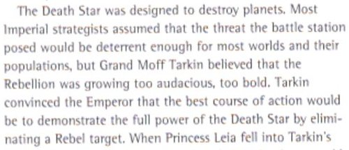
- **Leia Organa Solo; Grand Moff Tarkin**: "When Princess Leia fell into Tarkin's hands, the Grand Moff threatened to destroy her homeworld unless she revealed the location of the main Rebel base." Source: *Rebellion Era Sourcebook* (SWRPG d20), scan p.43
  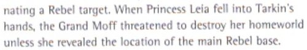

## scan p.44 (scan page 44)

Page contents: 624 words, 21 paragraphs | headings/entries: Death Star Trooper; Blaster pistol 346; Death star Personnel; Death Star Gunner; Blaster pistol 346; Death Star Officer; Blaster pistol 346; IK:

## scan p.45 (scan page 45)

Page contents: Death Star sidebar: 'more firepower than a hundred Star Destroyers', can shatter planets and capital ships with one shot; vent shaft Defense 25, needs a critical hit; 'Luke Skywalker spent a Force Point to make the shot, scoring the critical hit that destroyed the battle station.' (hand-read)

- **Luke Skywalker** — entry/section: The Death Star (Rebellion Era Sourcebook): "Luke Skywalker spent a Force Point to make the shot, scoring the critical hit that destroyed the battle station." Source: *Rebellion Era Sourcebook* (SWRPG d20), scan p.45
  

## scan p.46 (scan page 46)

Page contents: Imperial-class Star Destroyer 1,600 m, 9,700 stormtroopers, 72 TIEs; Victory-class still defending systems 'as late as the Yuuzhan Vong invasion' (hand-read)

- **Leia Organa Solo**: "An Imperial Star Destroyer chased Princess Leia's Tantive lV to the Tatooine system, eventually damaging its engines and capturing it with tractor beams." Source: *Rebellion Era Sourcebook* (SWRPG d20), scan p.46
  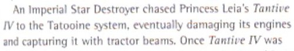

## scan p.47 (scan page 47)

Page contents: 504 words, 12 paragraphs | headings/entries: Ms Sr QQ So oe U m

## scan p.48 (scan page 48)

Page contents: X-wings deployed with such skill 'that the Empire believed a massive shipyard was producing them'; reputation grew 'to mythic proportions among Imperial commanders' (hand-read)

## scan p.49 (scan page 49)

Page contents: Kilian Rangers: Force-adept tradition of Kilia IV (Unknown Regions); Squire at FA 1, Ranger at FA 7, Lord at FA 13; never more than five; shield gauntlets parry/deflect blasters like lightsabers (Ranger/Lord Defense = Knight/Master Defense); siang lance Force-empowered at FA 5; Dark Rangers lead the Renegades (hand-read)

## scan p.50 (scan page 50)

Page contents: 885 words, 35 paragraphs | headings/entries: Kilian Ranger Feats; Kilian Ranger = Same as Jedi; Feat Feat*; Shield Gauntlet —_ Lightsaber Defense Defense; Knight Defense; Kilian Devices; Marker Ring; Siang Lance; Shield Gauntlets; Using Kilia in Your Campaign; ONE; HOPE; CHAPTER; NEW; SY

## scan p.51 (scan page 51)

Page contents: 983 words, 26 paragraphs | headings/entries: JNO H3idvVHo; Just Visiting; House vs. House; Thi

## scan p.52 (scan page 52)

Page contents: Kilia: Vareen Kol (Kilian Ranger, Noble 1/Force Adept 7, VP/WP 41/12) and Zandarun Toril (Dark Ranger, FA 8, VP/WP 44/12, DSP 14, Fear +10, Force Grip +8); Imperial one-shot TIE hyperdrive experiments all failed (hand-read)

## scan p.53 (scan page 53)

Page contents: TIE pilot corps 'the true elite of the Empire's military'; training nearly twice as long as other Imperial pilots; most Death Star gunnery chiefs were TIE-program washouts; Soontir Fel named among notable TIE aces; typical TIE pilot Soldier 2, Pilot +10 (hand-read)

## scan p.54 (scan page 54)

Page contents: 758 words, 21 paragraphs | headings/entries: Surge, roup; CHAPTER ONE

## scan p.55 (scan page 55)

Page contents: Yavin: Luke 'fired the shot that was heard around the galaxy'; Luke and Wedge used Yavin celebrity to form elite semi-independent X-wing units; Rogue Squadron 'the most famous' (hand-read)

## scan p.56 (scan page 56)

Page contents: After Yavin: Dentaal expelled its governor; a 'mysterious outbreak of the dreaded Candorian plague' made it a lifeless wasteland within two weeks; Crix Madine, leader of the Storm Commandos, defects (hand-read)

## scan p.57 (scan page 57)

Page contents: 905 words, 38 paragraphs | headings/entries: Kasei; Equip; Feats Sensitiv (Knowle (blaster; Equi Millenn; Skills +5, Dip; Intimid:

- **Luke Skywalker** — entry/section: Luke's legend after Yavin: "He destroyed the Death Star. He took it out with one shot, and he didn't even use his targeting computer!" Source: *Rebellion Era Sourcebook* (SWRPG d20), scan p.57
  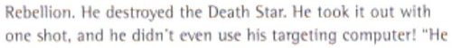
- **Darth Vader (Anakin Skywalker); Luke Skywalker**: "Though it took him a while to make a decision, in the end Solo intervened in time to force Darth Vader's TIE fighter to break off its attack on Luke's X-wing, granting young Skywalker the breathing room needed to fire the proton torpedo that destroyed the Death Star battle station." Source: *Rebellion Era Sourcebook* (SWRPG d20), scan p.57
  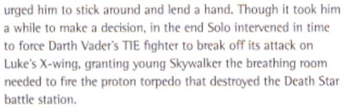
- **Darth Vader (Anakin Skywalker)**: "Before she could deliver those plans to the Rebel Alliance, an Imperia Star Destroyer under the command of Lord Darth Vader intercepted her ship near the desert planet of Tatooine." Source: *Rebellion Era Sourcebook* (SWRPG d20), scan p.57
  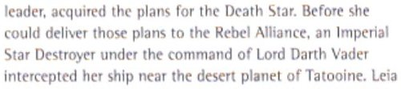
- **Grand Moff Tarkin**: "Grand Moff Tarkin finally convinced her to reveal the location of the Rebel base when he threatened to destroy her home planet of Alderaan." Source: *Rebellion Era Sourcebook* (SWRPG d20), scan p.57
  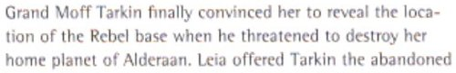
- **Han Solo; Chewbacca**: "Organa, Han Solo, Chewbacca, and the droids R2-D2 and C- 3PO, the Death Star was destroyed and the Alliance won its first major victory." Source: *Rebellion Era Sourcebook* (SWRPG d20), scan p.57
  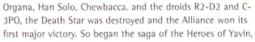

## scan p.58 (scan page 58)

Page contents: 517 words, 33 paragraphs | headings/entries: Star and wuld be; Intimidate +6, Knowledge (Corellia) +5, Knowledge; THK:; Lé; Equipment: Bowcaster, ammo bandolier, comlink,; Proficiencies (blaster pistols, blaster rifles, simple weapons),

### Stat block notes (game mechanics, not feats)

- Han Solo / Chewbacca (end of Battle of Yavin): Han Scoundrel 6/Soldier 2, heavy blaster +8/+3 (3d8), Pilot +15, CC D; Chewbacca Scout 6. Later blocks: p.114 Han Scoundrel 7/Soldier 2, Chewbacca Scout 8, Leia Noble 5/Soldier 2; p.152-153 Leia Noble 6/Soldier 2, Han Scoundrel 8/Soldier 2 (Source: *Rebellion Era Sourcebook* (SWRPG d20), scan p.58)
- Chewbacca (end of Battle of Yavin): (as of the end of the Battle of Yavin): Male Human Scoundrel 6/Soldier 2; Init +2; Defense 19 (+7 class, punch) or +8/+3 ranged (3d8, heavy blaster pistol); SQ Illicit barter, better lucky than good, sneak attack +2d6; SV Fort +6, Ref +7, Will +3; SZ M; FP 3; DSP 2; Rep 6; Str 13, Dex 14, Con 13, Int 13, Wis 12, Cha 15, Challenge Code: D, Equipment: Heavy blaster pistol, comlink, tools, Millenniu (Source: *Rebellion Era Sourcebook* (SWRPG d20), scan p.58)
- Leia Organa: As of end of Yavin: Noble 3/Soldier 2; VP/WP 25/13; Def 15; Diplomacy +11; FP use as though three levels higher; Force-Sensitive; FP 3; Challenge Code C (Source: *Rebellion Era Sourcebook* (SWRPG d20), scan p.58)
- Han Solo: As of end of Yavin: Scoundrel 6/Soldier 2; VP/WP 52/13; Def 19; heavy blaster +8/+3 (3d8); Pilot +15; better lucky than good, sneak attack +2d6; Starship Dodge (space transports); Challenge Code D (Source: *Rebellion Era Sourcebook* (SWRPG d20), scan p.58)
- Chewbacca: As of end of Yavin: Wookiee Scout 6; VP/WP 68/20; Str 20, Con 20; punch +9 (1d3+5); bowcaster 3d8; Wookiee rage; Challenge Code C (Source: *Rebellion Era Sourcebook* (SWRPG d20), scan p.58)

## scan p.59 (scan page 59)

Page contents: Emperor ordered attacks on anyone possibly aiding Rebels: 'Unruly crowds were obliterated. Spaceports were bombarded from above.' (hand-read)

- **Darth Vader (Anakin Skywalker)** — entry/section: Vader's fleet (Rebellion Era Sourcebook, Ch2): "Lord Darth Vader was placed in command of the mightiest task force ever assembled in recorded history, a fleet built around the new Super-class Star Destroyer Executor and charged with hunting down and exterminating the Rebel Alliance." Source: *Rebellion Era Sourcebook* (SWRPG d20), scan p.59
  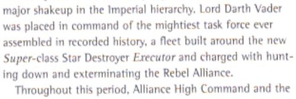

## scan p.60 (scan page 60)

Page contents: Mon Calamari defense fleet: 'the Empire has yet to gather the forces necessary to break through'; enslavement of Kashyyyk 'and its powerful Wookiees'; Alliance operational bases house 1,000-15,000 troops (hand-read)

