# Owner Material 037 — Star Wars D20 Drive folder (Core, Revised Core and Saga Edition): Sourcebooks/Rebellion Era Sourcebook.pdf [Star Wars Roleplaying Game (d20, 2000)] (scan pages 61–120)

- **Source:** Wizards of the Coast Star Wars Roleplaying Game books, web enhancements, Living Force campaign modules and articles (2000–2010), from the owner's "Star Wars D20" Drive folder (only the three edition subfolders; "General" was not read, as instructed). Secondary source (licensed Legends reference). Scan OCR'd on the box; the scan stays box-only and is **not** published.
- **Method:** every scanned page was OCR'd and machine-screened sentence by sentence for power-relevant statements (fights, kills, defeats, Force feats, rankings, superweapons) that name a character on our roster; each kept sentence is quoted verbatim from the OCR text and has a crop of the printed passage directly under it. Pages with nothing power-relevant are still listed with what is on them.
- **Citation:** "*Rebellion Era Sourcebook* (SWRPG d20), p.X" by printed page ("scan p.X" where no printed number applies). **Weight:** Licensed RPG material: a secondary source. Narrative text sums up Legends lore; game statistics are rules for players, not canon power levels, and rank lowest.

## scan p.61 (scan page 61)

Page contents: 682 words, 29 paragraphs | headings/entries: C; Allian The heart; Imperial

## scan p.62 (scan page 62)

Page contents: 525 words, 31 paragraphs | headings/entries: A typi; Alliance Command Center

## scan p.63 (scan page 63)

Page contents: 934 words, 25 paragraphs | headings/entries: OMu4 S#f1cdcvéea; THUY; Rebel Missions; Sabotage; Find Tigor Sims; Courier Mission

## scan p.64 (scan page 64)

Page contents: 606 words, 34 paragraphs | headings/entries: Own; Granus; Strike Team; MWY,; TNS,

## scan p.65 (scan page 65)

Page contents: 456 words, 26 paragraphs | headings/entries: Maicdw?

## scan p.66 (scan page 66)

Page contents: Cracken: 'Every blaster in our hands is a blaster that's not pointing at us.'; Ackbar views pirates as beneath contempt (hand-read)

### Stat block notes (game mechanics, not feats)

- Winter: Female Human Noble //Scout 2; Init +3; Defense 18 {+5 class, +3 Dex): Spd 10m; VP/WP 12/10: Atk +0 melee {td4-1, knife) or +4 ranged (3d4, hold-out blaster); SQ Bonus class skill (Gather Information), call in a favor, perfect memory, trailblazing; SV Fort +2, Ref +6, Will +5: SZ M; FP 2; DSP O; Rep 4; Str 9, Dex 16, Con 10, Int 16, Wis 12, Cl 6. Challenge C (Source: *Rebellion Era Sourcebook* (SWRPG d20), scan p.66)
- Winter: Noble 1/Scout 2; VP/WP 12/10; perfect memory; Imperial codename 'Targeter', on the Empire's most-wanted list (Source: *Rebellion Era Sourcebook* (SWRPG d20), scan p.66)

## scan p.67 (scan page 67)

Page contents: Bounty Hunters' Wars (multi-column, no clean crop): 'At the urging of Prince Xizor, crime lord of the Black Sun syndicate, and over Vader's objections, the Emperor approves a plan to destroy the Bounty Hunters' Guild. The Empire hires the infamous Boba Fett to serve as the agent of the Guild's destruction.' (hand-read)

## scan p.68 (scan page 68)

Page contents: 922 words, 54 paragraphs | headings/entries: Bureau,; The Ambush; WKS; Defense 17 (+2 Dex, +5 class);; Equipment; Blaster rifle, comlink,; Feats: Power Attack, Toughness, Track, Weapon Group; APTER TwO; I]| A DARK TIME; AMA

### Stat block notes (game mechanics, not feats)

- Jodo Kast: Soldier 6/Bounty Hunter 2; VP/WP 62/16; Def 20; blaster rifle +12/+7; Challenge Code E; armor modeled on Boba Fett's, often mistaken for him; Zardra Scout 4/Soldier 2 (VP/WP 38/11); Roweedu & Krussk Challenge Code B (Source: *Rebellion Era Sourcebook* (SWRPG d20), scan p.68)

## scan p.69 (scan page 69)

Page contents: Crix Madine under an Imperial deathmark: 'a genius when it comes to tactics and intelligence work', specialty ground engagements (hand-read)

## scan p.70 (scan page 70)

Page contents: 485 words, 25 paragraphs | headings/entries: Empire's most wanted list is that; Equipment: Vibrodagger, heavy blaster pistol, comlink, datapad; J; R Two; I]| A DARK TIME; MIP; UNIWWS

### Stat block notes (game mechanics, not feats)

- Hogun Rath: Former Guild leader; Scoundrel 8/Bounty Hunter 3; VP/WP 52/10; Def 22; sneak attack +3d6; Move Silently +13; Challenge Code E; 'a legend in the bounty hunter community'; used by the Emperor for assassinations and kidnappings in early Empire (Source: *Rebellion Era Sourcebook* (SWRPG d20), scan p.70)

## scan p.71 (scan page 71)

Page contents: HoloNet: break-in requires Computer Use DC 40 outside a Sector Plexus; Alliance hijacked a Sector Plexus drone ship to spread the truth of Alderaan's destruction (hand-read)

## scan p.72 (scan page 72)

Page contents: 691 words, 90 paragraphs | headings/entries: AN; The Graveyard of Alderaan 11K:; Howed; Perhaps the most captivating rumors; Ret; In some tales, lisappears as; A survivor of Alderaan, Lt. Falto Dragen; The heroes should be able to deal; Dragen has a small guard of four; IH) A DARK TIME ||]

## scan p.73 (scan page 73)

Page contents: COMPNOR / ISB; ISB agent Mar Barezz Soldier 4 (hand-read)

## scan p.74 (scan page 74)

Page contents: Imperial Intelligence: Ubiqtorate; Adjustments 'the most elite branch', agents 'accomplish the impossible'; IntSec officer Ara Garren Soldier 3/Noble 2 (hand-read)

## scan p.75 (scan page 75)

Page contents: Blackhole's specialty was fear (column OCR, no crop): 'Unlike the Emperor's agents who specialized in using the Force for martial prowess, Blackhole's specialty was fear. Paranoia is what fueled Blackhole's power.' (hand-read)

- **Blackhole (Emperor's Hand); Palpatine (Darth Sidious)** — entry/section: Blackhole's divination unrivaled: "Blackhole's talents for divination were unrivaled. Originally one of the Prophets of the Dark Side, his unerring visions impressed Palpatine. Too powerful to be ignored, Blackhole was moved from the Prophets to head of Imperial Intelligence." Source: *Rebellion Era Sourcebook* (SWRPG d20), scan p.75
  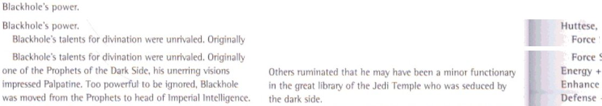

## scan p.76 (scan page 76)

Page contents: 645 words, 58 paragraphs | headings/entries: Blackhole; Intelligence fell under the capable stewardship; Blackhole: Male; Stygian-tr; Computer Use; Disq se +5 wmation +7,; Write Basic, Sense Motive +10,; Ks; Il| A DARK TIME ||]; A\\\ t Wy; TIS

### Stat block notes (game mechanics, not feats)

- Blackhole: Emperor's Hand, ex-Prophet of the Dark Side, head of Imperial Intelligence: Force Adept 5/Dark Side Devotee 7/Emperor's Hand 3; Def 24; DR 5; DSP 28; FP 3; Challenge Code E; Fear +20, Control Mind +19, Drain Knowledge +19, Drain Emotionary Energy +15, Illusion +14, Farseeing +12, Enhance Senses +12, Force Defense +12, Affect Mind +11, See Force +10, Force Grip +8; feats incl. Force Mastery, High Force Mastery, Hatred, Frightful Presence; unprecedented control over the entire HoloNet; command ISD Singularity (stygian-triprismatic coating); disappeared during the GCW, Intelligence then under Ysanne Isard (Source: *Rebellion Era Sourcebook* (SWRPG d20), scan p.76)

## scan p.77 (scan page 77)

Page contents: Corporate Sector Authority charter grants 'absolute power to control and utilize the sector'; eleven enslaved sentient species kept secret (hand-read)

## scan p.78 (scan page 78)

Page contents: 789 words, 42 paragraphs | headings/entries: Diplo Knowl ad/Write; Toes; Working for the CSA \um:-; Feats: Armor Proficiencies (light, medium), Toughness, Weapon; Group Proficiencies (blaster pistols, simple weapons). (4; Sabotage; Any of the factory worlds located; R; Ww ve y ir < a) <; AMZ; CAA; Empire, but even a short delay in

## scan p.79 (scan page 79)

Page contents: Maw Installation established by Tarkin, 'kept hidden even from the Emperor'; Kessel Run in 12 parsecs (like Han Solo did) = Astrogate DC 21 then Pilot DC 25+; Renn Volz (Ion Ring wrecked Rion's environment) (hand-read)

## scan p.80 (scan page 80)

Page contents: 707 words, 61 paragraphs | headings/entries: Pilot e the; Among Volz's most remarkable Subspace; Equipment: Datapac; Maw Installation; Inventions of Renn Volz |i:; Skills: Astrogate +8, Disable Dev; Weapon Group Proficiency (simple weapons; I]|| A DARK TIME; MW,; ULLIWS

## scan p.81 (scan page 81)

Page contents: 663 words, 45 paragraphs | headings/entries: J; C; Emperor's Hands his persona; I]! awit suva vii]; He can't u'; The Ir

- **Mara Jade Skywalker; Palpatine (Darth Sidious)** — entry/section: Emperor's Hand (Rebellion Era Sourcebook): "One such Hand is Mara Jade, a beautiful young woman with red-gold hair who looks more like a dancer or @ courte taxes on H san than a highly skilled agent." Source: *Rebellion Era Sourcebook* (SWRPG d20), scan p.81
  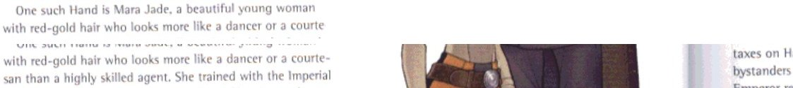

### Stat block notes (game mechanics, not feats)

- Mara Jade: Emperor's Hand (GCW): Scoundrel 6; VP/WP 42/15; Def 19; vibroblade +5 (2d6+1); sneak attack +2d6; receives Emperor's telepathic commands and draws strength from his well of dark side power; trained with the Imperial Royal Guard (Source: *Rebellion Era Sourcebook* (SWRPG d20), scan p.81)

## scan p.82 (scan page 82)

Page contents: Vess Kogo, Emperor's Hand (Scoundrel 4/Force Adept 2, VP/WP 24/12): 'he has the potential to surpass her [Mara Jade] in almost all areas'; Emperor 'turned Kogo into a killing machine'; Inquisitors 'have rarely failed to produce the desired results' (hand-read)

- **Antinnis Tremayne** — entry/section: Inquisitors (Rebellion Era Sourcebook): "One of the HAP most powerful and respected Inquisitors is High Inquisitor Tremayne, but an up-and-coming lower-ranked Inquisitor is the subtle and ruthless Drayneen." Source: *Rebellion Era Sourcebook* (SWRPG d20), scan p.82
  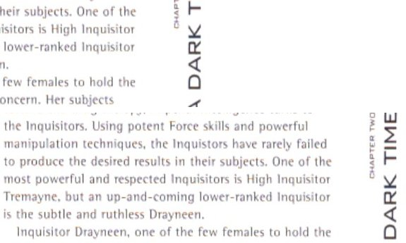

### Stat block notes (game mechanics, not feats)

- Inquisitor Drayneen (non-canon NPC): Force Adept 8 — Inquisitor stat example (Source: *Rebellion Era Sourcebook* (SWRPG d20), scan p.82)

## scan p.83 (scan page 83)

Page contents: Prophets of the Dark Side led by Supreme Prophet Kadann; 'few members among the Imperial hierarchy have any inclination that the Emperor is a powerful Force-user'; rumor Vader once studied at the Bosthirda dark side temple; Argor (Lesser Prophet, FA 4, DSP 12); Inquisitor Drayneen FA 8; High Inquisitor Tremayne 'one of the most powerful and respected Inquisitors' (hand-read)

## scan p.84 (scan page 84)

Page contents: 615 words, 35 paragraphs | headings/entries: Ks; I]| A DARK TIME; Tw; Equipment: Scrying cube, dark side talisman ]; WY; Feats: Alertness, Force-Sensitive, Quickness, Stealthy,; Force Feats: Alter, Control, Sense

## scan p.85 (scan page 85)

Page contents: Kaiburr Crystal: holds 5 Force Points giving +5d6 on Force skill checks for a round; as a lightsaber crystal +2 attack and damage (hand-read)

## scan p.86 (scan page 86)

Page contents: Charon (extragalactic death cult) Void Stone dampens Force users in its caverns; Charon could become 'an invading force that might be impossible to stop' (hand-read)

## scan p.87 (scan page 87)

Page contents: Scouring the Galaxy: 'Tens of thousands of probe droids' search for the Rebel base; Vader pushes his fleet 'night and day'; Imperial atrocities at Sarko VI,Star Palace, Ruisto Mon Cal colony (no survivors), Terrina Square massacre on Quellor (hand-read)

## scan p.88 (scan page 88)

Page contents: 440 words, 25 paragraphs | headings/entries: Hoth |v:; Hoth Asteroid Belt; Wi; THE EMPIRE STRIKES BACK

## scan p.89 (scan page 89)

Page contents: 719 words, 59 paragraphs | headings/entries: Q; Ili xOvVea SSWYLS BYIdWS 3H1|I; Alliance High; Wher Command fin; Some supporters wondered if it ever rea; Survey Mission; Ss meo; Empire did show up,; The |

## scan p.90 (scan page 90)

Page contents: Battle of Hoth: Vader's fleet found Echo Base via a probe droid; planetary shield prevented bombardment; 'the Alliance suffered a devastating defeat' which convinced it to strike all-or-nothing at Endor (hand-read)

## scan p.91 (scan page 91)

Page contents: 789 words, 79 paragraphs | headings/entries: Motive +13,; When the of Yavin,; S a; I|| yova SSWeLS 3YIdW3a SHL; Rieckan didn't truly believe that Grand Mof; He was wrong; Hoth its best de; SV Fort +6, Ref +7,; Nas this tactic; Rieekan put into upon assuming nq action; As soon as; Ss Torces; Rebels the use of their base! Alliance

### Stat block notes (game mechanics, not feats)

- General Carlist Rieekan: Noble 6/Officer 6; VP/WP 62/12; Def 19; Challenge Code D; Alderaanian who did not evacuate Alderaan because he 'didn't truly believe that Grand Moff Tarkin would really use the weapon' (Source: *Rebellion Era Sourcebook* (SWRPG d20), scan p.91)

## scan p.92 (scan page 92)

Page contents: 695 words, 48 paragraphs | headings/entries: Veers deployed a squadron of AT-AT walkers; Hoth Adventures; Rep 8; Str 11, Dex; The heroes make up one of six; General Veers | 1K:; Equipment; Multichanne; Point Blank Shot, Weapon Group Proficiencies [blaster; ITER THREE; I]} THE EMPIRE STRIKES BACK; HAF; MMII/Z,

### Stat block notes (game mechanics, not feats)

- General Maximilian Veers: Noble 1/Soldier 4/Officer 5; VP/WP 60/12; Def 18; Challenge Code D; 'considered the officer responsible for the Imperial victory at Hoth'; 'could have destroyed Alliance High Command and crippled the Rebellion' (Source: *Rebellion Era Sourcebook* (SWRPG d20), scan p.92)

## scan p.93 (scan page 93)

Page contents: Vader loaded hundreds of probe droids onto his fleet; Viper probe droid stats; AT-AT: Colossal, Hull 180, DR 15, heavy laser cannons 6d10 (hand-read)

## scan p.94 (scan page 94)

Page contents: 677 words, 34 paragraphs | headings/entries: Hyper- 13 [+8 ield; AT-ATs (ni; Skills: Listen +2, Spot +2, Survival +9; Warmpa Hunt; Na'; CHAPTER THREE; I}} THE EMPIRE STRIKES BACK; ZA

## scan p.95 (scan page 95)

Page contents: Snowtroopers immune to bribes, blackmail, seduction, and routing (Thug 1/Soldier 3, VP/WP 20/10) (hand-read)

### Stat block notes (game mechanics, not feats)

- Wampa: Arctic predator 3; VP/WP 32/20; Str 22, Con 20; claw 1d6+6; Challenge Code C (Luke wounded by the one-armed wampa) (Source: *Rebellion Era Sourcebook* (SWRPG d20), scan p.95)

## scan p.96 (scan page 96)

Page contents: Rogue Group (Luke Skywalker and Wedge Antilles) felled a couple of walkers with tow cables; SpecForce Soldier 3, Rogue Group pilot Fringer 4 (hand-read)

## scan p.97 (scan page 97)

Page contents: Vader 'doesn't accept anything less than success, and he often asks that his commanders pay for a significant failure with their lives. Both Griff and Ozzel met their end through Vader's Force powers'; Emperor gave Vader the Super Star Destroyer Executor; Vader wonders if Luke Skywalker, 'strong in the Force', is his son; Fondor shipyards (hand-read)

- **Darth Vader (Anakin Skywalker)**: "Vader accepted tt ft and the mission that went along with it: Find the Rebels and destroy them." Source: *Rebellion Era Sourcebook* (SWRPG d20), scan p.97
  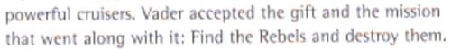

## scan p.98 (scan page 98)

Page contents: 710 words, 50 paragraphs | headings/entries: Lord Darth Vader; Admiral Piett; Admiral Piett: Male Human Soldier 4/Officer 2:; Equipment: Blaster pistol, datapad, code cylinder, comlink,; Captain Needa; Star Destroyer Officers; Destroyers might be the best at exhib; I]| THE EMPIRE STRIKES BACK ||]; Skills: Astro; Intimidation +7, Knowledge (Imperial Navy) +6, Knowledge

### Stat block notes (game mechanics, not feats)

- Admiral Piett: Soldier 4/Officer 2; Challenge Code C; 'never suffering the Dark Lord's wrath'; Captain Needa Diplomat 4/Soldier 2, CC B (Source: *Rebellion Era Sourcebook* (SWRPG d20), scan p.98)

## scan p.99 (scan page 99)

Page contents: Bounty hunters history: Jedi clashes ('someone almost always died') led the Senate to create self-policing guilds; Emperor publicly denounced but privately rewarded their destruction (hand-read)

- **Prince Xizor; Palpatine (Darth Sidious); Boba Fett** — entry/section: Xizor got the Guild disbanded; Fett engineered its downfall: "In an effort to end the threat of the bounty hunters, the leader of Black Sun, Prince Xizor of Falleen, convinced the Emperor to disenfranchise the Bounty Hunters' Guild. The Emperor contracted Boba Fett to engineer the downfall of the guild." Source: *Rebellion Era Sourcebook* (SWRPG d20), scan p.99
  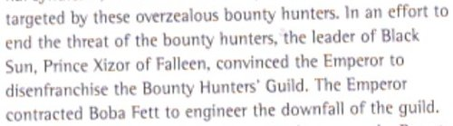

## scan p.100 (scan page 100)

Page contents: IG-88 (OCR '1G-88', no crop): 'Because of inadequate safety protocols, the programmers at Holowan were systematically slaughtered by their creations—a handful of unstoppable killing machines, led by the calculating and cunning IG-88. Since gaining his freedom, IG-88 has carried out his programming as an efficient killer. He answers to no one, making him an independent bounty hunter comparable in skill to Boba Fett.' (hand-read)

- **Boba Fett; Han Solo; Darth Vader (Anakin Skywalker)** — entry/section: Fett second-guessed Han Solo: "It was ultimately Boba Fett who second-guessed Han Solo and followed the Millennium Falcon to Bespin. Once he realized Solo's destination, he alerted Vader, and the Imperials arrived at Cloud City ahead of the Falcon." Source: *Rebellion Era Sourcebook* (SWRPG d20), scan p.100
  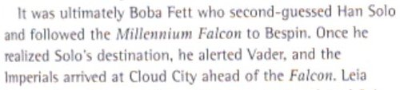
- **Bossk; Chewbacca** — entry/section: Bossk's feud with Chewbacca: "Bossk began his career hunting escaped Wookiee slaves and has a running feud with Han Solo's partner, Chewbacca. Though they have tangled multiple times, it is always Bossk who comes up short—short a limb, generally." Source: *Rebellion Era Sourcebook* (SWRPG d20), scan p.100
  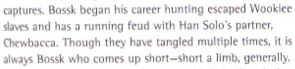
- **Darth Vader (Anakin Skywalker); Luke Skywalker** — entry/section: Vader called in professionals: "His own troops had failed over and over to capture his prey, so it was time to call in professionals—the same reasoning that allowed bounty hunters to thrive in the first place." Source: *Rebellion Era Sourcebook* (SWRPG d20), scan p.100
  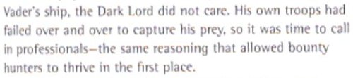

### Stat block notes (game mechanics, not feats)

- Bossk: Scout 4/Soldier 3/Bounty Hunter 4; VP/WP 94/16; Def 21; blaster rifle +13/+8 (3d8); CC D (Source: *Rebellion Era Sourcebook* (SWRPG d20), scan p.100)
- Bossk: Trandoshan Scout 4/Soldier 3/Bounty Hunter 4; VP/WP 94/16; Def 21; blaster rifle +13/+8 (3d8); uncanny dodge; Challenge Code D; eight live captures, four not-so-live (Source: *Rebellion Era Sourcebook* (SWRPG d20), scan p.100)
- IG-88: Scout 4/Soldier 6/Bounty Hunter 4; VP/WP 120/17; Def 19; +16/+11/+6 attacks; blaster cannon 4d8; uncanny dodge, sneak attack +2d6; Intimidate +14; Challenge Code E (Source: *Rebellion Era Sourcebook* (SWRPG d20), scan p.100)

## scan p.101 (scan page 101)

Page contents: Double Bounty letter (Calk Fen to Jabba): Han Solo has cost Jabba more than 1.3 million credits; 'I am betting on Boba Fett to bring him back to Tatooine' (hand-read)

- **Boba Fett** — entry/section: Most ruthless bounty hunter in the galaxy: "Known as the most ruthless bounty hunter in the galaxy, Boba Fett has completed an extraordinary number of successful missions." Source: *Rebellion Era Sourcebook* (SWRPG d20), scan p.101
  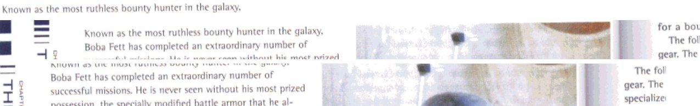
- **Han Solo; Boba Fett** — entry/section: The Double Bounty: Solo's toll on hunters: "In addition, Solo blasted your humble servant, Greedo, and has eluded or ended the careers of more bounty hunters than I care to list since he departed Tatooine with a false promise of paying what he owed with interest." Source: *Rebellion Era Sourcebook* (SWRPG d20), scan p.101
  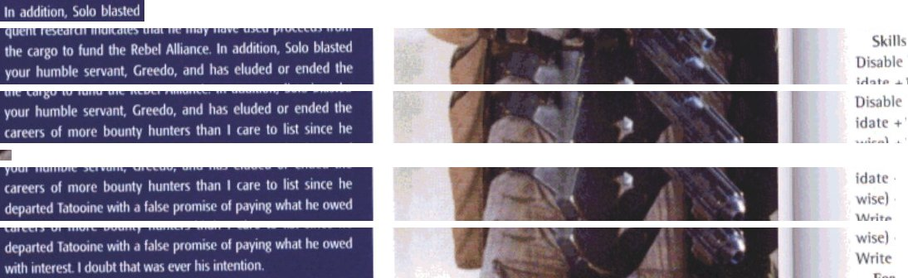

## scan p.102 (scan page 102)

Page contents: 602 words, 32 paragraphs | headings/entries: Slave !; AP TER THREE; CH; WW; THIS

### Stat block notes (game mechanics, not feats)

- Boba Fett: Soldier 6/Scoundrel 1/Bounty Hunter 6; VP/WP 100/15; Def 20; ranged +15/+10/+5; target bonus +3, sneak attack +3d6; Rep 10; Challenge Code E; Slave I: Hull 150, SP 90, blaster cannons +22 attack 5d10x2 (Source: *Rebellion Era Sourcebook* (SWRPG d20), scan p.102)

## scan p.103 (scan page 103)

Page contents: Han Solo escaped a Star Destroyer amid jettisoned rubbish 'though he didn't fool Boba Fett, who knew the trick as well' (hand-read)

- **Han Solo; Boba Fett**: "Han Solo escaped from an Imperial Star Destroyer amid the rubbish the ship cast off before its jump to hyperspace (though he didn't fool Boba Fett, who knew the trick as well)." Source: *Rebellion Era Sourcebook* (SWRPG d20), scan p.103
  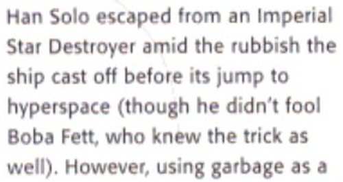

## scan p.104 (scan page 104)

Page contents: 968 words, 54 paragraphs | headings/entries: Is going; I fly; Flotsam and Jetsam |imK:-2°3; EP,; THREE; CHAPTER; A\\\ } UD; S \

## scan p.105 (scan page 105)

Page contents: Dark Trooper Project (General Rom Mohc): prototypes destroyed a Rebel base on Talay in 'a brutal massacre'; 'The Emperor and Darth Vader were impressed'; Phase Three (Soldier 8/Elite Trooper 4, VP/WP 96/19, CC E) only one made; project ended when Kyle Katarn destroyed Arc Hammer; phrik alloy (hand-read)

## scan p.106 (scan page 106)

Page contents: 835 words, 52 paragraphs | headings/entries: Dark Trooper Statistics |10K:; Feats: Ambidexterity, Armor Proficiencies (light, medium; Group Proficiencies (blaster pistols, blaster rifles, heavy; Proficiencies (blaster pistols, blaster rifles, heavy weapons,; Capture the Trooper; W DARK TROOPERS INHISTORY ©; Hammer; PTER THREE; HA; QW,; GHW

## scan p.107 (scan page 107)

Page contents: Dagobah: dark Jedi from Bpfassh perished there; cave strong in the dark side; Yoda 'Believed to have died during the early days of the Empire, Yoda actually went into hiding—perhaps taking advantage of the dark side energy on Dagobah to conceal his presence' (multi-column, no crop) (hand-read)

## scan p.108 (scan page 108)

Page contents: Finding a Jedi Master sidebar: non-Master teachers may cap students at 6th level Jedi consular/guardian (hand-read)

- **Yoda; Obi-Wan Kenobi; Luke Skywalker** — entry/section: Only Yoda remains: "The Emperor's purge of the Jedi Order left only a handful of Jedi alive. Of the Jedi Masters who once instructed the young Padawans in the Order, only Yoda remains. Obi-Wan Kenobi is the only one who knows where Yoda hides, and he shares that information with Luke Skywalker through a Force-induced vision." Source: *Rebellion Era Sourcebook* (SWRPG d20), scan p.108
  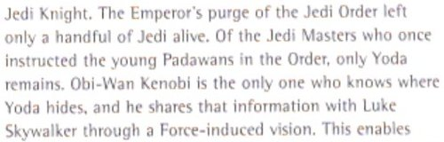

### Stat block notes (game mechanics, not feats)

- Qid Proko: Quarren purge survivor: Jedi Consular 8/Fringer 3; VP/WP 48/11; Def 19; lightsaber 3d8; Challenge Code D (Source: *Rebellion Era Sourcebook* (SWRPG d20), scan p.108)

## scan p.109 (scan page 109)

Page contents: 689 words, 25 paragraphs | headings/entries: The Planet Bespin; Native Life; Tibannopolis; Thot

## scan p.110 (scan page 110)

Page contents: Cloud City: Lando Calrissian won Baron Administrator 'in a game of sabacc'; reorganized the corrupt Wing Guard; strict neutrality; Bespin Tibanna is spin-sealed, four times normal energy output; ~6 million residents (hand-read)

## scan p.111 (scan page 111)

Page contents: 839 words, 35 paragraphs | headings/entries: BINH; Cloud City Adventures; Old Friend; Whatever the heroes do to get; Cor Pre act

## scan p.112 (scan page 112)

Page contents: Lt. Falto Dragen Noble 4/Soldier 4 VP/WP 55/12 CC D; Moff Elior sabacc with Lando, Corugg the Hutt, Queen Sula (hand-read)

## scan p.113 (scan page 113)

Page contents: Heroes of Yavin update: Yoda taught Luke 'in only a few weeks what the Jedi of the past learned over the course of many years'; Luke 'fought surprisingly well' against Vader on Cloud City; Falcon 'one of the fastest and most powerful ships of its size in the Rebel arsenal' (hand-read)

- **Luke Skywalker; Boba Fett; Darth Vader (Anakin Skywalker)**: "Luke would spend some time , ' +3, Far ' Boba Fett. one of the bounty hunters employed by Darth : in a bacta tank to heal his wounds, but he had survived. s nae : Force + vader t help find the Falcon, tracked So to Cloud City i The Empire, meanwhile, had discovered the location of the Feat : and alerted Vader and his troops { base." Source: *Rebellion Era Sourcebook* (SWRPG d20), scan p.113
  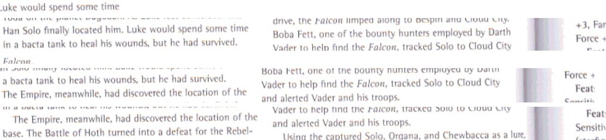

## scan p.114 (scan page 114)

Page contents: 932 words, 42 paragraphs | headings/entries: Equipment: Blaster pistol, comlink, datapad, C-3P0,; CHAPTE; I}} THE EMPIRE STRIKES BACK; Pi "J; VAT); Equipment: Bowcaster, ammo bandoleer, comlink, too pouch

- **Luke Skywalker**: "Luke learned of his dark heritage, and the Alliance was reeling from its most devastating defeat of the war." Source: *Rebellion Era Sourcebook* (SWRPG d20), scan p.114
  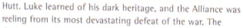

### Stat block notes (game mechanics, not feats)

- Luke Skywalker (escape from Cloud City): Fringer 2/Jedi Guardian 5; VP/WP 56/13; Def 21; lightsaber +8/+3 (3d8+2 per OCR "J08+2"); FP 2 DSP 1; CC D (Source: *Rebellion Era Sourcebook* (SWRPG d20), scan p.114)
- Leia Organa (escape from Cloud City): (as of the escape from Cloud City): Male Human Fringer 2/Jedi Guardian 5: Init « 3; Defense 21 (+8 class, +3 Dex); Spd 10m; VP/WP 56/13: Atk +8/+3 melee (J08+2/19~20, lightsaber) or +9/+4 ranged (3d6, blaster pistol); SQ Barter, Force Point use as though he were three levels higher; SV Fort +8, Ref +8, Will +3: 5Z M: FP 2: DSP 1; Rep 7; Str 14, Dex 16, Con 13, Int 15. Wis 11, Cha 11 Challenge Cod (Source: *Rebellion Era Sourcebook* (SWRPG d20), scan p.114)
- Luke Skywalker: as of escape from Cloud City: Fringer 2/Jedi Guardian 5; VP/WP 56/13; Def 21; lightsaber 3d8+2; Force Point use as though three levels higher; Pilot +12; Challenge Code D (Source: *Rebellion Era Sourcebook* (SWRPG d20), scan p.114)
- Leia Organa: as of escape from Cloud City: Noble 5/Soldier 2; VP/WP 34/13; Diplomacy +12; Challenge Code D (Source: *Rebellion Era Sourcebook* (SWRPG d20), scan p.114)
- Han Solo: up to carbonite: Scoundrel 7/Soldier 2; VP/WP 55/13; Def 19; heavy blaster 3d8; Pilot +16; Challenge Code D (Source: *Rebellion Era Sourcebook* (SWRPG d20), scan p.114)
- Chewbacca: as of escape from Cloud City: Scout 8; VP/WP 84/20; Str 20/Con 20; Wookiee rage; Challenge Code D (Source: *Rebellion Era Sourcebook* (SWRPG d20), scan p.114)

## scan p.115 (scan page 115)

Page contents: Between Hoth and Endor: Xizor, 'longtime rival of Darth Vader', 'one of the few non-Humans to have the ear of the Emperor', wanted Vader's spot as a step to the throne; Vader destroys Xizor's vessel after he refuses to surrender; Admiral Zaarin's coup, later eliminated by Grand Admiral Thrawn (hand-read)

- **Prince Xizor**: "Xizor, refusing to let the matter end, sends his perso avy . deal wi " Xizor, prince of the Falleen and longtime rival of Dart n pursuit of the escaping transport." Source: *Rebellion Era Sourcebook* (SWRPG d20), scan p.115
  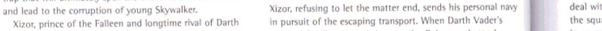

## scan p.116 (scan page 116)

Page contents: Chief Technician Viera Cheran accepts ten thousand credits from a mysterious operative to sabotage Luke Skywalker's X-wing; her efforts fail (hand-read)

- **Luke Skywalker; Wedge Antilles** — entry/section: Among the best starfighter pilots in the galaxy: "Being chosen for duty with the Rogues meant that you were among the best starfighter pilots in the galaxy. It also meant that you would be called upon to handle some of the most dangerous missions Alliance High Command could conceive." Source: *Rebellion Era Sourcebook* (SWRPG d20), scan p.116
  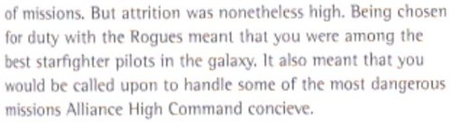
- **Luke Skywalker**: "The squadron has been assigned to Alliance High Command since the Battle of Yavin, but it is often sent to handle a variety of challenging missions, Since the terrible defeat at foth, Roque Squadron has been based on Home One, the Mon Calamari star cruiser that serves as headquarters for High Command and the Rebel fleet, Luke Skywalker envisioned the squadron as a rapid-response unit, able to be sent wherever it was needed on a moment's notice." Source: *Rebellion Era Sourcebook* (SWRPG d20), scan p.116
  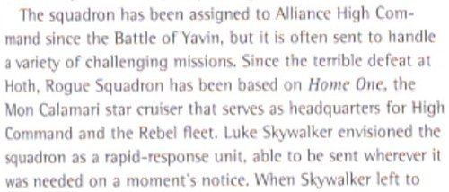

### Stat block notes (game mechanics, not feats)

- Wedge Antilles (Rogue Squadron): Scoundrel 1/Soldier 6/Starfighter Ace 1; Pilot +16; CC D (Source: *Rebellion Era Sourcebook* (SWRPG d20), scan p.116)
- Wedge Antilles: Male Human Scoundrel 1/Soldier 6/Starfighter Ace 1; Init +7; Defense 20 (+7 class, +3 Dex); Spd 10m; VP/WP 5 +9/+4 ranged (3d6, blaster pistol); SQ Mlicit barter, starfighter defense: SV Fort +6, Ref +9, Will +4; SZ M; FP 3; 0, Int 12, Wis 13, Cha DSP 1; Rep 4; Str 10, Dex 16, Cor 10. Challenge Code: D. Equipment: Blaster pistol, comlink, datapad, tool kit, flight suit, X-wing s (Source: *Rebellion Era Sourcebook* (SWRPG d20), scan p.116)
- Wedge Antilles: Scoundrel 1/Soldier 6/Starfighter Ace 1; Def 20; Pilot +16; Astrogate +12; Challenge Code D (Source: *Rebellion Era Sourcebook* (SWRPG d20), scan p.116)
- Wes Janson: Soldier 4; VP/WP 25/10; Challenge Code B (Source: *Rebellion Era Sourcebook* (SWRPG d20), scan p.116)

## scan p.117 (scan page 117)

Page contents: 795 words, 103 paragraphs | headings/entries: Constantly in competition with eacn; The Bothans control a sector of space; Dex 12, Con 10, Int 11; Equipment: Com; Wis 9,; A few examples follow; Atk +0 melee; Feats: weapons). 4; Extricate; Trustworthy, Weapon Group; Typical Bothan Information Broker: Female; Challenge Code:; Comlink, datay; Read/Write Bothan, Sense; Alertness,; Proficiency [simple; Disable Device + 5, Gather Int Read; Motive +5, Speak Bas; Cc, Speak; Weapon Group Proficiency [simple; When the heroes arrive on Cordes,; Bothan Expert; Knowledge; Huma; Eac all Sp

## scan p.118 (scan page 118)

Page contents: Bothan SpyNet 'renowned as the best independent intelligence organization in the galaxy'; Borsk Fey'lya allied Clan Alya to the Alliance though he 'sometimes puts his own interests above those of the Alliance'; Fey'lya's operatives gave their lives for the Death Star II plans (hand-read)

## scan p.119 (scan page 119)

Page contents: 506 words, 22 paragraphs | headings/entries: When the heroes make contact; SpyNet, they are greeted cordially; Do the heroes simply take the; The heroes, acting as liaisons be; See

## scan p.120 (scan page 120)

Page contents: Moff Sartar (Noble 8, CC C) and Fire-Rain 3 bioagent on Tatooine; the prefect recalls Vader 'running roughshod over the planet' (hand-read)

