# Owner Material 037 — Star Wars D20 Drive folder (Core, Revised Core and Saga Edition): Sourcebooks/Rebellion Era Sourcebook.pdf [Star Wars Roleplaying Game (d20, 2000)] (scan pages 121–161)

- **Source:** Wizards of the Coast Star Wars Roleplaying Game books, web enhancements, Living Force campaign modules and articles (2000–2010), from the owner's "Star Wars D20" Drive folder (only the three edition subfolders; "General" was not read, as instructed). Secondary source (licensed Legends reference). Scan OCR'd on the box; the scan stays box-only and is **not** published.
- **Method:** every scanned page was OCR'd and machine-screened sentence by sentence for power-relevant statements (fights, kills, defeats, Force feats, rankings, superweapons) that name a character on our roster; each kept sentence is quoted verbatim from the OCR text and has a crop of the printed passage directly under it. Pages with nothing power-relevant are still listed with what is on them.
- **Citation:** "*Rebellion Era Sourcebook* (SWRPG d20), p.X" by printed page ("scan p.X" where no printed number applies). **Weight:** Licensed RPG material: a secondary source. Narrative text sums up Legends lore; game statistics are rules for players, not canon power levels, and rank lowest.

## scan p.121 (scan page 121)

Page contents: 570 words, 8 paragraphs | headings/entries: Xiz orbital space skyhoc to the; Coru: 17 (+ mele (38)

## scan p.122 (scan page 122)

Page contents: Vader's castle on Coruscant; 'Perhaps the Dark Lord's most closely guarded secret is the contingent of Noghri commandos that Vader uses to handle his most secret missions'; Emperor keeps hidden vaults of Sith and Jedi artifacts; Coruscant Guards 'cannot be bribed, seduced, blackmailed, or routed' (Soldier 6, CC C) (hand-read)

## scan p.123 (scan page 123)

Page contents: Black Sun at its peak before Endor; Xizor 'easily seized control of the entire organization and none could or would oppose him'; Xizor has the ear of the Emperor (hand-read)

- **Prince Xizor; Darth Vader (Anakin Skywalker)**: "Falleen prince himself does not truly know the extent of his him nea U Indeed, Xizor privately vies to destroy Darth Vader and replace vast wealth." Source: *Rebellion Era Sourcebook* (SWRPG d20), scan p.123
  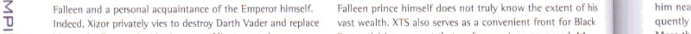
- **Darth Maul**: "Because there were no Equi; survivors of the attack (except Maul himself, who was blaster, killed a few months later), little is known of the exact skyhoo} course of events, When Maul left Black Sun's then-head- Skill: quarters on Ralltiir, however, every single Vigo, the syndi- Use +1: cate's Underlord (a shadowy figure known as "Lex") and +21, In the Underlord's bodyquard, a Dathomiri nightsister, lay Knowle dead, Thanks to the sheer size of the organization, Black Read/V\ Sun survived, but its activities were thrown into complete Read/V\ disarray." Source: *Rebellion Era Sourcebook* (SWRPG d20), scan p.123
  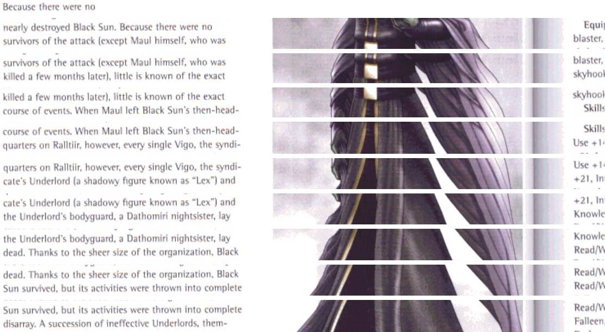

## scan p.124 (scan page 124)

Page contents: Xizor should never be underestimated (no crop): 'He also practices a variety of martial arts and combat techniques, despite his army of bodyguards and the personal protection of the enigmatic Guri (see the next page). Xizor is always prepared to crush an opponent physically as well as financially. The Falleen prince is an expert pilot, though few enemies have seen him fly his personal fighter, Virago, and lived to tell about it. Xizor should never be underestimated.' (hand-read)

- **Prince Xizor; Darth Vader (Anakin Skywalker)** — entry/section: Xizor after he was finished with her: "Among the dead was Xizor's entire family, and the prince iffect others gives a Falleen a +2 circumstance bonus on swore vengeance on Vader, The Underlord has destroyed all S = Bluff and Diplomacy checks." Source: *Rebellion Era Sourcebook* (SWRPG d20), scan p.124
  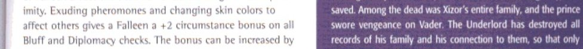

### Stat block notes (game mechanics, not feats)

- Prince Xizor: Noble 6/Scoundrel 6/Crime Lord 6; VP/WP 90/12; Def 25; Str 17 Cha 20; FP 5 DSP 15; contact (the Emperor); CC H (Source: *Rebellion Era Sourcebook* (SWRPG d20), scan p.124)
- Prince Xizor: Noble 6/Scoundrel 6/Crime Lord 6; Def 25; VP/WP 90/12; melee +14/+9/+4; Str 17, Int 18, Cha 20; Intimidate +28, Diplomacy +27, Bluff +26; contact (the Emperor); Frightful Presence; Challenge Code H; nearly a century old (Source: *Rebellion Era Sourcebook* (SWRPG d20), scan p.124)

## scan p.125 (scan page 125)

Page contents: 1060 words, 44 paragraphs | headings/entries: Guri, Human Replica Droid; Mtl! The Right Hand of Xizor; Challenge Code: f; Feats: Ambidexterity, Armor Proficiencies (light, medium; Jump +12,; Stinger; Small (28 m long); Crew: 1; Passengers:; Weapon: Twin laser cannon; Fire Arc: Turret; Durg The Hutt things), / zation, |

- **Guri; Prince Xizor** — entry/section: Few beings can get the better of Guri: "Few beings can get the better of Guri in any situation. Even if someone were to learn her secret—that she is actually a mechanical construct—there is little chance that individual would live long enough to spread the news. Her strength and dexterity are far above the Human norm, and in most cases she does not need a weapon to kill with great efficiency (although her training in all types of weapons has not been ignored)." Source: *Rebellion Era Sourcebook* (SWRPG d20), scan p.125
  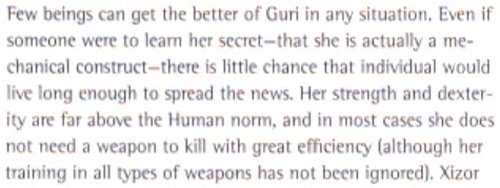

### Stat block notes (game mechanics, not feats)

- Guri: Human replica droid Scoundrel 4/Soldier 4/Noble 2; Def 23; VP/WP 73/1?; melee +16/+11 (1d6+8 punch); Spd 12m; Simonelle the Ingoian built her for nine million credits; Force-user with Sense needs See Force DC 25 to detect her nature (Source: *Rebellion Era Sourcebook* (SWRPG d20), scan p.125)

## scan p.126 (scan page 126)

Page contents: Vigos: Durga the Hutt 'might actually be able to' attain the Underlordship, has agents inside the Death Star II project and hopes to build his own superweapon (Noble 4/Scoundrel 1/Crime Lord 2, CC C); Clezo of Rodia (CC C) (hand-read)

- **Prince Xizor**: "The most powerful crime lord on Rodia is also one of Xizor's most reliable—and least flashy—lieutenants." Source: *Rebellion Era Sourcebook* (SWRPG d20), scan p.126
  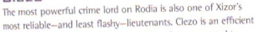

## scan p.127 (scan page 127)

Page contents: 'Xizor expects complete loyalty, and he doesn't tolerate betrayal. For all of their feuding, Xizor and Darth Vader share this trait, and both have eliminated more than one subordinate for failing them.' Green (CC C); Perit 'may be the only being that Xizor truly considers a friend' (hand-read)

## scan p.128 (scan page 128)

Page contents: 780 words, 88 paragraphs | headings/entries: Avaro is an excellent informatior; Howzim; Agents and Underlings 'i:; Howzim: Male Human Thug 13: Init; Equipment: Baton, blaster rifle; I]} SHADOWS OF THE EMPIRE |; CcCHArT

- **Prince Xizor** — entry/section: Howzim: not one intruder: "Howzim is very good at his job—in all the years that Xizor has employed him, not one intruder has made it inside Xizor's palace." Source: *Rebellion Era Sourcebook* (SWRPG d20), scan p.128
  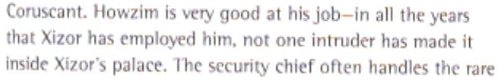

### Stat block notes (game mechanics, not feats)

- Howzim: Xizor's security chief: Thug 13; melee +16/+11/+6; Intimidate +19; Xizor can kill him instantly via brain chip; Challenge Code D. Avaro Sookcool Expert 10, CC B (Source: *Rebellion Era Sourcebook* (SWRPG d20), scan p.128)

## scan p.129 (scan page 129)

Page contents: Pike sisters Zan and Zu: Epicanthix twins, masters of teras kasi learned from the Followers of Palawa on Bunduki; refuse conventional weapons (hand-read)

- **Pike Sisters (Zan and Zu); Prince Xizor** — entry/section: Pike sisters: two dozen opponents, no weapons: "The Pike sisters had already earned a considerable reputation on the underground fighting circuit of the remote Pacanth Reach when they first came to Xizor's attention. The sisters single-handedly defeated and killed over two dozen opponents in one memorable match. Even more impressive to Xizor, the twins used no weapons to accomplish this feat. He immediately offered them jobs as highly paid assassins." Source: *Rebellion Era Sourcebook* (SWRPG d20), scan p.129
  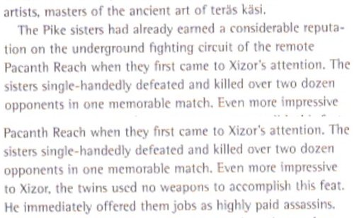
- **Prince Xizor**: "Pacanth Reach when they sisters single-handedly defeated an ver two dozen mpressive to Xizor, the twins uscd no weapons to accomplish this feat." Source: *Rebellion Era Sourcebook* (SWRPG d20), scan p.129
  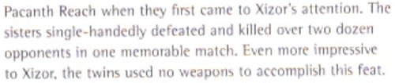

### Stat block notes (game mechanics, not feats)

- Pike Sisters: Zan Pike: Soldier 9; Def 20; VP/WP 59/13; melee +14/+9 (1d6+2 punch); Dex 20; Whirlwind Attack, Martial Artist; CC D. Zu Pike: Soldier 9; VP/WP 64/13; same attacks (Source: *Rebellion Era Sourcebook* (SWRPG d20), scan p.129)

## scan p.130 (scan page 130)

Page contents: Jabba 'respects and admires Xizor and his Black Sun operation'; Big Gizz Thug 12 CC D; swoop gang (hand-read)

## scan p.131 (scan page 131)

Page contents: Rescue of Han Solo: Luke 'attempted to use the Force against Jabba, but the crime lord simply laughed him off. The Hutt was not some weak-minded fool like Fortuna'; Luke dropped the portcullis on the rancor, 'It died instantly'; Sarlacc consumed Boba Fett—'or so they thought' (hand-read)

- **Lando Calrissian; Boba Fett; Han Solo; Leia Organa Solo; Luke Skywalker**: "Lando, meanwhile, : Sé j \fter d Ti it } reat post by Prince Xiz and the i f # inally took action as well, A confusing battle ensued, When types walker and his compan . ver, the Sarlace had consumed Boba Fett and many quard a oY ent on to rescue Han Solo from the clutches of the A : ; of Jabba's quards, Leia had strangled Jabba with the chair his h ile ¢ qstcr iba the Hutt ¢ complex plat put Land t that bound her to the Hutt, and Luke had destroyed the ' mask Calrissian into Jabba's palace, where he disquised himself as : ; : : massive sail barge, The companions were free, Jabba wi : f ne of ba ) ce quards." Source: *Rebellion Era Sourcebook* (SWRPG d20), scan p.131
  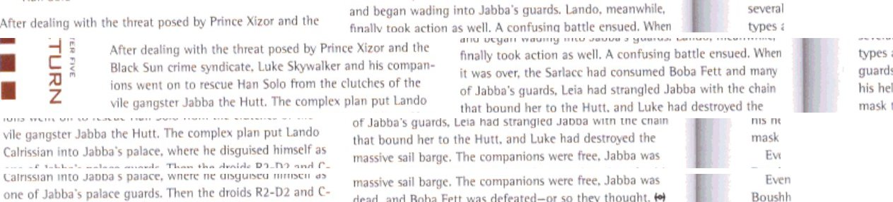
- **Boba Fett**: "Then the dr 5s R2-D2 and ( ' dead, and Boba Fett was defeated—or so thev thought." Source: *Rebellion Era Sourcebook* (SWRPG d20), scan p.131
  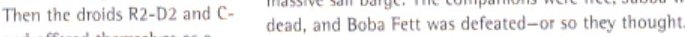

## scan p.132 (scan page 132)

Page contents: 562 words, 57 paragraphs | headings/entries: Paranoid and cautious to af expects; Technology fascinates Boushh, He has; Equipment:; Padded body armor, Ubese helmet, fo; Computer Use +8, Demolitions +11,; Boushh in:; Feats: Armor Proficiencies (light, medium, heavy}, Blind; Fight, Cautious, Gearhead, Improved Initiative, Sharp-Eyed,; Weapon Group Proficiencies (blaster pistols, blaster rifles,

- **Guri; Prince Xizor; Leia Organa Solo** — entry/section: Guri killed Boushh: "During a recent job for Black Sun, Boushh made the mistake of insulting Prince Xizor. Guri, Prince Xizor's trusted bodyguard, killed the Ubese as punishment for the infraction. Guri later gave Boushh's outfit to Leia Organa so that she could sneak into Imperial Center." Source: *Rebellion Era Sourcebook* (SWRPG d20), scan p.132
  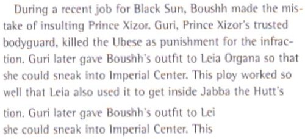

### Stat block notes (game mechanics, not feats)

- Boushh: Ubese Scoundrel 3/Soldier 4; VP/WP 31/10; Def 18; CC C; killed by Guri for insulting Xizor (Source: *Rebellion Era Sourcebook* (SWRPG d20), scan p.132)

## scan p.133 (scan page 133)

Page contents: 559 words, 33 paragraphs | headings/entries: I]}1q3r SHL 40 NYNLSY

### Stat block notes (game mechanics, not feats)

- Jabba the Hutt: Noble 3/Scoundrel 3/Crime Lord 6; Def 17; +6 Will vs mind-affecting Force skills; Knowledge (organized crime) +20; Challenge Code F; 'In his arrogance, Jabba thought he was immune to Luke Skywalker's abilities' (Source: *Rebellion Era Sourcebook* (SWRPG d20), scan p.133)

## scan p.134 (scan page 134)

Page contents: Jabba's court: Bib Fortuna, Salacious Crumb, Ephant Mon; Gamorrean captain Ortugg Thug 4 CC B (hand-read)

## scan p.135 (scan page 135)

Page contents: 610 words, 19 paragraphs | headings/entries: MW,; WW; Turmoil in the Outer Rirn; Factions at War

## scan p.136 (scan page 136)

Page contents: Mos Eisley Mourners: four ancient DX-series war droids (Soldier 7, VP/WP 46/16, CC D) released on Jabba's death to kill his possible enemies incl. Bib Fortuna and Lady Valarian; Kisa Shaki's ambition 'since the time of Xim the Despot' (hand-read)

## scan p.137 (scan page 137)

Page contents: Rebel Fleet: 'Many Bothans died to bring us this information'; Han: the Falcon 'She's the fastest ship in the fleet'; Wedge's Rogue Squadron as Red Group, 'the best in the Rebel fleet' (hand-read)

- **Lando Calrissian**: "With the defeat at Hoth, the Alliance decided to gather its Lando Calrissian volunteers to lead the starfighter attack on the various cells together and amass the Rebel fleet." Source: *Rebellion Era Sourcebook* (SWRPG d20), scan p.137
  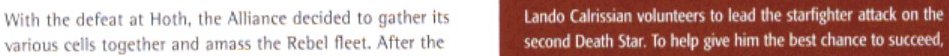

## scan p.138 (scan page 138)

Page contents: 776 words, 47 paragraphs | headings/entries: Feats: Alertness, Fame, Iron Will,; Calamari, Speak; Trustworthy, Weapon; Group Proficiencies (blaster pistols, simple weapons),; Equipment: Blaster pistol, comlink, datapad,; Alliance Leaders (10K:; FIVE; CHAPTER; Diplomacy +10, Gather Information +7, Intimidate +5,; Quarren, Spot +4,; General Madine: Male Human Soldier 2/Scoundrel

- **Admiral Ackbar; Grand Moff Tarkin**: "It wasn't long thereafter when Ackbar, who made a habit of studying Imperial tactics and defenses while enslaved by Tarkin, returned to Mon Calamari and convinced his people to join the Alliance." Source: *Rebellion Era Sourcebook* (SWRPG d20), scan p.138
  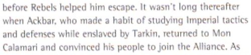

### Stat block notes (game mechanics, not feats)

- Admiral Ackbar: Male Mon Calamari Diplomat 4/Soldier 2/Officer 5; Init +1; Defense 15 (+4 class, +1 Dex); Spd 10m; VP/WP 39/10; Atk +7/+2 melee (Id (3d6, blaster pistol); SQ Amphibious, low-light vision, +4 3, punch) or +8/+3 ranged species bonus on Craft checks, +1 species bonus on Will saves 1 penalty on Will saves when in dry environments, leadership, requisition supplies, tactics; SV For (Source: *Rebellion Era Sourcebook* (SWRPG d20), scan p.138)
- Mon Mothma: Noble 8; VP/WP 27/9; Diplomacy +15; CC C. Admiral Ackbar: Diplomat 4/Soldier 2/Officer 5; VP/WP 39/10; Knowledge (Imperial tactics) +11; CC D; served Tarkin while enslaved. General Crix Madine: Soldier 2/Scoundrel 2/Scout 4; VP/WP 41/11; CC D (Source: *Rebellion Era Sourcebook* (SWRPG d20), scan p.138)

## scan p.139 (scan page 139)

Page contents: 642 words, 36 paragraphs | headings/entries: 

## scan p.140 (scan page 140)

Page contents: SpecForces: ten divisions; Han Solo's Endor strike team chosen with Madine from Echo Base troops, Major Bren Derlin unit leader; Rebel commando Soldier 4/Scout 4, CC B (hand-read)

## scan p.141 (scan page 141)

Page contents: Second Death Star: thermal exhaust flaw corrected; Bevel Lemelisk spared by the Emperor and given a second chance; new superlaser can target capital ships; Moff Jerjerrod 'possesses no creativity or imagination'; Vader sent to help complete it (hand-read)

- **Palpatine (Darth Sidious)** — entry/section: Fully operational: "While the new Death Star appears to be a half-finished shell, the Emperor directed the order of construction so that appearances would be deceiving. While the battle station's shields and hull and many of its decks are far from complete, the new superlaser has been installed and hooked into the power core. The weapon, featuring reduced recharge time and nimble targeting computers, is fully operational. When the Rebel fleet arrives, it will be in for a rude and terrifying surprise." Source: *Rebellion Era Sourcebook* (SWRPG d20), scan p.141
  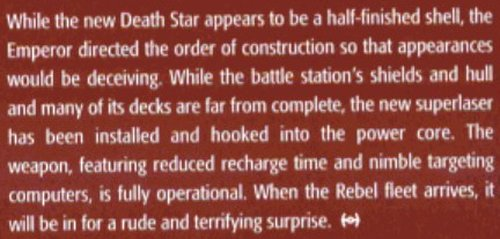

## scan p.142 (scan page 142)

Page contents: The Emperor: 'For more than three years, his powerful military machine and his best agents had been unable to put an end to "this insignificant rebellion"'; 'With the dark side of the Force at his side and thanks to his infinite patience, the Emperor had remade the galaxy in his own image'; Luke 'a being strong in the Force and dangerous to the Emperor's plans'; 'The Emperor had foreseen it' (hand-read)

- **Palpatine (Darth Sidious); Luke Skywalker; Darth Vader (Anakin Skywalker)** — entry/section: The Trap is Set: "The Emperor purposely allowed the intelligence reports concerning the construction of a new Death Star to fall into the Bothans' hands. To make the trap even sweeter, he provided his personal schedule, outlining when he planned to visit the construction site. Then he made sure that the Bothans had to fight their way to freedom so that it looked like they had earned the secrets they had escaped with." Source: *Rebellion Era Sourcebook* (SWRPG d20), scan p.142
  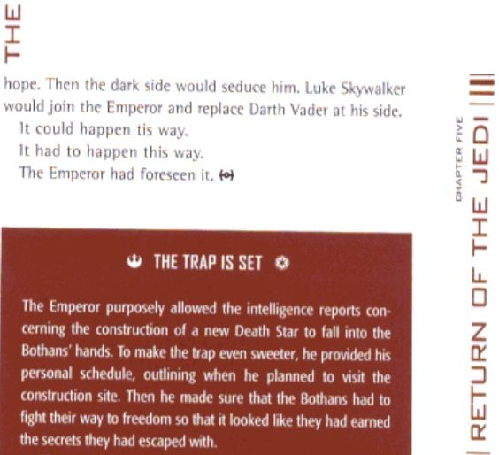
- **Darth Vader (Anakin Skywalker); Luke Skywalker**: "On the one hand, once the Rebel fleet arrived to make its massive and ultimately futile play against the new Death Star, the Emperor would surprise the fleet by revealing that the new superlaser was fully operational, On the other, his presence and the presence of his servant, Darth Vader, would draw Luke Skywalker to him." Source: *Rebellion Era Sourcebook* (SWRPG d20), scan p.142
  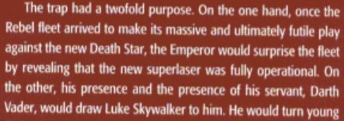

## scan p.143 (scan page 143)

Page contents: 823 words, 49 paragraphs | headings/entries: C); WHY; AS Vv Imperi shield |; Endor, As tl

## scan p.144 (scan page 144)

Page contents: Endor: Preducor Predator 5, VP/WP 67/52, Str 28, CC E; Executor hidden behind the moon; entire stormtrooper legion deployed (hand-read)

## scan p.145 (scan page 145)

Page contents: Imperial scout troopers Scout 4 CC B; Aratech 74-Z 300 km/h (hand-read)

## scan p.146 (scan page 146)

Page contents: 442 words, 28 paragraphs | headings/entries: Ewoks | 11K:; I]; RETURN OF THE JEDI

## scan p.147 (scan page 147)

Page contents: Ewok traps (log swing +15 attack 6d6), catapults, gliders; Ewok hunter Fringer 1; Tammala glider hermit exiled by Logray (hand-read)

## scan p.148 (scan page 148)

Page contents: 724 words, 63 paragraphs | headings/entries: None;; Searching for : Tammala; Ewok Hunter developing size, +3 Dex); weapons; Emphasis (Climb), We; Ewoks at War ji:; Equipment: Spear; I]! RETURN OF THE JEDI

## scan p.149 (scan page 149)

Page contents: Ewok heroes: Wicket Scout 3 CC A, observed an AT-ST crash; Logray Fringer 2/Noble 3 CC B (hand-read)

## scan p.150 (scan page 150)

Page contents: Battle of Endor: superlaser calibrated for moving capital ships; Lando used Imperial ships as cover from the superlaser; 'For the first time in decades, he saw the Emperor's true face—the face of hatred'; Emperor dead, 'his control over his forces vanished' (hand-read)

- **Luke Skywalker; Darth Vader (Anakin Skywalker); Palpatine (Darth Sidious)** — entry/section: Luke disarms Vader at Endor: "Inwardly, Luke struggled with his emotions, ultimately giving way to his rage in order to drive Vader to the floor and disarm him—actually cleaving Vader's mechanical hand off." Source: *Rebellion Era Sourcebook* (SWRPG d20), scan p.150
  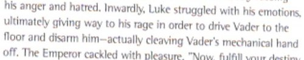
- **Darth Vader (Anakin Skywalker); Palpatine (Darth Sidious); Luke Skywalker** — entry/section: Vader hurls the Emperor: "He made his decision, and snatching up the frail old Emperor, hurled him into the reactor core shaft. But the effort had finished him." Source: *Rebellion Era Sourcebook* (SWRPG d20), scan p.150
  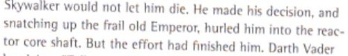
- **Luke Skywalker**: "What began as a trap set to destroy the Rebel Alliance and turn Luke Skywalker to the dark side of the Force evolved into the most decisive engagement of the Galactic Civil War." Source: *Rebellion Era Sourcebook* (SWRPG d20), scan p.150
  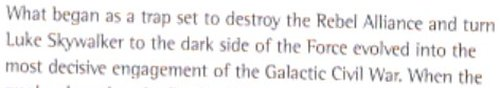

## scan p.151 (scan page 151)

Page contents: 691 words, 31 paragraphs | headings/entries: Luke Skywalker; Force Skills: Affect Mine; Force Feats: Alter, Contr; You; Fe: Sensi {Kno (blast

- **Luke Skywalker; Darth Vader (Anakin Skywalker)** — entry/section: Luke reaches the spark of Anakin: "As the Emperor worked to corrupt Luke, the young Skywalker managed to reach the spark of Anakin that was trapped within Vader's armored shell. Anakin reemerged and sacrificed his life to save his son." Source: *Rebellion Era Sourcebook* (SWRPG d20), scan p.151
  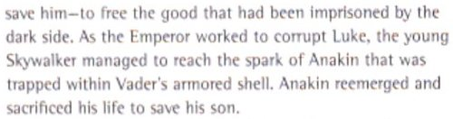

### Stat block notes (game mechanics, not feats)

- Luke Skywalker (end of Return of the Jedi): Fringer 2/Jedi Guardian 7 (Jedi Knight); lightsaber +10/+5 (3d8+2/19-20); Fort +9 Ref +10 Will +5; VP illegible (Source: *Rebellion Era Sourcebook* (SWRPG d20), scan p.151)
- Luke Skywalker: as of end of Return of the Jedi: Fringer 2/Jedi Guardian 7; Def 22; melee +10/+5 lightsaber 3d8+2; Force Point use as though three levels higher; Jedi Knight; Deflect Blasters; Challenge Code E (Source: *Rebellion Era Sourcebook* (SWRPG d20), scan p.151)

## scan p.152 (scan page 152)

Page contents: 521 words, 30 paragraphs | headings/entries: Cnow; Ability; Leia Organa E; I]|; RETURN OF THE JEDI; Equipment: Blaster pistol, comlink, datapad, C-3P0,

### Stat block notes (game mechanics, not feats)

- Leia Organa (end of Return of the Jedi): (as of the end of Return of the Jedi): Female Human Noble 6/Soldier 2; Init +1; Defense 16 (+5 class, +1 Dex}; Spd 10m; VP/WP 39/13; Atk +7/+2 melee (1d3+1, punch) or +7/+2 ranged (3d6, blaster pistol); SQ Call in favor 3, Inspire confidence +2, command +2, Force Point use as though she were three levels higher; SV Fort +6, Ref +4, Will +9; SZ M; FP 3; DSP 0; Rep 9; Str 12, Dex 13, Con 13, Int 14 (Source: *Rebellion Era Sourcebook* (SWRPG d20), scan p.152)
- Leia Organa: as of end of Return of the Jedi: Noble 6/Soldier 2; VP/WP 39/13; Def 16; Challenge Code D; 'heir to the traditions of the Jedi Knights' (Source: *Rebellion Era Sourcebook* (SWRPG d20), scan p.152)

## scan p.153 (scan page 153)

Page contents: 622 words, 37 paragraphs | headings/entries: A =; Chewbe; Back; Equipment: Heavy blaster pistol, comlink, tools,; Vookiet

### Stat block notes (game mechanics, not feats)

- Han Solo (end of Return of the Jedi): (as of the end of Return of the Jedi): Male the all-i Human Scoundrel 8/Soldier 2; Init +2; Defense 20 (+8 class, stepped +2 Dex); Spd 10m; VP/WP 55/13; Atk +9/+4 melee (1d341, Imperia punch) or +10/+5 ranged (3d8, heavy blaster pistol); SQ On E Illicit barter, better lucky than good, sneak attack +2d6; SV Fort +6, Ref +8, Will +3; SZ M; FP 1; DSP 2; Rep 8; Str 13, Dex 14, Con 13, Int 13, Wis 12, (Source: *Rebellion Era Sourcebook* (SWRPG d20), scan p.153)
- Han Solo: as of end of Return of the Jedi: Scoundrel 8/Soldier 2; Def 20; VP/WP 55/13; ranged +10/+5; Pilot +16; made a general (Source: *Rebellion Era Sourcebook* (SWRPG d20), scan p.153)

## scan p.154 (scan page 154)

Page contents: 617 words, 35 paragraphs | headings/entries: Chewbacca Update |i:; Intimidate +10, Jump +7, Knowledge (Kas!; EF

### Stat block notes (game mechanics, not feats)

- Chewbacca: as of end of Return of the Jedi: Scout 9; VP/WP 84/20; Str 20/Con 20; Challenge Code D; Ewoks 'followed the mighty Wookiee into battle' (Source: *Rebellion Era Sourcebook* (SWRPG d20), scan p.154)

## scan p.155 (scan page 155)

Page contents: Bakura: Luke 'still recovering from the injuries inflicted on him by the Emperor'; Luke commands the task force; learns 'there are other people in the galaxy who can use the Force' and vows to restore the Jedi Order (hand-read)

## scan p.156 (scan page 156)

Page contents: Ssi-ruuk: Force-blind; Force-users provide the most life energy for entechment; Ssi-Ruu soldier Soldier 3 CC B (hand-read)

- **Palpatine (Darth Sidious)** — entry/section: Emperor and the Ssi-ruuk: "In the years prior to the invasion of Bakura, the Ssi-ruuk had been secretly negotiating with the Emperor. The Ssi-ruuk developed a process called entechment to tap life energy as a power source to operate droids, ships, and other devices. At first, the Ssi-ruuk used the species known as the P'w'eck for energy slaves, but they soon needed to seek new sources of power. The Emperor learned of the Ssi-ruuk when they visited Human space, and he was willing to sacrifice the people of the Empire in order to gain the entechment technology." Source: *Rebellion Era Sourcebook* (SWRPG d20), scan p.156
  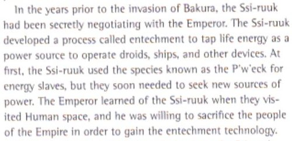

## scan p.157 (scan page 157)

Page contents: New Republic declared one month after Endor; Provisional Council, Mon Mothma chief councilor (hand-read)

## scan p.158 (scan page 158)

Page contents: Remnants: Pellaeon ordered retreat; Harrsk first warlord; Sate Pestage assumed the throne; Ruling Circle; Black Sun never recovers from Xizor's death, niece Savan; Grand Admirals: 'If the remaining Grand Admirals had united after Endor, they might have been able to wipe out the New Republic'; most died with the second Death Star, Takel executed, Grunger and Pitta annihilated each other; Thrawn 'the last and most dangerous Grand Admiral' (hand-read)

## scan p.159 (scan page 159)

Page contents: "Warlord Zsinj becomes one of the most powerful Imperial warlords of the New Republic era." (Zsinj not on roster; Soldier 2/Noble 8 stat block) (hand-read)

- **Grand Moff Tarkin** — entry/section: Warlords (Rebellion Era Sourcebook, Ch4): "Warlord Zsinj becomes one of the most powerful Imperial warlords of the New Republic era." Source: *Rebellion Era Sourcebook* (SWRPG d20), scan p.159
  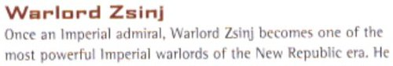
- **Ysanne Isard** — entry/section: Ysanne Isard: "The Director of Imperial Intelligence, Ysanne Isard killed her father, the previous director, in order to replace him. After the death of the Emperor, Isard rises in power and, for a time, holds the Empire together. She considers Rogue Squadron a significant threat to the Imperial remnant and sets out to destroy the special unit." Source: *Rebellion Era Sourcebook* (SWRPG d20), scan p.159
  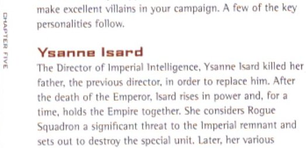
- **Warlord Zsinj** — entry/section: Warlord Zsinj: "Once an Imperial admiral, Warlord Zsinj becomes one of the most powerful Imperial warlords of the New Republic era. He eventually takes control of one-third of the galaxy, fighting both the New Republic and the Imperial remnant from the bridge of his Super Star Destroyer Iron Fist." Source: *Rebellion Era Sourcebook* (SWRPG d20), scan p.159
  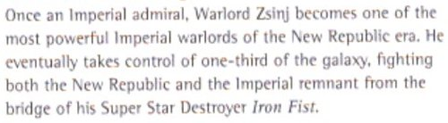
- **Grand Admiral Thrawn** — entry/section: Grand Admiral Thrawn: "The only non-Human ever named one of the Emperor's grand admirals, Thrawn has the pale blue skin and crimson eyes of the Chiss." Source: *Rebellion Era Sourcebook* (SWRPG d20), scan p.159
  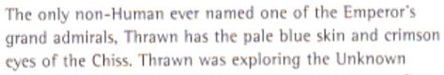
- **Grand Admiral Thrawn** — entry/section: Grand Admiral Thrawn: "He returns five years later to apply his military genius to destroying the New Republic." Source: *Rebellion Era Sourcebook* (SWRPG d20), scan p.159
  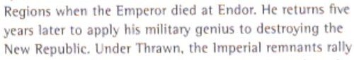

### Stat block notes (game mechanics, not feats)

- Gethzerion: Female Human Force Adept 7/Dark Force Witch or +14/+9/+4 ranged (by weapon); SQ Force weapon + 1d4, comprehend speech, inspire fear -3, spider walk, Force flight (20m), enshroud; SV Fort +12, Ref +11, Will +16; SZ M; FP Equipment: Tattered exotic robes, original copy of The o) Book of Shadows, Imperial-issue comlink, (Source: *Rebellion Era Sourcebook* (SWRPG d20), scan p.159)
- Ysanne Isard: Scoundrel 3/Noble 4; VP/WP 32/10; DSP 14; Bluff +14, Gather Information +15; Challenge Code D (Source: *Rebellion Era Sourcebook* (SWRPG d20), scan p.159)
- Gethzerion: Force Adept 7/Dark Force Witch 10; Def 24; VP/WP 122/15; Will +16; DSP 21; Move Object +18, Fear +14, Affect Mind +12, Force Grip +12; Force Lightning, Force Whirlwind, Summon Storm; Challenge Code G. Zsinj promised her a ship to capture Han and Leia (Source: *Rebellion Era Sourcebook* (SWRPG d20), scan p.159)
- Warlord Zsinj: Soldier 2/Noble 8; VP/WP 46/15; Intimidate +15; Challenge Code D (Source: *Rebellion Era Sourcebook* (SWRPG d20), scan p.159)

## scan p.160 (scan page 160)

Page contents: 419 words, 34 paragraphs | headings/entries: T + 14, al Self; ONS,; Equipment: Comlink, code cylinder, blaster pistol, datapad.,; Rukh; Ks; SHAPTER; I]| RETURN OF THE JED! ||[

- **Rukh; Grand Admiral Thrawn** — entry/section: Rukh: "Rukh, a young Noghri, impressed Grand Admiral Thrawn and was selected to serve as the grand admiral's personal bodyguard." Source: *Rebellion Era Sourcebook* (SWRPG d20), scan p.160
  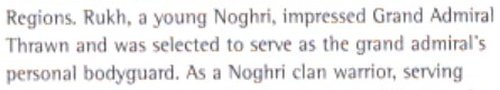

### Stat block notes (game mechanics, not feats)

- Grand Admiral Thrawn: Soldier 5/Noble 3/Officer 6; VP/WP 72/12; Knowledge (tactics) +20, Intimidate +16; Int 18; CC E (Source: *Rebellion Era Sourcebook* (SWRPG d20), scan p.160)
- Thrawn: Soldier 5/Noble 3/Officer 6; VP/WP 72/12; Int 18; Knowledge (tactics) +20; Rep 12; Challenge Code E (Source: *Rebellion Era Sourcebook* (SWRPG d20), scan p.160)
- Rukh: Noghri Soldier 11; VP/WP 76/17; melee +12/+7/+2, ranged +14/+9/+4 throwing dagger; Martial Arts, Spring Attack, Stealthy; Challenge Code E (Source: *Rebellion Era Sourcebook* (SWRPG d20), scan p.160)

## scan p.161 (scan page 161)

Page contents: back cover (hand-read)

