# Owner Material 037 — Star Wars D20 Drive folder (Core, Revised Core and Saga Edition): Sourcebooks/Secrets Of Naboo.pdf [Star Wars Roleplaying Game (d20, 2000)] (scan pages 1–60)

- **Source:** Wizards of the Coast Star Wars Roleplaying Game books, web enhancements, Living Force campaign modules and articles (2000–2010), from the owner's "Star Wars D20" Drive folder (only the three edition subfolders; "General" was not read, as instructed). Secondary source (licensed Legends reference). Scan OCR'd on the box; the scan stays box-only and is **not** published.
- **Method:** every scanned page was OCR'd and machine-screened sentence by sentence for power-relevant statements (fights, kills, defeats, Force feats, rankings, superweapons) that name a character on our roster; each kept sentence is quoted verbatim from the OCR text and has a crop of the printed passage directly under it. Pages with nothing power-relevant are still listed with what is on them.
- **Citation:** "*Secrets Of Naboo* (SWRPG d20), p.X" by printed page ("scan p.X" where no printed number applies). **Weight:** Licensed RPG material: a secondary source. Narrative text sums up Legends lore; game statistics are rules for players, not canon power levels, and rank lowest.

## scan p.1 (scan page 1)

Page contents: 0 words, 0 paragraphs | headings/entries: 

## scan p.2 (scan page 2)

Page contents: 498 words, 44 paragraphs | headings/entries: Sel; DESIGN; STEVE MILLER AND JD WIKER EDITING; THOMAS M. REID; ART DIRECTION; SEAN GLENN; LUCAS LICENSING EDITOR BEN HARPER; LUCAS LICENSING ART EDITOR IAIN MORRIS; COVER ART D. ALBHANDER GREGORY; INTERIOR ART; CARTOGRAPHY; TODD GAMBLE; TYPOGRAPHY; ERIN DORRIES AND ANGELIKA LOHOTZ; GRAPHIC DESIGN; PROJECT MANAGER; AMBER FULLERTON; PRODUCTION MANAGER; CHAS DELONG; GR; Introduction; The Neimoidians General Notes imoidian Soci; Neimoidian Commanders of the Naboo Blockade; PERIL ON NABOO Introduction; Epilogue; GAME STATISTICS Characters Creatures Droids Equipment; Vehicles

## scan p.3 (scan page 3)

Page contents: Secrets of Naboo: Valorum to Qui-Gon: 'Senator Palpatine recently approached me with concerns that echoed my own'; hopes Jedi involvement will 'cause the hidden hand that I sense here on Coruscant to move too quickly and thus become visible' (hand-read)

- **Palpatine (Darth Sidious); Qui-Gon Jinn** — entry/section: Valorum's letter to Qui-Gon: "Hyperbole, you say? Perhaps. But there is something in the air here on Coruscant—something unpleasant." Source: *Secrets Of Naboo* (SWRPG d20), scan p.3
  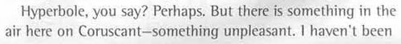

## scan p.4 (scan page 4)

Page contents: Colonel Kaaver Tapps: 'Neimoidians are by nature conflict-adverse'; reminders of the Battle of Ruusan (hand-read)

## scan p.5 (scan page 5)

Page contents: Xenosociologists: 'the Neimoidians' cowardice has always outweighed their greed in the past' (hand-read)

## scan p.6 (scan page 6)

Page contents: Trade Federation tech: battle droids depend on the Droid Control Ship; battleship carries 139,000 battle droids; droid starfighters built by Xi Charrians (hand-read)

## scan p.7 (scan page 7)

Page contents: 812 words, 20 paragraphs | headings/entries: Trade Federation Freighter; Trade Federation Battleship; GAMEMASTER NOTES; Trade Federation Battleship; SE ee AS dS :; G) IL MCP IL 91K

## scan p.8 (scan page 8)

Page contents: 625 words, 14 paragraphs | headings/entries: Trade Federation Droid Control Ship; Trade Federation C-9979 Landing Craft; Trade Federation Droid Control Ship; Oy L1rrron Sy,

## scan p.9 (scan page 9)

Page contents: 607 words, 25 paragraphs | headings/entries: Trade Federation C-93979 Landing Craft; Trade Federation Landing Craft; Droid Starfighter; Trade Federation Droid Starfighter; SR How r. oi; Trade Federation Droid Starfighter Modes of Operation; Walking Mode

## scan p.10 (scan page 10)

Page contents: 836 words, 22 paragraphs | headings/entries: SRG itr. ok; GAMEMASTER NOTES; Trade Federation Multi Troop Transports; OLMKP LEAK W ;; J mu

## scan p.11 (scan page 11)

Page contents: 854 words, 21 paragraphs | headings/entries: Armored Assault Tank; Single Trooper Aerial Platform (STAP); Trade Federation Droids; Battle Droids

## scan p.12 (scan page 12)

Page contents: Droideka (destroyer droid): Thug 12; Atk +13/+8/+3 ranged 4d8x2 heavy repeating blaster; DR 15; Challenge Code F. Infantry battle droid Thug 1 CC A; commander Thug 2 (hand-read)

## scan p.13 (scan page 13)

Page contents: 'droideka' means 'drone' in Colicoid; one destroyer droid per five hundred battle droids; slang for 'reinforcements' (hand-read)

## scan p.14 (scan page 14)

Page contents: 788 words, 31 paragraphs | headings/entries: AIO IL I ie > 1; Security Battle Droid: Red-marked security battle droids; The Meimoidians; General Notes; Neimoidian Society; Neimoidian Values

## scan p.15 (scan page 15)

Page contents: Neimoidians 'Status-obsessed, greedy, deceitful, cowardly'; 'Nothing is more shameful to a Neimoidian than to be held accountable for the results of a failed scheme' (hand-read)

- **Nute Gunray** — entry/section: Neimoidian selective breeding: "Young Neimoidians are kept in communal hives and given limited amounts of food. The more acquisitive ones hoard more than they can eat; the others die of starvation. Thus, only those who are excessively greedy and/or fearful of death can survive to adulthood." Source: *Secrets Of Naboo* (SWRPG d20), scan p.15
  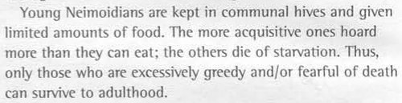

## scan p.16 (scan page 16)

Page contents: Gunray 'a hands-on leader who personally conducts all negotiations' and 'readily accepts responsibility for both the successes and the failures' (hand-read)

### Stat block notes (game mechanics, not feats)

- Nute Gunray: Diplomat 12; VP/WP 26/8; Bluff +16, Diplomacy +14; Will +11; Infamy; Challenge Code E (Source: *Secrets Of Naboo* (SWRPG d20), scan p.16)
- Rune Haako: Scoundrel 6/Noble 2; VP/WP 38/10; sneak attack +3d6 per GM note; Challenge Code D. Daultay Dofine: Scoundrel 7; VP/WP 29/11 (Source: *Secrets Of Naboo* (SWRPG d20), scan p.16)

## scan p.17 (scan page 17)

Page contents: Dofine gained position by 'well-concealed acts of backstabbing, and groveling before superiors' (hand-read)

- **Rune Haako; Nute Gunray** — entry/section: Rune Haako: "Rune Haako has served as diplomatic attaché and legal council on several of Viceroy Gunray's missions, and his cunning and intelligence are legendary. Though he always maintains a low profile, Republic Intelligence credits Haako with masterminding many of the Trade Federation's more abusive commercial agreements." Source: *Secrets Of Naboo* (SWRPG d20), scan p.17
  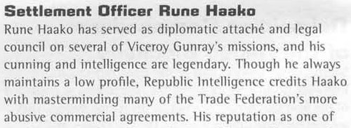

## scan p.18 (scan page 18)

Page contents: 754 words, 22 paragraphs | headings/entries: Data Goggles; Data Goggles; Mechno-Chair; Data Goggles

## scan p.19 (scan page 19)

Page contents: 337 words, 12 paragraphs | headings/entries: Neimoidian Shuttle; Neimoidian Shuttle

## scan p.20 (scan page 20)

Page contents: 859 words, 23 paragraphs | headings/entries: Naboo Planetary Brief; Remarkable Planetary; Features; Dominant Sapients; Humans; Gungans; Cultural Advisory

## scan p.21 (scan page 21)

Page contents: Naboo: Senator Palpatine represents Naboo; ancient bloody conflict with the Gungans; monarch elected, tradition from first Queen (hand-read)

## scan p.22 (scan page 22)

Page contents: 790 words, 17 paragraphs | headings/entries: Planet Naboo; Political Organization; VAC]

## scan p.23 (scan page 23)

Page contents: Queen Amidala fourteen, ruled six months; King Veruna 'became embroiled in less-than-noble offworld politics', abdicated; Amidala won 'by an overwhelming majority' (hand-read)

- **Padmé Amidala** — entry/section: Amidala's rise: "Amidala was elected Princess of Theed at the tender age of twelve. Though Veruna was concerned lest this popular young woman become a threat to his power, he thought he would be able to control her. Even then, however, Amidala was far too bright and headstrong to become anyone's puppet." Source: *Secrets Of Naboo* (SWRPG d20), scan p.23
  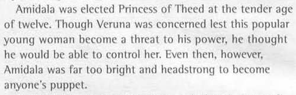

## scan p.24 (scan page 24)

Page contents: Veruna and Senator Palpatine sponsored Kwilaan Starport upgrade; Palpatine called it 'a shining example of what all planetary governments should strive to build' (hand-read)

## scan p.25 (scan page 25)

Page contents: 975 words, 20 paragraphs | headings/entries: Important People in Keren; Portmaster Hesh Verbon; Shep Contopault

- **Palpatine (Darth Sidious)** — entry/section: Hesh Verbon and Palpatine: "How she managed to get Senator Palpatine's backing to serve as portmaster is unclear, but she gained the position largely at his behest." Source: *Secrets Of Naboo* (SWRPG d20), scan p.25
  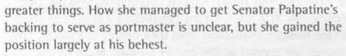

## scan p.26 (scan page 26)

Page contents: Hesh Verbon Scoundrel 5/Noble 2, CC D; Shep Contopault con man (hand-read)

## scan p.27 (scan page 27)

Page contents: Contopault's crime lords plan protection rackets on Naboo; Chee Mobok Twi'lek merchant (hand-read)

## scan p.28 (scan page 28)

Page contents: 443 words, 15 paragraphs | headings/entries: The Naboo Civic Spaceport; Theed Generator; TE —————; The Royal Starport

## scan p.29 (scan page 29)

Page contents: 481 words, 12 paragraphs | headings/entries: CEs); The Royal Palace; The Royal Court of Naboo

- **Palpatine (Darth Sidious)** — entry/section: Veruna's possible assassination: "Although Republic Intelligence cautions that, if King Veruna was indeed assassinated, the killer might still be at large, Senator Palpatine has been emphatic in his claims that the new regime is fully capable of maintaining law and order on Naboo." Source: *Secrets Of Naboo* (SWRPG d20), scan p.29
  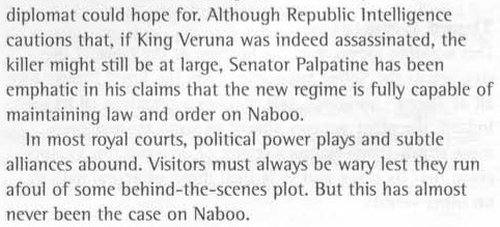

## scan p.30 (scan page 30)

Page contents: Amidala 'daughter of humble farmers from an isolated mountain village'; 'the courage to stand by her convictions'; scar of remembrance (hand-read)

## scan p.31 (scan page 31)

Page contents: 356 words, 13 paragraphs | headings/entries: Queen Amidala; GAMEMASTER NOTES; MB NAL LOW 977; SE f; G) IL MCP IL eK

- **Padmé Amidala** — entry/section: Queen Amidala (GM notes): "The Queen of the Naboo does not hesitate to put herself at risk for her beliefs if the situation demands it. Despite the fact that every one of her handmaidens doubles as a bodyguard, Amidala prefers to rely on her own abilities in a crisis. Thanks to extensive martial instruction from Captain Panaka, Amidala can also perform sneak attacks." Source: *Secrets Of Naboo* (SWRPG d20), scan p.31
  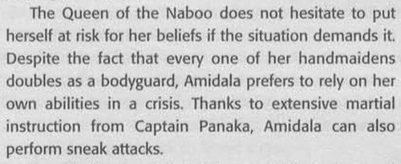

### Stat block notes (game mechanics, not feats)

- Padme Amidala: as Queen (TPM era): Noble 4/Soldier 2; VP/WP 28/11; ranged +7 hold-out; Disguise +14, Diplomacy +11; Point Blank Shot, Precise Shot; Challenge Code C (Source: *Secrets Of Naboo* (SWRPG d20), scan p.31)

## scan p.32 (scan page 32)

Page contents: 458 words, 17 paragraphs | headings/entries: Game Rulebook, but apply the following modifications:

## scan p.33 (scan page 33)

Page contents: Handmaidens: thirteen on duty, five travel; Sabé closest resemblance, the Queen's best friend; Eirtaé, Rabé stats (Scoundrel 2-4, CC C) (hand-read)

- **Padmé Amidala** — entry/section: The Queen's Handmaidens: "When danger threatens, Amidala simply changes clothes with one of her handmaidens. While the handmaiden poses as the Queen, Amidala assumes the role of Padmé Naberrie, who supposedly serves as a royal messenger." Source: *Secrets Of Naboo* (SWRPG d20), scan p.33
  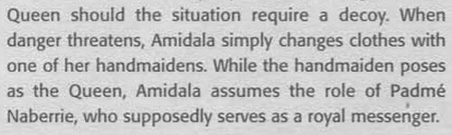

## scan p.34 (scan page 34)

Page contents: A Senate security officer theorised the Queen 'might herself be a disguised handmaiden' (hand-read)

## scan p.35 (scan page 35)

Page contents: 802 words, 32 paragraphs | headings/entries: M1550; Ul a >|; Other Council Members; Sio Bibble; GAMEMASTER NOTES; The Governor of Naboo; The Head of Security; G) LCP IL Je 3) 1

- **Captain Panaka** — entry/section: The Head of Security: "The current Head of Security is Captain Panaka. Known in some circles as "the quickest eyes on Naboo," he is famous for his uncanny accuracy with a blaster pistol." Source: *Secrets Of Naboo* (SWRPG d20), scan p.35
  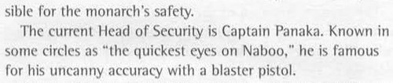

### Stat block notes (game mechanics, not feats)

- Sio Bibble: Noble 8; VP/WP 40/11; dedicated pacifist, never carries weapons; Diplomacy +12; Challenge Code D (Source: *Secrets Of Naboo* (SWRPG d20), scan p.35)
- Captain Panaka: Soldier 11; Init +8; Def 19; VP/WP 64/14; melee +14/+9/+4 martial arts; ranged +15/+10/+5 S-5 heavy blaster pistol; Dex 18; Spot +12; Far Shot, Quick Draw, Precise Shot, Rapid Shot, Martial Arts; Challenge Code E. Served in a Republic Special Task Force; created the handmaiden institution (Source: *Secrets Of Naboo* (SWRPG d20), scan p.35)

## scan p.36 (scan page 36)

Page contents: Ric Olié leads Bravo flight; Naboo forces 'too small and too inefficient' (hand-read)

### Stat block notes (game mechanics, not feats)

- Ric Olie: Soldier 5/Starfighter Ace 2; Init +8; VP/WP 25/14; Pilot +14, Astrogate +11; can shorten travel by 25-50%; Challenge Code D (Source: *Secrets Of Naboo* (SWRPG d20), scan p.36)

## scan p.37 (scan page 37)

Page contents: 'Just after the assassination of King Veruna', Security Guards fought the Ralthar Syndicate; Palace Guard ~150; Security Guard 5-6,000 (hand-read)

## scan p.38 (scan page 38)

Page contents: Space Fighter Corps ~100 pilots, 'by no means the most dangerous space pilots in galaxy' (hand-read)

## scan p.39 (scan page 39)

Page contents: 1001 words, 21 paragraphs | headings/entries: STORY WOGR: FOUN LOVE... SUGH f PAM!; Queen Amidala's Royal Starship

## scan p.40 (scan page 40)

Page contents: Royal Starship unarmed; Gian speeders last used 'during their unsuccessful hunt for King Veruna's assassins' (hand-read)

## scan p.41 (scan page 41)

Page contents: 617 words, 26 paragraphs | headings/entries: HST; S-5 Heavy Blaster (Ascension Gun); Naboo Royal Pistol; Flash Speeder; Gian Speeder; Naboo Weapons; CR-2 Blaster Pistol

## scan p.42 (scan page 42)

Page contents: Panaka made the S-5 ascension gun standard and created the Royal Pistol (hand-read)

## scan p.43 (scan page 43)

Page contents: Gungans: Palpatine serves as their default representative; Ankura and Otolla races; strong warrior tradition, Grand Army (hand-read)

## scan p.44 (scan page 44)

Page contents: 559 words, 9 paragraphs | headings/entries: Otoh Gunga; Boss fass Council Hall s -* Bongo; Construction Bubble; O 100 200 300 400 Scale in

## scan p.45 (scan page 45)

Page contents: Gungans: 'intense dislike of the Naboo'; Boss power absolute; Rep Council (hand-read)

- **Boss Nass** — entry/section: Leaders of the Gungans: "The current Boss is named Nass. Sources characterize him alternately as "fair but stubborn" and a "self-important, pompous windbag." Regardless of which description is accurate, Boss Nass is obviously an intimidating figure to his people." Source: *Secrets Of Naboo* (SWRPG d20), scan p.45
  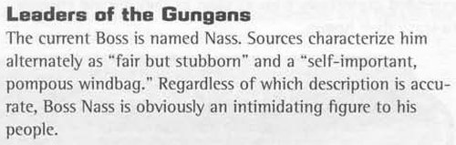

## scan p.46 (scan page 46)

Page contents: 465 words, 12 paragraphs | headings/entries: Bubble Wort Processing Plants; Important Figures in Otoh Gunga; Boss Mass

## scan p.47 (scan page 47)

Page contents: 668 words, 20 paragraphs | headings/entries: Boss Nass; The Rep Council; Captain Tarpals; Armed Forces

### Stat block notes (game mechanics, not feats)

- Boss Nass: Gungan Noble 7; VP/WP 33/12; Intimidate +8; Challenge Code C; 'short-tempered bully' tempered by wisdom (Source: *Secrets Of Naboo* (SWRPG d20), scan p.47)

## scan p.48 (scan page 48)

Page contents: Grand Army could mobilise within 36 hours; 'surprisingly effective'; Gungans 'neither less evolved... merely different' (hand-read)

- **Captain Tarpals; Jar Jar Binks** — entry/section: Captain Tarpals: "In his years of service, Tarpals has seen many threats come and go. Chief among these, of course, have been the many varieties of lethal sea creatures roaming the murky depths around his underwater city. However, no sea creature has ever tested his mettle as much as Gungan-in-exile Jar Jar Binks." Source: *Secrets Of Naboo* (SWRPG d20), scan p.48
  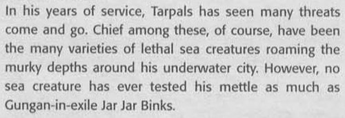

### Stat block notes (game mechanics, not feats)

- Captain Tarpals: Gungan Soldier 6/Scout 2; VP/WP 44/13; electropole +8/+3 (2d6+1); Challenge Code D (Source: *Secrets Of Naboo* (SWRPG d20), scan p.48)

## scan p.49 (scan page 49)

Page contents: Some analysts think the Trade Federation blockade aims at Gungan technology secrets (hand-read)

## scan p.50 (scan page 50)

Page contents: 393 words, 17 paragraphs | headings/entries: Electropole; Energy Balls; Cesta and Atlatl; Defense; Personal Energy Shields

## scan p.51 (scan page 51)

Page contents: Gungan shield generators protect a 75-metre radius; energy balls disable droids (hand-read)

## scan p.52 (scan page 52)

Page contents: 386 words, 13 paragraphs | headings/entries: Flora and Fauna of Maboo; Native Flora of Note; Glie; Red Glie

## scan p.53 (scan page 53)

Page contents: 749 words, 21 paragraphs | headings/entries: FLKEOOKLE ROW N |; Green Glie; Glie Poisons; GAMEMASTER NOTES

## scan p.54 (scan page 54)

Page contents: Advisory Note: Jedi Knight Keiran Valn died on Alderaan from a glie-derived poison at a banquet held by his own family (hand-read)

## scan p.55 (scan page 55)

Page contents: 810 words, 26 paragraphs | headings/entries: Millaflower; Clodhopper These fast-breeding, omnivorous, insectoid creatures are; Clodhopper

## scan p.56 (scan page 56)

Page contents: Clodhoppers devastated Corva colony and 'consumed 87% of the colonists'; colo claw fish up to 40 m, VP/WP 126/256, Challenge Code G (hand-read)

## scan p.57 (scan page 57)

Page contents: Knights of the Core: humanocentric terrorist group (adventure hook) (hand-read)

## scan p.58 (scan page 58)

Page contents: Opee sea killers have chewed their way out of colo claw fish bellies; veermok favoured criminal guard beasts (hand-read)

## scan p.59 (scan page 59)

Page contents: 813 words, 30 paragraphs | headings/entries: LIC O OIL OK RS; Falumpaset; Fambaa; Haadu; GAMEMASTER NOTES; Nuna; Shaak

## scan p.60 (scan page 60)

Page contents: 765 words, 35 paragraphs | headings/entries: Opee Sea Hiller; Peko Peko; Shaak; Tusk-Cat; Ru L1KILrLoOK \

