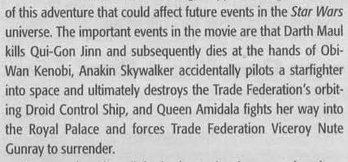
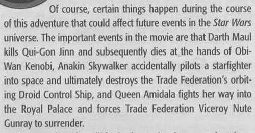
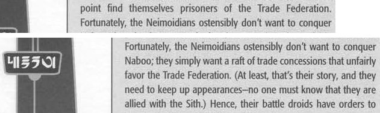
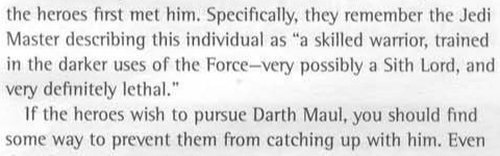
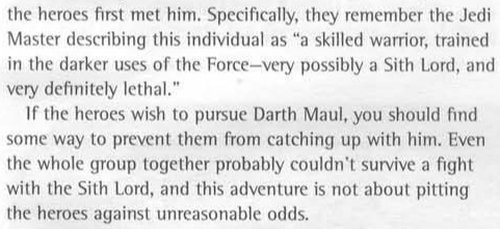
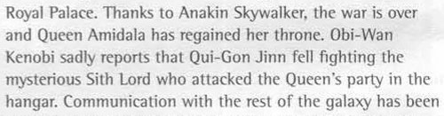
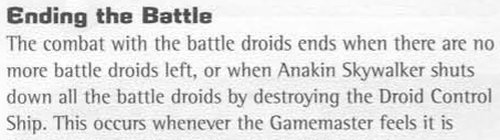

# Owner Material 037 — Star Wars D20 Drive folder (Core, Revised Core and Saga Edition): Sourcebooks/Secrets Of Naboo.pdf [Star Wars Roleplaying Game (d20, 2000)] (scan pages 61–98)

- **Source:** Wizards of the Coast Star Wars Roleplaying Game books, web enhancements, Living Force campaign modules and articles (2000–2010), from the owner's "Star Wars D20" Drive folder (only the three edition subfolders; "General" was not read, as instructed). Secondary source (licensed Legends reference). Scan OCR'd on the box; the scan stays box-only and is **not** published.
- **Method:** every scanned page was OCR'd and machine-screened sentence by sentence for power-relevant statements (fights, kills, defeats, Force feats, rankings, superweapons) that name a character on our roster; each kept sentence is quoted verbatim from the OCR text and has a crop of the printed passage directly under it. Pages with nothing power-relevant are still listed with what is on them.
- **Citation:** "*Secrets Of Naboo* (SWRPG d20), p.X" by printed page ("scan p.X" where no printed number applies). **Weight:** Licensed RPG material: a secondary source. Narrative text sums up Legends lore; game statistics are rules for players, not canon power levels, and rank lowest.

## scan p.61 (scan page 61)

Page contents: 433 words, 10 paragraphs | headings/entries: ES Te; Veermok

## scan p.62 (scan page 62)

Page contents: 894 words, 21 paragraphs | headings/entries: Peril on Maboo; Plot Overview; Getting the Heroes Into the Story; Staying "On the Map"; Act I: Invasion; O15 141

- **Darth Maul; Qui-Gon Jinn; Obi-Wan Kenobi; Darth Vader (Anakin Skywalker); Padmé Amidala; Nute Gunray** — entry/section: Peril on Naboo: the events of the movie: "The important events in the movie are that Darth Maul kills Qui-Gon Jinn and subsequently dies at the hands of Obi-Wan Kenobi, Anakin Skywalker accidentally pilots a starfighter into space and ultimately destroys the Trade Federation's orbiting Droid Control Ship, and Queen Amidala fights her way into the Royal Palace and forces Trade Federation Viceroy Nute Gunray to surrender." Source: *Secrets Of Naboo* (SWRPG d20), scan p.62
  
- **Darth Maul; Qui-Gon Jinn; Obi-Wan Kenobi; Darth Vader (Anakin Skywalker)**: "Of course, certain things happen during the course of this adventure that could affect future events in the Star Wars universe, The important events in the movie are that Darth Maul kills Qui-Gon Jinn and subsequently dies at the hands of Obi- Wan Kenobi, Anakin Skywalker accidentally pilots a starfighter into space and ultimately destroys the Trade Federation's orbiting Droid Control Ship, and Queen Amidala fights her way into the Royal Palace and forces Trade Federation Viceroy Nute Gunray to surrender." Source: *Secrets Of Naboo* (SWRPG d20), scan p.62
  

## scan p.63 (scan page 63)

Page contents: 908 words, 19 paragraphs | headings/entries: SFO; Read the following aloud to the players:

## scan p.64 (scan page 64)

Page contents: Peril on Naboo rumours: Jedi platoon captured; handmaidens spies; Bibble escaped to the Lianorm Swamp (hand-read)

## scan p.65 (scan page 65)

Page contents: 353 words, 17 paragraphs | headings/entries: Destroyer Droid; Fixed Encounter Hey; A. Battle Droids

## scan p.66 (scan page 66)

Page contents: 834 words, 23 paragraphs | headings/entries: 

## scan p.67 (scan page 67)

Page contents: 878 words, 28 paragraphs | headings/entries: Theed has fallen."

## scan p.68 (scan page 68)

Page contents: 604 words, 23 paragraphs | headings/entries: H. Speeder; Other Ways Out of Theed; The Great Grass Plains; The Cliffs; Scale In Meters; Hospital; Main Boulevard; Palace; Royal Hangar; Generator Complex; Escape From Theed

## scan p.69 (scan page 69)

Page contents: 945 words, 22 paragraphs | headings/entries: The Palace; Lying Low; Surrendering; Scene Two: Pursued by STAPs

- **Nute Gunray; Palpatine (Darth Sidious)** — entry/section: Captured by the Trade Federation: "Fortunately, the Neimoidians ostensibly don't want to conquer Naboo; they simply want a raft of trade concessions that unfairly favor the Trade Federation. (At least, that's their story, and they need to keep up appearances—no one must know that they are allied with the Sith.)" Source: *Secrets Of Naboo* (SWRPG d20), scan p.69
  

## scan p.70 (scan page 70)

Page contents: 891 words, 17 paragraphs | headings/entries: The Main Boulevard Bridge

## scan p.71 (scan page 71)

Page contents: 949 words, 24 paragraphs | headings/entries: DEEN]; The Gungan Patrol

## scan p.72 (scan page 72)

Page contents: 845 words, 26 paragraphs | headings/entries: Pirates; Mett Habble; ERG AKNErLOK 4

## scan p.73 (scan page 73)

Page contents: 761 words, 23 paragraphs | headings/entries: Act Il: The Maboo Underground

## scan p.74 (scan page 74)

Page contents: 571 words, 19 paragraphs | headings/entries: The Resistance Camp; Outside Theed; Great Grass Plains; Gungan Patrol; Gallo Mouftains; Lake Paonga; Rendezvous Point; Lianorm Swamp; Scale in Kilometers; OI

## scan p.75 (scan page 75)

Page contents: 923 words, 18 paragraphs | headings/entries: 

## scan p.76 (scan page 76)

Page contents: Peril on Naboo cameo notes: Sabé 'strong and sure of herself'; Anakin eager about Podracing; Qui-Gon 'very concerned about the young boy' (hand-read)

## scan p.77 (scan page 77)

Page contents: 712 words, 17 paragraphs | headings/entries: WIS FOI |; Heroes in Alternate Roles; Making Other Plans

## scan p.78 (scan page 78)

Page contents: 891 words, 23 paragraphs | headings/entries: Scene Three: Underwater Salvage; The Bongos; VAM?

## scan p.79 (scan page 79)

Page contents: 864 words, 24 paragraphs | headings/entries: The Journey

## scan p.80 (scan page 80)

Page contents: 667 words, 17 paragraphs | headings/entries: VAG; Ze \

## scan p.81 (scan page 81)

Page contents: 1061 words, 20 paragraphs | headings/entries: WSF; The Opees; The Waterfalls; Act Ill: Assault on Theed

## scan p.82 (scan page 82)

Page contents: 887 words, 22 paragraphs | headings/entries: Approaching the Secret Passage; Unwanted Attention

## scan p.83 (scan page 83)

Page contents: 466 words, 9 paragraphs | headings/entries: 

## scan p.84 (scan page 84)

Page contents: 434 words, 26 paragraphs | headings/entries: Key to Occupied Theed; Sunken Transport Cross-Section; Solleu River; Transport; The Repair Bay; Theed; Waterfall; Opee Sea; Colo Claw Fish; Underwaterway; Killers; Scale In Kilometers

## scan p.85 (scan page 85)

Page contents: 847 words, 36 paragraphs | headings/entries: The Destroyer Droid; In the Transport, Hatches Sealed; Hiding in the Bay; Aboard the Transport (Hatches Open}; Outcome

## scan p.86 (scan page 86)

Page contents: Gode Takrab Neimoidian forger working under Rune Haako: fake Amidala holo agreeing to commercial exclusivity (hand-read)

- **Darth Maul** — entry/section: Secrets Of Naboo: "Specifically, they remember the Jedi Master describing this individual as “a skilled warrior, trained in the darker uses of the Force—very possibly a Sith Lord, and very definitely lethal.” If the heroes wish to pursue Darth Maul, you should find some way to prevent them from catching up with him." Source: *Secrets Of Naboo* (SWRPG d20), scan p.86
  
- **Darth Maul; Qui-Gon Jinn** — entry/section: The Figure in Black: "Specifically, they remember the Jedi Master describing this individual as "a skilled warrior, trained in the darker uses of the Force—very possibly a Sith Lord, and very definitely lethal." If the heroes wish to pursue Darth Maul, you should find some way to prevent them from catching up with him. Even the whole group together probably couldn't survive a fight with the Sith Lord, and this adventure is not about pitting the heroes against unreasonable odds." Source: *Secrets Of Naboo* (SWRPG d20), scan p.86
  

## scan p.87 (scan page 87)

Page contents: 523 words, 19 paragraphs | headings/entries: The Forged Agreement; Oo 150 5} 450 600; Scale in Meters; Main Boulevard; Palace; Royal Hangar; Generator Complex; Occupied Theed

## scan p.88 (scan page 88)

Page contents: 476 words, 19 paragraphs | headings/entries: Repair Bay; Service Corridor; Cliff Edge; Utility Vehicles 3—; Elevator ®; Platform 3 {to hangar]; G 10 20 30 Scale in; Meters

## scan p.89 (scan page 89)

Page contents: 674 words, 18 paragraphs | headings/entries: Scene Three: The Neimoidian Shuttle; Forcing Cooperation; The Direct Approach; Hostage

## scan p.90 (scan page 90)

Page contents: 464 words, 9 paragraphs | headings/entries: Locating the Document; Searching the Shuttle

## scan p.91 (scan page 91)

Page contents: 543 words, 25 paragraphs | headings/entries: Ul al >); The Shuttle; Monument Repair Bay; Destroying the Shuttle; Monument; Shuttle; Fountain; Monument; Royal Palace; Building; Monument; Scale in Meters

## scan p.92 (scan page 92)

Page contents: 764 words, 18 paragraphs | headings/entries: Holding the Shuttle; Reinforcements; Holding the Shuttle; Frontal Assault; VAOC

## scan p.93 (scan page 93)

Page contents: 685 words, 19 paragraphs | headings/entries: Friend-Or-Foe; Epilogue

- **Darth Vader (Anakin Skywalker); Padmé Amidala; Obi-Wan Kenobi; Qui-Gon Jinn; Darth Maul** — entry/section: Epilogue: "Thanks to Anakin Skywalker, the war is over and Queen Amidala has regained her throne. Obi-Wan Kenobi sadly reports that Qui-Gon Jinn fell fighting the mysterious Sith Lord who attacked the Queen's party in the hangar." Source: *Secrets Of Naboo* (SWRPG d20), scan p.93
  
- **Darth Vader (Anakin Skywalker)**: "Ending the Battle The combat with the battle droids ends when there are no more battle droids left, or when Anakin Skywalker shuts down all the battle droids by destroying the Droid Control Ship." Source: *Secrets Of Naboo* (SWRPG d20), scan p.93
  

## scan p.94 (scan page 94)

Page contents: 878 words, 27 paragraphs | headings/entries: Game Statistics

## scan p.95 (scan page 95)

Page contents: Game statistics: Droideka Thug 12, Challenge Code F; Mett Habble Noble 4; Gode Takrab Noble 3 (Forgery +11) (hand-read)

## scan p.96 (scan page 96)

Page contents: 782 words, 41 paragraphs | headings/entries: Equipment; Atlatl; Cesta; CR-2 Blaster Pistol; Electropole; Naboo Royal Pistol; Personal Energy Shield; S-5 Heavy Blaster ("Ascension Gun"); VAMC

## scan p.97 (scan page 97)

Page contents: 821 words, 36 paragraphs | headings/entries: Armor Proficiency; Vehicles; Bongo Submersible; Weapon: None; Trade Federation Armored Assault Tank (AAT); Trade Federation Multi Troop Transport (MTT)

## scan p.98 (scan page 98)

Page contents: 190 words, 9 paragraphs | headings/entries: Printed in U.S.A TSR11794

