# Owner Material 037 — Star Wars D20 Drive folder (Core, Revised Core and Saga Edition): Sourcebooks/Secrets of Tatooine.pdf [Star Wars Roleplaying Game (d20, 2000)] (scan pages 1–60)

- **Source:** Wizards of the Coast Star Wars Roleplaying Game books, web enhancements, Living Force campaign modules and articles (2000–2010), from the owner's "Star Wars D20" Drive folder (only the three edition subfolders; "General" was not read, as instructed). Secondary source (licensed Legends reference). Scan OCR'd on the box; the scan stays box-only and is **not** published.
- **Method:** every scanned page was OCR'd and machine-screened sentence by sentence for power-relevant statements (fights, kills, defeats, Force feats, rankings, superweapons) that name a character on our roster; each kept sentence is quoted verbatim from the OCR text and has a crop of the printed passage directly under it. Pages with nothing power-relevant are still listed with what is on them.
- **Citation:** "*Secrets of Tatooine* (SWRPG d20), p.X" by printed page ("scan p.X" where no printed number applies). **Weight:** Licensed RPG material: a secondary source. Narrative text sums up Legends lore; game statistics are rules for players, not canon power levels, and rank lowest.

## scan p.1 (scan page 1)

Page contents: 10 words, 5 paragraphs | headings/entries: STAR. Wile; ROLEPLAYING GAME; SECRETS OF TATOOINE; JD WIKER

## scan p.2 (scan page 2)

Page contents: 7 words, 4 paragraphs | headings/entries: Lil; ROLEPLAYING GAME; SECRETS OF TATOOINE

## scan p.3 (scan page 3)

Page contents: 290 words, 28 paragraphs | headings/entries: Secrets of Tatooine; DESIGN; EDITING; BRIAN CAMPBELL AND CORY J. HERNDON; CREATIVE DIRECTION; THOMAS M. REID; ART DIRECTION; LUCAS LICENSING EDITOR; LUCAS LICENSING ART EDITOR; COVER ART; INTERIOR ART; CARTOGRAPHY; TYPOGRAPHY; GRAPHIC DESIGN; PLAYTESTING; CAMPBELL, MATTHEW BURKE; BUSINESS MANAGER; PROJECT MANAGER; PROOUCTION MANAGER; Sm; Visit our website at www.wizards. com/stanwars

## scan p.4 (scan page 4)

Page contents: 135 words, 7 paragraphs | headings/entries: Table of Contents; BSe2eBera

## scan p.5 (scan page 5)

Page contents: Tatooine 'the heart of the Star Wars universe'; 'Even a crime so heinous as murder goes not so much unsolved as ignored' (hand-read)

## scan p.6 (scan page 6)

Page contents: 418 words, 18 paragraphs | headings/entries: Life on Tatooine; CIVILIZED AREAS >; SCALE IN KILOMETERS; Planetary Data; NORTHERNIDUNE}SEA; JUNDUAND WASTES; WESTERNIDUNE|SEA; GREATIMESA\IPUATEAU; LIFE ON TATODINE

## scan p.7 (scan page 7)

Page contents: 376 words, 13 paragraphs | headings/entries: INIDOIV NON; Climate; Geography; Jundiand Wastes

## scan p.8 (scan page 8)

Page contents: Krayt dragon encounters 'nearly always fatal'; Beggar's Canyon, threading the Stone Needle (hand-read)

- **The Sarlacc; Jabba the Hutt** — entry/section: Great Pit of Carkoon: "It is a massive, fearsome monster that hides itself under the endless sand and drags in unwary passersby to slowly digest them over the course of several centuries. Criminals frequently use it to dispose of victims or rivals, and Jabba the Hutt finds the screams of the Sarlacc's meals particularly soothing." Source: *Secrets of Tatooine* (SWRPG d20), scan p.8
  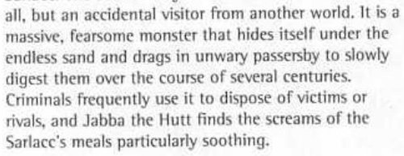

## scan p.9 (scan page 9)

Page contents: 824 words, 23 paragraphs | headings/entries: Surviving Tatooine; Heat; Thirst; Finding Water; Survival Check DC

### Stat block notes (game mechanics, not feats)

- The Sarlacc: Predator 10; Defence 18; VP/WP 180/288; 9 tentacles Str 28; bite +11/+6 3d8+9; DR 10; victims in secondary stomachs kept alive and digested over centuries; 80 damage from inside to cut free (Source: *Secrets of Tatooine* (SWRPG d20), scan p.9)

## scan p.10 (scan page 10)

Page contents: 643 words, 16 paragraphs | headings/entries: Gravel Storms; LIFE ON TATOOINE

## scan p.11 (scan page 11)

Page contents: Tusken Raiders named for Fort Tusken they destroyed; settlers believe 'until the Sand People are wiped out, no settler is truly safe'; Jawas possibly only true natives; sandcrawlers converted mining refineries (hand-read)

## scan p.12 (scan page 12)

Page contents: 604 words, 15 paragraphs | headings/entries: Jawas; LIFE ON TATODINE

## scan p.13 (scan page 13)

Page contents: 606 words, 14 paragraphs | headings/entries: INIOOLVL NO 3411; Sandcrawlers

## scan p.14 (scan page 14)

Page contents: 804 words, 25 paragraphs | headings/entries: Sandcrawler; Creatures of Tatooine; Bantha; Eopie; LIFE ON TATOOINE

## scan p.15 (scan page 15)

Page contents: Krayt dragons: dragon pearls worth over 100,000 credits; Sand People live in fear of them (hand-read)

- **Jabba the Hutt** — entry/section: Krayt Dragon: "Jabba the Hutt has long been interested in capturing a krayt dragon—originally because of the rumor of the dragon pearls, but in later years because he wanted to see how his pet rancor would fare against one of the giant lizards." Source: *Secrets of Tatooine* (SWRPG d20), scan p.15
  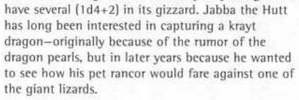

## scan p.16 (scan page 16)

Page contents: 459 words, 11 paragraphs | headings/entries: Ronto; Scurrier; LIFE ON TATOOINE

## scan p.17 (scan page 17)

Page contents: 171 words, 4 paragraphs | headings/entries: Survival +3

## scan p.18 (scan page 18)

Page contents: Jedi Knights Sidrona Diath and son Dace Diath came from Tatooine in the early-settler era; worrt once attacked its own reflection; Jabba keeps worrts at his palace (hand-read)

## scan p.19 (scan page 19)

Page contents: B'omarr monks: brain removed into a jar as 'gift', granted to Alkhara 'and every crime lord since'; timeline lists Jabba killed by Leia Organa (hand-read)

## scan p.20 (scan page 20)

Page contents: Melnea Amthout led Dowager Queen settlers, first contact with Jawas; Sand People took Fort Tusken, no settlers survived (hand-read)

## scan p.21 (scan page 21)

Page contents: B'omarr brain surgery Treat Injury DC 30; Mos Eisley corrupted by Rodian refugees; Tatooine ore became magnetic, mines closed (hand-read)

## scan p.22 (scan page 22)

Page contents: 411 words, 10 paragraphs | headings/entries: The Hutts; SETTLING TATODINE

## scan p.23 (scan page 23)

Page contents: Hutts bought farmers' loans and turned defaulters into slaves; 'not all Hutts were as cruel to their slaves as the infamous Jabba would one day be' (hand-read)

## scan p.24 (scan page 24)

Page contents: 147 words, 10 paragraphs | headings/entries: Podracing; TATODINE

## scan p.25 (scan page 25)

Page contents: 663 words, 16 paragraphs | headings/entries: Cities of Tatooine; City Access

## scan p.26 (scan page 26)

Page contents: 704 words, 23 paragraphs | headings/entries: Customs; DOCKING BAY 94 >; CITIES OF TATOOINE

## scan p.27 (scan page 27)

Page contents: 837 words, 19 paragraphs | headings/entries: Commerce; Goods snd Services; Law and Order

## scan p.28 (scan page 28)

Page contents: 637 words, 19 paragraphs | headings/entries: Challenge Code: B. : : H

## scan p.29 (scan page 29)

Page contents: Sail barge used by Jabba's court at Carkoon (ROTJ); Anakin's Podracer Radon-Ulzer 620C, Sebulba's Collor Pondrat Plug-F Mammoth (hand-read)

## scan p.30 (scan page 30)

Page contents: 512 words, 23 paragraphs | headings/entries: Skyhoppers; Shyhopper; Landspeeders; CITIES OF TATOOINE; Podrecers; Anakin Skywalker's Podracer; Craft: Radon-Ulzer 620C; Class: Ground (Speeder);; Crew: Varies (1 pilot); Passengers: none; Cargo

## scan p.31 (scan page 31)

Page contents: 366 words, 13 paragraphs | headings/entries: NIODIVL 40 S31110; Boles Roor's Podracer; Swoops; Swoop

- **Jabba the Hutt; Palpatine (Darth Sidious)** — entry/section: The Rise of the Empire Era: "Always accustomed to bribing and extorting Republic officials who bothered to visit Tatooine, the Hutts actually found life somewhat easier for the two decades prior to the establishment of Imperial rule. The Hutts' best guess was that someone located close to the Republic Senate was diverting attention away from Tatooine for some unknown reason." Source: *Secrets of Tatooine* (SWRPG d20), scan p.31
  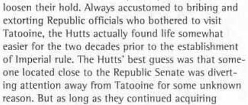

## scan p.32 (scan page 32)

Page contents: 779 words, 28 paragraphs | headings/entries: Mos Esps; Who's In Charge; Currency Exchange Values; Wupiupi 0.625 «0.0156. 0.062510; Laws snd Ordinances; CITIES OF TATOOINE

- **Jabba the Hutt** — entry/section: Who's In Charge: "Each of the Hutts on Tatooine is trying to edge out the others, to one degree or another. Unfortunately for the rest, Jabba is much more focused on his scheming than he pretends to be. Unless something changes radically in the near future, he will attain his goal much sooner than the others suspect." Source: *Secrets of Tatooine* (SWRPG d20), scan p.32
  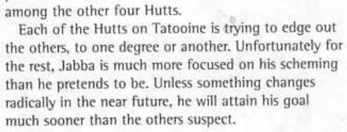

## scan p.33 (scan page 33)

Page contents: 31 words, 13 paragraphs | headings/entries: NIDOLV 40 SH1119; Sar; WER Rae i; Se si bs a fe wee:; He

## scan p.34 (scan page 34)

Page contents: 739 words, 38 paragraphs | headings/entries: Semple Ciess One Infrections; Sample Class Two Infractions; Murder or manslaughter of a free citizen,; Semple Class Three Infrections; CITIES OF TATOOINE; Jabba the Hutt; Pa -

- **Jabba the Hutt; Gardulla the Hutt** — entry/section: Jabba the Hutt: "To draw attention away from his acquisition of power, Jabba graciously surrendered control of Mos Espa's slave trade to his onetime rival Gardulla—just in time for the Republic to finally enforce its antislavery laws on the last few Outer Rim worlds that still allowed the industry. Gardulla was ruined, and Jabba was that much closer to controlling Tatooine." Source: *Secrets of Tatooine* (SWRPG d20), scan p.34
  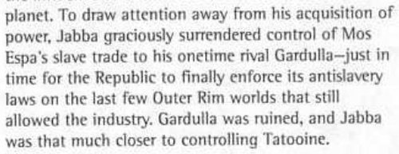

## scan p.35 (scan page 35)

Page contents: Bib Fortuna sacked seven Twi'lek cities as slaver and captured the orphaned, injured Nat Secura; Ryloth had sentenced Fortuna to death for ryll smuggling (hand-read)

- **Jabba the Hutt; Ephant Mon; Bib Fortuna** — entry/section: Jabba the Hutt: "The first was Naroon Cuthus, who was so efficient that Jabba ultimately had to eliminate him; he knew far too much to live. A pair of ambitious smugglers replaced Cuthus: Bidlo Kwerve, a Corellian, and Bib Fortuna, a Twi'lek. Jabba played them against each other to prevent either from becoming a threat to him, but Fortuna eventually got the upper hand. Kwerve received the dubious distinction of becoming the first being Jabba fed to his pet rancor." Source: *Secrets of Tatooine* (SWRPG d20), scan p.35
  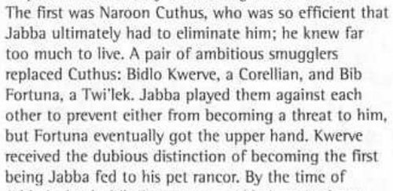
- **Ephant Mon; Jabba the Hutt; Luke Skywalker** — entry/section: Jabba the Hutt: "(Ultimately, Ephant Mon earned Jabba's scorn because of his respect for the Jedi powers of Luke Skywalker — but that respect also enabled him to outlive Jabba.)" Source: *Secrets of Tatooine* (SWRPG d20), scan p.35
  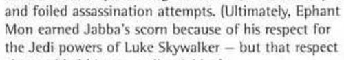

### Stat block notes (game mechanics, not feats)

- Jabba the Hutt: Noble 3/Scoundrel 3/Crime Lord 6; VP/WP 70/16; Defense 19; Will +11; Bluff +16, Diplomacy +18, Gather Information +20, Intimidate +18, Knowledge (organized crime) +20; Rep 10; Challenge Code F; Infamy (Source: *Secrets of Tatooine* (SWRPG d20), scan p.35)

## scan p.36 (scan page 36)

Page contents: 847 words, 17 paragraphs | headings/entries: Skills: Appraise +4, Bluff +10, Diplomacy +12,; Gardulle the Hutt; CITIES OF TATODINE

- **Bib Fortuna; Jabba the Hutt; Han Solo** — entry/section: Bib Fortuna: "Jabba planned to execute them, but they had prepared for such a contingency, and instead killed Jabba. This of course delighted Bib Fortuna, who had been preparing to assassinate Jabba himself anyway. But when he returned to the palace to seize his prize, he discovered that the B'omarr monks had concealed their own plans from him. Bib Fortuna soon found himself a disembodied brain floating in a containment sphere amid the most enlightened minds of the B'omarr." Source: *Secrets of Tatooine* (SWRPG d20), scan p.36
  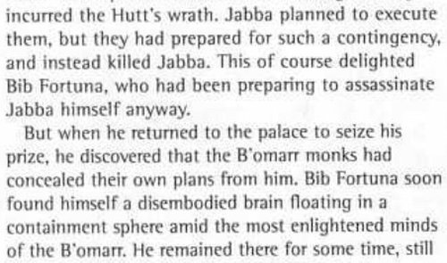

### Stat block notes (game mechanics, not feats)

- Bib Fortuna: Diplomat 5; VP/WP -/12; Bluff +10, Diplomacy +12; DSP 6; Challenge Code D (Source: *Secrets of Tatooine* (SWRPG d20), scan p.36)

## scan p.37 (scan page 37)

Page contents: 867 words, 17 paragraphs | headings/entries: Watto's Junk Shop

- **Gardulla the Hutt; Jabba the Hutt; Shmi Skywalker; Darth Vader (Anakin Skywalker); Sebulba** — entry/section: Gardulla the Hutt: "Gambling on the Podraces gradually drained away Gardulla's fortunes, and she found herself giving up various luxuries, such as slaves (including Shmi Skywalker and her infant son Anakin) on unlucky bets. Jabba tricked her into backing a Xexto pilot named Gasgano and betting heavily on him. Jabba already knew (by virtue of his astromech droid's oddsfiguring skills) that Gasgano could never beat Sebulba—Jabba's favorite." Source: *Secrets of Tatooine* (SWRPG d20), scan p.37
  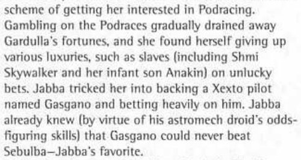
- **Watto; Darth Vader (Anakin Skywalker)** — entry/section: Watto's Junk Shop: "After the Battle of Naboo, the Toydarian is also famous for having lost all his money betting against his own slave, Anakin Skywalker, in the Boonta Eve Podrace." Source: *Secrets of Tatooine* (SWRPG d20), scan p.37
  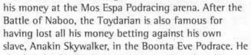

### Stat block notes (game mechanics, not feats)

- Gardulla the Hutt: Diplomat 4; VP/WP -/13; Diplomacy +11; Challenge Code E (Source: *Secrets of Tatooine* (SWRPG d20), scan p.37)

## scan p.38 (scan page 38)

Page contents: 864 words, 22 paragraphs | headings/entries: The Slave Quarter; Slave Tracking Devices; Shmi Skywalker; Feats: Skill Emphasis (Craft [electronics}); CITIES OF TATOUINE

- **Shmi Skywalker; Darth Vader (Anakin Skywalker)** — entry/section: Shmi Skywalker: "Anakin Skywalker's mother, Shmi, is a woman moved by destiny—some would say the Force—to bring about a great change in the galaxy. She does not know what that change will be, but she knows that it somehow involves her son." Source: *Secrets of Tatooine* (SWRPG d20), scan p.38
  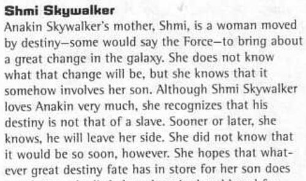

### Stat block notes (game mechanics, not feats)

- Shmi Skywalker: Commoner; VP/WP -/11; Craft (electronics) +8; Challenge Code A (Source: *Secrets of Tatooine* (SWRPG d20), scan p.38)

## scan p.39 (scan page 39)

Page contents: Mos Espa Grand Arena cost almost sixty slave lives; Boonta Eve Classic pilot mortality over fifty percent (hand-read)

- **Darth Vader (Anakin Skywalker); Sebulba** — entry/section: Fode and Beed: "Their most dynamic event so far was the Boonta Eve Classic on Tatooine, where the virtual unknown Anakin Skywalker unseated the reigning champion, Sebulba." Source: *Secrets of Tatooine* (SWRPG d20), scan p.39
  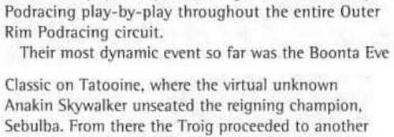

## scan p.40 (scan page 40)

Page contents: Rebellion era: governor Tour Aryon keeps Tatooine from the Emperor's notice and quietly removes Jabba's rivals; "Lady" Valarian the Whiphid runs the Lucky Despot (hand-read)

## scan p.41 (scan page 41)

Page contents: Prefect Eugene Talmont (Diplomat 2, CC B) aims to bring Jabba to justice while taking bribes (hand-read)

## scan p.42 (scan page 42)

Page contents: 32 words, 7 paragraphs | headings/entries: MOS €ISLEY >; CITIES OF TATOOINE; SoU ee Se A ER

## scan p.43 (scan page 43)

Page contents: Lt. Harburik (Noble 2/Soldier 3/Officer 1, VP/WP 30/12, CC C) throws stormtroopers at Jabba's agents; sandtrooper Thug 3; Garindan "Long Snoot" Kubaz Diplomat 4 spy paid by both Talmont and Jabba (hand-read)

## scan p.44 (scan page 44)

Page contents: 401 words, 11 paragraphs | headings/entries: The Wreck of the Dowager Queen; CITIES OF TATOOINE

## scan p.45 (scan page 45)

Page contents: Dim-U monastery front for slicers run by "Abbot" Drayk; Chalmun the Wookiee swindled the cantina from three Gran; Wuher's "no droids, no blasters, no messes" (hand-read)

## scan p.46 (scan page 46)

Page contents: 592 words, 19 paragraphs | headings/entries: Wuher; Habe; CITIES OF TATOOINE

## scan p.47 (scan page 47)

Page contents: Labria, Mos Eisley's worst information broker, was secretly Kardue'sai'Malloc, the Devaronian captain who executed over seven hundred at Montellian Serat; Kabe and Muftak; Momaw Nadon exiled Ithorian hiding Rebels under a Vesuvague hanging tree (hand-read)

## scan p.48 (scan page 48)

Page contents: 859 words, 21 paragraphs | headings/entries: Muftek; CITIES OF TATOOINE

## scan p.49 (scan page 49)

Page contents: 400 words, 12 paragraphs | headings/entries: The Lucky Despot; Lady Valarian; CASINO >

- **Lady Valarian; Jabba the Hutt** — entry/section: Lady Valarian: "She finally reached agreements with Jabba in which she paid him an exorbitant sum to leave him in peace and promised not to try to extend her criminal operations farther than the spaceport. Officially, they both honor their side of the bargain—but the truce between them is a shaky one. Each is constantly testing the other's defenses, seeking a way to eliminate the competition once and for all." Source: *Secrets of Tatooine* (SWRPG d20), scan p.49
  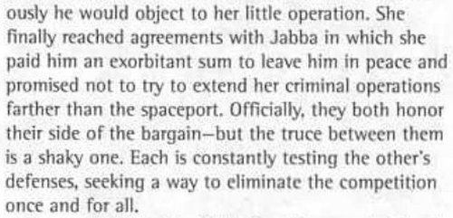

## scan p.50 (scan page 50)

Page contents: 598 words, 17 paragraphs | headings/entries: CITIES OF TATOOINE; Eefive-Tootoo

- **Lady Valarian; Han Solo; Jabba the Hutt** — entry/section: Lady Valarian: "warrior of the huge bounty on Han Solo's head. Predictably, D'Wopp decided to set out at once to collect the prize. Valarian objected—violently—to her new mate's poor timing (and choice of patrons), and in the ensuing argument, she killed her own newlywed husband." Source: *Secrets of Tatooine* (SWRPG d20), scan p.50
  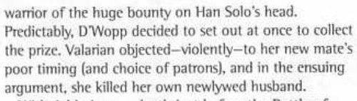
- **Lady Valarian; Jabba the Hutt; Talon Karrde** — entry/section: Lady Valarian: "With Jabba's own death just before the Battle of Endor, Valarian finally had her chance to seize Jabba's empire. Assuming that all Jabba's lieutenants had been killed aboard his sail barge—there certainly wasn't any news coming out of Jabba's palace—Valarian quickly took over Jabba's operations in and around Mos Eisley and began extending her reach into Tatooine's other cities as well. Of course, without Jabba around to call the shots, most of the Hutt's smuggler contacts drifted to other patrons, notably the elusive Talon Karrde." Source: *Secrets of Tatooine* (SWRPG d20), scan p.50
  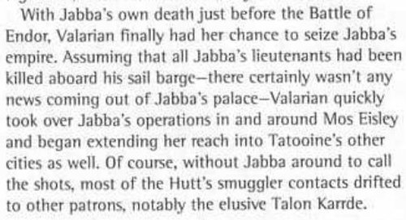
- **Jabba the Hutt; Lady Valarian** — entry/section: Eefive-Tootoo: "When Jabba smeared meat all over the assassin droid and threw it to his rancor, all that was left was twisted scraps of metal and broken gears. Lady Valarian rescued the scrap and paid to have it rebuilt and reprogrammed—all because she knew it would spoil Jabba's fun." Source: *Secrets of Tatooine* (SWRPG d20), scan p.50
  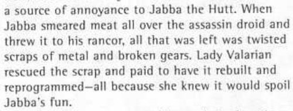

### Stat block notes (game mechanics, not feats)

- Lady Valarian: Noble 2/Scoundrel 5/Crime Lord 3; VP/WP 62/14; Defense 20; Diplomacy +15, Gather Information +14, Knowledge (organized crime) +14; sneak attack +2d6; Rep 8; Challenge Code E (Source: *Secrets of Tatooine* (SWRPG d20), scan p.50)

## scan p.51 (scan page 51)

Page contents: Ortugg Gamorrean captain Thug 4 (vibro-ax +9, 2d10+4); Tessek Quarren accountant skimming Jabba's money; Zutton "Snaggletooth" Scout 3/Soldier 3 VP/WP 55/14 paints his targets (hand-read)

- **Ephant Mon; Ki-Adi-Mundi** — entry/section: Ephant Mon: "While unswervingly loyal to Jabba, Ephant Mon is hardly an exemplary individual. Throughout his long life, he has been a mercenary, a slaver, and has even tangled with the Jedi—once actually kidnapping the daughter of Cerean Jedi Master Ki-Adi-Mundi. The Chevin has survived for so long largely by betraying his business associates faster than they can betray him." Source: *Secrets of Tatooine* (SWRPG d20), scan p.51
  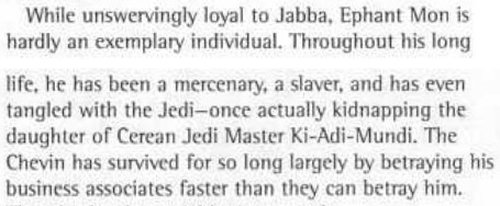

### Stat block notes (game mechanics, not feats)

- Ephant Mon: Scoundrel 4; VP/WP 32/14; Defense 16; DSP 8; Profession (gunrunner) +11; Challenge Code D (Source: *Secrets of Tatooine* (SWRPG d20), scan p.51)

## scan p.52 (scan page 52)

Page contents: 410 words, 14 paragraphs | headings/entries: Zutton; CITIES OF TATODINE

## scan p.53 (scan page 53)

Page contents: 431 words, 24 paragraphs | headings/entries: Jabba's Palsce; JABBA'S THRONE ROOM >; S SSR SS; SCALE IN METERS

- **Jabba the Hutt** — entry/section: Jabba's Palace: "Like every resident before him, Jabba arrogantly believes that the monks are merely pacifistic scholars who suffer the series of occupations as only the weak truly can. Little does he know that the monks are planning to one day remove his brain and make him one of them." Source: *Secrets of Tatooine* (SWRPG d20), scan p.53
  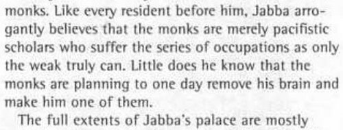

## scan p.54 (scan page 54)

Page contents: Weequays all answer to "Weequay"; Porcellus three-time Golden Spoon winner; Malakili former Corellian circus tamer, rancor's keeper (hand-read)

## scan p.55 (scan page 55)

Page contents: 826 words, 22 paragraphs | headings/entries: IIODIVL40 S310; Salacious Crumb

- **Han Solo; Jabba the Hutt; Boba Fett; Darth Vader (Anakin Skywalker)** — entry/section: Jabba the Hutt: "The bounty was finally claimed by the infamous bounty hunter Boba Fett, who managed to increase the sum even further by suggesting that Han Solo (now frozen in carbonite) could be considered not just a bounty, but a piece of artwork—created by none other than the Dark Lord of the Sith, Darth Vader. Amused at the notion, Jabba paid Boba Fett 250,000 credits for Solo." Source: *Secrets of Tatooine* (SWRPG d20), scan p.55
  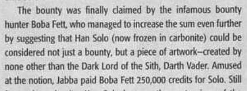
- **Jabba the Hutt; Leia Organa Solo; Luke Skywalker; Han Solo; Chewbacca; Jabba's Rancor** — entry/section: Jabba the Hutt: "Han Solo's friends-including the newly trained Jedi Knight, Luke Skywalker—attempted a rescue, but earned Jabba's wrath when they not only freed Han from the carbonite, but killed his pet rancor. Infuriated, Jabba attempted to execute Skywalker, Solo, and Solo's copilot, the Wookiee Chewbacca, by feeding them to the Sarlacc. But Solo's companions turned the tables on Jabba. The sluglike crime lord died aboard his sail barge over the Great Pit of Carkoon, strangled to death by Leia Organa." Source: *Secrets of Tatooine* (SWRPG d20), scan p.55
  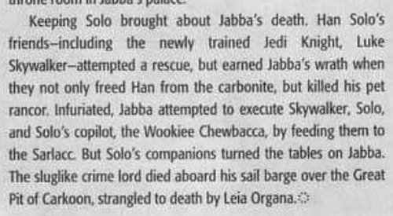
- **Jabba's Rancor; Bib Fortuna; Jabba the Hutt** — entry/section: The Rancor: "Jabba rewarded Bib Fortuna by making him his majordomo—and rewarded Bidlo Kwerve by making him the rancor's first meal. Jabba's rancor is actually somewhat small for its species; it has been in captivity for so long that it hasn't completely matured physically." Source: *Secrets of Tatooine* (SWRPG d20), scan p.55
  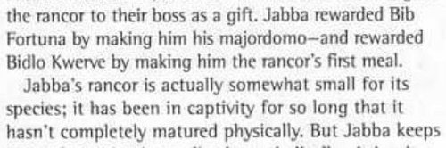
- **Salacious Crumb; Jabba the Hutt** — entry/section: Salacious Crumb: "Crumb's job as jester is to make Jabba laugh at least once each day—or be eaten (either by the rancor, or Jabba himself). He has managed to survive years at Jabba's side, and everyone in Jabba's employ hates him, so he has plainly done his job well. (There are as many plots to kill Salacious Crumb as there are to kill Jabba himself.)" Source: *Secrets of Tatooine* (SWRPG d20), scan p.55
  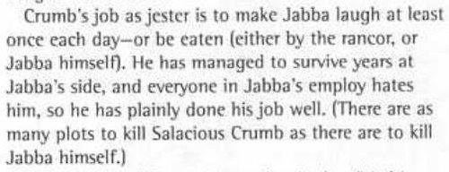
- **Han Solo; Luke Skywalker; Chewbacca**: "Keeping Solo brought about Jabba's death, Han Solo's friends-including the newly trained Jedi Knight, Luke Skywalker—attempted a rescue, but earned Jabba's wrath when they not only freed Han from the carbonite, but killed his pet rancor. infuriated, Jabba attempted to execute Skywalker, Solo, -and Solo's copilot, the Wookiee Chewbacca, by feeding them to the Sarlacc." Source: *Secrets of Tatooine* (SWRPG d20), scan p.55
  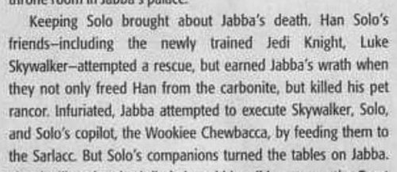

### Stat block notes (game mechanics, not feats)

- Jabba's Rancor: Predator 5; VP/WP 40/36; Defense 22; claw +11 (1d6+8), bite +6 (2d6+8); Str 26; fast healing 2; Challenge Code D (Source: *Secrets of Tatooine* (SWRPG d20), scan p.55)
- Salacious Crumb: Kowakian monkey-lizard Scavenger 2; VP/WP 10/4; Challenge Code B (Source: *Secrets of Tatooine* (SWRPG d20), scan p.55)

## scan p.56 (scan page 56)

Page contents: 0 words, 0 paragraphs | headings/entries: 

## scan p.57 (scan page 57)

Page contents: NJO era: Mos Entha model city; Valarian bought a city council seat via deal with the New Republic; protégé Shiri'ani (Twi'lek Expert 2/Diplomat 3, CC D) bought as a child slave by Bib Fortuna (hand-read)

- **Lady Valarian** — entry/section: Who's In Charge: "She has had a progressively more difficult time staying disassociated from criminal incidents and has been the target of no less than seven recent assassination attempts—some of which originated within the ranks of her own organization." Source: *Secrets of Tatooine* (SWRPG d20), scan p.57
  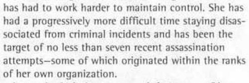

## scan p.58 (scan page 58)

Page contents: 17 words, 2 paragraphs | headings/entries: MOS ENTHA >

## scan p.59 (scan page 59)

Page contents: 670 words, 32 paragraphs | headings/entries: Lews end Ordinances; Semple Class One Infractions; Conspiracy or treason against the New Republic,; Semple Class Two Infractions; Semple Class Three Infractions; Semple Class Four infractions; The Lucky Star

## scan p.60 (scan page 60)

Page contents: Herogga the Hutt (Nasirii; Noble 2/Scoundrel 5, VP/WP 46/15, DSP 10, CC E) hides under the Crystal Moon run by Porcellus and Malakili; orders execution of rivals' children; Yuuzhan Vong devastated Nal Hutta, Hutts fleeing to Tatooine (hand-read)

- **Bib Fortuna** — entry/section: Shiri'ani: "If Shiri'ani has an interest in anyone, it is the mysterious Twi'lek she has come to know as Firith Olan. Arriving at the Lucky Star shortly after its grand opening, Olan impressed her with his wit, charisma, cunning—and the fact that he had the brain of her most hated enemy, Bib Fortuna, in a jar." Source: *Secrets of Tatooine* (SWRPG d20), scan p.60
  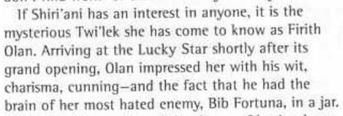
- **Bib Fortuna; Lady Valarian** — entry/section: Shiri'ani: "Her eagerness has blinded her, though, and she is allowing Olan to gradually turn her against Lady Valarian. With each passing day, she channels more of her resources into aiding Firith Olan instead of her mentor—never guessing that he secretly is Bib Fortuna, his brain implanted in Olan's body." Source: *Secrets of Tatooine* (SWRPG d20), scan p.60
  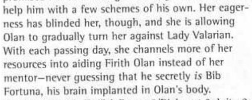
