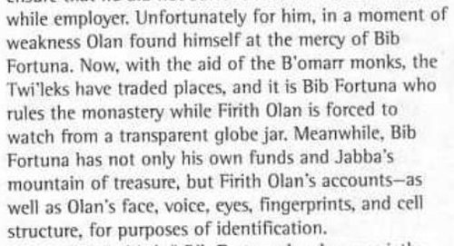
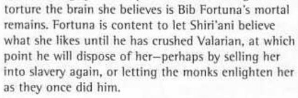
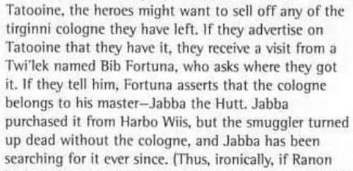
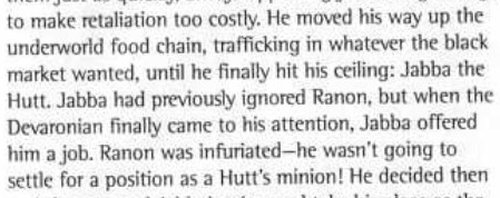

# Owner Material 037 — Star Wars D20 Drive folder (Core, Revised Core and Saga Edition): Sourcebooks/Secrets of Tatooine.pdf [Star Wars Roleplaying Game (d20, 2000)] (scan pages 61–95)

- **Source:** Wizards of the Coast Star Wars Roleplaying Game books, web enhancements, Living Force campaign modules and articles (2000–2010), from the owner's "Star Wars D20" Drive folder (only the three edition subfolders; "General" was not read, as instructed). Secondary source (licensed Legends reference). Scan OCR'd on the box; the scan stays box-only and is **not** published.
- **Method:** every scanned page was OCR'd and machine-screened sentence by sentence for power-relevant statements (fights, kills, defeats, Force feats, rankings, superweapons) that name a character on our roster; each kept sentence is quoted verbatim from the OCR text and has a crop of the printed passage directly under it. Pages with nothing power-relevant are still listed with what is on them.
- **Citation:** "*Secrets of Tatooine* (SWRPG d20), p.X" by printed page ("scan p.X" where no printed number applies). **Weight:** Licensed RPG material: a secondary source. Narrative text sums up Legends lore; game statistics are rules for players, not canon power levels, and rank lowest.

## scan p.61 (scan page 61)

Page contents: Eidolon Base built by Sate Pestage, captured by Rogue Squadron, later resettled by ex-Imperials with eight TIE fighters (hand-read)

## scan p.62 (scan page 62)

Page contents: Captain Arajen Turmen (Noble 2/Soldier 4/Officer 2, VP/WP 44/12, Pilot +13, CC E) leads Imperial settlers at Eidolon; fears another Fort Tusken (hand-read)

- **Bib Fortuna** — entry/section: Bib Fortuna Returns: "Unfortunately for him, in a moment of weakness Olan found himself at the mercy of Bib Fortuna. Now, with the aid of the B'omarr monks, the Twi'leks have traded places, and it is Bib Fortuna who rules the monastery while Firith Olan is forced to watch from a transparent globe jar. Meanwhile, Bib Fortuna has not only his own funds and Jabba's mountain of treasure, but Firith Olan's accounts—as well as Olan's face, voice, eyes, fingerprints, and cell structure, for purposes of identification." Source: *Secrets of Tatooine* (SWRPG d20), scan p.62
  

## scan p.63 (scan page 63)

Page contents: Yuuzhan Vong found Tatooine useless for dovin basals; after the Hutts' failed alliance the Vong bio-converted Nal Hutta and Nar Shaddaa; Hutts petition to relocate to Tatooine (hand-read)

- **Bib Fortuna; Lady Valarian** — entry/section: Bib Fortuna Returns: "Fortuna is content to let Shiri'ani believe what she likes until he has crushed Valarian, at which point he will dispose of her—perhaps by selling her into slavery again, or letting the monks enlighten her as they once did him." Source: *Secrets of Tatooine* (SWRPG d20), scan p.63
  

### Stat block notes (game mechanics, not feats)

- Bib Fortuna: (NJO, in Firith Olan's body) Diplomat 5/Crime Lord 2; VP/WP 11/14; Bluff +11, Diplomacy +12, Intimidate +11; DSP 10; Rep 9; Challenge Code D (Source: *Secrets of Tatooine* (SWRPG d20), scan p.63)

## scan p.64 (scan page 64)

Page contents: Podracing rules: relative abstraction, template, speeds neutral/low/high/boost; Sebulba's pod is an infamous armed exception (hand-read)

## scan p.65 (scan page 65)

Page contents: 606 words, 31 paragraphs | headings/entries: Speed and Temperature; Race Track; Starting the Race; Roll initiative,; Initiative; Speed; Using Boost; Racing Actions; Maneuvering

## scan p.66 (scan page 66)

Page contents: 184 words, 30 paragraphs | headings/entries: TwOUMD HDNVO HOtH; SyuNnLYYSdWSl SUISUS . 1WH1LU09 30 ino; Pal jonuUoD uieBay jonuo? ureSay; S22} WO}tg pasoddg yeZue, dwng; ZyCNwsuajeg z 'Buyoo>; Fe AAS 1O}td EF saajeniul; Je swoqesayaxy ee spaads doy; To SWNT SWLLHELS HIbuL 3904

## scan p.67 (scan page 67)

Page contents: Podracing maneuvers (attack, ram, bump, regain control), engine temperature, damage; Boonta Classic called "the most dangerous race course in the galaxy" (hand-read)

## scan p.68 (scan page 68)

Page contents: 367 words, 8 paragraphs | headings/entries: PODRACING

## scan p.69 (scan page 69)

Page contents: 782 words, 23 paragraphs | headings/entries: Lowy; Table 3-5: Crash; Demage; Partial Demage Effecte; Repairing Damage; Modifying Podracers; Generating a Race; Generating

## scan p.70 (scan page 70)

Page contents: 270 words, 12 paragraphs | headings/entries: PODRACING

## scan p.71 (scan page 71)

Page contents: 748 words, 24 paragraphs | headings/entries: Generating Podracer Attributes; Table 3-6: Modifiers; Genersting Hull Points and Cooling Modifiers; Generating Stretches; Length of Rece; Example Rece Courses; The Tibanna 300

## scan p.72 (scan page 72)

Page contents: 14 words, 3 paragraphs | headings/entries: Tibanna 300 >; TURN (Turn maneuver,

## scan p.73 (scan page 73)

Page contents: 363 words, 17 paragraphs | headings/entries: ONIIVYOOd; Sample Podracers; Wan Sendege; Repair +2 Durability +2 Repair+4; SOCIM CHARIS; GRE BSSETRGSTAR=S; Clegg Holdfest

## scan p.74 (scan page 74)

Page contents: 281 words, 48 paragraphs | headings/entries: Skywalker; Pilot +8 Acceleration +1 Accelerate+9; Pilot +8 Acceleration +1 Accelerate+9; Repair +0 Durability +2. Repair+2; Ratts Tyerell; Boles Roor; PODRACING; Repair +0 Durability +1 Repair+1; Dud Bolt; Pilot +4 = Turning +4 Tum+8; Repair +2 Durability +4. Repair+6; Teamto Pagalies; Pilot +4 Acceleration +0 Accelerate+4; Pilot +4 Turning +5 Tum+9; Repair +2 Durability +4 Repair+6

### Stat block notes (game mechanics, not feats)

- Anakin Skywalker: Podracer pregen: Initiative +3, Pilot +9, Repair +3, VP/WP 8/10 (Boonta Eve Classic) (Source: *Secrets of Tatooine* (SWRPG d20), scan p.74)

## scan p.75 (scan page 75)

Page contents: 222 words, 32 paragraphs | headings/entries: Alder Beado; Pilot +5 Acceleration +6 Accelerate+11; Pilot +5 = Turning +4 Tum+9; Repair +0 Durability +3 Repair+3 Neve Hee; Pilot +4 Acceleration +0 Accelerate+4; Pilot +4 Turning +4 Tum+s8; Repair +2 Durability +2 Repair+4; Pilot +5 Acceleration +3 Accelerate+8; Pilot +5 Turning +1 Turn+6; Pilot +4 = Acceleration +1 Accelerate+5; Pilat +4 'Turning +0 Turn+4; Repair +2 Durability +4 Repair+6 _"; Ody Mandrell; Pilot Acceleration Accelerate+9; Pilot +6 Turing +2 Turn+8; Repair Durability; Elan Mak; Durability +3; Sbe Endocott

## scan p.76 (scan page 76)

Page contents: Adventure Between Sand and Sky: Devaronian crime lord Ranon Djelkh at war with Jabba plots to kill him with a mole serpent lured by tirginni cologne; enforcer Oggun Bantha-Horn; smuggler Harbo Wiis (hand-read)

## scan p.77 (scan page 77)

Page contents: 785 words, 28 paragraphs | headings/entries: Mistsken identity; Docking Bay 14

## scan p.78 (scan page 78)

Page contents: 707 words, 14 paragraphs | headings/entries: Thug Tactics; Oggun's Tactics

## scan p.79 (scan page 79)

Page contents: 814 words, 23 paragraphs | headings/entries: Oggun accepts the merchandise—and then orders ig; Scene Two: Across the Dune Sea; Sand in the Sky

## scan p.80 (scan page 80)

Page contents: 867 words, 17 paragraphs | headings/entries: Reaping the Whirlwind; Scene One: Digging Out; The Jawas

## scan p.81 (scan page 81)

Page contents: 616 words, 16 paragraphs | headings/entries: LAD IOE A! RIIAGS

## scan p.82 (scan page 82)

Page contents: Mole serpent freed from the Star Stalker wreck killed more than half a Tusken tribe and most of their banthas; A-Zulmun survived by jamming his rifle in its mouth (hand-read)

## scan p.83 (scan page 83)

Page contents: 873 words, 17 paragraphs | headings/entries: Send People Tactics; When the Smoke Clesrs

## scan p.84 (scan page 84)

Page contents: 862 words, 18 paragraphs | headings/entries: A-Zulmun; Scene One: Danger under the Sands; BETWEEN SAND AND THE SKY

## scan p.85 (scan page 85)

Page contents: 817 words, 18 paragraphs | headings/entries: ANS FHL ONY ONYS N33M138; The Star Stalker

## scan p.86 (scan page 86)

Page contents: 708 words, 17 paragraphs | headings/entries: Male Serpent Tactics

## scan p.87 (scan page 87)

Page contents: 832 words, 20 paragraphs | headings/entries: The Heroos' Tectics; Moving Silently; High Ground; Using the Force; Scene Two: Danger under the Suns; The Crime Lord Renon Djelkh

## scan p.88 (scan page 88)

Page contents: 400 words, 9 paragraphs | headings/entries: Bargaining with Ranon; BETWEEN SAND AND THE SKY

## scan p.89 (scan page 89)

Page contents: 899 words, 17 paragraphs | headings/entries: Renon's Tectics; Oggun's Strategy; Mole Serpent Tactics

## scan p.90 (scan page 90)

Page contents: 958 words, 23 paragraphs | headings/entries: BETWEEN SAND AND THE SKY

## scan p.91 (scan page 91)

Page contents: 876 words, 17 paragraphs | headings/entries: Cast of Characters; Harbo Wiis

- **Bib Fortuna; Jabba the Hutt** — entry/section: Epilogue: "If they advertise on Tatooine that they have it, they receive a visit from a Twi'lek named Bib Fortuna, who asks where they got it. If they tell him, Fortuna asserts that the cologne belongs to his master—Jabba the Hutt. Jabba purchased it from Harbo Wiis, but the smuggler turned up dead without the cologne, and Jabba has been searching for it ever since." Source: *Secrets of Tatooine* (SWRPG d20), scan p.91
  

## scan p.92 (scan page 92)

Page contents: Ranon Djelkh Devaronian Scoundrel 6 (VP/WP 37/13, Defense 19, DSP 13, CC D); Oggun Bantha-Horn enforcer with a Wookiee bowcaster trophy (hand-read)

- **Jabba the Hutt** — entry/section: Ranon Djelkh: "He moved his way up the underworld food chain, trafficking in whatever the black market wanted, until he finally hit his ceiling: Jabba the Hutt. Jabba had previously ignored Ranon, but when the Devaronian finally came to his attention, Jabba offered him a job. Ranon was infuriated—he wasn't going to settle for a position as a Hutt's minion!" Source: *Secrets of Tatooine* (SWRPG d20), scan p.92
  

## scan p.93 (scan page 93)

Page contents: 851 words, 25 paragraphs | headings/entries: Jawas; Deeses

## scan p.94 (scan page 94)

Page contents: A-Zulmun Tusken Fringer 5 (VP/WP 42/15); Mole serpent Predator 12, VP/WP 180/80, bite +18 2d8+10, swallow whole, CC F; Empideera Kkek Jawa haggler and Deesee power/translator droid; T-36 Skyfighter flawed in atmosphere (hand-read)

## scan p.95 (scan page 95)

Page contents: 884 words, 19 paragraphs | headings/entries: T-36 Skyfighter; Skyfighter

