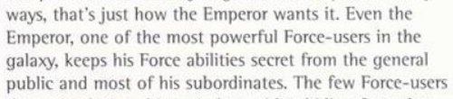
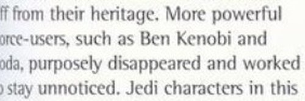
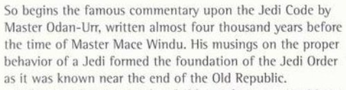
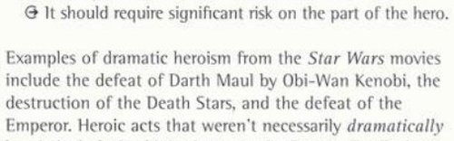
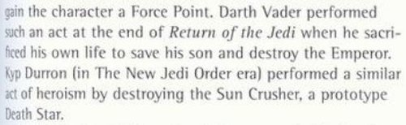

# Owner Material 037 — Star Wars D20 Drive folder (Core, Revised Core and Saga Edition): Sourcebooks/Star Wars Roleplaying Game Core Rulebook.pdf [Star Wars Roleplaying Game (d20, 2000)] (scan pages 121–180)

- **Source:** Wizards of the Coast Star Wars Roleplaying Game books, web enhancements, Living Force campaign modules and articles (2000–2010), from the owner's "Star Wars D20" Drive folder (only the three edition subfolders; "General" was not read, as instructed). Secondary source (licensed Legends reference). Scan OCR'd on the box; the scan stays box-only and is **not** published.
- **Method:** every scanned page was OCR'd and machine-screened sentence by sentence for power-relevant statements (fights, kills, defeats, Force feats, rankings, superweapons) that name a character on our roster; each kept sentence is quoted verbatim from the OCR text and has a crop of the printed passage directly under it. Pages with nothing power-relevant are still listed with what is on them.
- **Citation:** "*Star Wars Roleplaying Game Core Rulebook* (SWRPG d20), p.X" by printed page ("scan p.X" where no printed number applies). **Weight:** Licensed RPG material: a secondary source. Narrative text sums up Legends lore; game statistics are rules for players, not canon power levels, and rank lowest.

## scan p.121 (scan page 121)

Page contents: 869 words, 39 paragraphs | headings/entries: EHPLOSIVG CHARGES; Grenade, Prag; Energy —-

## scan p.122 (scan page 122)

Page contents: 795 words, 21 paragraphs | headings/entries: Sing; Stugthrower; CHAPTER SEVEN; Ini iy; I) I

## scan p.123 (scan page 123)

Page contents: 863 words, 33 paragraphs | headings/entries: S280) Seer; WIARS whidenD; Battle Armor; Blast Helmet and Vest; Ceremonial Armor; Combat Jumpsuit; Corellian Powersuit; Stormtrooper Armor; IM ty TaN od

## scan p.124 (scan page 124)

Page contents: 874 words, 38 paragraphs | headings/entries: Equipment; Bacta Tank; Breath Mask; Code Cylinder; No money, no parts! No deallgy; Credit Chip; UIPMENT iat i iia; CHAPTER; EQ

## scan p.125 (scan page 125)

Page contents: 704 words, 39 paragraphs | headings/entries: Gee) © 82>; MOASS B2LeeHD; Datapad; Energy Cell; Holoprojector; Holorecorder; Liquid Cable Dispenser; Grappling Spike Launcher

## scan p.126 (scan page 126)

Page contents: 683 words, 25 paragraphs | headings/entries: Sensor Pack; EQUIPMENT

## scan p.127 (scan page 127)

Page contents: 8 words, 5 paragraphs | headings/entries: COMBAT; CHAPTER EIGHT

## scan p.128 (scan page 128)

Page contents: 518 words, 9 paragraphs | headings/entries: How Combat Works; Setup

## scan p.129 (scan page 129)

Page contents: 1098 words, 32 paragraphs | headings/entries: W284 © 82>; ANOD) S21a¥HD; Surprise Round; CHAPTER B= COMBAT Mt); First Regular Round; Tt) ee

## scan p.130 (scan page 130)

Page contents: 536 words, 22 paragraphs | headings/entries: Combat Sequence; Loi oO) CHAPTER A= COMBAT «OBE PE; UU (sclLink

## scan p.131 (scan page 131)

Page contents: 764 words, 47 paragraphs | headings/entries: IVEwWwnod; Th; Combat Statistics; Attack Roll; Size Modifier; Range Penalty; Fine (stingfly) +8 i Damage; Strength Bonus; Defense; NM te TO OE

## scan p.132 (scan page 132)

Page contents: 917 words, 36 paragraphs | headings/entries: Rounds; Initiative; Attacks; Damage; D Vitality Points; Dyin; Healing Naturally; Miniatures and Action Pigures; CHAPTER @ = COMBAT

## scan p.133 (scan page 133)

Page contents: 1011 words, 29 paragraphs | headings/entries: VARIANT: THE DEPERSE ROLL; Dexterity Modifier; Size Modifier; Touch Attacks; Vitality and Wound Paints

## scan p.134 (scan page 134)

Page contents: 918 words, 38 paragraphs | headings/entries: Initiative; Joining a Battle; Flat-Footed; Surprise; WW WI ed) fb) wl; Actions in Combat; AAAA; WE TEN CHAPTER @ = COMBAT; WE VE WON Esc}linn:: |; Vi

## scan p.135 (scan page 135)

Page contents: 925 words, 31 paragraphs | headings/entries: S208 = arr; The Combat Round; Action Types; Attack Action; Mave Action; CHAPTER B= COMBAT th YP Ml; Hel im oa; Pree Actions; Table 8-2: Fundamental Actions in Combat; Attack Actions; Witt Te oe

## scan p.136 (scan page 136)

Page contents: 655 words, 32 paragraphs | headings/entries: Automatic Misses and Hits; Damage Rolls; Critical Hits; Melee and Ranged Attack Situations; If Vor'en makes; Gut; MAPTER EF

## scan p.137 (scan page 137)

Page contents: 636 words, 33 paragraphs | headings/entries: LMOI3 WRLaYHD; Nas; Multiple Attacks; Shooting or Throwing into a Melee; CHAPTER A= COMBAT JM of OM OE; Rorworr suffers ~4 penalty beca; Qr; Fighting Defensively; Unarmed Attacks; Move Actions; Mave

## scan p.138 (scan page 138)

Page contents: 592 words, 41 paragraphs | headings/entries: Manipulating an Item; Standing Up; Charge; Pull Attack; Critical Hit Flowchart; Attack Roll Result 1-19 (number on d20); Attack Roll Result 20 (number on d20); No Threat. Deal Threat!; SSO; Critical Roll Result = Miss!; SSO

## scan p.139 (scan page 139)

Page contents: 945 words, 44 paragraphs | headings/entries: SPEEDING UP COMBAT; Table 8-3: Two-Weapon Fighting Penalties; Circumstances Primary Hand Off Hand; Normal penalties -6 -10; Off-hand weapon is light -4 -8; Ambidexterity feat -6 -6; Two-Weapon Fighting feat -4 -8; Off-hand weapon is light and -2 -2; Ambidexterity feat and Two-Weapon Fighting feat; Run; Total Defense

## scan p.140 (scan page 140)

Page contents: 859 words, 38 paragraphs | headings/entries: DAMAGE TD SPEGIPICRRERS; Head All attack rolls, saves, and checks; Damaging Helpless Defenders

## scan p.141 (scan page 141)

Page contents: 928 words, 37 paragraphs | headings/entries: AMOTD @user¥HD; Fhe dt; WN (scJLinh: 0 0; Stabilization and Recovery; Healing; Natural Healing; Assisted Healing; CHAPTER A= COMBAT ith Yo OD; Healing Limits; Tactical Movement; Wd Te eo

## scan p.142 (scan page 142)

Page contents: 980 words, 32 paragraphs | headings/entries: Tle 8-5: Tactical Speed; Flanking; Namie; Combined Fire; Oo UD) CHAPTER @ = COMBAT; BE VEL ON [sc}Linn::; CMAPTE® ElGut

## scan p.143 (scan page 143)

Page contents: 881 words, 45 paragraphs | headings/entries: Table 8-6: Creature Size and Scale; Combat Modifiers; Table 8-7: Attack Roll Modifiers; Circumstance Melee Ranged; Attacker flanking defender* +2 -; Attacker on higher ground +1 (0); Attacker fallen -4 0; Attacker concealed +2t +2t; Defender sitting or kneeling +2 -2; Defender fallen +4 -4; Defender climbing +2t +2t; Defender surprised +0f +0t or flat-footed; Defender running +0t -2t; Defender grappling +0t +0tt (attacker not); Defender pinned +4t -4t; Defender has cover —See Cover—; Defender concealed —See Concealment—; CHAPTER B= COMBAT th i) ob OM); Degree of Cover; Cover Defense Bonus; Cover Reflex Save Bonus; T) ee

## scan p.144 (scan page 144)

Page contents: 789 words, 38 paragraphs | headings/entries: One-half; Nine-tenths +10 +4*; Total; Concealment; Hh Wipe them out... °°°°; Table 8-9: Concealment; Concealment Example Miss Chance; Three-quarters Dense foliage 30%; Nine-tenths Near total darkness 40%; Helpless Defenders; Special Initiative Actions; CwaPTEn

## scan p.145 (scan page 145)

Page contents: 814 words, 30 paragraphs | headings/entries: Delaying Limits; Multiple Characters Delaying; How Readying Works; Readying an Action; Initiative Consequences of Readying; Readying a Weapon Against a Charge; Special Weapon Effects; Direction of Throw; Vit | ee | ty

## scan p.146 (scan page 146)

Page contents: 469 words, 27 paragraphs | headings/entries: Rutofire; Win Pel; CHAPTER 8 = COMBAT; BE WEL ON (seJLinh::; CHAPTER EfGMT; TT

## scan p.147 (scan page 147)

Page contents: 703 words, 33 paragraphs | headings/entries: OPTIOOL HOLE: STANY ATTACKS; Multifire; Multiple Ranged Attacks; Advanced Maneuvers; Attack an Object; Strike an Object

## scan p.148 (scan page 148)

Page contents: 921 words, 35 paragraphs | headings/entries: Size (Example) Held* Carried* inanimate; TT ee; Table 8-12: Substance Hardness and Wound Points; Table 8-13: Damaging Objects; Bantha Rush; Initiating a Bantha Rush; Wt ETE) CHAPTER 8 = COMBAT; Bt lal ti; HN [sc)LINE:: |

## scan p.149 (scan page 149)

Page contents: 938 words, 40 paragraphs | headings/entries: Disarm; Grapple; Grapple Checks; STRCHING BONUSES; Stacking means "combining for a cumulative; Starting a Grapple; Joining a Grapple; If You're Grappling; If You're Pinned

## scan p.150 (scan page 150)

Page contents: 640 words, 33 paragraphs | headings/entries: Seing Knocked Down

## scan p.151 (scan page 151)

Page contents: 0 words, 0 paragraphs | headings/entries: 

## scan p.152 (scan page 152)

Page contents: 578 words, 9 paragraphs | headings/entries: The Force Through the Ages; CHAPTER NINE

- **Palpatine (Darth Sidious)** — entry/section: The Force Through the Ages: "Even the Emperor, one of the most powerful Force-users in the galaxy, keeps his Force abilities secret from the general public and most of his subordinates." Source: *Star Wars Roleplaying Game Core Rulebook* (SWRPG d20), scan p.152
  

## scan p.153 (scan page 153)

Page contents: 1038 words, 30 paragraphs | headings/entries: Gi88k = ety; Tn) |; Force-Using Traditions; Disturbances in the Force; Hoo Wet i; The Jedi

## scan p.154 (scan page 154)

Page contents: 976 words, 53 paragraphs | headings/entries: The Jedi Code; JEDI AND LIGHTSARERS; EE ee ae

- **Obi-Wan Kenobi; Yoda** — entry/section: The Jedi (Rebellion era): "More powerful users, such as Ben Kenobi and Yoda, purposely disappeared and worked to stay unnoticed." Source: *Star Wars Roleplaying Game Core Rulebook* (SWRPG d20), scan p.154
  

## scan p.155 (scan page 155)

Page contents: 986 words, 32 paragraphs | headings/entries: O2te =*e2ze; Ta |; Tul; N38; The Teachings of Master Odan-Urr; The Path Within the Code; Interpreting the Code; Meditation; Wh Ta a oe

- **Odan-Urr** — entry/section: SIDEBAR: The Teachings of Master Odan-Urr: "So begins the famous commentary upon the Jedi Code by Master Odan-Unrr, written almost four thousand years before the time of Master Mace Windu. His musings on the proper behavior of a Jedi formed the foundation of the Jedi Order as it was known near the end of the Old Republic." Source: *Star Wars Roleplaying Game Core Rulebook* (SWRPG d20), scan p.155
  

## scan p.156 (scan page 156)

Page contents: 471 words, 19 paragraphs | headings/entries: 

## scan p.157 (scan page 157)

Page contents: 907 words, 41 paragraphs | headings/entries: I) ||; I; Morality; Bravery; Oei-Wan K side, they reason

## scan p.158 (scan page 158)

Page contents: 975 words, 38 paragraphs | headings/entries: Force Points; Hh PI EE Vt; Gaining Force Points; SO44; CHAPTER WINE

- **Darth Maul; Obi-Wan Kenobi**: "Examples of dramatic heroism from the Star Wars movies include the defeat of Darth Maul by Obi-Wan Kenobi, the destruction of the Death Stars, and the defeat of the Emperor." Source: *Star Wars Roleplaying Game Core Rulebook* (SWRPG d20), scan p.158
  

## scan p.159 (scan page 159)

Page contents: 723 words, 34 paragraphs | headings/entries: The Dark Side; Gaining Dark Side Points; Force Point (and which side of the; JEO! MASTER; Dark Side Characters

## scan p.160 (scan page 160)

Page contents: 534 words, 14 paragraphs | headings/entries: Atoning; Ser HARTH, DARK JEO!; CHAPTER WINE; LL

- **Darth Vader (Anakin Skywalker); Palpatine (Darth Sidious); Kyp Durron** — entry/section: Dark Side Characters: "Darth Vader performed such an act at the end of Return of the Jedi when he sacrificed his own life to save his son and destroy the Emperor. Kyp Durron (in The New Jedi Order era) performed a similar act of heroism by destroying the Sun Crusher, a prototype Death Star." Source: *Star Wars Roleplaying Game Core Rulebook* (SWRPG d20), scan p.160
  

## scan p.161 (scan page 161)

Page contents: 3 words, 2 paragraphs | headings/entries: CHAPTER TEN

## scan p.162 (scan page 162)

Page contents: 446 words, 15 paragraphs | headings/entries: Vehicle Costs; Vehicle Combat; Table 10-1: Speed Modifiers to Vehicle Checks; Vehicle Size; Vehicle Maneuvers

## scan p.163 (scan page 163)

Page contents: 760 words, 26 paragraphs | headings/entries: Waa U3sayR>; A2i8% #°S2r; Table 10-2: Vehicle Maneuvers; Jump (ground); Loop (air); Regain Control Cany); Turn fany); Extreme Turn Cany)

## scan p.164 (scan page 164)

Page contents: 959 words, 42 paragraphs | headings/entries: Sip; Said; Table 10-5: Used Vehicle Flaws d% Flaw

## scan p.165 (scan page 165)

Page contents: 912 words, 43 paragraphs | headings/entries: It a; Table 10-6: Vehicle Collision Damage; Speed (m/rd) Base Damage; Table 10-7: Vehicle Collision Size Modifiers; EAPLODING VEHICLES; Vehicle Descriptions; D el on) re Wi

## scan p.166 (scan page 166)

Page contents: 544 words, 15 paragraphs | headings/entries: AT-AT WALKER; Walkers; AT-ST WALKER

## scan p.167 (scan page 167)

Page contents: 682 words, 28 paragraphs | headings/entries: Q25et eats; Waa WaLeWHD; N38; LANOSPEEDER; Plash Speeder; Speeder Bikes; ARirspeeders

## scan p.168 (scan page 168)

Page contents: 479 words, 23 paragraphs | headings/entries: SPEEDER BiKe; Cloud Cars; Skiffs; AIRSPEEDER

## scan p.169 (scan page 169)

Page contents: 7 words, 5 paragraphs | headings/entries: CHAPTER ELEVEN; TRESHIPS

## scan p.170 (scan page 170)

Page contents: 402 words, 31 paragraphs | headings/entries: Second, the starship is a tool; STARSHIPS*; Zi ; |

## scan p.171 (scan page 171)

Page contents: 928 words, 49 paragraphs | headings/entries: Sr; Malfunctioning nav computer: -4 penalty to Astrogate; Situations, for instance,; CHAPTER 11 = STARSHIPS; Booking Passage; Chartering a Starship; Space Travel; Hyperspace Travel

## scan p.172 (scan page 172)

Page contents: 15 words, 2 paragraphs | headings/entries: 

## scan p.173 (scan page 173)

Page contents: 1052 words, 32 paragraphs | headings/entries: WAADTE Sdiave?; Te |; Vil; I bl; Wiel

## scan p.174 (scan page 174)

Page contents: 440 words, 27 paragraphs | headings/entries: Table 11-4: Astrogation Difficulty Modifier; CHAPTER ELEVEN; Situation DC Modifier Skill Check Modifier; Nav computer used* - +2/+4/+6; Astromech used* ~ +1/4+2/43; Hyperdrive lightly damaged +5 -

## scan p.175 (scan page 175)

Page contents: 800 words, 24 paragraphs | headings/entries: AAAA; Two fighters against a; Star Destroyers,; Starship Combat:; Relative Abstraction

## scan p.176 (scan page 176)

Page contents: 15 words, 3 paragraphs | headings/entries: Point Blank Short Medium Long Sensor

## scan p.177 (scan page 177)

Page contents: 777 words, 50 paragraphs | headings/entries: The Starship Combat Template; Starship Size; Table 11-8: Starship Sizes; Size Category Modifier Size (m) Examples; Colossal -8 1001+; Gargantuan -4 501-1000 Assault frigate; Huge =2 251-500 Nebulon-B escort frigate; Small +1 21-50; Tiny +2 11-20 Starfighter; Diminutive +4 6-10 TIE fighter; Imperial Star Destroyer, Mon Calamari star cruiser; Light freighter, Imperial customs light cruiser; Initiative

## scan p.178 (scan page 178)

Page contents: 812 words, 47 paragraphs | headings/entries: Table 11-11: Starship Piloting Maneuvers; Opposed, faster +5 Opposed, faster +5; Increase Range: This maneuver increases the range; If the; Il) CHAPTER VW = STARSHIPS IPE Ve

## scan p.179 (scan page 179)

Page contents: 1209 words, 24 paragraphs | headings/entries: MUABI9 BT4vHD; TT) |; No) Weel i oa

## scan p.180 (scan page 180)

Page contents: 921 words, 36 paragraphs | headings/entries: WO a; Wmieu; Attacking; Weapon Facing; Mt It; CuAPTOR Eleven; I) MI

