# Owner Material 037 — Star Wars D20 Drive folder (Core, Revised Core and Saga Edition): Sourcebooks/Star Wars Roleplaying Game Core Rulebook.pdf [Star Wars Roleplaying Game (d20, 2000)] (scan pages 181–240)

- **Source:** Wizards of the Coast Star Wars Roleplaying Game books, web enhancements, Living Force campaign modules and articles (2000–2010), from the owner's "Star Wars D20" Drive folder (only the three edition subfolders; "General" was not read, as instructed). Secondary source (licensed Legends reference). Scan OCR'd on the box; the scan stays box-only and is **not** published.
- **Method:** every scanned page was OCR'd and machine-screened sentence by sentence for power-relevant statements (fights, kills, defeats, Force feats, rankings, superweapons) that name a character on our roster; each kept sentence is quoted verbatim from the OCR text and has a crop of the printed passage directly under it. Pages with nothing power-relevant are still listed with what is on them.
- **Citation:** "*Star Wars Roleplaying Game Core Rulebook* (SWRPG d20), p.X" by printed page ("scan p.X" where no printed number applies). **Weight:** Licensed RPG material: a secondary source. Narrative text sums up Legends lore; game statistics are rules for players, not canon power levels, and rank lowest.

## scan p.181 (scan page 181)

Page contents: 1040 words, 34 paragraphs | headings/entries: NUATIE ORideed; I) Il; Table 11-13: Starship Range Penalties; Point Blank Range; Hw wel ee; Fire-Linked Weapons; Fighter Wings; Starship Missile Weapons

## scan p.182 (scan page 182)

Page contents: 560 words, 53 paragraphs | headings/entries: Resolving the Attack; Table 11-14: Missile Guidance Systems; ING size; TRADE FEDERATION BATTL

## scan p.183 (scan page 183)

Page contents: 960 words, 35 paragraphs | headings/entries: NoAaTS; Unguided Missiles; Table 11-15: Unguided Missile Range; Large to Colossal Short; Planetary Medium; Damage; Repairing Damage; Miscellaneous Weapon Motes; Wiel @ il; Starship Descriptions; Starfighters

## scan p.184 (scan page 184)

Page contents: 945 words, 26 paragraphs | headings/entries: TERMINOLOGY

## scan p.185 (scan page 185)

Page contents: 735 words, 20 paragraphs | headings/entries: Trade Federation Droid Starfighter; Drop STARFIGHTER; Naboo f-1 Starfighter; Yuuzhan Vong Coralskipper

## scan p.186 (scan page 186)

Page contents: 668 words, 30 paragraphs | headings/entries: MILLENNIUM FALCON

## scan p.187 (scan page 187)

Page contents: 963 words, 28 paragraphs | headings/entries: Set Sere; Ere iL De); Capital Ships; Imperial Star Destroyer; Mon Calamari Star Cruiser; Nebulon-B Escort Frigate

## scan p.188 (scan page 188)

Page contents: 727 words, 40 paragraphs | headings/entries: Corellian Corvette; Iede Federation Battleship; Obl) vi il |; NEBULON-B ESCORT FRIGATE; KC i; Ly

## scan p.189 (scan page 189)

Page contents: 5 words, 2 paragraphs | headings/entries: APTER TW; GAMEMASTERING STRE WARS

## scan p.190 (scan page 190)

Page contents: 479 words, 29 paragraphs | headings/entries: Twecve; Gamemastering involves writing, planning, acting, refer; Providing Adventures; GAMEMASTERIN; Teaching the Game

## scan p.191 (scan page 191)

Page contents: 954 words, 28 paragraphs | headings/entries: SYVM YVLS DNISSLSVWANVS; BAVIRL BILEdHD; Something In Between

## scan p.192 (scan page 192)

Page contents: 916 words, 38 paragraphs | headings/entries: The in-; GAMEMASTERING STAR WARS

## scan p.193 (scan page 193)

Page contents: 1124 words, 19 paragraphs | headings/entries: DAVIRL BRLaYHD; BEER EEREEEE SYVM YVLS INIMALSVWANVS; Good GM Management

## scan p.194 (scan page 194)

Page contents: 1000 words, 44 paragraphs | headings/entries: PayerGM Trust; Handling Unbalanced Heroes; Deal with the Problem In-Game; Deal with the Problem Out-of-Game; Changing the Rules; Altering the Way Things Work; TWELVE; WARS; BEER EEE EEE; Ld [| a [| |

## scan p.195 (scan page 195)

Page contents: 1102 words, 29 paragraphs | headings/entries: DAVARI:; SHYVM YVLS DNIXSLSVWANVS; Additions to the Game; Making Mistakes; Knowing the Players; Table Rules; No-Show Players

## scan p.196 (scan page 196)

Page contents: 1119 words, 60 paragraphs | headings/entries: Dice Conventions; Jokes and Off-Topic Discussions; I il I Odd ol; EOOSIOGRRTIONS FOR RUONING THE GR; Working with the Players; An obnoxious, irresponsible, trouble-making player can; Mtl; WN (sclLink; GAMEMASTERING STAR WARS

## scan p.197 (scan page 197)

Page contents: 1169 words, 22 paragraphs | headings/entries: VEAL shidyed; Metagame Thinking; Knowing the Heroes; The Heroes' Basic Statistics; The Players' Likes and Dislikes

## scan p.198 (scan page 198)

Page contents: 937 words, 35 paragraphs | headings/entries: Knowing the Adventure and Other Materials; Bi WI ade Tl a; Hnowing the Rules; Setting the Stage; CHAPIOR twecve; SE GAMEMASTERING STAR WARS ae eaH ET; JOO

## scan p.199 (scan page 199)

Page contents: 1121 words, 29 paragraphs | headings/entries: Oita = Sry; SHYVM YVLS DNISSLSVWANVS; BATIAL BRidvHD; Recapping; Describing; Setting the Pace; Referencing Rules; Asking Questions; Taking Breaks; Providing the Action

## scan p.200 (scan page 200)

Page contents: 1033 words, 34 paragraphs | headings/entries: Bluff; Demolitions (particularly in setting explosives) Diplomacy; Disable Device; Disquise; Hide; Listen; Move Silently Search; Spot; GM Cheating and Player Perceptions; TWELVE; CHAPTER

## scan p.201 (scan page 201)

Page contents: 1033 words, 41 paragraphs | headings/entries: Solon; BATTAL; Sige = S29; WL LP) 148; MOWO; When Bad Things Happen to Good Heroes; Ending Things; How to Build an Adventure; Encounters

- **Darth Vader (Anakin Skywalker)**: "Longer adventures may have more complex goals, or even multiple goals within the same adventure (destroy the Death Star before it is completed and rescue Darth Vader from the Emperor's control)." Source: *Star Wars Roleplaying Game Core Rulebook* (SWRPG d20), scan p.201
  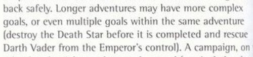

## scan p.202 (scan page 202)

Page contents: 815 words, 58 paragraphs | headings/entries: WHAT'S SPACE FOOTRSY?; Plenty of Action; Bpic Plots; Clear-Cut Motives; Ii ss; Out) Vt) a il | a; Simple Encounters; Challenging Encounters; They should; W; WU [sclLinh; GAMEMASTERING STAR WARS

## scan p.203 (scan page 203)

Page contents: 878 words, 27 paragraphs | headings/entries: TIRE BRLaYHO; SHYVM YVLS DINIXSLSVWANVS; In) Il |; Ii | 148; MOWOR; Extreme Encounters; Challenge Codes; Table 12-2: Hazard Encounters; I Wie TENE ae) ae

## scan p.204 (scan page 204)

Page contents: 962 words, 28 paragraphs | headings/entries: Uhat Isn't an Encounter?; Intriguing Interactions; CHAPTER TWELVE; WARS; BEEBE REE EREE

## scan p.205 (scan page 205)

Page contents: 879 words, 44 paragraphs | headings/entries: SHYVM YVLS DNISSLSVWANVS; Game Effect; Factor; Pits, chasms, bridges and ledges; Fog; Whirling blades or giant, spinning gears; Attitude Means Possible Actions climactic battle; Captivating Descriptions

## scan p.206 (scan page 206)

Page contents: 1029 words, 38 paragraphs | headings/entries: Action; Covering with ranged weapon Using the Force; Delaying; Description; Describing Character Actions; Awarding Experience; TWELVE; WARS

## scan p.207 (scan page 207)

Page contents: 972 words, 36 paragraphs | headings/entries: DAVIRL BBLawH>; SYVM YVLS DNISSLSVWANVS; Vm DN) 148; MOMOR; Money; Equipment; Reputation; Ranks, Titles, or Honors; How to Build a Campaign; Create a Context; GO ®9 B QO @O

## scan p.208 (scan page 208)

Page contents: 820 words, 29 paragraphs | headings/entries: Villains; Tips for well-played villains include the following:; Allies; Animals; GAMEMASTERING STAR WARS | gsekehRnakekEEegs sal; Boe 183

## scan p.209 (scan page 209)

Page contents: 1035 words, 19 paragraphs | headings/entries: PAVEML B2LevHD; Build on Campaign Events

## scan p.210 (scan page 210)

Page contents: 869 words, 33 paragraphs | headings/entries: LLL; Creating Prestige Classes; Examples of good requirements include: @ Species; Table 12-4: The Bounty Hunter; CHAPTER tvtuve; WARS; SE GAMEMASTERING STAR

## scan p.211 (scan page 211)

Page contents: 865 words, 31 paragraphs | headings/entries: Ey; Site) = err; SATIAL @user; Class Skills; Class Features; Crimelord

## scan p.212 (scan page 212)

Page contents: 852 words, 32 paragraphs | headings/entries: Class Skills; Elite Trooper; Defense Reputation; TWELVE; CHAPTER; GAMEMASTERING STAR WARS

## scan p.213 (scan page 213)

Page contents: 907 words, 33 paragraphs | headings/entries: BAVERG; BEER EEEREERE SYVM YVLS INIWALSVWAWNVS; MAOWIOF,; Class Skills; Class Features; Starfighter Ace; Defense Reputation

## scan p.214 (scan page 214)

Page contents: 801 words, 38 paragraphs | headings/entries: Class Skills; Class Features; Table 12-8: The Officer; Officer; Defense Reputation; CHAPTER Twelve; SE GAMEMASTERING STAR WARS; JOOOE

## scan p.215 (scan page 215)

Page contents: 793 words, 30 paragraphs | headings/entries: SaYVM AaVLS SINIAALSVWAWVS; Class Skills; Class Features; PRINCESS Leia ORGANA; NR; GAITIGAL AIT AGAINST GMM CHARACTERS

## scan p.216 (scan page 216)

Page contents: 893 words, 15 paragraphs | headings/entries: Diplomat; CHAPTOR TWELVE; Class Skills; Bxpert

## scan p.217 (scan page 217)

Page contents: 703 words, 56 paragraphs | headings/entries: WAv9RL BBLawHD; BERR ERE EES SYVM YVLS DNINSLSVWANVD; Gises = et; Tat |; ADDO,; Class Features; Thug; Class Skills; Score; Class Features; Table 12-11: The Thug Base; Lvl Attack Bonus; Ist +1; Fort; Save

## scan p.218 (scan page 218)

Page contents: 955 words, 37 paragraphs | headings/entries: Suffocation and Drowning; Thin Air; Airless Environments; Ni [sc}LINk; GAMEMASTERING STAR WARS

## scan p.219 (scan page 219)

Page contents: 983 words, 25 paragraphs | headings/entries: CHARACTER CONDITION SUMMARY

## scan p.220 (scan page 220)

Page contents: 926 words, 37 paragraphs | headings/entries: Table 12-13: Poisons Initial; Disease; Teble 12-14: Diseases; TweL; SE GAMEMASTERING STAR WARS; CuaPrEe

## scan p.221 (scan page 221)

Page contents: 3 words, 2 paragraphs | headings/entries: 

## scan p.222 (scan page 222)

Page contents: 526 words, 8 paragraphs | headings/entries: Life in the Galaxy; CRATES Tetaraiw

## scan p.223 (scan page 223)

Page contents: 1088 words, 21 paragraphs | headings/entries: Imi BDLewN?; Ii | 148; MOWOE; The Three Eras; The Rise of the Empire

## scan p.224 (scan page 224)

Page contents: 996 words, 24 paragraphs | headings/entries: The Rebellion Era; The New Jedi Order Era; Hey Characters from the Three Eras; CWAPTES THIBTOEN; I) Ml

## scan p.225 (scan page 225)

Page contents: 945 words, 30 paragraphs | headings/entries: W2DLUIML BIiaTHD; Obi-Wan Kenobi; Tt; Qui-Gon Jinn

- **Obi-Wan Kenobi** — entry/section: Key Characters: Obi-Wan Kenobi (Rise of the Empire): "By the time of the blockade of the planet Naboo, Obi-Wan has learned nearly everything that his Master can teach him, though he is perhaps less aware of the living Force than Qui-Gon would prefer, lacking the kind of intuition and compassion that make the older Jedi a Master." Source: *Star Wars Roleplaying Game Core Rulebook* (SWRPG d20), scan p.225
  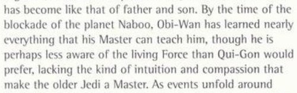
- **Obi-Wan Kenobi** — entry/section: Obi-Wan Kenobi: "Marked for the Agricultural Corps to tend to sick crops after being passed over by a number of potential Jedi Masters, Obi-Wan was eventually given a chance to prove himself by dueling with other hopefuls." Source: *Star Wars Roleplaying Game Core Rulebook* (SWRPG d20), scan p.225
  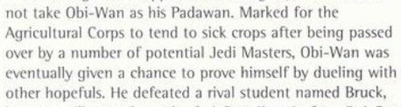
- **Obi-Wan Kenobi; Qui-Gon Jinn** — entry/section: Obi-Wan Kenobi: "He defeated a rival student named Bruck, but was still passed over by Qui-Gon Jinn." Source: *Star Wars Roleplaying Game Core Rulebook* (SWRPG d20), scan p.225
  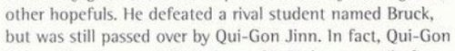
- **Qui-Gon Jinn** — entry/section: Qui-Gon Jinn: "One of the greatest Jedi living at the time of the Trade Federation embargo, Qui-Gon Jinn is nonetheless not a member of the Jedi Council." Source: *Star Wars Roleplaying Game Core Rulebook* (SWRPG d20), scan p.225
  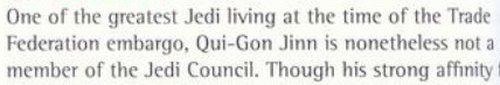
- **Qui-Gon Jinn** — entry/section: Qui-Gon Jinn: "Stil Qui-Gon was a formidable lightsaber duelist—the best his Master had seen in 400 years of teaching—and has since fought in a variety of conflicts all over the galaxy, sometimes against odds that would have overwhelmed a lesser swordsman." Source: *Star Wars Roleplaying Game Core Rulebook* (SWRPG d20), scan p.225
  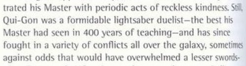
- **Qui-Gon Jinn** — entry/section: Qui-Gon Jinn: "Even so, Qui-Gon is acutely aware that even Jedi Masters are not immortal, and hopes that he will accomplish something important and enduring before his life is over." Source: *Star Wars Roleplaying Game Core Rulebook* (SWRPG d20), scan p.225
  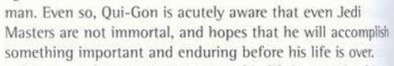
- **Qui-Gon Jinn** — entry/section: Qui-Gon Jinn: "After Qui-Gon was forced to kill Crion, Xanates rebelled and attacked his former Master, and aan though he was defeated, escapedlargely because Qui-Gon could not bring himself to kill his former student." Source: *Star Wars Roleplaying Game Core Rulebook* (SWRPG d20), scan p.225
  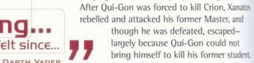
- **Qui-Gon Jinn** — entry/section: Qui-Gon Jinn: "Now, at the age of 60, Qui-Gon Jinn is still a formidable figure, with craggy features and a penetrating gaze." Source: *Star Wars Roleplaying Game Core Rulebook* (SWRPG d20), scan p.225
  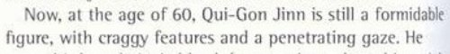

### Stat block notes (game mechanics, not feats)

- Obi-Wan Kenobi (Rise of the Empire): Male Human Jedi Guardian 6; VP/WP 52/14; FP 5; Rep 4; Str 15, Dex 16, Con 14, Int 13, Wis 12, Cha 13; Force skills Affect Mind +6, Battlemind +9, Enhance Ability +7, Force Push +10, Move Object +6, See Force +6; Force feats Alter, Burst of Speed, Control, Deflect Blasters, Sense (Source: *Star Wars Roleplaying Game Core Rulebook* (SWRPG d20), scan p.225)
- Qui-Gon Jinn: Male Human Jedi Guardian 15; VP/WP 94/12; Atk +17/+12/+7 melee (lightsaber); SQ Jedi Master; FP 11; Rep 8; Str 13, Dex 15, Con 12, Int 16, Wis 17, Cha 15; Force skills Affect Mind +18, Battlemind +13, Empathy +10, Enhance Ability +9, Force Defense +10, Force Push +17, Heal Another +13, Move Object +17, See Force +15; Force feats include Force Mastery, Knight Mind, Lightsaber Defense, Master Defense (Source: *Star Wars Roleplaying Game Core Rulebook* (SWRPG d20), scan p.225)

## scan p.226 (scan page 226)

Page contents: 32 words, 4 paragraphs | headings/entries: 

## scan p.227 (scan page 227)

Page contents: 775 words, 21 paragraphs | headings/entries: It 5; Amidala, Queen of Naboo

### Stat block notes (game mechanics, not feats)

- Padmé Amidala (Queen): Female Human Noble 4/Soldier 2; VP/WP 28/11; FP 3; Rep 8; no Force skills (Source: *Star Wars Roleplaying Game Core Rulebook* (SWRPG d20), scan p.227)

## scan p.228 (scan page 228)

Page contents: 1032 words, 22 paragraphs | headings/entries: Palpatine, Naboo Senator; Jar Jar Binks; Anakin Skywalker; CHAPTER THIRTEEN

- **Palpatine (Darth Sidious)** — entry/section: Palpatine, Naboo Senator: "Losing election after election for a string of political appointments, Palpatine nonetheless managed to learn from his defeats, finally winning perhaps the most valued position of all—that of sectorial senator for the Naboo system." Source: *Star Wars Roleplaying Game Core Rulebook* (SWRPG d20), scan p.228
  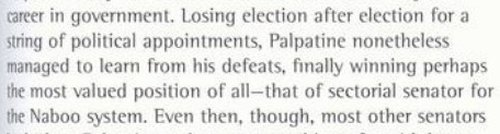

### Stat block notes (game mechanics, not feats)

- Palpatine (Naboo Senator public profile): Male Human Noble 3; VP/WP 18/13; FP 2; Rep 7 (cover identity; compare Darth Sidious block p231) (Source: *Star Wars Roleplaying Game Core Rulebook* (SWRPG d20), scan p.228)

## scan p.229 (scan page 229)

Page contents: 824 words, 23 paragraphs | headings/entries: MODLETHL BTLGVHD; S262 =° ety; Heli ow oo; Watto, Junk Merchant; Hot peggats in his purse; His flippers stink like bantha curd

- **Darth Vader (Anakin Skywalker)** — entry/section: Key Characters: Anakin Skywalker (Rise of the Empire): "What he does not yet realize is that within him the Force is stronger than in any living being, and that his dreams may actually be premonitions of things that will one day come to pass." Source: *Star Wars Roleplaying Game Core Rulebook* (SWRPG d20), scan p.229
  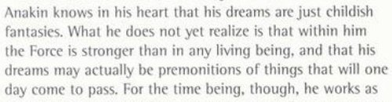
- **Darth Vader (Anakin Skywalker)** — entry/section: Key Characters: Anakin Skywalker (Rise of the Empire): "To Anakin, being allowed to fly a Podracer is the next best thing to being in the cockpit of a starfighter, and when Watto recognized the boy's astounding reflexes, Anakin jumped at his master's offer to pilot a Podracer on Watto's behalf." Source: *Star Wars Roleplaying Game Core Rulebook* (SWRPG d20), scan p.229
  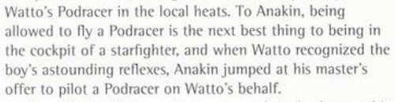
- **Darth Vader (Anakin Skywalker)**: "Although that Podracer is now so much junk—destroyed in a race against the vile Sebulba—Anakin has put his extraordinary mechanical skills to good use, building a replacement in secret behind the slave quarters where he lives." Source: *Star Wars Roleplaying Game Core Rulebook* (SWRPG d20), scan p.229
  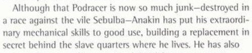

### Stat block notes (game mechanics, not feats)

- Anakin Skywalker (age 9): Male Human Fringer 1; VP/WP 8/10; FP 3; Force skill Enhance Ability +3; Skill Emphasis (Pilot), Pilot +9 (Source: *Star Wars Roleplaying Game Core Rulebook* (SWRPG d20), scan p.229)

## scan p.230 (scan page 230)

Page contents: 1054 words, 28 paragraphs | headings/entries: Darth Maul; OF PLAY BEER a; CHAPTER; U) { Y W

- **Darth Maul** — entry/section: Key Characters: Darth Maul: "Abducted as an infant before the Jedi Knights could detect his sensitivity to the Force, Maul was mercilessly indoctrinated into the mysteries of the ancient Sith, forced to become strong, tough, quick, and clever—or die. He had no childhood. He was forged into a weapon, a tool for destruction, with no sense of fear or remorse. He was mercilessly punished for even the merest display of weakness. As a reward for learning lessons well, he was trained even harder." Source: *Star Wars Roleplaying Game Core Rulebook* (SWRPG d20), scan p.230
  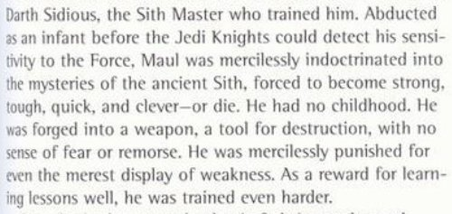
- **Darth Maul; Palpatine (Darth Sidious)** — entry/section: Key Characters: Darth Maul: "Once he had mastered eclectic fighting styles and become attuned to the living Force, Maul was abandoned by Darth Sidious on a remote Outer Rim planet. There, he was hunted day and night by a legion of assassin droids, forced to use every scrap of training merely to survive. When Maul had destroyed the last of his hunters, his Master returned, and challenged him to a duel. Finally overcome by exhaustion, frustration, and the taunts of his sadistic teacher, the young apprentice gave in to his anger, thus giving himself to the Dark Side." Source: *Star Wars Roleplaying Game Core Rulebook* (SWRPG d20), scan p.230
  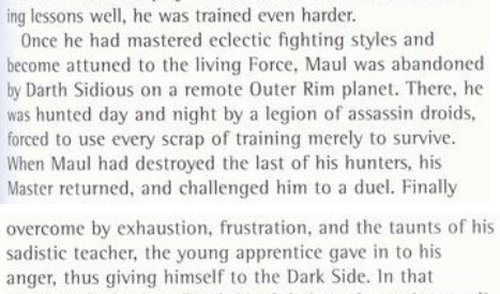
- **Darth Maul** — entry/section: Key Characters: Darth Maul: "Darth Maul carries the double-bladed lightsaber he constructed using his Master's holocron schematics, but often uses it only as a single scarlet blade to lull his opponent into a false sense of efficacy. Countless opponents have had a fraction of a second to express their surprise when the "pommel" of the deadly weapon ignited in their faces. A very few have even seen the Sith Lord split the weapon into two separate blades, with which to more efficiently dispatch his foes." Source: *Star Wars Roleplaying Game Core Rulebook* (SWRPG d20), scan p.230
  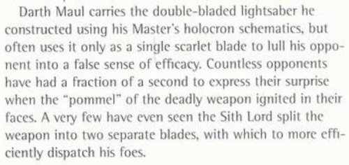

### Stat block notes (game mechanics, not feats)

- Darth Maul: Male Jedi Guardian 12; VP/WP 120/16; Atk +16/+11/+6 melee (double-bladed lightsaber); SQ Jedi Knight; FP 6; DSP 14; Rep 7; Str 17, Dex 19, Con 16, Int 14, Wis 11, Cha 12; Force skills Battlemind +11, Fear +11, Force Grip +11, Force Push +7, Move Object +10, See Force +8; feats Knight Defense, Martial Artist, Two-Weapon Fighting; Force feats Alter, Burst of Speed, Control, Lightsaber Defense, Sense (Source: *Star Wars Roleplaying Game Core Rulebook* (SWRPG d20), scan p.230)

## scan p.231 (scan page 231)

Page contents: 814 words, 8 paragraphs | headings/entries: 

- **Palpatine (Darth Sidious)** — entry/section: Key Characters: Darth Sidious, Sith Master: "Perhaps the single most diabolical being in the galaxy, Darth Sidious is also one of the most powerful. Steeped in the dark side of the Force, Sidious has been plotting the destruction of the Jedi order for decades, working in secret to wreak the vengeance of the ancient and sinister Sith, whose own order was all but destroyed by the Jedi in the distant past." Source: *Star Wars Roleplaying Game Core Rulebook* (SWRPG d20), scan p.231
  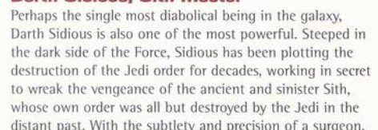
- **Palpatine (Darth Sidious)** — entry/section: Key Characters: Darth Sidious, Sith Master: "Now, though, Darth Sidious is finally ready to crush the Jedi, once and for all. With his ability to examine the future as another might examine a book, he has seen the steps to take, the path to follow, to fulfill Darth Bane's dream of vengeance. Victory is within his grasp." Source: *Star Wars Roleplaying Game Core Rulebook* (SWRPG d20), scan p.231
  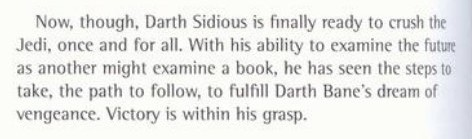
- **Darth Bane** — entry/section: Key Characters: Darth Sidious, Sith Master: "After watching the Sith order destroyed by both the attacks of the Jedi and internal power struggles, Bane found himself the only survivor of the Sith, and sole heir to its traditions." Source: *Star Wars Roleplaying Game Core Rulebook* (SWRPG d20), scan p.231
  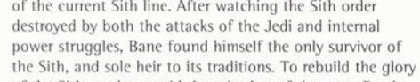

### Stat block notes (game mechanics, not feats)

- Darth Sidious: Male Human Noble 3/Jedi Consular 16; VP/WP 124/13; SQ Jedi Master; SV Will +16; FP 2; Rep 16; Int 18, Wis 16; Force skills Affect Mind +14, Empathy +17, Farseeing +24, Fear +14, Force Defense +16, Force Grip +15, Heal Self +14, Move Object +16, See Force +19, Telepathy +20; Force feats Alter, Control, Deflect Blasters, Dissipate Energy, Force Lightning, Force Mastery, Force Mind, Force Whirlwind, Sense (Source: *Star Wars Roleplaying Game Core Rulebook* (SWRPG d20), scan p.231)

## scan p.232 (scan page 232)

Page contents: 1026 words, 33 paragraphs | headings/entries: Yoda; Mace Windu; THISTOEN; PLAY; AS OF BEE; Y; Ld [| t_ LE] |g

- **Yoda** — entry/section: Key Characters: Yoda: "He is nearly 900 years old when Senator Palpatine is elected Supreme Chancellor of the Republic. He has lived longer than any other Jedi, and has seen literally thousands of his friends, colleagues, and students—through violent battle and simple old age—become one with the Force." Source: *Star Wars Roleplaying Game Core Rulebook* (SWRPG d20), scan p.232
  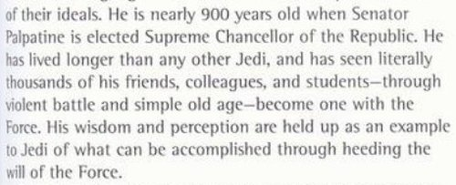
- **Yoda** — entry/section: Key Characters: Yoda: "Master Yoda encourages meditation and forethought, as well as strict observance of the Jedi traditions, pointing to the 800 years worth of Jedi that he has personally trained—many of whom have gone on to be exemplars of the Jedi way—as proof of his convictions." Source: *Star Wars Roleplaying Game Core Rulebook* (SWRPG d20), scan p.232
  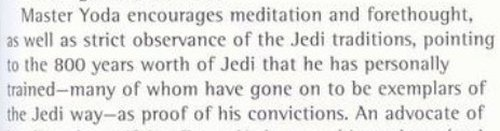
- **Yoda** — entry/section: Key Characters: Yoda: "Considering that he is recognized as the leading Jedi authority on seeing events that have not yet come to pass, Yoda may be the only Jedi who truly knows what is best for the Jedi Order." Source: *Star Wars Roleplaying Game Core Rulebook* (SWRPG d20), scan p.232
  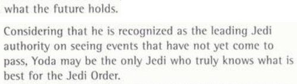
- **Mace Windu** — entry/section: Mace Windu: "A popular story among the Padawans is that Mace Windu once found himself completely surrounded by the formidable warriors known as Gank killers—all with blasters drawn." Source: *Star Wars Roleplaying Game Core Rulebook* (SWRPG d20), scan p.232
  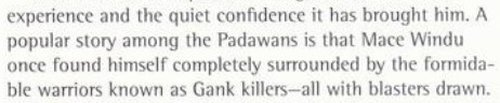

### Stat block notes (game mechanics, not feats)

- Yoda: Male Jedi Consular 20; VP/WP 134/14; Atk +19/+14/+9 melee (lightsaber); SQ Healing, Jedi Master; SV Will +16; FP 15; Rep 14; Wis 19, Cha 17; Force skills Affect Mind +25, Empathy +25, Farseeing +27, Force Defense +17, Heal Another +10, Heal Self +20, Move Object +20, See Force +24; Force feats Alter, Burst of Speed, Control, Deflect Blasters, Dissipate Energy, Force Mastery, Force Mind, Lightsaber Defense, Sense (Source: *Star Wars Roleplaying Game Core Rulebook* (SWRPG d20), scan p.232)

## scan p.233 (scan page 233)

Page contents: 468 words, 19 paragraphs | headings/entries: The Rebellion Era

- **Mace Windu** — entry/section: Key Characters: Mace Windu: "has traveled the galaxy nearly as much as Master Yoda, and done battle in all corners with a variety of foes, against a variety of styles—leading him to develop his own fighting style, a relentless lightsaber assault that is at once unpredictable and perfectly balanced. Though other Jedi may be stronger or faster than Master Windu, he is the recognized master of the Order's fighting techniques." Source: *Star Wars Roleplaying Game Core Rulebook* (SWRPG d20), scan p.233
  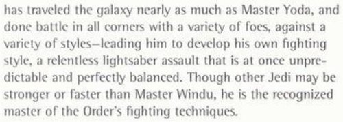

### Stat block notes (game mechanics, not feats)

- Mace Windu: Male Human Jedi Guardian 18; VP/WP 134/15; Atk +20/+15/+10/+5 melee (lightsaber); SQ Jedi Master; FP 12; Rep 14; Str 12, Dex 14, Con 15, Int 16, Wis 17, Cha 18; Force skills Affect Mind +18, Battlemind +18, Empathy +9, Farseeing +11, Force Defense +12, Force Push +17, Move Object +19, See Force +15; feats Expertise, Spring Attack, Whirlwind Attack; Force feats Knight Defense, Lightsaber Defense, Master Defense (Source: *Star Wars Roleplaying Game Core Rulebook* (SWRPG d20), scan p.233)

## scan p.234 (scan page 234)

Page contents: 1031 words, 25 paragraphs | headings/entries: THIRTEEN; ERAS OF PLAY; Rae EEE HA I; WU [scJLiMn::

- **Leia Organa Solo**: "Hurrying home to Alderaan aboard her consular ship, the Tantive IV, to take the plans to her father, Leia was forced to detour by the Imperial Star Destroyer Devastator." Source: *Star Wars Roleplaying Game Core Rulebook* (SWRPG d20), scan p.234
  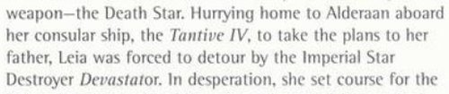

## scan p.235 (scan page 235)

Page contents: 846 words, 13 paragraphs | headings/entries: Han Solo, Smuggler

- **Han Solo** — entry/section: Key Characters: Han Solo, Smuggler: "His fast reflexes and exemplary flying led Han Solo to graduate the Academy with top honors, and he soon found himself in the Imperial Navy." Source: *Star Wars Roleplaying Game Core Rulebook* (SWRPG d20), scan p.235
  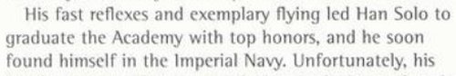
- **Han Solo** — entry/section: Key Characters: Han Solo, Smuggler: "Han's own philosophy on the matter is to never doubt his own abilities, but to respect the abilities of his opponents. Fortunately, he's rarely encountered an enemy whose abilities exceeded his own." Source: *Star Wars Roleplaying Game Core Rulebook* (SWRPG d20), scan p.235
  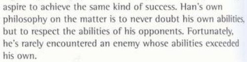
- **Han Solo** — entry/section: Han Solo, Smuggler: "He still manages to flash a winning grin in the face of overwhelming odds, and leaps into every perilous situation with the confidence that he will leap right back out again without a scratch." Source: *Star Wars Roleplaying Game Core Rulebook* (SWRPG d20), scan p.235
  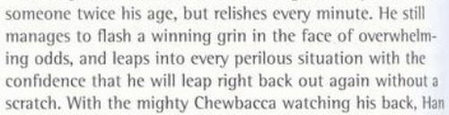
- **Chewbacca**: "With the mighty Chewbacca watching his back, Han feels almost invincible—though he still has the common sense to run when things get out of control." Source: *Star Wars Roleplaying Game Core Rulebook* (SWRPG d20), scan p.235
  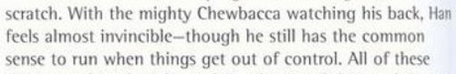
- **Han Solo** — entry/section: Han Solo, Smuggler: "All of these things combined might explain why Han Solo's exploits are legendary among spacers and smugglers, and why so many aspire to achieve the same kind of success." Source: *Star Wars Roleplaying Game Core Rulebook* (SWRPG d20), scan p.235
  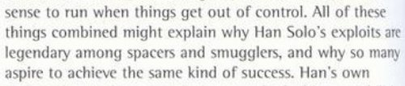

### Stat block notes (game mechanics, not feats)

- Leia Organa (Rebellion era): Female Human Noble 3/Soldier 2; VP/WP 25/12; FP 3; Rep 6; Force-Sensitive feat, no Force skills (Source: *Star Wars Roleplaying Game Core Rulebook* (SWRPG d20), scan p.235)
- Han Solo (Rebellion era): Male Human Scoundrel 6/Soldier 2; VP/WP 52/13; Atk +8 ranged (heavy blaster pistol); FP 3; Rep 6; Pilot +15 (Source: *Star Wars Roleplaying Game Core Rulebook* (SWRPG d20), scan p.235)

## scan p.236 (scan page 236)

Page contents: 1010 words, 24 paragraphs | headings/entries: Chewbacca; R2-D2, Astromech Droid; THieTceN; I | a6

- **Chewbacca; Han Solo** — entry/section: Key Characters: Chewbacca: "At Han Solo's side, Chewbacca has acquired a reputation as one of the most dangerous smugglers in the galaxy, based on tales of his great strength and even greater temper. But those who know Chewie well realize that much of his reputation is simply fanciful hype. In point of fact, Chewbacca is the more cautious of the two, sometimes almost to the point of cowardice." Source: *Star Wars Roleplaying Game Core Rulebook* (SWRPG d20), scan p.236
  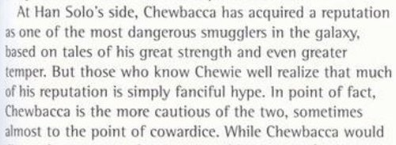

### Stat block notes (game mechanics, not feats)

- Chewbacca (Rebellion era): Male Wookiee Scout 6; VP/WP 68/19; Atk +8 melee (punch 1d3+4); Wookiee rage; FP 2; Str 19, Con 19 (Source: *Star Wars Roleplaying Game Core Rulebook* (SWRPG d20), scan p.236)

## scan p.237 (scan page 237)

Page contents: 802 words, 25 paragraphs | headings/entries: C-3PO, Protocol Droid; Obi-Wan "Ben" Kenobi; Wel

- **Obi-Wan Kenobi** — entry/section: Key Characters: Obi-Wan "Ben" Kenobi: "Once a great Jedi Knight and a general in the Clone Wars, "Old Ben" is now nothing more than a colorful old hermit occasionally seen buying supplies in Anchorhead and Mos" Source: *Star Wars Roleplaying Game Core Rulebook* (SWRPG d20), scan p.237
  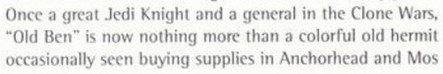

## scan p.238 (scan page 238)

Page contents: 1077 words, 22 paragraphs | headings/entries: Hiei; Lando Calrissian, Gambler; THIOTEEN; WN (scJLINh::

- **Luke Skywalker**: "But it wasn't until stormtroopers killed Owen and Beru Lars that Luke decided that there was no longer any reason to stay on Tatooine." Source: *Star Wars Roleplaying Game Core Rulebook* (SWRPG d20), scan p.238
  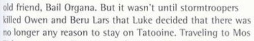
- **Han Solo**: "Traveling to Mos Eisley spaceport, Ben arranged transport to Alderaan with a cocky Corellian smuggler—Han Solo—and just barely managed to escape to hyperspace aboard the Millennium Falcon before being fired upon by Imperial Star Destroyers." Source: *Star Wars Roleplaying Game Core Rulebook* (SWRPG d20), scan p.238
  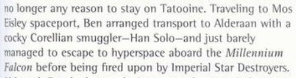
- **Luke Skywalker**: "Although Ben had enough time to teach young Luke some nidimentary lessons about the Force on the journey to Alderaan, the planet was gone when they arrived, destroyed by the Death Star." Source: *Star Wars Roleplaying Game Core Rulebook* (SWRPG d20), scan p.238
  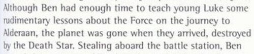
- **Darth Vader (Anakin Skywalker); Luke Skywalker; Boba Fett**: "Darth Vader, searching the galaxy for the Rebels and Luke Skywalker, the Rebel pilot who almost single-handedly destroyed the Death Star, came to Bespin, bringing with him a platoon of stormtroopers and a bounty hunter named Boba Fett." Source: *Star Wars Roleplaying Game Core Rulebook* (SWRPG d20), scan p.238
  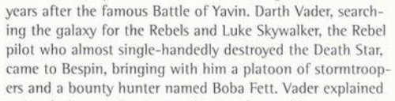

### Stat block notes (game mechanics, not feats)

- Obi-Wan "Ben" Kenobi (Rebellion era): Male Human Jedi Guardian 15; VP/WP 102/13; Atk +16/+11/+6 melee (5d8, lightsaber); SQ Jedi Master; SV Will +12; FP 12; Rep 7; Force skills Affect Mind +20, Battlemind +10, Enhance Ability +8, Farseeing +8, Force Push +11, Force Stealth +13, Move Object +12, See Force +15; Force feats Alter, Burst of Speed, Control, Deflect Blasters, Knight Defense, Lightsaber Defense, Master Defense, Sense (Source: *Star Wars Roleplaying Game Core Rulebook* (SWRPG d20), scan p.238)

## scan p.239 (scan page 239)

Page contents: 917 words, 26 paragraphs | headings/entries: THE WEAPONS OF BOBA FETT

- **Boba Fett**: "Laser Gauntlet: Boba Fett's right wrist gauntlet is capable of firing a wicked laser beam (see below)." Source: *Star Wars Roleplaying Game Core Rulebook* (SWRPG d20), scan p.239
  
- **Boba Fett**: "On a successful hit, the target must attempt a Reflex save, with a DC equal to Boba Fett's attack roll." Source: *Star Wars Roleplaying Game Core Rulebook* (SWRPG d20), scan p.239
  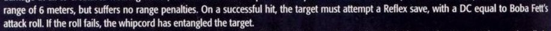

### Stat block notes (game mechanics, not feats)

- Lando Calrissian (Rebellion era): Male Human Scoundrel 8; VP/WP 40/12; FP 2; Rep 4; Bluff +14, Disguise +16 (Source: *Star Wars Roleplaying Game Core Rulebook* (SWRPG d20), scan p.239)

## scan p.240 (scan page 240)

Page contents: 628 words, 33 paragraphs | headings/entries: Boba Fett, Bounty Hunter; Skills: Astrogate; Darth Vader, Dark Lord of the Sith; WeOltll tll at ml Hl i wl; ERAS OF PLAY EREEEEERE ET; Emperor does not share; LORD DARTH VADER

- **Darth Vader (Anakin Skywalker)** — entry/section: Key Characters: Darth Vader, Dark Lord of the Sith: "Sustained now by machinery, and unable to live without his custom-made body armor, Vader set about establishing himself as the heir to all the secrets of the Sith order, using what he learned to destroy the Jedi, With training and encouragement, Darth Vader systematically hunted down and destroyed every Jedi on a thousand worlds, and hounded the rest—a mere handful at best—into exile" Source: *Star Wars Roleplaying Game Core Rulebook* (SWRPG d20), scan p.240
  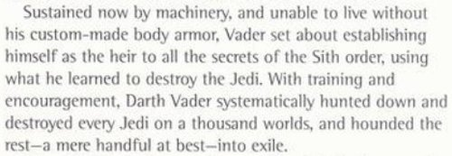
- **Darth Vader (Anakin Skywalker)**: "When his Master became Emperor, Darth Vader became the second-most powerful being in the known galaxy." Source: *Star Wars Roleplaying Game Core Rulebook* (SWRPG d20), scan p.240
  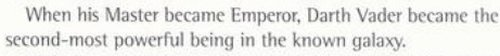

### Stat block notes (game mechanics, not feats)

- Boba Fett: Male Human Soldier 6/Scoundrel 1/Bounty Hunter 6; VP/WP 100/15; Defense 22; Target bonus +3, sneak attack +3d6; FP 2; DSP 4; Rep 10; armor and weapons sidebar p239 (jet pack, flamethrower, rocket darts, whipcord, etc.) (Source: *Star Wars Roleplaying Game Core Rulebook* (SWRPG d20), scan p.240)
