# Owner Material 037 — Star Wars D20 Drive folder (Core, Revised Core and Saga Edition): Sourcebooks/Star Wars Roleplaying Game Core Rulebook.pdf [Star Wars Roleplaying Game (d20, 2000)] (scan pages 241–300)

- **Source:** Wizards of the Coast Star Wars Roleplaying Game books, web enhancements, Living Force campaign modules and articles (2000–2010), from the owner's "Star Wars D20" Drive folder (only the three edition subfolders; "General" was not read, as instructed). Secondary source (licensed Legends reference). Scan OCR'd on the box; the scan stays box-only and is **not** published.
- **Method:** every scanned page was OCR'd and machine-screened sentence by sentence for power-relevant statements (fights, kills, defeats, Force feats, rankings, superweapons) that name a character on our roster; each kept sentence is quoted verbatim from the OCR text and has a crop of the printed passage directly under it. Pages with nothing power-relevant are still listed with what is on them.
- **Citation:** "*Star Wars Roleplaying Game Core Rulebook* (SWRPG d20), p.X" by printed page ("scan p.X" where no printed number applies). **Weight:** Licensed RPG material: a secondary source. Narrative text sums up Legends lore; game statistics are rules for players, not canon power levels, and rank lowest.

## scan p.241 (scan page 241)

Page contents: 999 words, 29 paragraphs | headings/entries: DARTH UADER'S ARMOR

- **Darth Vader (Anakin Skywalker)** — entry/section: Key Characters: Darth Vader, Dark Lord of the Sith: "Though Vader still performed missions of terror and assassination for the Emperor, he had much time to meditate and hone his skills. By the time the Emperor assigned Darth Vader to oversee construction of the Death Star battle station, he was one of the deadliest warriors alive, shielded by his imposing armor, steeled by countless combats, and empowered by the dark side of the Force." Source: *Star Wars Roleplaying Game Core Rulebook* (SWRPG d20), scan p.241
  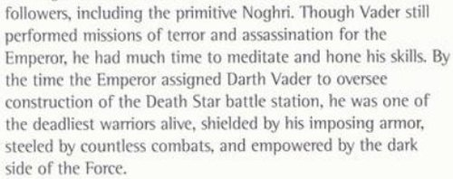
- **Darth Vader (Anakin Skywalker)** — entry/section: SIDEBAR: Darth Vader's Armor: "The Dark Lord of the Sith is both kept alive and made even more powerful by his custom-made black armor. If the armor is ever removed, Darth Vader will quickly die—there being so little of his body left to sustain normal functions." Source: *Star Wars Roleplaying Game Core Rulebook* (SWRPG d20), scan p.241
  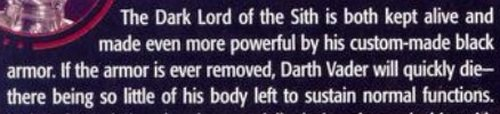
- **Luke Skywalker** — entry/section: Key Characters: Luke Skywalker, Jedi Master (NJO): "With the only Jedi he knew gone, and his own knowledge of the Force not yet complete, much of Luke's life since th Battle of Endor became an unending quest to learn everything he could about the secrets of the Force." Source: *Star Wars Roleplaying Game Core Rulebook* (SWRPG d20), scan p.241
  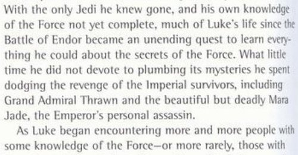
- **Exar Kun; Luke Skywalker**: "Although the Jedi academy had its difficulties—not the leas! of which was an ancient Sith evil named Exar Kun—the school survived, and Luke was well on the way to reestablishing the Jedi Order in the galaxy." Source: *Star Wars Roleplaying Game Core Rulebook* (SWRPG d20), scan p.241
  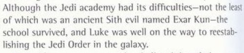

### Stat block notes (game mechanics, not feats)

- Darth Vader (Rebellion era): Male Human Fringer 1/Jedi Guardian 18; Defense 27; VP/WP 122/15; Atk +22/+17/+12/+7 melee (5d8+3, lightsaber); SQ Jedi Master, DR 5 (armor); SV Fort +13, Ref +15, Will +10; FP 10; DSP 16; Rep 10; Str 16, Dex 16, Con 15, Int 17, Wis 14, Cha 15; Force skills Affect Mind +12, Enhance Ability +14, Farseeing +12, Force Defense +12, Force Grip +15, Force Push +15, Move Object +21, See Force +16, Telepathy +18; Force feats Alter, Burst of Speed, Control, Deflect Blaster, Dissipate Energy, Force Whirlwind, Master Defense, Sense; Pilot +18 (Source: *Star Wars Roleplaying Game Core Rulebook* (SWRPG d20), scan p.241)
- Luke Skywalker (NJO era): Male Human Jedi Guardian 16/Fringer 2; Defense 26; VP/WP 112/14; Atk +20/+15/+10/+5 melee (5d8+2, lightsaber); SQ Barter, Jedi Master; SV Fort +10, Ref +12, Will +5; FP 8; Rep 13; Force skills Affect Mind +11, Battlemind +10, Empathy +12, Enhance Ability +8, Farseeing +10, Force Defense +8, Heal Self +7, Move Object +15, See Force +12, Telepathy +8; Force feats incl. Force Mastery, Knight Defense, Lightsaber Defense, Master Mind; Pilot +18 (Source: *Star Wars Roleplaying Game Core Rulebook* (SWRPG d20), scan p.241)

## scan p.242 (scan page 242)

Page contents: 991 words, 31 paragraphs | headings/entries: Leia Organa Solo, Senator; Han Solo, War Hero; Terereen; OOF PLAY; U) < Y W; S23." 15570

- **Leia Organa Solo** — entry/section: Leia Organa Solo, Senator: "Still, born of a family strong in the Force, and trained by the most powerful Jedi in the New Republic, Leia is strong, and she occasionally calls upon her abilities in her duties as a diplomat and ambassador—as well as when her family or friends are threatened." Source: *Star Wars Roleplaying Game Core Rulebook* (SWRPG d20), scan p.242
  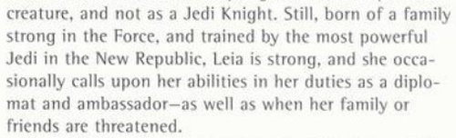

### Stat block notes (game mechanics, not feats)

- Leia Organa Solo (NJO era): Female Human Noble 10/Jedi Consular 3/Soldier 2; VP/WP 80/13; FP 8; Rep 12; Diplomacy +23; Force skills Affect Mind +6, Empathy +9, Enhance Senses +5, Farseeing +7, Heal Self +3, Move Object +7, See Force +9 (Source: *Star Wars Roleplaying Game Core Rulebook* (SWRPG d20), scan p.242)
- Leia Organa Solo: Female Human Noble 10/Jedi Consular 3/Soldier 2; Init +1 (Dex); Defense 20 (+9 class, +1 Dex); Spd 10m; VP/WP 80/13; Atk +11/+6/+1 melee (1d3, punch) or +11/+6/+1 melee (2d8, crit 19-20, lightsaber), +12/+7/+2 ranged (3d6, blaster pistol); SQ Call in a favor, inspire confidence +3; SV Fort +9, Ref +7, Will +10; SZ M; FP 8; Rep 12; Str 11, Dex 13, Con 13, Int 16, Wis 16, Equip (Source: *Star Wars Roleplaying Game Core Rulebook* (SWRPG d20), scan p.242)

## scan p.243 (scan page 243)

Page contents: 1091 words, 23 paragraphs | headings/entries: MEGLETME; Jaina Solo, Jedi Apprentice; I We Te ee oe

- **Jaina Solo** — entry/section: Key Characters: Jaina Solo, Jedi Apprentice: "Inheriting her father's quick reflexes at the helm, and her grandfather's talent with the Force, Jaina Solo is an extraordinary pilot. Despite being only 16 years old, she has already come to the attention of the galaxy-famous Rogue Squadron, who hope to one day recruit her as an X-wing pilot." Source: *Star Wars Roleplaying Game Core Rulebook* (SWRPG d20), scan p.243
  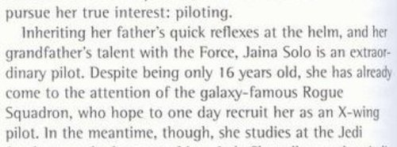
- **Leia Organa Solo; Boba Fett; Luke Skywalker**: "Through a series of wild adventures—including kidnapping Leia Organa to prevent her from marrying a handsome rival, evading continued pursuit by the bounty hunter Boba Fett, and helping to defeat the rebom Emperor—Han has remained much the same wry adventurer he was when he first met Luke Skywalker on Tatooine." Source: *Star Wars Roleplaying Game Core Rulebook* (SWRPG d20), scan p.243
  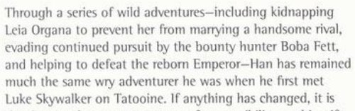
- **Chewbacca; Mara Jade Skywalker; Grand Admiral Thrawn**: "Chewbacca has remained Han's friend through countless adventures, helping to rescue him from the clutches of the gangster Jabba the Hutt, facing the three-eyed Trioculus, recruiting the smuggler Talon Karrde and the assassin Mara Jade to fight Grand Admiral Thrawn, destroying the Wayland weapons and cloning facilities, and even helping to raise Han's children." Source: *Star Wars Roleplaying Game Core Rulebook* (SWRPG d20), scan p.243
  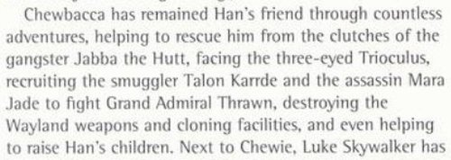

### Stat block notes (game mechanics, not feats)

- Han Solo (NJO era): Male Human Scoundrel 12/Soldier 2; VP/WP 85/13; Atk +14/+9/+4 ranged (heavy blaster pistol); sneak attack +4d6; FP 5; Rep 9; Pilot +19 (Source: *Star Wars Roleplaying Game Core Rulebook* (SWRPG d20), scan p.243)
- Jaina Solo (NJO era, age 16): Female Human Jedi Guardian 6; VP/WP 40/13; FP 4; Rep 4; Force skills Affect Mind +8, Battlemind +5, Empathy +7, Enhance Ability +5, Force Defense +3, Move Object +11, See Force +6 (Source: *Star Wars Roleplaying Game Core Rulebook* (SWRPG d20), scan p.243)

## scan p.244 (scan page 244)

Page contents: 1036 words, 28 paragraphs | headings/entries: Jacen Solo, Jedi Apprentice; THEATERS; Anakin Solo, Jedi Apprentice

- **Anakin Solo** — entry/section: Key Characters: Anakin Solo, Jedi Apprentice: "The youngest child of Han Solo and Leia Organa, Anakin Solo is already strong in the Force." Source: *Star Wars Roleplaying Game Core Rulebook* (SWRPG d20), scan p.244
  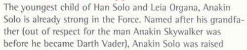
- **Anakin Solo** — entry/section: Key Characters: Anakin Solo, Jedi Apprentice: "Anakin's understanding of the Force evidences itself largely as an affinity for how things connect. By age five he was capable of disassembling and reassembling even complex computers" Source: *Star Wars Roleplaying Game Core Rulebook* (SWRPG d20), scan p.244
  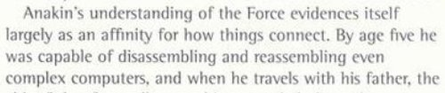
- **Anakin Solo; Luke Skywalker** — entry/section: Key Characters: Anakin Solo, Jedi Apprentice: "At age 15 he is on the verge of becoming a man, but is still not quite the Jedi Knight he wants to be, despite the fact this his teacher is his uncle Luke Skywalker, the most advanced Jedi in the galaxy." Source: *Star Wars Roleplaying Game Core Rulebook* (SWRPG d20), scan p.244
  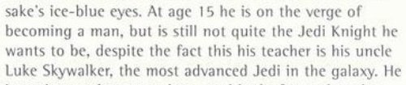

### Stat block notes (game mechanics, not feats)

- Jacen Solo (NJO era): Male Human Jedi Guardian 6; VP/WP 46/13; FP 4; Rep 4; Force skills Affect Mind +9, Battlemind +6, Empathy +9, Enhance Senses +6, Farseeing +2, Force Defense +3, Move Object +11, See Force +6, Telepathy +5 (Source: *Star Wars Roleplaying Game Core Rulebook* (SWRPG d20), scan p.244)
- Anakin Solo (NJO era, age 15): Male Human Jedi Guardian 5; VP/WP 40/12; FP 3; Rep 3; Force skills Affect Mind +5, Battlemind +8, Empathy +3, Enhance Ability +4, Move Object +9, See Force +4 (Source: *Star Wars Roleplaying Game Core Rulebook* (SWRPG d20), scan p.244)

## scan p.245 (scan page 245)

Page contents: 974 words, 14 paragraphs | headings/entries: I) I

- **Mara Jade Skywalker; Palpatine (Darth Sidious)** — entry/section: Key Characters: Mara Jade Skywalker: "In fact, Mara Jade was trained in hand-to-hand combat, marksmanship, the use of exotic weapons and poisons, and most interestingly, the Force. Although personally trained by the living epitome of the dark side, Mara Jade's own experience with the Force was neither good nor evil. She dwelt in a gray area, using the Force to augment her own formidable abilities, but not drawing on its darker aspects, and not using it in hatred or anger. Indeed, her emotional detachment about her assignments lent Mara an almost Jedi-like self-control. Were she not the Emperor's personal assassin, she might well have become a Jedi Master—though through some means known only to the Emperor, Mara Jade's own control of the Force was assisted by Palpatine himself. When he perished, much of her ability swiftly faded away." Source: *Star Wars Roleplaying Game Core Rulebook* (SWRPG d20), scan p.245
  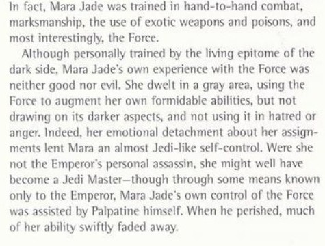

## scan p.246 (scan page 246)

Page contents: 862 words, 25 paragraphs | headings/entries: THIRTEEN; ERAS OF PLAY

- **Mara Jade Skywalker** — entry/section: Key Characters: Mara Jade Skywalker: "Although she is able to keep its worst effects at bay using the Force, she is one of only two people to contract it and still live—though the other is near death." Source: *Star Wars Roleplaying Game Core Rulebook* (SWRPG d20), scan p.246
  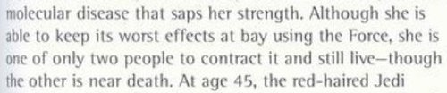
- **Mara Jade Skywalker; Luke Skywalker** — entry/section: Key Characters: Mara Jade Skywalker: "Only when the mad Jedi clone Joruus C'Baoth attempted to turn them both to the dark side, and Mara slew a clone of Luke Skywalker, did she finally feel as though she had fulfilled her duty to the Emperor." Source: *Star Wars Roleplaying Game Core Rulebook* (SWRPG d20), scan p.246
  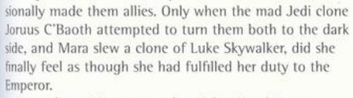

### Stat block notes (game mechanics, not feats)

- Mara Jade Skywalker (NJO era): Female Human Jedi Guardian 8/Scoundrel 6; Defense 25; VP/WP 96 (54 diseased)/15 (8 diseased); SQ Jedi Knight, sneak attack +2d6; FP 2; Rep 8; Force skills Affect Mind +8, Battlemind +11, Enhance Ability +8, Heal Self +14, Move Object +15, See Force +11, Telepathy +7 (Source: *Star Wars Roleplaying Game Core Rulebook* (SWRPG d20), scan p.246)
- Nom Anor: Male Yuuzhan Vong Noble 6/Soldier 5/Officer 3; VP/WP 95/14; SQ Yuuzhan Vong biotech, immune to Force Sense and Alter; FP 0; Rep 7 (Source: *Star Wars Roleplaying Game Core Rulebook* (SWRPG d20), scan p.246)

## scan p.247 (scan page 247)

Page contents: 3 words, 2 paragraphs | headings/entries: CHAPTER FOURTEEN; DPPONENTS

## scan p.248 (scan page 248)

Page contents: 458 words, 24 paragraphs | headings/entries: Bothans; Cereans; ALLIES AND OPPONENTS

## scan p.249 (scan page 249)

Page contents: 775 words, 28 paragraphs | headings/entries: BOTHAN; Dugs; Ewoks

## scan p.250 (scan page 250)

Page contents: 755 words, 24 paragraphs | headings/entries: Gamorreans; Til Ove) tt); ALLIES AND OPPONENTS; TER FO

## scan p.251 (scan page 251)

Page contents: 921 words, 37 paragraphs | headings/entries: S268) S° 82>; Humans; Hutts

## scan p.252 (scan page 252)

Page contents: 770 words, 26 paragraphs | headings/entries: Mon Calamari; WN a 0); MON CALAMAR; Moghri; CHAPTER FOURTEEN; ALLIES AND OPPONENTS

## scan p.253 (scan page 253)

Page contents: 770 words, 29 paragraphs | headings/entries: BERR REE EEE SLINSNOdd0 GNV Sainv; W2B4ENOs; Ti ie; NoGret; Rodians; Sullustans

## scan p.254 (scan page 254)

Page contents: 988 words, 32 paragraphs | headings/entries: Twi'leks; Yuuzhan Vong

## scan p.255 (scan page 255)

Page contents: Yuuzhan Vong species: Immune to Force, Sense and Alter; dovin basals can pull moons out of orbit (p254) (hand-read)

## scan p.256 (scan page 256)

Page contents: 868 words, 18 paragraphs | headings/entries: YUUZHAN VONG EQUIPMENT; Amphistaff Weapon Profile; ALLIES AND OPPONENTS; Amphistaff Poison

## scan p.257 (scan page 257)

Page contents: 977 words, 44 paragraphs | headings/entries: S2i8i * 82+; BERR EEE EEE SINSNOddO0 GNvV SaImv; WaPLENON; Damage; I Wit) WE i ne

## scan p.258 (scan page 258)

Page contents: 932 words, 41 paragraphs | headings/entries: Lan; Wadd Vt) at ml Hi i wl; Strength: Any creature that can physically manipulate; ALLIES AND OPPONENTS; GHERTORE FEATS

## scan p.259 (scan page 259)

Page contents: 1015 words, 36 paragraphs | headings/entries: BEER EER EERE E SINSANOddO GNV Sav; NOPLENOd WILAYHD; OWOE; Creature Descriptions Dewback; Haadu; Mynock

## scan p.260 (scan page 260)

Page contents: 1078 words, 26 paragraphs | headings/entries: Preducor; Tauntaun

## scan p.261 (scan page 261)

Page contents: 534 words, 18 paragraphs | headings/entries: SEER EEE EEE SINSNOddO GNV S3ITI1Vv; Wampa Ice Creature; BAL SERINUS, DARK JEDI; Ally and Opponent Archetypes; Generic Characters

## scan p.262 (scan page 262)

Page contents: 585 words, 125 paragraphs | headings/entries: Generic Administrator, male or female, any species; Initiative: Defense: Speed: VP/WP: Attacks:; Damage:; Special Qualities:; Saves: Challenge Code: Force Points:; Dark Side Points:; Reputation: Abilities:; Skills:; Feats:; Equipment:; Diplomat 4; Hold-out blaster 3d4 None; Fort +0, Ref +1, Will +4; B; Str 9, Dex 10, Con 8,; Emphasis (Knowledge) Datapad, comlink, blaster; Generic Assassin, male or female, any species; Defense: Speed: VP/WP: Attacks:; Damage:; Special Qualities: Saves:; Skills:; Feats:; Equipment:; WY We aa; Scoundrel 4; Illicit barter,; Computer Use +4, Disguise +9,; Improved Initiative, Sneaky; Signature weapon; Diplomat 8; Hold-out blaster 3d4; None; Fort +1, Ref +2, Will +6; Cc; Str 9, Dex 10, Con 8,; Datapad, comlink, general access pass, hold-out blaster; Scoundrel 6/Soldier 2; Unarmed +5/+0 melee; Blaster pistol +8/+3 ranged Unarmed 1d3-1; Blaster pistol 3d6; Fort 

## scan p.263 (scan page 263)

Page contents: 843 words, 76 paragraphs | headings/entries: BEER EEE EEE SILNANOddO OGNV S3aITIVv; MORLNNOE SRLdYHD; Initiative: Defense: Speed: VP/WP: Attacks:; Damage:; Saves: Challenge Code: Force Points:; Reputation: Abilities:; Skills:; Feats:; Equipment:; Special Qualities:; Dark Side Points:; Scout 4; Knife +3 melee; Blaster pistol +5 ranged Knife 1d4; Blaster pistol 3d6 Trailblazing,; Fort +3, Ref +4, Will +4; Cc; Str 10, Dex 15, Con 12,; Improved Initiative,; Knife +6/+1 melee; Hvy blaster pistol +8/+3 ranged Knife 1d4; Hvy blaster pistol 3d8; D; Str 10, Dex 15, Con 12,; Int 13, Wis 14, Cha 10; Knife +10/+5 melee; Blaster carbine +12/+7/+2 ranged Knife 1d4; Blaster carbine 3d8; Fort +6, Ref +11, Will +7; E; Str 10, Dex 16, Con 12,; Int 13, Wis 14, Cha 10; Assassin; Bounty Hunter

## scan p.264 (scan page 264)

Page contents: 734 words, 99 paragraphs | headings/entries: Defense: Speed: vP/WP: Attacks:; Damage:; Special Qualities:; Saves: Challenge Code: force Points:; Dark Side Points:; Reputation:; Skills:; Feats:; Equipment:; Boba Fett and; Aurra Sing. Note; Scoundrel 4; Fort +1, Ref +5, Will +3; Cc; Str 8, Dex 13, Con 10,; Int 12, Wis 14, Cha 16; Alertness, Low Profile; Con Artist; Crimelord; Scoundrel 6/Noble 2; Unarmed +4 melee; Hold-out blaster +6 ranged Unarmed 1d3-1; Hold-out blaster 3d4; Fort +2, Ref +9, Will +7; D; Str 8, Dex 14, Con 10,; SAAA; Scoundrel 8/Noble 4; Hold-out blaster 3d4; Command; Fort +3, Ref +10, Will +8; E; Str 8, Dex 14, Con 10,; Int 13, Wis 14, Cha 16; Dark Jedi; ALLIES AND OPPONENTS; CHAPTER four

## scan p.265 (scan page 265)

Page contents: 671 words, 13 paragraphs | headings/entries: BEER EEE EEE SINANOddO ONV S3ITIV; Generic Crimelord, male or female, any species; Special Qualities:; Blaster pistol 3d6; Hold-out blaster 3d4 plus sneak attack +2d6; Hold-out blaster 3d4 plus resource access, minions

## scan p.266 (scan page 266)

Page contents: 746 words, 38 paragraphs | headings/entries: Blaster rifle 3d8 (+2 within; E; Str 14, Dex 16, Con 14,; Int 12, Wis 11, Cha 8; Treat Injury +9; Blite Trooper; Ue ee |; Fountetn; ALLIES AND OPPONENTS

## scan p.267 (scan page 267)

Page contents: 825 words, 33 paragraphs | headings/entries: WERLENOA EDLavR?; SLNANOddO ONV SSAITIV; Blaster pistol 3d6; E; Str 14, Dex 16, Con 13,; Move Object +14, Move; Point Blank Shot, Weapon Focus (lightsaber); AOMOn; Gambler

## scan p.268 (scan page 268)

Page contents: Generic Jedi guidance: Rebellion-era surviving Jedi "must be remarkable specimens indeed; the 12th-level Jedi Guardian is best for this. In The New Jedi Order, few Jedi have trained well enough to surpass 8th level, whereas in the Old Republic, the Golden Age of the Jedi Order, Jedi of all levels exist." Expert ace tier (Soldier 6/Starfighter Ace 6, Pilot +22) = Wedge Antilles, Soontir Fel (p267) (hand-read)

## scan p.269 (scan page 269)

Page contents: 622 words, 141 paragraphs | headings/entries: BERR EEE EES SLNSNOddO ONV SAITIV; Ih)!; Generic Gambler, male or female, any species; Initiative: Defense: Speed: VP/WP: Attacks:; Damage:; Special Qualities:; Saves: Challenge Code: Force Points:; Dark Side Points:; Reputation: Abilities:; Skills:; Feats:; Equipment:; Scoundrel 4; Unarmed +2 melee; Hold-out blaster +5 ranged Unarmed 1d3-1; Hold-out blaster 3d4; Better lucky than good,; Fort +1, Ref +6, Will +3; Cc; Str 8, Dex 14, Con 10,; Spot +9; Sharp-Eyed, Skill Emphasis (Profession: gambler); Sabacc cards, nice clothes, hold-out blaster, money; Generic Jedi, male or female, any species; Initiative: Defense: Speed: VP/WP: Attacks:; Damage:; Special Qualities:; Saves: Challenge Code: Force Points:; Dark Side Points:; Reputation: Abilities:; Skills:; Feats:; Equipment:; Jedi Guardian 4; Lightsaber +5 melee; Fort +6, Ref +7, Will +3 D; Alter, Blind-Fight,; Scoundrel 8; Hold-out blaster

## scan p.270 (scan page 270)

Page contents: 826 words, 17 paragraphs | headings/entries: Generic Medic, male or female, any species; WU ee; Cnarten fourteen; ALLIES AND OPPONENTS

## scan p.271 (scan page 271)

Page contents: 815 words, 39 paragraphs | headings/entries: BERR REE EEE SINSNOddO GNV Sav; Soldier 12; Light repeating blaster 2d8 None; Fort +11, Ref +7, Will +5; D; Str 13, Dex 16, Con 16,; Int 10, Wis 12, Cha 8; Infamy, Martial Artist,; Spring Attack,; Whirlwind Attack; Padded battle armor, multichannel comlink, field kit,; Naboo Handmaiden; I Me Te a

## scan p.272 (scan page 272)

Page contents: 642 words, 135 paragraphs | headings/entries: Initiative: Defense: Speed: VP/WP: Attacks:; Damage:; Special Qualities:; Saves: Challenge Code: Force Points:; Dark Side Points:; Reputation: Abilities:; Skills:; Feats:; Equipment:; Noble 2/Soldier 2; Blaster carbine 3d8; Fort +4, Ref +4, Will +4; B; Str 9, Dex 14, Con 12,; Armor Proficiency; NbIi 2/Sol 4/Officer 2 +2 (Dex); Blaster pistol 3d6; Fort +7, Ref +6, Will +6; Cc; Str 9, Dex 14, Con 12,; Skill Emphasis (Knowledge: military); Uniform, weapons, rank insignia; Generic Naboo Handmaiden, female Human only; Initiative: Defense: Speed: VP/WP: Attacks:; Damage:; Special Qualities:; Saves: Challenge Code: Force Points:; Dark Side Points:; Reputation: Abilities:; Skills:; Feats:; Equipment:; Scoundrel 2; Knife +0 melee; Hold-out blaster +3 ranged Knife 1d4-1; Hold-out blaster 3d4; B; Str 8, Dex 14, Con 10,; Int 12, Wis 13, Cha 15; Handmaiden robes, datapads, comlink, weapons; Scoundrel

## scan p.273 (scan page 273)

Page contents: 838 words, 39 paragraphs | headings/entries: MARLUNON BTLAYHD; BERR EER EEE SINSNOddO GNV Salmv; Generic Outlaw, male or female, any species; Pirate; Fringer 6/Scoundrel 6; Hl OO} Oe; Unarmed +8/+3 melee Vibroblade +9/+4 melee; Hvy blaster pistol +11/+6 ranged Vibroblade 2d6+1; Hvy blaster pistol 3d8; Fort +9, Ref +11, Will +3; E; Str 12, Dex 16, Con 14,; Int 10, Wis 9, Cha 14; Bluff +17, Diplomacy +6, Gather Information +20,; Precise Shot; Nondescript, battered speeder, weaponry, personal belongings

## scan p.274 (scan page 274)

Page contents: 693 words, 60 paragraphs | headings/entries: Generic Pirate, male or female, any species; Scoundrel 3/Soldier 1; Scoundrel 5/Soldier 3; Special Qualities:; Saves:; Blaster pistol 3d6; Illicit barter,; Fort +5, Ref +7, Will +1; Scoundrel 8/Soldier 4; Vibroblade +11/+6 melee; Hvy blaster pistol +12/+7 ranged Vibroblade 2d6+1; Heavy blaster pistol 3d8; Fort +7, Ref +9, Will +2; E; Str 12, Dex 15, Con 12,; Int 14, Wis 8, Cha 14; Skill Emphasis (Gather Information),; Starship Dodge; Vibroblade, blaster pistol; Challenge Code: C D; Force Points: 1 2; Dark Side Points: 1 2; Reputation: 1 3; Equipment: Vibroblade, blaster pistol Vibroblade, blaster pistol; Spy; Lill _; Technician; CHAPTER; WU [scJLinh::; ALLIES AND OPPONENTS

## scan p.275 (scan page 275)

Page contents: 788 words, 69 paragraphs | headings/entries: W33LENO4 BFLe¥MD; BEER EER EEE SINSNOddO GNV S3IT1IV; Initiative: Defense: Speed: VP/WP: Attacks:; Damage:; Saves: Challenge Code: Force Points:; Reputation: Abilities:; Skills:; Equipment:; Special Qualities:; Dark Side Points:; Generic Smuggler, male or female, any species; Scoundrel 4; Blaster pistol 3d6; Illicit barter, better lucky than good; Fort +1, Ref +6, Will +2 Cc; T; Str 8, Dex 14, Con 10,; Point Blank Shot,; Skill Emphasis (Bluff),; Scoundrel 4/Scout 4; Blaster pistol 3d6; Fort +3, Ref +8 Will +4; D; Str 8, Dex 14, Con 10,; Small starship, illegal cargo, forged shipping permits; Blaster pistol 3d6; E; Str 8, Dex 14, Con 10,; Skill Emphasis (Pilot); Small starship, illegal cargo, forged shipping permits; Wt) Te a ee

## scan p.276 (scan page 276)

Page contents: 645 words, 31 paragraphs | headings/entries: Generic Spy, male or female, any species; Initiative: +1 (Dex) +2 (Dex) +2 (Dex); VP/WP: 14/8 33/8 42/8; Challenge Code: = C D E; Force Points: 1 2 3; Dark Side Points: 1 2 3; Reputation: 1 3 4; Trader Servants of the Empire; Stormtroopers; ALLIES AND OPPONENTS; Cwarree; I)

## scan p.277 (scan page 277)

Page contents: 648 words, 116 paragraphs | headings/entries: SLeat © a2e; BEE EEE EEREE SINSNOddO GNV SaImv; W2D18N04 BdLavHD; Initiative: Defense: Speed: VP/WP: Attacks:; Damage:; Saves: Challenge Code: Force Points:; Reputation: Abilities:; Skills:; Feats:; Equipment:; Initiative: Defense: Speed: VP/WP: Attacks:; Damage:; Saves: Challenge Code: Force Points:; Reputation: Abilities:; Skills:; Feats:; Equipment:; Special Qualities:; Dark Side Points:; Special Qualities:; Dark Side Points:; Generic Technician, male or female, any species; Expert 4; Blaster pistol 3d6; None; Fort +0, Ref +2, Will +4 B; Disable Device +9,; Tools, repair kit, comlink; Generic Thief, male or female, any species; Scoundrel 4; Fort +0, Ref +7, Will +2 Cc; Expert 8; None; Fort +1, Ref +3, Will +6; Cc; Str 11, Dex 12, Con 9,; Disable Device +13,; Pilot +10, Repair +18 plus Skill Emphasis; Tools, repair kit, comlink; Scoundrel 8; Fort +1, Ref +9, Will +3; D; Str 10, Dex 16,

## scan p.278 (scan page 278)

Page contents: 589 words, 46 paragraphs | headings/entries: Generic Thug, male or female, any species; Thug 6; None; Fort +6, Ref +2, Will +2 Cc; Weapons; Diplomat 12; None; Fort +3, Ref +4, Will +9 G; Str 8, Dex 10, Con 9,; Computer Use +6, Diplomacy +22,; Datapad with inventory and; CwAPTOR fouRTeeN; ALLIES AND OPPONENTS; S28.m 1837b

## scan p.279 (scan page 279)

Page contents: 718 words, 29 paragraphs | headings/entries: SERRE EERE SE SINSNOddO GNV Sav; ROYAL GUARD ARMOR; Imperial Royal Guard

## scan p.280 (scan page 280)

Page contents: 37 words, 2 paragraphs | headings/entries: 

## scan p.281 (scan page 281)

Page contents: 0 words, 0 paragraphs | headings/entries: 

## scan p.282 (scan page 282)

Page contents: 467 words, 17 paragraphs | headings/entries: Owning Droids; Droid Personalities

## scan p.283 (scan page 283)

Page contents: 884 words, 32 paragraphs | headings/entries: WERLata Bdiernd; Ta |e; Behavioral Inhibitors; Droid Classification; CHAPTER 15 = OROIDS IM I; Rules; Droid Classes; Programming and Equipment

## scan p.284 (scan page 284)

Page contents: 667 words, 29 paragraphs | headings/entries: Droid Chassis; Lae _; Table 15-1: Droid Movement and Terrain; Droid Obstruction Surface; Droid Appendages; CHAPTER 15 = DRDIDS; WE WEL ON [sc] Link:

## scan p.285 (scan page 285)

Page contents: 865 words, 32 paragraphs | headings/entries: Move Object; Force Feats Affecting Droids:; Force Liat Force Whirlwind; Climb; Jump; Listen; Search; Spot; Vitality and Wounds; Droid Repair; Table 15-4: Droid Repair Checks; Task pc Shutdown 10 Rebuild 15; Wt) Te

## scan p.286 (scan page 286)

Page contents: 876 words, 39 paragraphs | headings/entries: Table 15-5: Droid Ailments; Droid Maintenance; WOM ON Oe; Initial Damage Secondary Damage; Yes, I'm sure it's 29°°9; Effects of Environment; CWAPTOR FIOTOCEN; I na; WE VL ON Esc JLine:

## scan p.287 (scan page 287)

Page contents: 1031 words, 32 paragraphs | headings/entries: Modifying Droids; CHAPTER 1S = DROIOS i fF

## scan p.288 (scan page 288)

Page contents: 672 words, 29 paragraphs | headings/entries: Armor; Locked Access; Remote Processor; Heuristic Processor; Infrared Vision; Low-Light Vision; Telescopic Vision; Saws 360° Vision; CHAPTER 15 = OROIDS IME VOI; UN fsc}Ling:: WH

## scan p.289 (scan page 289)

Page contents: 788 words, 33 paragraphs | headings/entries: W2RkdTA WRAaYHD; O48@i 82+; Diagnostics Package; Vocabulator; Translator Unit; Recording Unit; Telescopic Appendage; Tool Mount; Weapon Mount; Self-Destruct System; CHAPTER 15 = OROIDS Mt i; Table 15-6: Droid Accessories; Internal Storage; Environmental Compensation

## scan p.290 (scan page 290)

Page contents: 651 words, 31 paragraphs | headings/entries: Lill ~; Magnetic Feet; Rust Inhibitor; Shields; First-Degree Droids; Medical Droid; Interrogation Droid; TD CHAPTER 1S = DROIDS; It Val; WU (scJLiNh:: |

## scan p.291 (scan page 291)

Page contents: 893 words, 28 paragraphs | headings/entries: W3IL4Ts BELavHD; S269t = oar; Second-Degree Droids; Astromech; ASTROMECH DROIOS

## scan p.292 (scan page 292)

Page contents: 798 words, 37 paragraphs | headings/entries: Third-Degree Droids; ProTroco. ORoID; Ue) | iI; Het we od; Translator Droid; CHAPTER 15 = DROIDS; Cuarten; IE WEL WON (sc )LIMk::

## scan p.293 (scan page 293)

Page contents: 708 words, 31 paragraphs | headings/entries: TRADE FEDERATION GSATTLE DROIOS; Fourth-Degree Droids; Battle Droid; Destroyer Droid; TRADE FEDERATION DESTROYER DROW

## scan p.294 (scan page 294)

Page contents: 825 words, 40 paragraphs | headings/entries: Second Blaster +7/+2 +5/+0; First Blaster +7/+7/+7/+2/-3 +5/+5/+5/+5/+0/-5; Multishot w/Rapid Shot; Patrol Droid

## scan p.295 (scan page 295)

Page contents: 904 words, 37 paragraphs | headings/entries: MODI ETE BPLaWHD; Gish @°R2e; Training Remote; Good against the living? That's; HAN SOLD; Feats: Alertness, Multiattack. |

## scan p.296 (scan page 296)

Page contents: 811 words, 45 paragraphs | headings/entries: Ill 4; Fifth-Degree Droids; Pit Droid; Power Droid; Skills: Repair +2, Speak Basic; POWER DROID; CHAPTER; WN (sc}LIMh::; I)

## scan p.297 (scan page 297)

Page contents: 623 words, 10 paragraphs | headings/entries: J

## scan p.298 (scan page 298)

Page contents: 737 words, 30 paragraphs | headings/entries: I: é; Heute of be wh; EF a; Chancellor has made eradicating the last vestiges; SHADOWS

## scan p.299 (scan page 299)

Page contents: 560 words, 29 paragraphs | headings/entries: IH) ||; HAG YOU THE GRMGIMASTER?; Getting the Heroes Involved; Plaza; Scene 1: Agent of Terror; Depth and Height in Meters; Repulsor Platform Door \; Scale in Meters; Has

## scan p.300 (scan page 300)

Page contents: 985 words, 37 paragraphs | headings/entries: Attempting to Gain Entrance; HW) I Pet Vl a; Villain Tactics; SixteEe; CHAPTER; Ld [|

