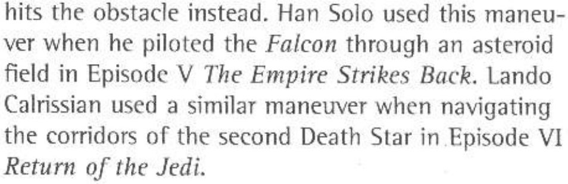
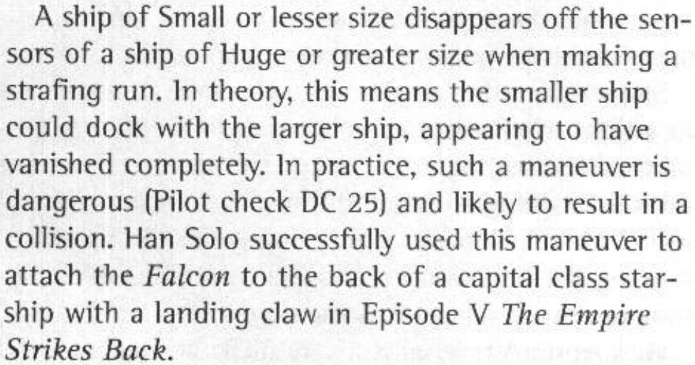

# Owner Material 037 — Star Wars D20 Drive folder (Core, Revised Core and Saga Edition): Sourcebooks/Starships Of The Galaxy.pdf [Star Wars Roleplaying Game (d20, 2000)] (scan pages 1–60)

- **Source:** Wizards of the Coast Star Wars Roleplaying Game books, web enhancements, Living Force campaign modules and articles (2000–2010), from the owner's "Star Wars D20" Drive folder (only the three edition subfolders; "General" was not read, as instructed). Secondary source (licensed Legends reference). Scan OCR'd on the box; the scan stays box-only and is **not** published.
- **Method:** every scanned page was OCR'd and machine-screened sentence by sentence for power-relevant statements (fights, kills, defeats, Force feats, rankings, superweapons) that name a character on our roster; each kept sentence is quoted verbatim from the OCR text and has a crop of the printed passage directly under it. Pages with nothing power-relevant are still listed with what is on them.
- **Citation:** "*Starships Of The Galaxy* (SWRPG d20), p.X" by printed page ("scan p.X" where no printed number applies). **Weight:** Licensed RPG material: a secondary source. Narrative text sums up Legends lore; game statistics are rules for players, not canon power levels, and rank lowest.

## scan p.1 (scan page 1)

Page contents: 32 words, 9 paragraphs | headings/entries: SO eS os; GAME

## scan p.2 (scan page 2)

Page contents: 58 words, 14 paragraphs | headings/entries: OE; PEERS OOO OOS PAAR,; Wit E FLA Yi NM G&; SERN ER RRS OLE OTN; STARSHIPS OF THE GALAXY; PS EE EEN re; EL; PSEC ERLE |

## scan p.3 (scan page 3)

Page contents: 386 words, 19 paragraphs | headings/entries: DESIGNER; LUCAS LICENSING ART; COVER ARTIST; DIRECTOR

## scan p.4 (scan page 4)

Page contents: 579 words, 3 paragraphs | headings/entries: 

## scan p.5 (scan page 5)

Page contents: 642 words, 19 paragraphs | headings/entries: Introduction; Using This Book

## scan p.6 (scan page 6)

Page contents: 221 words, 3 paragraphs | headings/entries: 

## scan p.7 (scan page 7)

Page contents: 411 words, 15 paragraphs | headings/entries: Table 1-1: Ship Size Construction; Size Modifier; Table 1-2: Automation Construction; Mass metric tons); Automation

## scan p.8 (scan page 8)

Page contents: 322 words, 12 paragraphs | headings/entries: Table 1-3: Life Support Life Support; Madiunsiie and bene ; —; Table 1-4: Stowage Construction Cargo Roti

## scan p.9 (scan page 9)

Page contents: 673 words, 18 paragraphs | headings/entries: Oo Vane Any size; Madune -size or greater; Consumables; Hyperdrive

## scan p.10 (scan page 10)

Page contents: 279 words, 17 paragraphs | headings/entries: Table 1-6: Hyperdrives Construction Hyperdrive; Table 1-7: Backup Hyperdrives; Construction Hyperdrive

## scan p.11 (scan page 11)

Page contents: 419 words, 35 paragraphs | headings/entries: Table 1-8: lon Engines Construction Maximum Size; Points Restrictions; Fine, Diminutive; Double; PIIP Pn PoP D ET Rae; Shields; Poor -2 peed on 'Pilot uci; Excellent; Construction Points; Maneuverability sore trerreittentd oe; Rabe s ise; Size Restriction; Garga ntuan, Colossal; Superstructure

## scan p.12 (scan page 12)

Page contents: 349 words, 10 paragraphs | headings/entries: Table 1-10: Superstructure Construction Hull; Weapons Suite

## scan p.13 (scan page 13)

Page contents: 471 words, 31 paragraphs | headings/entries: Table 1-11: Weapons Suite; Construction Emplacement; Points Points Ship Size cies; Table 1-12: Base Price; Cost by OM ell —; Starship Base Price

## scan p.14 (scan page 14)

Page contents: Corellian AG-2G escort quadlaser can be turned into a full quad laser cannon by increasing its power source, as was done on the Millennium Falcon; Empire outlawed shield generators above 60 SP (hand-read)

## scan p.15 (scan page 15)

Page contents: 359 words, 22 paragraphs | headings/entries: Table 1-13: Master Starship Weapons; Hes; Emplacement; Pi nomen __ Points aan a; Multifir re; Hh OY; Autofite

## scan p.16 (scan page 16)

Page contents: 401 words, 22 paragraphs | headings/entries: Misste Rant ed; Max Range; Emplacement; F Point blank; Emplacement Class |; Points; Emplacement Points Bi; Mass nile mine — |; Point blank |

## scan p.17 (scan page 17)

Page contents: 894 words, 20 paragraphs | headings/entries: 

## scan p.18 (scan page 18)

Page contents: 649 words, 17 paragraphs | headings/entries: Table 1-14: Extra Armor; DR ArmOF; Additional Systems; Pilot Check nel; Cost Cargo Space eta tons) |

## scan p.19 (scan page 19)

Page contents: 720 words, 21 paragraphs | headings/entries: Table 1-15: Backup Shield Generators; Emplacement Points; Dimi n Wile 2,000 3; Table 1-16: Cloaking Devices; Cargo Space FP oot a); Goaking Device ——; Hibriduirt lvaking Device; FP al mw ——; C k t C } S

## scan p.20 (scan page 20)

Page contents: A Star Destroyer with a crew of up to 37,085 has only 24 escape pods; Katana fleet slave-linked jumped into hyperspace and was not seen again until after the fall of the Empire (hand-read)

## scan p.21 (scan page 21)

Page contents: 545 words, 18 paragraphs | headings/entries: Table 1-19: Slave Circuits; Diminutive/Fine; Table 1-20: Sensor Masks; DC Increase; Amazing; Other Systems and Exceptions

## scan p.22 (scan page 22)

Page contents: 327 words, 17 paragraphs | headings/entries: CHAPTER TWig; Size and Class; Crew Requirements; Table 2-1: Space Station Size; Construction Points Station Size; Consumables; Size sonsechill Size eae Ae

## scan p.23 (scan page 23)

Page contents: 233 words, 38 paragraphs | headings/entries: Table 2-3: Life Support; Construction Maximum Station Size; Pe tocumionttel nino Restrictions 7; Table 2-4: Stowage Construction Cargo Capacity; Space Station; Medium-size and greater; Table 2-5: Consumables; Construction Consumable Ponts Duration; Table 2-6: eeslinns; Construction Hyperdrive; Station Size; Restrictions a; Small and: eases |; Medium-size and; Table 2-7: Backup Hyperdrives; Construction Points; Hyperdrive Mec tod; Table 2-8: lon Engines Construction Maximum Speed; Pilot Check; Table 2-9: Shield Generators; Construction Shield; Station — Size Restrictions

## scan p.24 (scan page 24)

Page contents: 300 words, 18 paragraphs | headings/entries: 

## scan p.25 (scan page 25)

Page contents: Construction time: Imperial II Star Destroyer up to 640 weeks in one slip, Executor 2,109 weeks; shipyard lore (Alderaan Royal Engineers 20,000+ years, KDY pro-Empire, Incom defectors brought the X-wing to the Rebellion) (hand-read)

## scan p.26 (scan page 26)

Page contents: 582 words, 27 paragraphs | headings/entries: Shipyards; Table 3-2: mtn poe and Construction Multiples; Construction lire; Pirate Race; Freitek, Inc. (410 slips, construction multiple 0.5); Hoensayr

## scan p.27 (scan page 27)

Page contents: 642 words, 26 paragraphs | headings/entries: Mon Calamari (1,000 slips, construction multiple 0.75); Siluuit Corporation (400 slips, construction multiple 1); SoroSuub; The Black Market; Table 3-3: Black Market Resources =v Mental; Resource Level; A ee |

## scan p.28 (scan page 28)

Page contents: 398 words, 6 paragraphs | headings/entries: Table 3-4: Black Market Resource Levels; Once a black market has been located,

## scan p.29 (scan page 29)

Page contents: 436 words, 12 paragraphs | headings/entries: Defining a Modification; Fe frigé that auto table

## scan p.30 (scan page 30)

Page contents: 666 words, 20 paragraphs | headings/entries: Gargantuan; Diminutive/Fine | 100; Time, Cost, and Difficulty; Downgrading; Minor Starport/ Stardock; Starship Maintenance

## scan p.31 (scan page 31)

Page contents: 189 words, 11 paragraphs | headings/entries: New Uses for Old Skills; Computer Use; T C t \; Co Scr Co me un: cer

## scan p.32 (scan page 32)

Page contents: 720 words, 21 paragraphs | headings/entries: Table 4-1: Holoflet Searches; Craft (Starships); Farseeing; Table 4-2: Farseeing and Fire Control ee; Pact — Resunt; Forgery; Repair

## scan p.33 (scan page 33)

Page contents: 750 words, 34 paragraphs | headings/entries: Table 4-3: Repairing Shields; Biss ne Co a; New Feats; Gunner; Maneuver Expertise; Pinpoint Accuracy; Rapid Gunner; Starship Point Blank Shot; Fo de; Yo wt Pr lev Bs ad; Pil rol; Pri Sti; Th Ste shi

## scan p.34 (scan page 34)

Page contents: 574 words, 35 paragraphs | headings/entries: OUT; Force Dodge ;; Force Pilot; New Prestige Classes; Blockade Runner; Class Skills; Defense Reputation

## scan p.35 (scan page 35)

Page contents: 641 words, 21 paragraphs | headings/entries: Class Features; Deep Space Pilot; Class Skills; Class Features; Defense Reputation oe aeemae Fc

## scan p.36 (scan page 36)

Page contents: 724 words, 17 paragraphs | headings/entries: Master Gunner; Table 4-6: The Master Gunner; Class Features

## scan p.37 (scan page 37)

Page contents: 630 words, 24 paragraphs | headings/entries: Naval Officer; Table 4-7: The Naval Officer Base; S555; Fort Ref —_ will; Class Skills; Class Features; Defense Bonus; Enhance fleet +2

## scan p.38 (scan page 38)

Page contents: 847 words, 19 paragraphs | headings/entries: Starship Combat; Clarifications; New Maneuvers

## scan p.39 (scan page 39)

Page contents: 934 words, 17 paragraphs | headings/entries: Number of Ships Flying Cover a i

- **Han Solo; Lando Calrissian** — entry/section: Flyby maneuver: "Han Solo used this maneuver when he piloted the Falcon through an asteroid field in Episode V The Empire Strikes Back. Lando Calrissian used a similar maneuver when navigating the corridors of the second Death Star in Episode VI Return of the Jedi." Source: *Starships Of The Galaxy* (SWRPG d20), scan p.39
  

## scan p.40 (scan page 40)

Page contents: 995 words, 11 paragraphs | headings/entries: 

## scan p.41 (scan page 41)

Page contents: 560 words, 17 paragraphs | headings/entries: New Combat Options; Table 4-9: Battle Damage; Result of Damage * PAL GLE '

- **Han Solo** — entry/section: Strafing run docking: "A ship of Small or lesser size disappears off the sensors of a ship of Huge or greater size when making a strafing run. In theory, this means the smaller ship could dock with the larger ship, appearing to have vanished completely. In practice, such a maneuver is dangerous (Pilot check DC 25) and likely to result in a collision. Han Solo successfully used this maneuver to attach the Falcon to the back of a capital class starship with a landing claw in Episode V The Empire Strikes Back." Source: *Starships Of The Galaxy* (SWRPG d20), scan p.41
  

## scan p.42 (scan page 42)

Page contents: 940 words, 13 paragraphs | headings/entries: 

## scan p.43 (scan page 43)

Page contents: 835 words, 23 paragraphs | headings/entries: Streamlined Starship Combat; Ch; Se co; Sev use! mal join be 1 wisk

## scan p.44 (scan page 44)

Page contents: 892 words, 21 paragraphs | headings/entries: 

## scan p.45 (scan page 45)

Page contents: 250 words, 8 paragraphs | headings/entries: 

## scan p.46 (scan page 46)

Page contents: 901 words, 15 paragraphs | headings/entries: Run Several Scenes at Once; Space Battles; Search and Destroy

## scan p.47 (scan page 47)

Page contents: 788 words, 21 paragraphs | headings/entries: Table 5-1: 7 Hazards; Hazard ER Result of Failure —

## scan p.48 (scan page 48)

Page contents: Even the best starfighter pilots shouldn't feel confident taking on a Star Destroyer: ISD always hits on a natural 20, its turbolasers average 135 damage (destroys an N-1, X-wing to 20 hull); an X-wing needs about six hits to drop its 300-point shields plus all six torpedoes and eight laser hits to destroy it; exploding starships deal 20d6 to those inside (hand-read)

## scan p.49 (scan page 49)

Page contents: 430 words, 36 paragraphs | headings/entries: DES EEE CRD HL CSS Boe; Noble 2/Soldier 2; Equipment:; Noble 4/Soldier 2/; Noble 4/Soldier 2/ Naval Otticer 6

## scan p.50 (scan page 50)

Page contents: 593 words, 18 paragraphs | headings/entries: Generic Dilettante, male or female, any species; Gillian Cot KR es ee Bee are; Reputation: 4 9 |

## scan p.51 (scan page 51)

Page contents: 534 words, 28 paragraphs | headings/entries: Docking Authority Officer; Expert 2/Thug 2; Doodle +5, idl i; Eaulinient:; Expert 4/Thug 4; Combat forncsuit, A weapons, comlink, datapad; See ee eae

## scan p.52 (scan page 52)

Page contents: Generic Jedi Pilot: Jedi pilots rare in Rise of the Empire era, all but unknown in Rebellion era; several exist in New Republic era forming squadrons (hand-read)

## scan p.53 (scan page 53)

Page contents: 475 words, 16 paragraphs | headings/entries: Force Feats:

## scan p.54 (scan page 54)

Page contents: 575 words, 50 paragraphs | headings/entries: Expert 2/Thug 2; Defense: 10 Speed: 10m (or by species); VP/WP: —/14; Special Qualities: None; Saves: Fort +5, Ref +0, Will +3; Challenge Code: A; Force Points: 0; Dark Side Points: 0; Reputation: 0; Abilities: Str 13, Dex 11, Con 14,; Skills:; Equipment: Ragged clothes, knife; Improved Initiative, Spacer, Weapon Group Proficiency; Expert 4/Thug 4; Club 1d6+2-; None; Fort +7, Ref +2, will +7; Expert 6/Thug 6 15; Club 1d6+2; Frag grenade he ce None :; Fort +9, Ref +5, Will +9; Str 14, Dex 12, Con 14,; Ragged clothes, club, frag grenade; ADVENTURES IN SPA

## scan p.55 (scan page 55)

Page contents: 93 words, 32 paragraphs | headings/entries: CONFERENCE ROOM; LOUNGE; SMALL STATEROOMS/ paee-— CREW QUARTERS; LARGE STATE- ROOM/CAPT'S QUARTERS; LAVATORY; CHAIR; UL; DOOR 'i | 6 |; ARCHWAY; COMPUTER/SHIP COM | REFRESHER i; HOLOCHESS BOARD; RETRACTABLE LANDING RAMP; BED; BUNKBEDS SCALE IN METERS

## scan p.56 (scan page 56)

Page contents: 52 words, 15 paragraphs | headings/entries: CONFERENCE D ROOM ¢; GALLEY COOKTOP TRASH ——-———p COMPAS TOR; SCALE IN METERS; SESS Oe OTL nape; SE Re er 8 ee ene ee

## scan p.57 (scan page 57)

Page contents: 50 words, 9 paragraphs | headings/entries: BRIDGE 1 CREW / 1 PASSENGER BRIDGE; SCALE IN METERS

## scan p.58 (scan page 58)

Page contents: 97 words, 21 paragraphs | headings/entries: PRA ot; LE; ARE owe; SPACE TRANSPORT >; CREW QUARTERS; SUILYYND Si idVI/WOOU ~J1¥is 394¥T; Suslyyne Mayd — — sSWOOUSLYLS T1¥WS—; SCALE IN METERS

## scan p.59 (scan page 59)

Page contents: 100 words, 22 paragraphs | headings/entries: PER; TYPICAL CAPTIAL SHIP BRIDGE; Tey - TACTICAL STATIONS OFFICERS' LOUNGE; E: ROOM; MAIN CONFERENC; COMMAND DECK; ESCAPE PODS; AFT FORE; WEAPONS CONTROL; COMMUNICATIONS eh CONSOLES... 40}; WEAPONS es CONTROL i; TYPICAL IMPERIAL BRIDGE —————; TURBOLIFT; HOLOGRAM POD — SCALE IN METERS

## scan p.60 (scan page 60)

Page contents: 75 words, 22 paragraphs | headings/entries: TYPICAL SHIP SECTIONS > §; ANTENNA EQUIPMENT ' AND STRUCTURE; OFFICES!~; MEDICAL LAB; MEDICAL OFFICER STATION --——~----~; STATION; TYPICAL IMPERIAL; Detention Cell; Security Desk; Bacta Tank™

