# Owner Material 037 — Star Wars D20 Drive folder (Core, Revised Core and Saga Edition): Sourcebooks/Starships Of The Galaxy.pdf [Star Wars Roleplaying Game (d20, 2000)] (scan pages 61–114)

- **Source:** Wizards of the Coast Star Wars Roleplaying Game books, web enhancements, Living Force campaign modules and articles (2000–2010), from the owner's "Star Wars D20" Drive folder (only the three edition subfolders; "General" was not read, as instructed). Secondary source (licensed Legends reference). Scan OCR'd on the box; the scan stays box-only and is **not** published.
- **Method:** every scanned page was OCR'd and machine-screened sentence by sentence for power-relevant statements (fights, kills, defeats, Force feats, rankings, superweapons) that name a character on our roster; each kept sentence is quoted verbatim from the OCR text and has a crop of the printed passage directly under it. Pages with nothing power-relevant are still listed with what is on them.
- **Citation:** "*Starships Of The Galaxy* (SWRPG d20), p.X" by printed page ("scan p.X" where no printed number applies). **Weight:** Licensed RPG material: a secondary source. Narrative text sums up Legends lore; game statistics are rules for players, not canon power levels, and rank lowest.

## scan p.61 (scan page 61)

Page contents: 93 words, 28 paragraphs | headings/entries: PRIMARY POWER CONDUITS; ENGINEERING ACCESS; Pr wee ee owen wan nnn; Be. CONTROL ROOM; Cargo Pod; SD, igs ied; Cargo Crate; Secure Cargo Container; SCALE IN METERS; AAR Nene; SS eee; Seeded; ALP P LOCA Rn; PLO; Are o=

## scan p.62 (scan page 62)

Page contents: 312 words, 34 paragraphs | headings/entries: AFT; Deflection Shield Domes; A a ar; Medical \; FORE Maintenance; AT-AT and AT=-ST Storage; Navigation Beck; Area Main Landing Bay; Waste Dump; Deck ' ' Bs Short-Ranage Communications Array; Secondary Communications Deck; Quarters csebbes eee an Main Engineering; Front Turbolasers ~Primary Sensors; DEFENSES: Enhanced Delphus JC-671 projected

## scan p.63 (scan page 63)

Page contents: 241 words, 13 paragraphs | headings/entries: CHAPTER SIX mos; STAI; Ot; A-9 Vigilance Interceptor; Be atte

## scan p.64 (scan page 64)

Page contents: A-wing: supposedly the fastest ship ever built; A-9 Vigilance (KDY, five years after Endor); B-wing/E2 post-Endor (hand-read)

## scan p.65 (scan page 65)

Page contents: 444 words, 17 paragraphs | headings/entries: B-WING; B-Wing and B-Wing/E2; Co Ini +4 Co Sp cre Po!; Ar fir; Fr cc

## scan p.66 (scan page 66)

Page contents: 357 words, 12 paragraphs | headings/entries: CloakShape Fighter; CLOAKSHAPE FIGHTER

## scan p.67 (scan page 67)

Page contents: 408 words, 15 paragraphs | headings/entries: ESCAPE FOO; EE; Cy Si Cr Ce S}; Pc

- **Jaizen Suel** — entry/section: CloakShape Fighter: "Jedi ace Jaizen Suel used a modified CloakShape fighter called Dawn Raider as her personal fighter in the late years of the Old Republic. (Modifications included a maneuvering fin, hyperdrive sled, and two weeks of consumables; the ship was valued at 110,000 credits.) Jaizen was considered something of a renegade by many other Jedi of the time, since she saw it as her duty to keep order in many of the" Source: *Starships Of The Galaxy* (SWRPG d20), scan p.67
  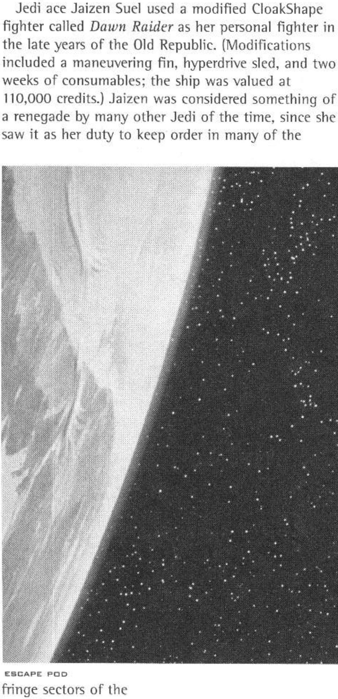

### Stat block notes (game mechanics, not feats)

- Jaizen Suel: Use the generic 12th-level Jedi pilot (Fringer 1/Jedi Guardian 6/Starfighter Ace 5; Battlemind, Enhance Ability, Force Defense); ignored suggestions made by the Jedi Council, fought piracy and slavery in fringe sectors (Source: *Starships Of The Galaxy* (SWRPG d20), scan p.67)

## scan p.68 (scan page 68)

Page contents: 601 words, 12 paragraphs | headings/entries: E-Wing: Type B; Gun Tug

## scan p.69 (scan page 69)

Page contents: Nebula Raiders pirate fleet (Z-95s and gun tugs) led by Trandoshan Ssurussk, generic 8th-level pirate; E-wing performance far surpassed all expectations, flown only by aces in NJO era; Hapan Miy'til fighter can go head-to-head with X-wings or TIE interceptors (hand-read)

## scan p.70 (scan page 70)

Page contents: 387 words, 8 paragraphs | headings/entries: I-77 HOWLRUNNER; Lambda Shuttle

- **Palpatine (Darth Sidious)** — entry/section: Lambda Shuttle: "The Emperor himself used a modified Lambda (with heavier weapons and a HoloNet transceiver) as his transport of choice on the rare occasions he left Coruscant." Source: *Starships Of The Galaxy* (SWRPG d20), scan p.70
  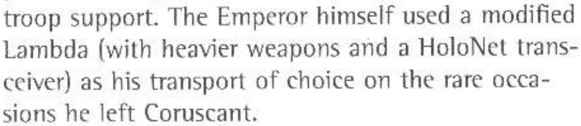

## scan p.71 (scan page 71)

Page contents: 417 words, 18 paragraphs | headings/entries: LAMBDA SHUTTLE; Miy'til Fighter; I —_; Cr fig lor (N Co; Fre Col Rai; The figk

## scan p.72 (scan page 72)

Page contents: 384 words, 11 paragraphs | headings/entries: MIY'TIL ASSAULT BOMBER ANO MIY'TIL FIGHTER

## scan p.73 (scan page 73)

Page contents: 397 words, 12 paragraphs | headings/entries: PHOENIX HAWK LIGHT PINNACE; Phoenix Hawk Light Pinnace; Scimitar Assault Bomber

## scan p.74 (scan page 74)

Page contents: Svelte-class shuttle called a "Vader-class" shuttle by Imperial pilots for its harsh lines and black finish; T-65AC4 X-wing popular with some of the best pilots in the galaxy in NJO era (hand-read)

## scan p.75 (scan page 75)

Page contents: 400 words, 14 paragraphs | headings/entries: TIE ADVANCED X11; T-65ACW H-Wing; Pe A A. =e =; C S V

## scan p.76 (scan page 76)

Page contents: 367 words, 9 paragraphs | headings/entries: TIE BOMBER; TIE Bomber

- **Darth Vader (Anakin Skywalker)** — entry/section: TIE Advanced x1: "Sienar Systems made many prototype TIE models in the years just prior to and immediately after the Battle of Yavin. One of the most successful of these was the TIE Advanced x1, which for years was used by the elite of the Empire, including Darth Vader himself." Source: *Starships Of The Galaxy* (SWRPG d20), scan p.76
  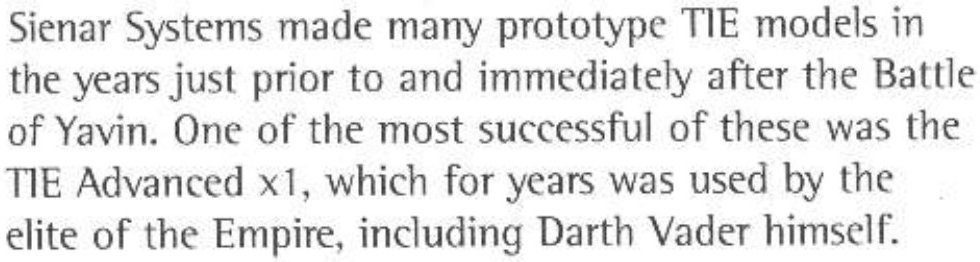

## scan p.77 (scan page 77)

Page contents: TIE interceptor designed specifically to counteract the X-wing; faster and more maneuverable than the X-wing (hand-read)

## scan p.78 (scan page 78)

Page contents: 214 words, 5 paragraphs | headings/entries: ASSAULT SHUTTLE AND ACTION IV BULK FREIGHTER

## scan p.79 (scan page 79)

Page contents: Birthright: modified Barloz freighter of the Cilgris Duro traders (Thes Cilgris, Rise of Empire; son Yett, Rebellion; nephew Naul, NJO), weakness for those fighting for justice; use 8th-level freighter captain (hand-read)

## scan p.80 (scan page 80)

Page contents: 400 words, 11 paragraphs | headings/entries: CITADEL CRUISER; Citadel Cruiser

## scan p.81 (scan page 81)

Page contents: 379 words, 10 paragraphs | headings/entries: DEATHRAVEN; Deathraven

- **Erron Kell** — entry/section: Deathraven: "Deathraven is the personal craft of Erron Kell, a mercenary pilot-for-hire. Kell was a Rebel pilot who fought at the Battle of Endor. When he found the more orderly New Republic military was not to his liking, he resigned his commission. During The New Jedi Order era, Kell is a freelance pilot selling his skills to the highest bidder." Source: *Starships Of The Galaxy* (SWRPG d20), scan p.81
  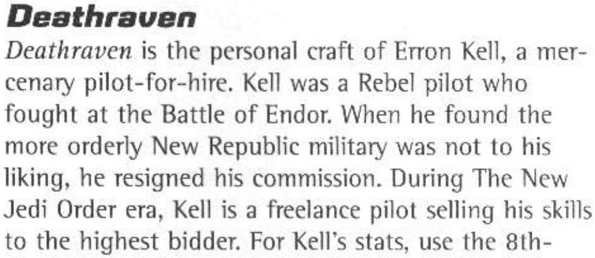
- **Erron Kell** — entry/section: Deathraven: "Kell's contacts within the New Republic got him access to a few B-wing/E2s that were considered too badly damaged to be worth repairing. With the help of engineers at the Kuat Drive Yards, Kell merged the damaged ships into a unique double-hulled B-wing variant, with both bodies rotating around a central expanded cockpit." Source: *Starships Of The Galaxy* (SWRPG d20), scan p.81
  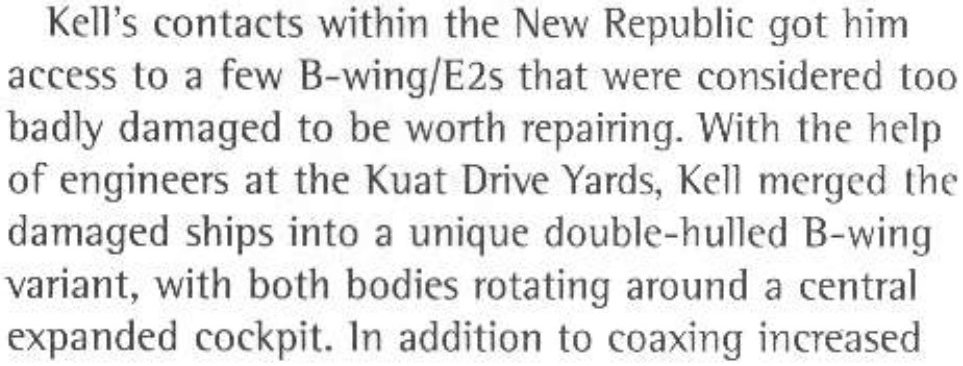

### Stat block notes (game mechanics, not feats)

- Erron Kell: Use the 8th-level fighter pilot (Core Rulebook ch14); Deathraven: Maneuver +18 with Kell (+17 crew), 4 fire-linked assault lasers +22 9d10x2, 4 proton torpedo launchers (40 torpedoes) 11d10x2, 8 fire-linked light ion cannons, 150 SP / 150 HP; formidable warship able to outfight most starfighters and outrun most larger ships (Source: *Starships Of The Galaxy* (SWRPG d20), scan p.81)

## scan p.82 (scan page 82)

Page contents: 582 words, 15 paragraphs | headings/entries: FIRESPRAY-3 1

- **Boba Fett** — entry/section: Slave I: "The most famous Firespray-31 is doubtless Slave I, the personal vessel of bounty hunter Boba Fett. Slave I has been heavily modified to Fett's specifications, including a concealed turret with proton torpedoes and a tractor beam, a HoloNet transceiver, and extensive internal security systems. It also has an amazing sensor mask, increasing the DC of any Computer Use check to find Slave I with sensors by +8." Source: *Starships Of The Galaxy* (SWRPG d20), scan p.82
  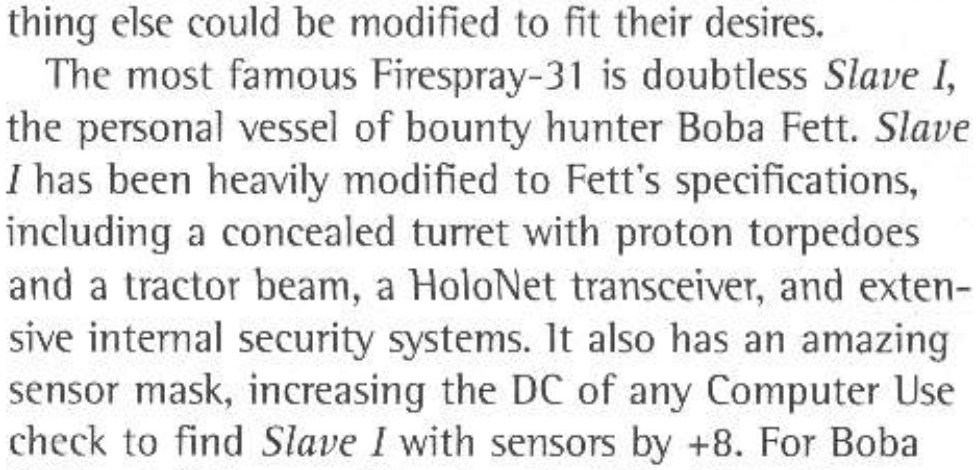

### Stat block notes (game mechanics, not feats)

- Boba Fett: Slave I with Fett piloting: Maneuver +12 (+11 crew), hyperdrive x1, 90 SP / 150 HP, ion cannon +20 (+15 crew), twin blaster cannons and concussion missiles +15, 6 prisoner berths (Source: *Starships Of The Galaxy* (SWRPG d20), scan p.82)

## scan p.83 (scan page 83)

Page contents: Post-Endor 'junkers' salvage ships (modified Gallofree transports) used by both Alliance and Empire to salvage battle zones (hand-read)

## scan p.84 (scan page 84)

Page contents: 390 words, 10 paragraphs | headings/entries: JADE SABRE; Jade Sabre; Royal Starships

- **Mara Jade Skywalker; Luke Skywalker** — entry/section: Jade Sabre: "Jade Sabre was Mara Jade Skywalker's personal shuttle, built for her by her husband, Jedi Master Luke Skywalker. It replaced her original shuttle, Jade's Fire, which was destroyed." Source: *Starships Of The Galaxy* (SWRPG d20), scan p.84
  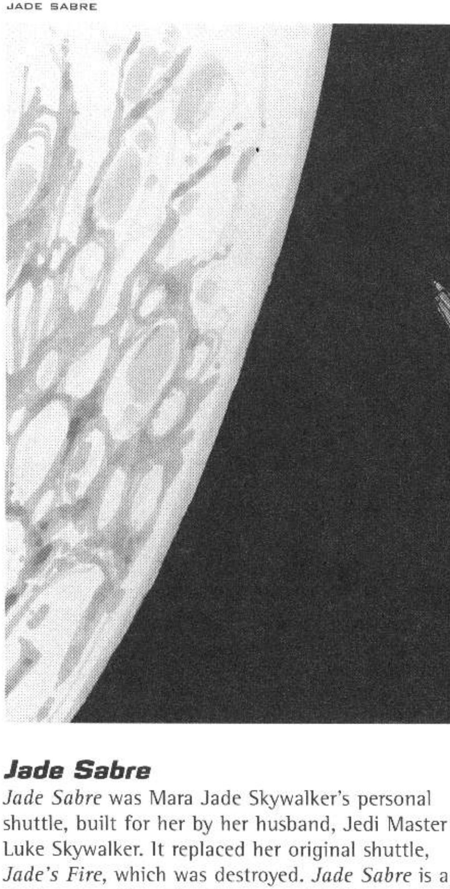
- **Mara Jade Skywalker** — entry/section: Jade Sabre: "Unfortunately, Jade Sabre was destroyed by the Yuuzhan Vong on the planet Dantooine early in their invasion of the galaxy." Source: *Starships Of The Galaxy* (SWRPG d20), scan p.84
  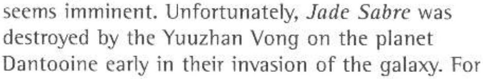

### Stat block notes (game mechanics, not feats)

- Mara Jade: Jade Sabre with Mara piloting: Maneuver +17 (+10 crew), four quad lasers +23 (+14 crew), 200 SP / 180 HP, fighter bay for an X-wing (Source: *Starships Of The Galaxy* (SWRPG d20), scan p.84)

## scan p.85 (scan page 85)

Page contents: 389 words, 10 paragraphs | headings/entries: ROYAL STARSHIP; Skipray Blastboat; ASA wag

- **Padmé Amidala** — entry/section: Royal Starship: "The Royal Starship of Naboo is a fairly typical example of a royal starship. Commissioned by King Veruna and later used by Queen Amidala, it was meticulously crafted by the Theed Palace Space Engineering Corps." Source: *Starships Of The Galaxy* (SWRPG d20), scan p.85
  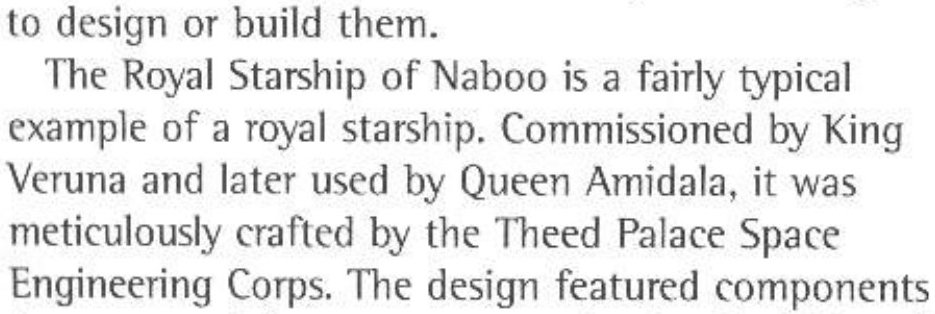

## scan p.86 (scan page 86)

Page contents: 407 words, 8 paragraphs | headings/entries: SKIPRAY BLASTBOATS

- **Irackant** — entry/section: Krakana's Claw: "Krakana's Claw was constructed from a stripped-down Skipray blastboat by the bounty hunter Irackant, a Mon Calamari bounty hunter who tracked down Imperial war criminals during The New Jedi Order era." Source: *Starships Of The Galaxy* (SWRPG d20), scan p.86
  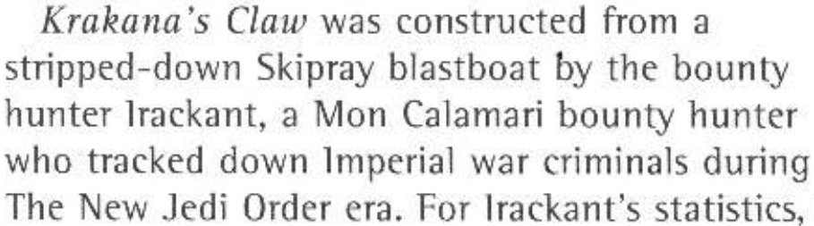

### Stat block notes (game mechanics, not feats)

- Irackant: 8th-level generic bounty hunter modified: Int 15, Con 10, Mon Calamari abilities, Starship Operation (space transport), Diplomacy +6; Krakana's Claw Maneuver +8 (+7 crew), assault lasers, ion cannons, 16 heavy torpedoes, 3-captive cell (Source: *Starships Of The Galaxy* (SWRPG d20), scan p.86)

## scan p.87 (scan page 87)

Page contents: 384 words, 12 paragraphs | headings/entries: STAR SHUTTLE; VIBRE-; Star Shuttle

- **Palpatine (Darth Sidious)** — entry/section: Star Shuttle: "Important members of the Galactic Senate often traveled in Corellian Star Shuttles, and one was assigned to the Chancellor for his private use. As Palpatine's bureaucracy placed an unbearable strain on the Old Republic's finances, Star Shuttles were gradually phased out by less glamorous (and more adaptable) Star Cruisers." Source: *Starships Of The Galaxy* (SWRPG d20), scan p.87
  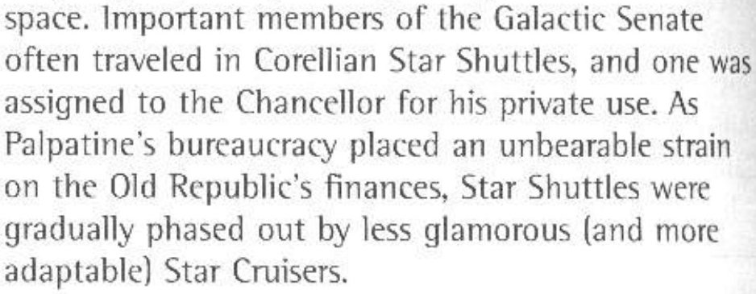

## scan p.88 (scan page 88)

Page contents: 392 words, 8 paragraphs | headings/entries: VIBRE-CLASS ASSAULT CRUISER; Vibre-Class Assault Cruiser

## scan p.89 (scan page 89)

Page contents: 532 words, 18 paragraphs | headings/entries: Craft: Silvuit Corporation Vibre-class Assault Cruiser;

## scan p.90 (scan page 90)

Page contents: Bothan assault cruiser: built in the peace era, feared as Bothan aggression vs Corellia; proved itself defending the Core against the Yuuzhan Vong (hand-read)

## scan p.91 (scan page 91)

Page contents: Windsinger: famous Carrack with Expert +8 crew; disappeared shortly before the Clone Wars, rumored to reappear for decades rescuing wrecks and attacking pirates and Imperials (hand-read)

## scan p.92 (scan page 92)

Page contents: 414 words, 10 paragraphs | headings/entries: CORELLIAN GUNSHIP

## scan p.93 (scan page 93)

Page contents: Rif Taranu: use the 4th-level generic spacer (hand-read)

- **Rif Taranu** — entry/section: Dead Reckoning: "Dead Reckoning is a modified Space Cruiser owned by Rif Taranu, a Human smuggler with Alliance sympathies during the Rebellion era. Taranu stripped out most of the luxury accommodations for additional cargo space, installed double turbolaser turrets above and below, and converted the salon pod to more cargo space and a set of concussion missile launchers. Taranu made several runs for the Alliance, smuggling weapons and agents across the fringe worlds. After the Empire fell, he turned back to pure smuggling for profit." Source: *Starships Of The Galaxy* (SWRPG d20), scan p.93
  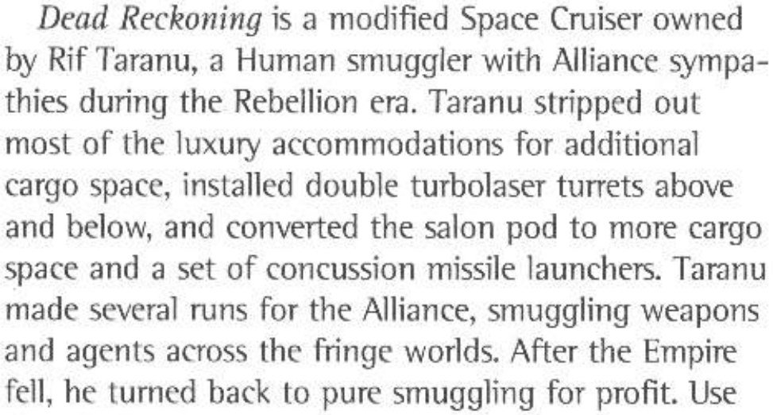

## scan p.94 (scan page 94)

Page contents: Defender-class SD: New Republic's most powerful warship, in theory can destroy any one big capital ship or 2-4 mid-sized ones; kept near the Core as too precious to risk (hand-read)

- **Whyrrryk; Obi-Wan Kenobi** — entry/section: Defender Star Destroyer: "The first Defender completed was Obi-Wan, a ship named after one of the Rebellion's heroes. The commander of Obi-Wan is Captain Whyntyk, a female Wookiee." Source: *Starships Of The Galaxy* (SWRPG d20), scan p.94
  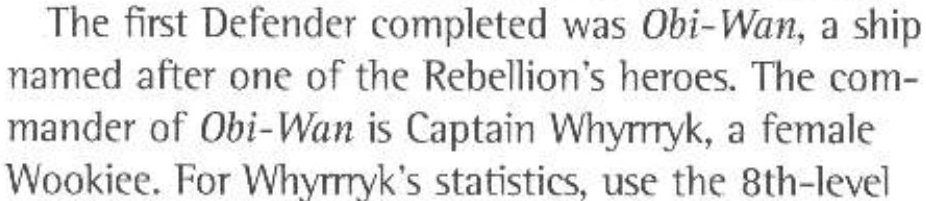

### Stat block notes (game mechanics, not feats)

- Whyrrryk: 8th-level generic mercenary modified: Starship Operations (capital ships) instead of Blind-Fight, Str 17, Int 12, Diplomacy +5, Knowledge (military tactics) +10; commands the Defender SD Obi-Wan (crew Highly Skilled +6, 40 heavy turbolasers 10d10x5, 500 SP / 700 HP) (Source: *Starships Of The Galaxy* (SWRPG d20), scan p.94)

## scan p.95 (scan page 95)

Page contents: 420 words, 13 paragraphs | headings/entries: Dreadnaught; Pe is a> He ar ee ©

- **Trence Vosh** — entry/section: Dreadnaught Leviathan: "A particularly famous Dreadnaught, Leviathan, served as an Old Republic antipirate ship. Its light turbo quadlasers were reconfigured as point defense weapons, and its expanded hangar space could deploy sixty fighters. The Senate sent Leviathan to patrol merchant routes, investigate commerce irregularities, and enforce Old Republic trade law. Toward the end of the Old Republic, the Senate lacked consensus on where Leviathan should be sent, and it often had no official mission other than patrolling for pirates. Its commander, Captain Trence Vosh, was an Alderaanian Human male." Source: *Starships Of The Galaxy* (SWRPG d20), scan p.95
  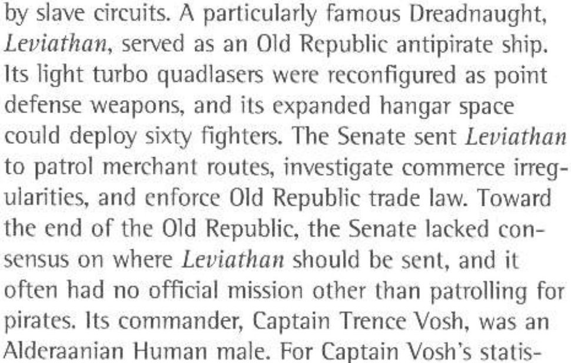

### Stat block notes (game mechanics, not feats)

- Trence Vosh: Use the 8th-level generic military officer (Core Rulebook ch14) (Source: *Starships Of The Galaxy* (SWRPG d20), scan p.95)

## scan p.96 (scan page 96)

Page contents: Hapan Battle Dragon: backbone of Hapan military, 40 turbolasers and 40 ion cannons in rotary rings, Hapan turbolasers fire only once every 3 rounds, so Hapans focus whole-fleet fire on no more than four ships (hand-read)

## scan p.97 (scan page 97)

Page contents: 432 words, 12 paragraphs | headings/entries: IMPERIAL ESCORT CARRIER

- **Coorsha** — entry/section: Coorsha's Cross: "One of the few exceptions was an escort carrier that fell into the hands of a Rodian pirate named Coorsha, who immediately renamed it Coorsha's Cross. With a ragtag squadron of Howlrunners, Z-95's, and Cloak- Shape fighters, Coorsha raided areas of space near the Kathol sector. During the early stages of the Yuuzhon Vong invasion, Coorsha may have acted as a Yuuzhon Vong agent or allied himself with the New Republic." Source: *Starships Of The Galaxy* (SWRPG d20), scan p.97
  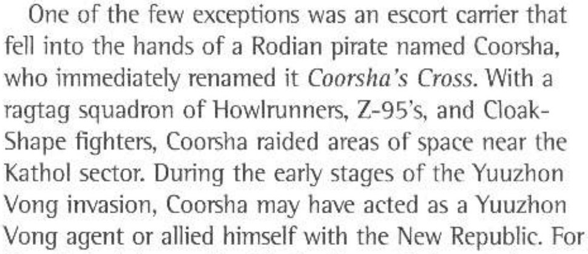

### Stat block notes (game mechanics, not feats)

- Coorsha: Use the 8th-level generic bounty hunter (Core Rulebook ch14) (Source: *Starships Of The Galaxy* (SWRPG d20), scan p.97)

## scan p.98 (scan page 98)

Page contents: Imperial II: a single one in a system is generally enough to pacify its entire population; one of the most powerful capital ships ever built (hand-read)

- **Feyet Kiez** — entry/section: Imperial II Star Destroyer Empire: "The first Imperial II Star Destroyer constructed was Empire, commanded by Admiral Feyet Kiez. Empire was almost as feared a starship as Executor, and actually saw a fair amount of service during the middle and later years of the Rebellion era. The ship's primary objectives included capturing Alliance convoys and medical ships." Source: *Starships Of The Galaxy* (SWRPG d20), scan p.98
  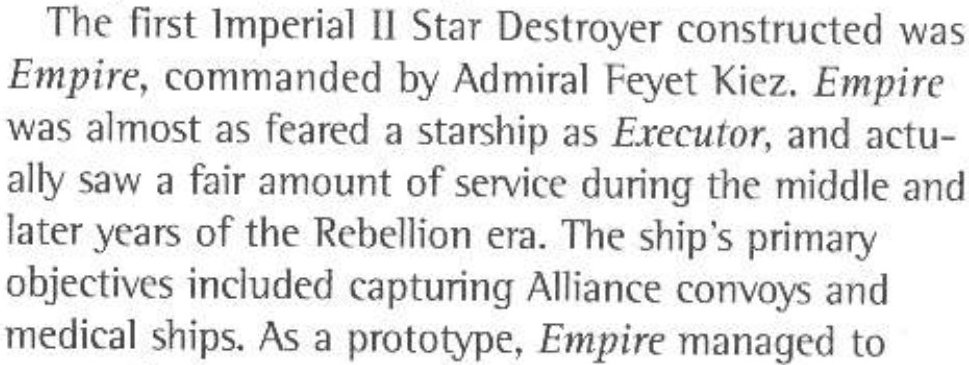

### Stat block notes (game mechanics, not feats)

- Feyet Kiez: Use the generic 12th-level naval officer; Empire prototype mustered 500 shield points instead of the standard 250, handpicked crew quality +8 (Source: *Starships Of The Galaxy* (SWRPG d20), scan p.98)

## scan p.99 (scan page 99)

Page contents: 413 words, 8 paragraphs | headings/entries: IMPERIAL STAR GALLEON

## scan p.100 (scan page 100)

Page contents: 390 words, 10 paragraphs | headings/entries: IMMOBILIZER-418

## scan p.101 (scan page 101)

Page contents: Lancer frigate judged a failed experiment in space tactics; early models had more than half their guns malfunction on any given day (hand-read)

## scan p.102 (scan page 102)

Page contents: MC90 among most powerful capital ships of NJO era, kept near the Core Worlds (hand-read)

## scan p.103 (scan page 103)

Page contents: 404 words, 10 paragraphs | headings/entries: SYSTEM PATROL CRAFT; System Patrol Craft

## scan p.104 (scan page 104)

Page contents: Victory SD considered the ultimate combat starship when introduced near the end of the Clone Wars; Victory designs can enter upper atmosphere, which later SD designs cannot safely manage (hand-read)

- **Frei Aycen** — entry/section: Freejack: "Freejack is one such ship, captured from an Old Republic world shortly before the Rise of the Empire era. With expanded cargo space and a hyperdrive (at the cost of many of the ship's shield generators), Freejack became the flagship of Frei Aycen. Aycen was a female Corellian pirate captain who ran a fleet of CloakShape fighters and modified small transports." Source: *Starships Of The Galaxy* (SWRPG d20), scan p.104
  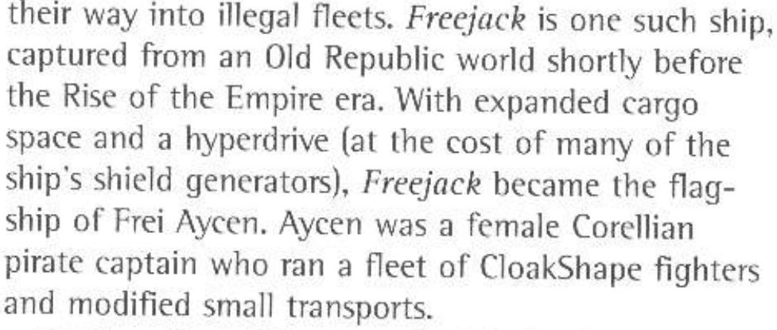
- **Frei Aycen** — entry/section: Freejack: "Frei Aycen didn't like the corruption of the Old Republic, but was more a thief than a killer. She might be convinced to help characters who work for the Republic if they are on a genuinely important mission." Source: *Starships Of The Galaxy* (SWRPG d20), scan p.104
  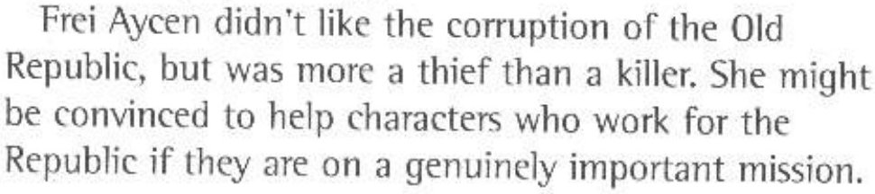

### Stat block notes (game mechanics, not feats)

- Frei Aycen: 8th-level generic pirate modified: Str 10, Con 10, Wis 12, Cha 16, Starship Operation (capital ship); Freejack crew Highly skilled +6, Maneuver +9 (Source: *Starships Of The Galaxy* (SWRPG d20), scan p.104)

## scan p.105 (scan page 105)

Page contents: 419 words, 12 paragraphs | headings/entries: VICTORY STAR DESTROYER

## scan p.106 (scan page 106)

Page contents: 202 words, 9 paragraphs | headings/entries: CHAPTER NINE; SPACE STATIONS; Executor; EXECUTOR

- **Darth Vader (Anakin Skywalker)** — entry/section: Executor: "Executor was the first Super-class Star Destroyer to be completed, beginning service shortly after the Battle of Yavin. It served as Darth Vader's personal flagship, a spacegoing headquarters from which he directed search-and-destroy operations, battles against Rebel fleets, and planetary assaults. Aside from the short-lived Death Stars, Executor was the most feared Imperial vessel until its destruction during the Battle of Endor." Source: *Starships Of The Galaxy* (SWRPG d20), scan p.106
  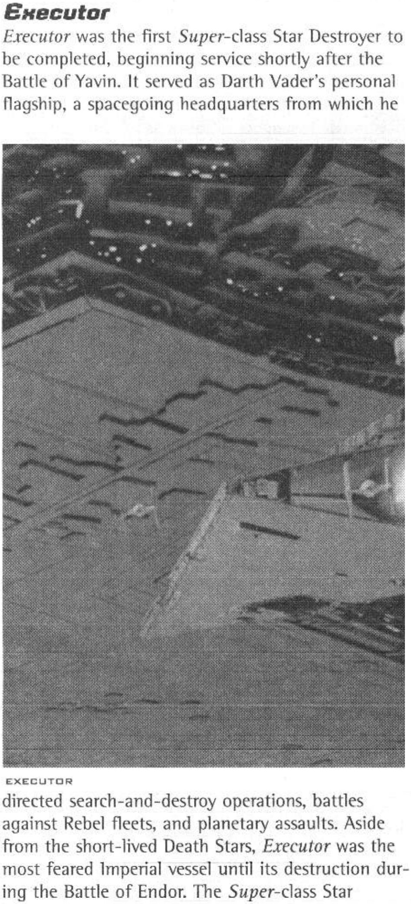

## scan p.107 (scan page 107)

Page contents: Golan NovaGun stations larger than Imperial-class SDs and arguably carry more firepower; skyhooks teem in Coruscant's skies (hand-read)

## scan p.108 (scan page 108)

Page contents: 391 words, 12 paragraphs | headings/entries: GOLAN SPACE DEFENSE STATION; Skyhook; PS ©

## scan p.109 (scan page 109)

Page contents: 389 words, 8 paragraphs | headings/entries: STARFORGE STATION; StarForge Station

## scan p.110 (scan page 110)

Page contents: StarForge Station shadowport: let moffs modify personal ships without alerting superiors, so the Empire never moved to destroy it; new identity for a wanted ship 20,000 credits and two weeks (hand-read)

- **Crost Lib'eyay** — entry/section: StarForge Station: "StarForge is run by an administrator, usually one elected by the Council of Tenants. For most of the Rebellion era, the administrator was Crost Lib'eyay, a Bothan ex-spy." Source: *Starships Of The Galaxy* (SWRPG d20), scan p.110
  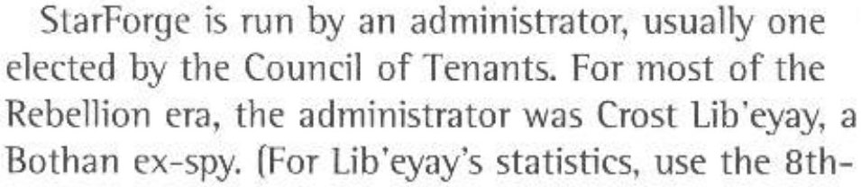

### Stat block notes (game mechanics, not feats)

- Crost Lib'eyay: 8th-level generic smuggler modified: +2 Dex, -2 Con, -2 Wis, +2 species bonus on Gather Information and Sense Motive (Source: *Starships Of The Galaxy* (SWRPG d20), scan p.110)

## scan p.111 (scan page 111)

Page contents: Torpedo Spheres called "pocket Death Stars" by Rebels; no more than six in service at once; 500 proton torpedo tubes coordinated by over a hundred technicians, not enough to destroy a planet (hand-read)

## scan p.112 (scan page 112)

Page contents: 212 words, 57 paragraphs | headings/entries: CRAFT; SIZE SIZE MODIFIER; CREW; CONSUMABLES; Max SPEED; QUALITY; CARGO CAPACITY; NODIFIER; SIZE MODIFIER; BONUS; ARNOS N; BONUS BONUS; RO ke Pw. AY NGS GAME; Isc; SPEED MODIFIER; Modifies Stop Docking Cruising Attack Ramming; MODIFIER BONUS QUALITY; FIRE LINKED []] NUNBER; WEAPON O2; FIRE LINKED [}] WUMBER; WEAPON O3; FIRE LINKED []] NUMBES; WEAPON OY; FIRE LIWKEd [J; TOTAL POINTS; BASE ATTACK; ATTACH BONUS; DAMAGE = |_|; ATTACK BonuUS DAMAGE; BASE ATTACK *; RANGE MOOIFIER; Bini; ENGINE OTHER POINT SHORT MEOIUN QUALITY BLANK; ATTACH BONUS DAMAGE; BASE ATTACK; POINT SHORT NEDIUN BLANK; ATTACH BonuUS; BASE ATTACK *; RANGE MODIFIER

## scan p.113 (scan page 113)

Page contents: 149 words, 15 paragraphs | headings/entries: Your transport to excitement; Stactignter Eustar Equx; SP ee

## scan p.114 (scan page 114)

Page contents: 254 words, 11 paragraphs | headings/entries: 

